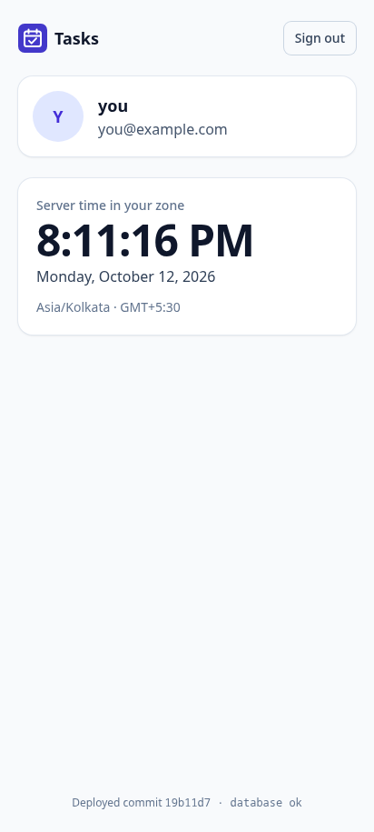
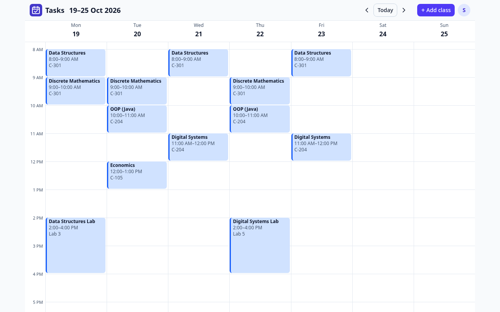

# Planner App — Build Journey

> Working name: TBD
> Started: 2026-10-05
> Purpose of this file: a running log of every decision, debate, problem, mistake and fix, so the full story is available later (and for interviews).

---

## 1. Vision

A calendar + tasks hybrid for students and builders. Your fixed week (classes, runs, writing days) is always visible. Tasks and projects sit right beside it, and you can drag them onto free time. Built for one use case, opinionated, not a blank canvas.

**Origin:** I needed this myself. Existing apps were either paid, bloated, or too thin.

## 2. Core surface (three sections, no more)

| Section | What it holds |
|---|---|
| **Calendar** | Recurring blocks (daily / weekly / custom). Blocks can be cancelled (greyed + diagonal stripes, not deleted). Drag tasks in to plan time. |
| **Tasks** | Misc todo list + Projects (each with nested tasks). Timer and sessions per task; optional notes / commit refs per session. |
| **Thought dump** | Fast capture (typed or voice) of ideas that need more thinking before they become tasks. General or per project. |

**Long term:** a shared user space across tools on `*.ahmedatif.in`.

---

## 3. Decisions log

Format: what was decided → why → alternatives considered.

### D-001 · Keep the three-section scope (2026-10-05)
- **Decision:** Calendar, Tasks/Projects, Thought dump form the core. All features must serve "organize my day."
- **Why:** Feature *count* matters less than *cohesion*. Notion is a general note tool you have to configure. This app is opinionated for one flow.
- **Pushback received:** risk of rebuilding Notion.
- **Resolution:** The core is coherent. The real scope risk is the *integrations* (MCP, VS Code, browser extension, ecosystem). Those stay later-phase.

### D-002 · No ChatGPT-plan integration (2026-10-05)
- **Decision:** Don't depend on users' ChatGPT plans.
- **Why:** That route needs Plus/Pro, so it doesn't work for free users.
- **Consequence:** Scheduling logic leans algorithmic. LLM use becomes optional and goes behind a provider interface.

### D-003 · No Google Calendar sync for v1 (2026-10-05)
- **Decision:** Skip two-way sync.
- **Why:** Not used by the target user (me). The KIIT uni calendar lives on the college portal.
- **Maybe later:** a cheap one-way ICS export, and a holiday import that bulk-cancels classes.

### D-004 · Recurring groups / "schedules" (2026-10-05)
- **Decision:** Recurring items belong to named groups (e.g. "Classes", "Writing").
- **Group properties:** colour, active date range, attendance on/off.
- **Semester change:** archive the old group, add the new one, and the app shows conflicts with other groups.
- **Why:** Semester changes become a one-step swap. History and attendance survive because groups are archived, not deleted.

### D-005 · Attendance: default = attended (2026-10-05)
- **Decision:** Only deviations get marked. The cancel action asks once: "Prof cancelled" or "I skipped."
- **Why:** Marking every class as attended would be a chore. You were already tapping cancel for the visual, so the split costs zero extra taps.
- **Scope:** Only for groups that have attendance turned on.
- **Known gap:** an unmarked skip counts as attended. See D-010.

### D-006 · Integrations are add-ons, built in order (2026-10-05)
- **Decision:** Core first. Then the **git post-commit hook**, then the **VS Code extension**, then **Claude Code hooks/plugin**. Browser extension last.
- **Why:** The git hook is tool-agnostic, tiny, and solves the "forgot to start the timer" problem early. Claude Code setup is heavier.
- **Planned Claude Code behaviour:** the first prompt in a project folder auto-starts a session (if none is running) and notifies the user.
- **Planned VS Code behaviour:** a Start button; auto-match the project from the working directory; pick the task from the project's task tree.

### D-007 · PWA first, native later (2026-10-05)
- **Decision:** Ship a PWA. Move to a native app gradually, mainly for widgets.
- **Why:** App store costs; the PWA works for everyone in the meantime. The backend is API-first, so a native app is just another client.

### D-008 · Uni calendar import via an LLM prompt (2026-10-05)
- **Decision:** Define a custom import format. Give users a ready-made prompt that converts their uni calendar into that format with any LLM; they paste the result back in.
- **Why:** Zero LLM cost on our side, and it works for any university.
- **Guardrail:** validate the data and show a preview before applying, since LLMs can get dates wrong.

### D-009 · Heartbeats: batch and treat as "last seen," don't store each ping (2026-10-05)
- **Decision:** Clients batch activity and send roughly every 2 minutes, only while active. The server updates a session's `last_seen` instead of storing every ping. A gap longer than the threshold closes the session (computed lazily).
- **Why:** The worry was load at scale. Latency tolerance here is minutes, unlike Ruyah's real-time sync, so batching is fine. Rough math: 10k people actively coding, one request per 2 min each ≈ 83 req/s, which one server handles easily.

### D-010 · Attendance: confirm in the evening shutdown (2026-10-05)
- **Problem:** with default-attended, a skip that's never marked inflates attendance.
- **Decision:** The evening shutdown shows today's classes pre-ticked as "went"; one tap flips one to "skipped." Classes not yet reviewed count as *unconfirmed*, and attendance shows as a range until they're confirmed.

### ADR v0.0 · The walking-skeleton stack (2026-10-12)
- **Decision:** v0.0 is built on this stack, the minimal one from `docs/brainstorm/00-overview.md` §1:
  - **Repo:** one pnpm monorepo (`apps/api`, `apps/web`, `packages/core`), TypeScript 7 strict, Biome, Vitest, Node 24 as the floor.
  - **API:** one Hono process on Node 24, which runs the TypeScript source directly (no build step). Settings checked with zod at start-up, pino logs, and one RFC 9457 error shape with stable codes (D-043).
  - **Data:** Postgres 18 through Drizzle 0.45 + `pg`, with the generated SQL migration reviewed and committed (D-038). UUIDv7 ids. Auth tables are prefixed `auth_` (`auth_user`, `auth_session`, …) so `user` never clashes with the SQL keyword and `session` never clashes with v1's work sessions.
  - **Auth:** Better Auth 1.7.7 inside the API, Google sign-in only, an allowlist of one checked before a user row exists, and a database-backed, host-only, 30-day sliding cookie (D-058–D-060). Every query is scoped by `user_id`; no row-level security yet, with one cross-user test.
  - **Web:** React 19 + Vite 8, TanStack Router and Query, Tailwind 4, `vite-plugin-pwa` 2.0.0 (D-075). The service worker caches the app shell only, never `/api` (D-046).
  - **One origin:** the API serves the built PWA, `/api/v1` and `/api/auth` (D-045). In development, Vite forwards `/api` to the API for the same effect.
  - **Box and pipeline:** one Docker image (`node:24-alpine`), Compose with Caddy in front and Postgres on a private network (D-064). CI on every PR: Biome, typecheck, tests against a real Postgres, the time-zone matrix, the coverage gate, gitleaks, and an image build that boots. On `main`: a multi-arch image to GHCR, then `deploy.sh` (pre-deploy dump, migrate, health check on the commit SHA, rollback on failure) (D-066).
- **Why:** it's the smallest stack that keeps every later door open. There's one language end to end, one process, one database and one box, and every piece can be explained line by line.
- **Alternatives considered:** in the D-entries the overview proposes (§4: D-038, D-040, D-045, D-058–D-060, D-064, D-066, D-075). Not repeated here.
- **Numbers at the end of v0.0:**
  - 213 tests (core 102, API 77 against real Postgres, web 34);
  - recurrence branch coverage 98.1%;
  - a fresh clone runs with `pnpm i && pnpm dev` in about 36 s, or 7 s with a warm package store;
  - the image is 379 MB unpacked;
  - a local production deploy takes 12 s.
- **Status:** built and tested locally; not deployed yet. The four open defaults were confirmed on 2026-10-12: A6 (Google + allowlist; hand-built auth waits for the v1.5 machine tokens), A8 (Drizzle 0.45 + `pg`), A10 (RLS arrives with v0.2's first data tables, earlier than planned) and A11 (`--no-ff` merges, CI Postgres via `services:`, coverage gate on recurrence only).

### ADR v0.2 · The readable calendar (2026-10-14)
- **Decision:** my timetable on the home screen, built on v0.0 and v0.1 with these choices:
  - **Server-side expansion (B6).** `GET /api/v1/calendar?from&to` runs the recurrence engine and returns finished occurrences. The engine stays in shared code, so the PWA could run it later without a rewrite.
  - **A 62-day window (B7), answered with 422.** A too-wide window is readable but wrong, which is what `validation_failed` (422) means in our contract; 400 stays "couldn't even parse it". No new error code.
  - **Row-level security (A10).** The three calendar tables force a `user_id` policy. Each request runs in a transaction that names the user (`set_config('app.user_id', …, true)`) and switches to a non-owner `tasks_app` role. Composite `(user_id, parent_id)` foreign keys guard links between rows, since foreign-key checks ignore RLS. Queries still filter by `user_id` too.
  - **Client-made UUIDv7 ids (D-034, D-042).** A retried create with the same id returns the existing row (200), so flaky Wi-Fi can't make duplicates; an id someone else holds is a new `conflict` code (409).
  - **One rulebook (D-041).** zod schemas in `packages/core` validate request bodies on the server and the class form in the browser.
  - **A custom render-only grid (B10, D-076, D-077).** Interval-partitioning layout, cancelled occurrences on a background layer, a fixed 10-colour palette, 12-hour times, weeks from Monday, the full 24 hours scrolled to `max(now − 1 h, 07:00)`, a day view under 768 px and a week view above, ±8 weeks of navigation (B11).
  - **Offline reads (D-046).** TanStack Query's cache is saved to IndexedDB and restored before the first screen draws; a badge says "offline · last synced 2:02 PM". Writes stay online-only until v0.3 (D-048).
  - **A public timetable file format, private data (D-020, amended).** `fixtures/sample-timetable.json` is made up; my real timetable lives in git-ignored `private/` and reaches only my local database through a seed script that refuses anything but `localhost`.
- **Why:** the smallest version that shows my real week correctly on a phone, keeps other people's data out of reach even when a query forgets its filter, and opens on campus without signal.
- **Alternatives considered:** FullCalendar v7 behind the same `TimeGridProps` adapter (kept as the fallback); client-side expansion; app-only `user_id` filtering (what v0.0 did); caching `/api` in the service worker; an `Idempotency-Key` table.
- **Numbers at the end of v0.2:**
  - 438 tests (core 132, API 157 against real Postgres, web 149);
  - recurrence branch coverage 98.1%;
  - my real timetable checked against the hand-made golden weeks: 5 weeks, 105 classes, 0 differences, through the API, the phone day view and the laptop week view;
  - a cold open on a simulated slow 4G link (1.6 Mbps, 150 ms) draws the first class in about 3.0 s, and a warm open in about 0.4 s. This was measured on the laptop through a local Caddy, so it's an estimate; the phone measurement waits for the server;
  - the web bundle is 558 KB (176 KB compressed), mostly the Temporal polyfill.
- **Status:** built and tested locally, in a PR stacked on v0.0's. The B6, B7, B10 and B11 defaults are mine to confirm.

---

## 4. Debates & pushback (how I handled feedback)

| # | Concern raised | My response | Outcome |
|---|---|---|---|
| 2 | Too many features → becomes Notion | Three sections, one goal; Notion is general-purpose and setup-heavy | Core kept; integrations deferred (D-001) |
| 4 | Logging friction kills apps | Dump has no dailies; voice capture; AI/manual breakdown later | Agreed for dump; friction still matters for **timers**, so automate those (commit/heartbeat idea) |
| 5 | Thought dump → graveyard | Dump is meant for later breakdown, by design | Accepted; add gentle aging signal, not a forced ritual |
| Attendance | Marking skipped = chore | Valid | Default-attended model (D-005) |

---

## 5. Risks & open problems

| Risk | Status | Mitigation |
|---|---|---|
| Recurrence edge cases (one-off cancel/move, "this and following", semester end, DST) | **Open** | Deep dive during backend design |
| Timer friction | Partly addressed | Server-owned timer; auto sessions from commits/editor |
| Commits mark the *end* of work, not the start | Partly addressed | Start signals from the VS Code Start button and Claude Code's first prompt (D-006) |
| Heartbeat load at scale | Addressed | Batching + `last_seen` updates (D-009) |
| Unmarked skips inflate attendance | Addressed | Evening confirm + "unconfirmed" range (D-010) |
| Matching a folder to a project by name is fragile (renames, duplicate names) | **Open** | Proposed: a small `.planner` link file in the repo root, with name matching only as a fallback |
| No free LLM via ChatGPT | Addressed | Algorithmic-first; provider interface; free-tier / BYO-key options |
| Mobile capture speed (widgets, share sheet are native-only) | **Open** | PWA first; native wrapper later if needed |
| Timetable formats vary wildly | Parked | Support KIIT format first if built |
| The API's database login is a superuser, so RLS stops forgotten filters but not arbitrary SQL | **Open** | A separate non-superuser login for the API before a second real person signs in |

---

## 6. Feature backlog

| Feature | Status | Notes |
|---|---|---|
| Recurring blocks + cancel state | ✅ Core | |
| Recurring groups (swappable per semester, conflict view) | ✅ Core | D-004 |
| Tasks + projects (nested) + drag to calendar | ✅ Core | Task / Block / Session separation |
| Timer + sessions, notes, commit refs | ✅ Core | |
| Thought dump (text + voice) | ✅ Core | |
| "You just got time back" suggestions | ✅ Accepted | Pure algorithm, fit tasks into gaps |
| Estimation multiplier | ✅ Accepted | Algorithm-heavy, per category |
| Natural-language quick add | ✅ Accepted | Rule parser first |
| Evening shutdown reminder | ✅ Accepted | Needs push notifications |
| Attendance tracking | ✅ Accepted | Default-attended (D-005) |
| Auto-attach commits / auto sessions | ✅ Accepted ("gold") | git hook → VS Code ext → MCP / Claude Code hook |
| Screenshot timetable import | 🅿️ Parked | Formats vary; KIIT-only first |
| Browser extension | 🔭 Far future | |
| Shared `*.ahmedatif.in` identity | 🔭 Far future | |
| AI breakdown of dump items | 🔭 Optional | Behind provider interface |

---

## 7. Open questions

- PWA vs native app on a shared backend? (Leaning: PWA first, API-first backend.)
- Which free/cheap LLM path, if any? (Free-tier APIs, BYO key, on-device.)
- Session gap threshold for commit-based sessions?
- How are commits mapped to tasks? (Branch name, commit trailer, or the active task.)
- App name.

---

## 8. Roadmap (draft)

1. **v0** — Recurring calendar, groups, cancel/skip. Dogfood for 2 weeks.
2. **v1** — Tasks/projects, drag → block, timer/sessions, thought dump.
3. **v2** — Attendance, quick add, "time back", estimation multiplier, shutdown reminder.
4. **v3** — git hook auto sessions → VS Code extension → MCP / Claude Code integration.
5. **Later** — Timetable import, browser extension, shared identity.

---

## 9. Session log

### 2026-10-05 · Session 1 — Idea critique
- Shared the full idea; received critique (8 cracks), innovation ideas, and a first HLD/LLD pass.
- Pushed back on scope (#2) and the graveyard concern (#5); reached resolutions (see §4).
- Learned ChatGPT-plan access is Plus/Pro only → pivoted to algorithmic-first (D-002).
- New idea of my own: **recurring groups** swappable per semester with conflict detection (D-004).
- Fixed attendance friction with the default-attended model (D-005).
- Proposed automated work sessions from commits (heartbeat + gap timeout).
- **Next:** backend design, with the recurrence engine deep dive first.

### 2026-10-05 · Session 2 — Follow-ups
- Locked the integration order: git hook → VS Code → Claude Code (D-006).
- Worried heartbeats wouldn't scale with many users. Worked through the math; batching + `last_seen` makes it cheap (D-009). Learned the key difference from Ruyah: this needs minutes of latency tolerance, not milliseconds.
- Designed how Claude Code and VS Code start sessions automatically (D-006).
- Uni calendar import via a user-run LLM prompt + custom format (D-008).
- PWA first, native app later for widgets (D-007).
- Found a hole in the attendance design (unmarked skips) and fixed it (D-010).
- Realised the estimation multiplier update is like a learning-rate step on the error, the same idea as training a model.

### 2026-10-12 · v0.0 walking skeleton, built locally
- Settled the shared contracts first (package names, ports, env names, the `/healthz` and `/api/v1/me` shapes). Then the API, the web app and the deploy pipeline were built in parallel against them and merged.
- Checked end to end on this laptop:
  - the dev stack through Vite;
  - the production image through the production Compose file and Caddy on `localhost`;
  - `/healthz` reports the image's commit, and Chrome reports the PWA as installable.
- Still to do before the v0.0 demo ("merge a PR, and 3 minutes later the phone shows the new SHA"): the Google OAuth client, the server, Cloudflare DNS, the GitHub secrets and branch protection, the first deploy, and installing the app on my phone.

### 2026-10-13 · v0.2 readable calendar, built locally
- Settled the contracts first again (request schemas, the palette, three tables and the row-level security migration), then built the API, the calendar grid, and the class form with offline reads in parallel against them.
- Loaded my real timetable into the local database only, and checked five weeks of it against my hand-checked golden weeks, at phone and laptop size.
- Checked the production image on the laptop: the right commit on `/healthz`, and with the network cut, the app still opens from the saved copy, with the offline badge.
- Two bugs found on the way: an impossible date (`2026-02-30`) crashed the calendar window check, and the offline badge pushed the buttons off a phone's title bar.

