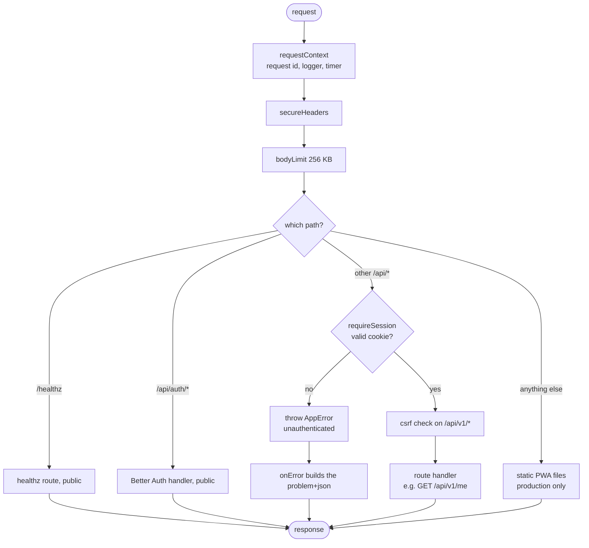

# API server

> **Background:** [[HTTP basics]] · [[Middleware]] · [[Error responses]] · [[Structured logging]] · [[Environment variables and config]] · [[Connection pools]]

`apps/api` (`@tasks/api`): the Node program that answers every `/api/*` request, `/healthz`, and, in production, the PWA's files. Built in v0.0. Why these tools: [[API stack choices]]. Its database: [[Database and migrations]]. Its sign-in: [[Auth]].

Read [[How a request travels]] first: this note zooms into step 4 ("Caddy → Hono") of that journey.

## How to run it

| Command (from the repo root) | What happens |
|---|---|
| `docker compose up -d --wait db` | Starts Postgres 18.6 in Docker and waits until it accepts connections |
| `pnpm db:migrate` | Applies any migrations the database hasn't seen ([[Database migrations]]) |
| `pnpm --filter @tasks/api dev` | Migrates, then runs `node --watch src/main.ts`: the server restarts when you save a file |
| `pnpm dev` | All of the above, plus the web app's Vite server, side by side |
| `pnpm --filter @tasks/api dev:session you@example.com` | Prints a session cookie for a local user, so you can be "signed in" without Google ([[Auth]]) |
| `pnpm --filter @tasks/api test` | The integration tests. Starts the local Postgres first if it isn't running |
| `pnpm --filter @tasks/api seed:sample [email]` | Writes the made-up sample timetable into your **local** database for that user ([[Timetable files and seeding]]) |
| `pnpm --filter @tasks/api seed:private [email]` | The same with your real timetable from git-ignored `private/kiit-sem3.json`. Refuses anything but a local database |

There is **no build step**. `node src/main.ts` runs the TypeScript directly: Node deletes the type annotations as it loads each file ([[TypeScript checking vs running]]). That's why imports name the `.ts` file (`import { createApp } from './app.ts'`). The scripts show it:

*From `apps/api/package.json` (shortened):*
```json
  "scripts": {
    "dev": "node --env-file-if-exists=../../.env src/db/migrate.ts && node --env-file-if-exists=../../.env --watch src/main.ts",
    "start": "node --env-file-if-exists=../../.env src/main.ts",
    "db:migrate": "node --env-file-if-exists=../../.env src/db/migrate.ts",
    // …
```

What to notice:
- Every script is plain `node` pointed at a `.ts` file: no `tsc`, no `dist/` folder to build first.
- `dev` is two commands joined by `&&`: run the migrations, and only if that succeeded, start the server with `--watch` (restart on save).
- `--env-file-if-exists=../../.env` loads the repo-root `.env` when there is one, and carries on without it when there isn't ([[Environment variables and config]]).

Try it: with the server running, `curl -i localhost:3000/healthz` answers `200` with `{"sha":"dev","dbOk":true,"time":"…Z"}`, and `curl -i localhost:3000/api/v1/me` answers `401` with a problem body ([[Error responses]]).

## Files

| File | What it does |
|---|---|
| `package.json` | Scripts (`dev`, `start`, `db:migrate`, `db:generate`, `dev:session`, `seed`, `seed:sample`, `seed:private`, `typecheck`, `test`) and exact dependency versions |
| `tsconfig.json` | Extends the repo's base config and adds Node's types |
| `vitest.config.ts` | Test settings: the global setup that prepares the test database, and "one test file at a time" |
| `drizzle.config.ts` | Tells drizzle-kit where the schema is and where to write migrations |
| `drizzle/` | The SQL migrations, committed. See [[Database and migrations]] |
| `src/main.ts` | The entry point: reads the environment, builds the real pieces, listens on `HOST:PORT`, shuts down cleanly on SIGTERM |
| `src/app.ts` | `createApp(deps)`: wires the middleware and routes in order. Opens no port |
| `src/env.ts` | Reads and checks every environment variable once ([[Environment variables and config]]) |
| `src/logger.ts` | The pino logger, with redaction ([[Structured logging]]) |
| `src/http/context.ts` | The request id, the per-request logger, the access-log line |
| `src/http/errors.ts` | `AppError` and the one place errors become responses ([[Error responses]]) |
| `src/http/json-body.ts` | Reads a JSON body: bad JSON → 400, wrong shape → 422. First used by v0.2's creates |
| `src/http/user-scope.ts` | The `userScope` middleware: gives calendar routes `c.var.asUser` and marks their answers `private, no-store` ([[Row-level security in our database]]) |
| `src/http/row-id.ts` | Reads `:id` from the URL; anything that isn't a UUID is a 404 |
| `src/routes/healthz.ts` | `GET /healthz` |
| `src/routes/me.ts` | `GET /api/v1/me` |
| `src/routes/groups.ts`, `series.ts`, `calendar.ts` | The v0.2 calendar routes ([[Calendar API]]) |
| `src/calendar/*` | The calendar tables' repository functions, row mapping, constraint → 422 mapping, the seed ([[Calendar API]], [[Timetable files and seeding]]) |
| `src/static-site.ts` | Serves the built PWA from `STATIC_DIR` in production |
| `src/db/*` | The pool, Drizzle, the schema, migrations ([[Database and migrations]]); `user-scope.ts` runs queries as one user (`withUser`), `pg-errors.ts` reads Postgres error codes ([[Row-level security in our database]]) |
| `src/auth/*` | Better Auth's setup, the allowlist, the session gate, the dev-session helper ([[Auth]]) |
| `src/profile/profile.ts` | Reads and creates `profile` rows, always filtered by user id |
| `src/scripts/dev-session.ts` | The `dev:session` command |
| `src/scripts/seed.ts` | The `seed` commands ([[Timetable files and seeding]]) |
| `src/test/*` | Test helpers: test env, test database, fake Google, cookie parsing ([[Integration tests]]) |
| `*.test.ts` | The tests, next to the code they test |
| `compose.yaml` (repo root) | The development Postgres |

## The middleware stack, in order

Every request takes one path through this; errors from anywhere jump to `onError`.



Every request passes through these layers from top to bottom; the response passes back up ([[Middleware]]). From `src/app.ts`:

| # | Applies to | Layer | What it does |
|---|---|---|---|
| 1 | everything | `requestContext` | Gives the request an id (`X-Request-Id`), a logger tagged with it, and writes one log line when the response is ready |
| 2 | everything | `secureHeaders()` | Adds browser safety headers (`X-Content-Type-Options: nosniff`, `X-Frame-Options`, …). Not HSTS: Caddy sends that one ([[Reverse proxies and TLS]]) |
| 3 | everything | `bodyLimit` | Refuses bodies over 256 KB with 413 before reading them |
| 4 | `GET /healthz` | route | Public health check |
| 5 | `GET/POST /api/auth/*` | Better Auth | Sign-in, Google's callback, sign-out, get-session. Answers itself |
| 6 | `/api/*` | `requireSession` | No valid session cookie → 401. Puts the user on the request |
| 7 | `/api/v1/*` | `csrf()` | Refuses form-style POSTs from other sites |
| 8 | `GET /api/v1/me` | route | The signed-in user, their profile, the server time |
| 8a | `/api/v1/groups/*`, `/series/*`, `/calendar/*` | `userScope` | Gives the routes `c.var.asUser` (one transaction as you, under row-level security); on the way out, `Cache-Control: private, no-store` |
| 8b | those paths | routes | The calendar API ([[Calendar API]]) |
| 9 | other GETs | static site | Only when `STATIC_DIR` is set: PWA files, else `index.html` |
| — | nothing matched | `notFound` | 404 problem |
| — | anything threw | `onError` | The matching problem; unknown errors → 500, logged with the stack |

The same order in `createApp`, line by line (the numbers in the comments are the table's):

*From `apps/api/src/app.ts` (shortened):*
```ts
  app.use(requestContext(logger)); // 1
  app.use(secureHeaders({ strictTransportSecurity: false })); // 2
  app.use(bodyLimit({ maxSize: MAX_BODY_BYTES })); // 3

  // Public.
  healthzRoute(app, { env, pool, now }); // 4

  // …
  app.on(['GET', 'POST'], `${paths.auth}/*`, (c) => auth.handler(c.req.raw)); // 5

  // Everything else under /api needs a session.
  app.use('/api/*', requireSession(auth, env.AUTH_ALLOWED_EMAILS)); // 6
  // …
  app.use(`${paths.apiV1}/*`, csrf({ origin: env.BETTER_AUTH_URL })); // 7
  meRoute(app, { db, now }); // 8

  // …
  const scoped = userScope(db);
  for (const prefix of [paths.groups, paths.series, paths.calendar]) {
    app.use(`${prefix}/*`, scoped); // 8a
  }
  groupsRoutes(app); // 8b
  seriesRoutes(app, { db });
  calendarRoute(app);

  // The built PWA, in production (STATIC_DIR). Last, so it never shadows the API.
  if (env.STATIC_DIR) staticSite(app, env.STATIC_DIR, logger); // 9

  app.notFound(onNotFound);
  app.onError(onError);
```

What to notice:
- `app.use(fn)` with no path wraps every request; `app.use('/api/*', fn)` only paths under `/api`. Hono runs everything in the order it was registered, which is why the order of these lines *is* the security design.
- `${paths.apiV1}/*` is a template string: `paths.apiV1` is `'/api/v1'` (from `packages/core/src/api.ts`, shared with the PWA), so this reads `/api/v1/*`.
- Line 5 hands Better Auth the raw standard `Request` (`c.req.raw`) and returns whatever `Response` it builds, untouched.
- `notFound` and `onError` aren't layers in the chain: Hono calls them when no route matched, or when anything above threw.

**Trace one request:** your phone opens the app and asks `GET /api/v1/me` with its cookie.
1. `requestContext` names it `7a06…`.
2. `secureHeaders` and `bodyLimit` pass it on (no body).
3. `/healthz` and `/api/auth/*` don't match.
4. `requireSession` finds the cookie, checks it with Better Auth (one indexed Postgres lookup), and sets `user`.
5. `csrf` lets a `GET` through: reading can't change anything.
6. The `/me` route reads your profile (`where user_id = <your id>`) and answers JSON.
7. On the way out, `secureHeaders` adds its headers and `requestContext` adds `X-Request-Id: 7a06…` and logs `GET /api/v1/me 200 16ms`.

## Why `createApp` takes its dependencies

`createApp({ env, logger, pool, db, auth, now })` builds the app from pieces handed to it, instead of creating them itself. This is called **dependency injection**: "give me what I need; I won't go and get it". `main.ts` hands it the real pieces. Tests hand it a test database, a logger that writes into an array, and a clock stuck at `2026-10-12T04:30:00Z`, then call `app.request('/healthz')` with no port and no network. Without this, every test would need a running server and would see the real time, so `serverTime` could never be checked exactly.

The list of pieces, and the two places that fill it in:

```ts
// apps/api/src/app.ts
export interface AppDeps {
  env: Env;
  logger: Logger;
  pool: Pool;
  db: Database;
  auth: Auth;
  /** The clock. Tests pass a fixed one so responses are predictable. */
  now: () => Date;
}
// apps/api/src/main.ts: the real pieces
const app = createApp({ env, logger, pool, db, auth, now: () => new Date() });
// apps/api/src/test/app.ts: the test pieces
export const TEST_NOW = new Date('2026-10-12T04:30:00.000Z');
// …
  const app = createApp({
    env,
    logger: logs.logger,
    pool: testPool,
    db: testDb,
    auth,
    now: () => TEST_NOW,
  });
```

What to notice:
- `now: () => Date` means "a function that returns a `Date`": the clock is a dependency, just like the database ([[TypeScript essentials]] for `interface`).
- `main.ts` passes `() => new Date()`, the real time. The test passes `() => TEST_NOW`, the same instant on every call.
- `{ env, logger, pool, … }` is shorthand for `{ env: env, logger: logger, pool: pool, … }`; the test spells out the pieces whose names differ (`pool: testPool`).

## Shutting down

`docker stop` sends the signal **SIGTERM** ("please stop") and waits 10 seconds before **SIGKILL** ("stop now", no clean-up). On SIGTERM, `main.ts` stops accepting connections, lets requests in flight finish, closes the database pool, and exits with code 0. If that takes over 8 seconds it exits anyway, so Docker never has to kill it mid-write. Ctrl+C sends SIGINT and gets the same treatment.

*From `apps/api/src/main.ts`:*
```ts
let stopping = false;
function shutdown(signal: NodeJS.Signals): void {
  if (stopping) return;
  stopping = true;
  logger.info({ signal }, 'shutting down');
  setTimeout(() => {
    logger.error('shutdown took too long; exiting anyway');
    process.exit(1);
  }, 8_000).unref();

  server.close(async (error) => {
    if (error) logger.error({ err: error }, 'error while closing the HTTP server');
    await pool.end();
    process.exit(error ? 1 : 0);
  });
}
process.once('SIGTERM', shutdown);
process.once('SIGINT', shutdown);
```

What to notice:
- `server.close(callback)` stops taking new connections and calls back once the requests in flight have finished. Only then does `pool.end()` close the database connections, so no request loses its connection halfway.
- The `setTimeout(…, 8_000)` is the safety net: after 8 s it exits with code 1, whatever is still hanging. `.unref()` tells Node not to stay alive just for this timer, so a quick shutdown doesn't wait the full 8 s. (`8_000` is 8000; the `_` only helps you read it.)
- `stopping` makes a second signal (pressing Ctrl+C twice) harmless; `process.once` reacts to the first of each signal only.

## Check yourself
- Swap layers 5 and 6 in `app.ts` (the session gate before Better Auth's routes). Does signing in still work? Find the first line of `requireSession` that answers it, and say what would break if that line weren't there.
- A request to `/api/v1/typo` without a cookie: which layer answers, and with which status? With a valid cookie?
- Why does the request id get added to the response *after* `await next()` in `requestContext`, not before? (Hint: who builds Better Auth's responses?)
- In a test, how does `/me` report exactly `2026-10-12T04:30:00.000Z` as `serverTime`?
