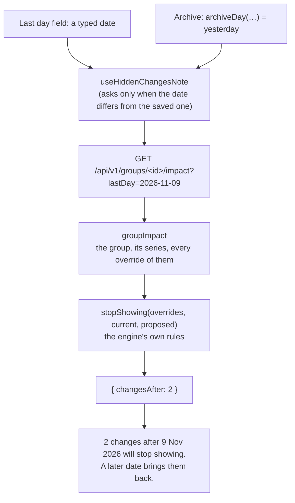

# Archive and last days

> **Background:** [[Recurrence engine]] · [[How a request travels]] · [[Server state and caching]] · [[Shared form pieces]] · [[The user's day]]

**Archive** ends a group or a class in one tap: it sets the last day to yesterday, so the day you archive doesn't count, and the group moves to Archived straight away. Its past stays on the calendar. Before you tap, and while you type any last day by hand, the form says what the date would hide: "2 changes after 9 Nov 2026 will stop showing. A later date brings them back." A **change** here is an override: a cancel, a note, an extra class. Hidden, never erased: the rows stay in the database, and moving the date later shows them again. This is ticket #12, built in PR #22 (Archive, the count, the warning) and PR #23 (yesterday instead of today). Why it's built this way: [[Archive choices]].

## Predict first

Made-up data. "Classes · Sem 3 (sample)" has no last day, and one class in it, Data Structures, has cancels on Fri 6, Mon 9, Fri 13 and Mon 16 Nov. Today is Tue 10 Nov. You open the group and look under the Save row.

1. What last day will Archive save?
2. How many changes does the line under Archive say will stop showing?
3. Instead of Archive, you type a last day of 20 Dec into the field. Does the field warn about anything?

## Files

| File | What it does |
|---|---|
| `packages/core/src/days.ts` | `archiveDay`: the last day Archive sets, or nothing when Archive has nothing to do |
| `packages/core/src/recurrence/expand.ts` | `stopShowing`: the overrides that show now and wouldn't with a new last day; `extraShows`, shared with `expand()` |
| `apps/api/src/calendar/impact.ts` | `groupImpact`, `seriesImpact`: load every override of the classes, ask `stopShowing`, count |
| `apps/api/src/calendar/overrides.ts` | `listOverridesOf`: every override of some series, any date |
| `apps/api/src/routes/groups.ts`, `routes/series.ts` | `GET .../:id/impact?lastDay=YYYY-MM-DD` |
| `apps/web/src/lib/impact.ts` | `impactQuery`, `hiddenChangesNote` (the sentence), `useHiddenChangesNote` (both, for a form) |
| `apps/web/src/components/form-controls.tsx` | `Field`'s new `warning` line, and `ArchiveSection` (the button and the line under it) |
| `apps/web/src/groups/GroupForm.tsx`, `series/SeriesForm.tsx` | The wiring: when Archive shows, what it saves, which warning goes where |
| `apps/api/src/routes/archive.test.ts`, `days.test.ts`, `expand.test.ts`, `lib/impact.test.ts` | The tests (see the end) |



## Which day Archive sets: `archiveDay`

*From `packages/core/src/days.ts`:*
```ts
export function archiveDay(
  item: { untilDate: ISODate | null; startDate?: ISODate },
  today: ISODate,
  group?: { untilDate: ISODate | null },
): ISODate | undefined {
  const yesterday = dayBefore(today);
  if (item.startDate !== undefined && item.startDate > yesterday) return undefined;
  const endsBy = (lastDay: ISODate | null | undefined) => lastDay != null && lastDay <= yesterday;
  if (endsBy(item.untilDate) || endsBy(group?.untilDate)) return undefined;
  return yesterday;
}
```

What to notice:
- **Yesterday, from your day.** `today` comes from `todayFor(profile)`, the date in your profile's zone ([[The user's day]]). `dayBefore` (in core, wrapping `Temporal.PlainDate`) does the date maths, so 1 Jan 2027 gives 31 Dec 2026 without anyone counting days in a month. A group is archived once its last day is before today (`isArchived`, a few lines above), so a last day of yesterday archives it at once.
- **Dates compared as text.** `item.startDate > yesterday` compares two strings like `'2026-11-10'`. Year, then month, then day, each padded with zeros: text in that shape sorts in date order, so `<` and `>` work. That's why the dates stay strings in core.
- **`undefined` means "don't offer Archive".** Three cases:
  - **A series that starts today or later.** Its last day (yesterday) would come before its first day, and the database refuses that: a `CHECK` on the series table says `until_date is null or until_date >= start_date`. Such a series offers only Delete. Groups have no first day, so the group form never passes one.
  - **It already ends by yesterday.** Its own last day is yesterday or earlier: Archive would change nothing.
  - **Its group already ends by yesterday.** A class in an ended group is already over, whatever its own last day says.
- **`!= null`, with one `=`,** is true for both `null` (no last day) and `undefined` (no group passed). Loose equality is the clearer choice here: `!== null && !== undefined` says the same thing at twice the length.
- **"The earlier of" for free.** The spec asked for the earlier of the current last day and the new one, so Archive never moves an end *later*. Here that falls out of the second case: if the current last day is earlier than yesterday, Archive isn't offered at all, and the earlier date stays.

The forms pass the last day **as typed**, not as saved. Type 5 Nov into the field and Archive disappears, because the typed date already ends the group. Before code review it was the saved date, and Archive could replace a typed 30 Oct with a later one.

With today Tue 10 Nov:

| Last day (typed) | Group's last day | First day | Archive offers |
|---|---|---|---|
| none | none | 1 Sep | 9 Nov |
| 30 Nov | none | 1 Sep | 9 Nov |
| 10 Nov | none | 1 Sep | 9 Nov |
| 9 Nov | none | 1 Sep | nothing |
| 5 Nov | none | 1 Sep | nothing |
| none | 31 Aug | 1 Sep | nothing |
| none | none | 10 Nov | nothing: Delete only |
| none | none | 9 Nov | 9 Nov |

## What a last day would hide: `stopShowing`

A last day in the past doesn't touch the database's overrides. The engine just stops drawing what falls after it: such an override is **dormant** ([[Recurrence engine]], next to `findOrphans`). So "what will stop showing" is a question for the engine, asked twice: does this override show with the groups and series as they are now, and with the new last day?

*From `packages/core/src/recurrence/expand.ts` (shortened):*
```ts
export function stopShowing(
  overrides: readonly OccurrenceOverride[],
  current: Placement,
  proposed: Placement,
): OccurrenceOverride[] {
  const showsNow = showsWith(current);
  const showsProposed = showsWith(proposed);
  return overrides.filter((o) => showsNow(o) && !showsProposed(o));
}
// …
function showsWith({ groups, series }: Placement): (o: OccurrenceOverride) => boolean {
  const groupById = new Map(groups.map((g) => [g.id, g]));
  const seriesById = new Map(series.map((s) => [s.id, s]));
  return (o) => {
    const s = seriesById.get(o.seriesId);
    const g = s && groupById.get(s.groupId);
    if (!s || !g) return false;
    return o.kind === 'extra' ? extraShows(o, g) : occursOn(s, o.originalDate, g);
  };
}

/** An extra shows up to its group's last day; its series' own dates don't hide it. */
function extraShows(o: ExtraOverride, g: ScheduleGroup): boolean {
  return g.untilDate === null || o.newDate <= g.untilDate;
}
```

What to notice:
- **A `Placement` is the groups and series an override is placed by**: `Pick<ExpandInput, 'groups' | 'series'>`, the two fields of `expand()`'s input that decide dates. `current` is them as saved; `proposed` is the same with the new last day swapped in.
- **`showsWith` returns a function.** It builds its two lookup tables (`Map`s) once, and the function it hands back keeps them: a **closure**. `filter` then calls `showsNow(o)` once per override without rebuilding anything.
- **Two rules, the engine's own.** A change to a generated class (a cancel, a note) shows while the series still generates its original date, inside the series' and the group's dates: `occursOn(s, date, g)`, the same function `expand()` uses. An **extra** has no generated date; only its group's last day hides it. That's `extraShows`, which `expand()`'s pass 3 now calls too, so the count and the calendar share one line.
- **So a class's own last day never hides an extra.** A make-up class you placed on 20 Nov stays on 20 Nov even if the class's last day becomes 15 Nov. The group's last day does hide it: the semester is over.
- **"Shows now and not after", not "after the date".** Already dormant changes aren't counted, so moving a last day *later* hides nothing and says nothing. An orphan (a change on a date the rule no longer makes, say the class moved from Mondays to Tuesdays) shows in neither, so it's never counted.
- **Moves, later.** A moved class is counted by its original date, because that's how the engine places it today. In v0.3b moves show where they landed; `showsWith`'s comment says so, and the later list holds the reminder to change both together.

## The impact read, on the server

The phone holds only the weeks it has loaded ([[Offline reads]]), and a cancel can be on any date, say next March. So the count comes from the server, which loads every override of the classes:

*From `apps/api/src/calendar/impact.ts` (shortened):*
```ts
  const group = await findGroup(scope, id);
  if (!group) return undefined;
  const inGroup = (await listSeries(scope)).filter((s) => s.groupId === id);
  const overrides = await listOverridesOf(
    scope,
    inGroup.map((s) => s.id),
  );
  const current = { groups: [group], series: inGroup };
  const proposed = {
    groups: [{ ...group, untilDate: lastDay ?? group.untilDate }],
    series: inGroup,
  };
  return {
    changesAfter: stopShowing(overrides, current, proposed).length,
    hasHistory: overrides.length > 0 || inGroup.some((s) => metBefore(s, group, today)),
  };
```

`{ ...group, untilDate: … }` copies the group with one field replaced; nothing is saved. `lastDay ?? group.untilDate` keeps the saved last day when none was asked about, so `current` and `proposed` are the same and the count is 0. Delete asks that way (#14): the same read, with no last day, also carries `hasHistory`, whether deleting the group would lose anything ([[Delete with the typed name]]). `seriesImpact` is the same for one class and its own last day. Since #13 it can also be asked about a new first day and a new timing: [[Series change warnings]].

*From `apps/api/src/routes/groups.ts`:*
```ts
  app.get(`${one}/impact`, async (c) => {
    const id = rowId(c.req.param('id'), 'group');
    const query = impactQuerySchema.safeParse(c.req.query());
    if (!query.success) throw validationFailed(query.error);
    const today = await todayOf(deps.db, c.get('user').id, deps.now());
    const impact = await c.var.asUser((scope) => groupImpact(scope, id, query.data.lastDay, today));
    if (!impact) throw noSuchRow('group');
    return c.json(impact);
  });
```

What to notice:
- **The query string is checked like a body.** `c.req.query()` is `{ lastDay: '2026-11-20' }`; `impactQuerySchema` (core) says `lastDay` is an optional ISO date. `?lastDay=soon` is a 422 with the problem on `lastDay` ([[Validating input with schemas]], [[Error responses]]).
- **Someone else's group is a 404**, the same as a missing one. `asUser` runs the reads as you, so row-level security never returns another user's group, `findGroup` finds nothing, and `noSuchRow` answers "no such group" ([[Row-level security in our database]]). The isolation test checks it with a second user.
- **A `GET` that answers a "what if".** It reads, never writes, so the browser may ask it as often as you type. It's a sub-resource of the row (`/groups/<id>/impact`) rather than a flag on `PATCH`, so asking can never save by accident.

A real exchange from the tests: cancels on 18, 23 and 25 Nov and an extra lab on 26 Nov, asked about 20 Nov:

```text
GET /api/v1/groups/<id>/impact?lastDay=2026-11-20
→ 200 { "changesAfter": 3 }
```

The 18th is on or before the 20th, so it stays.

## In the forms

*From `apps/web/src/lib/impact.ts` (shortened):*
```ts
export function impactQuery<T extends Impact = Impact>(
  rowPath: string | null,
  ask: SeriesImpactQuery | undefined,
) {
  return queryOptions({
    queryKey: ['impact', rowPath, ask],
    // Dropped as soon as no form shows it: a count from an earlier visit could
    // be out of date (a new cancel, another last day) and flash before the refetch.
    gcTime: 0,
    queryFn:
      rowPath === null || ask === undefined || halfTyped(ask.lastDay) || halfTyped(ask.firstDay)
        ? skipToken
        : ({ signal }) => {
            // …the question as a query string, `lastDay=2026-11-20`
            return apiGet<T>(`${rowPath}/impact?${new URLSearchParams(search)}`, { signal });
          },
  });
}
```

`ask` is the question, `{ lastDay: '2026-11-20' }` for a last day. #13 widened it to a series' first day and timing, and added `halfTyped`, which waits while a year is still being typed; [[Series change warnings]] explains both. `T` is the answer's type: `Impact` for a group, `SeriesImpact` for a series.

What to notice:
- **One cache entry per date, dropped once unused.** The key holds `ask`, so each date is its own query ([[Server state and caching]]). Type 20 Nov, then 25 Nov, then 20 Nov again, and three requests go: once the field moves to 25 Nov, nothing shows the 20 Nov answer, and `gcTime: 0` drops it straight away.
- **`skipToken`** is TanStack Query's "don't ask yet". A new group has no row to ask about (`rowPath` is `null`), and an empty field has no date; then the query sits idle instead of sending a request that can only fail.
- **`gcTime: 0`.** The app keeps every other query forever and saves it for offline (`gcTime: Infinity`, [[Offline reads]]). A count is different: it goes stale the moment someone cancels a class, so it's dropped as soon as nothing shows it. It's also left out of the offline copy, which keeps only the queries named in `persist.ts` (`me`, `groups`, `series`, `calendar`). Writes need a connection anyway, so offline there's nothing to warn about.
- **`signal`** lets TanStack Query cancel the request if you type another date before the answer comes. `URLSearchParams` builds `lastDay=2026-11-20` with any escaping done for us.

`useHiddenChangesNote(rowPath, lastDay, saved)` asks only when the date differs from the saved one, and turns the answer into the sentence: "1 change after 14 Nov 2026 will stop showing. A later date brings it back.", or nothing for 0. The group form calls it twice: once for the typed date, once for Archive's. The series form uses it only for Archive's day; since #13 it asks about everything typed at once ([[Series change warnings]]).

*From `apps/web/src/groups/GroupForm.tsx` (shortened):*
```tsx
  const rowPath = group === null ? null : `${paths.groups}/${group.id}`;
  const typedLastDay = values.untilDate === '' ? null : values.untilDate;
  const archiveOn = group === null ? undefined : archiveDay({ untilDate: typedLastDay }, today);
  const hiddenByTyped = useHiddenChangesNote(rowPath, values.untilDate, initial.untilDate);
  const hiddenByArchive = useHiddenChangesNote(rowPath, archiveOn, initial.untilDate);
// …
  /** Save, with Archive's last day. */
  async function archive(day: ISODate) {
    const next = { ...values, untilDate: day };
    setValues(next);
    clearProblem('untilDate');
    setArchiving(true);
    await submit(next);
    setArchiving(false);
  }
```

What to notice:
- **Archive is Save with one field changed.** It saves the whole form through the same `submit` as Save ([[Groups screen]]), so a name you changed a moment ago goes with it, then goes back to Groups. Nothing new reaches the server: it's the `PATCH` that was always there, with `untilDate`.
- **`submit(next)`, not `submit(values)`.** `setValues(next)` asks React to draw the form again with the new date, but `values` in this running function is still the old object until that next draw. Passing `next` sends what you see. That's also why `submit` takes the values as an argument instead of reading `values` itself: Save passes the form as it is, Archive passes it with the new last day.
- **`setArchiving(true)`** tells the two buttons apart: Archive reads "Archiving…" and Save keeps its label (`saving={saving && !archiving}`).
- **The series form** does the same, with two more inputs to `archiveDay`: the class's first day, and its group as currently chosen in the select, so a class moved into an ended group stops offering Archive.

The warning under the Last day field is `Field`'s new `warning`:

*From `apps/web/src/components/form-controls.tsx` (shortened):*
```tsx
      {warning !== undefined && (
        <p
          id={warningId(id)}
          aria-live="polite"
          className="mt-1 text-sm text-amber-800 empty:hidden dark:text-amber-300"
        >
          {warning}
        </p>
      )}
```

- **`aria-live="polite"`** makes it a **live region**: when its text changes, a screen reader reads it out after what it's saying now, without moving the focus. That matters here, because the count arrives a moment after you type, while the focus is still in the date input.
- **A live region must exist before its text does** ([[Dialogs and toasts]]): a screen reader watches elements that are already there. So the forms pass `warning={hiddenByTyped ?? ''}`: an empty string keeps the paragraph in the page, and `empty:hidden` (a Tailwind class for the CSS `:empty` selector) hides it while it has nothing to say.
- **`describedBy`** adds the warning's id to the input's `aria-describedby`, so it's also read whenever the field is focused later.
- Amber, not red: it's a fact about the date, not a mistake. Save still works.

`ArchiveSection` is the button and the line under it: "Its last day becomes yesterday, 9 Nov 2026, so today doesn't count. Everything up to then stays on the calendar.", then the count in amber when there is one. It shows only when `archiveOn` isn't `undefined`. Offline, it's greyed out like Save (`disabled={saving || !online}`), and the button is described by the same "You're offline" note.

The answers to *Predict first*: 1) `2026-11-09`. 2) 2: the cancels on 13 and 16 Nov. The ones on 6 and 9 Nov are on or before the new last day, and they stay. 3) No: nothing comes after 20 Dec, so the count is 0 and the field says nothing.

## How it was checked

- **Core:** `archiveDay` (5 tests: no or later last day, already ended, the group's last day, a series starting today or yesterday, month and year ends); `stopShowing` (4: a group hides cancels and extras, a series hides cancels but not extras, already-hidden changes left out, an orphan never counted); and the dormant rule (2: a cancel after a group's or a series' last day comes back when the date moves later).
- **API**, over HTTP against Postgres (`archive.test.ts`): the impact read for groups and series (counts, 0 without a date, already hidden, 422 on a bad date, 404 on an unknown row); Archive's `PATCH` for both, keeping the past and bringing changes back; a class that hasn't started refused a last day before its first. `calendar-isolation.test.ts`: another user's impact is a 404.
- **Web:** `impact.test.ts` (3: the sentence, the empty case, the request path).
- **In Chrome** at 412×915 and 1280×800 with made-up data: the count matched the API, Archive saved 9 Nov and the group appeared under Archived at once, moving the last day back later brought the 13 and 16 Nov cancels back, and a class starting 10 Nov offered only Delete.

## Check yourself

- **Predict:** a class's last day is 30 Nov, and it has an extra on 25 Nov. You change the *class's* last day to 20 Nov. Does the warning count the extra? What if you change the *group's* last day to 20 Nov instead?
- **Trace:** you type 20 Nov, then 25 Nov, then 20 Nov into the Last day field. How many requests go to `/impact`, and why?
- **Break it:** in `archive()`, call `submit(values)` instead of `submit(next)`. What does Archive save?
- **Explain:** why does the count come from the server, when the phone already has the engine?
- **Explain:** why does the warning paragraph stay in the page, empty, when there's nothing to say?
