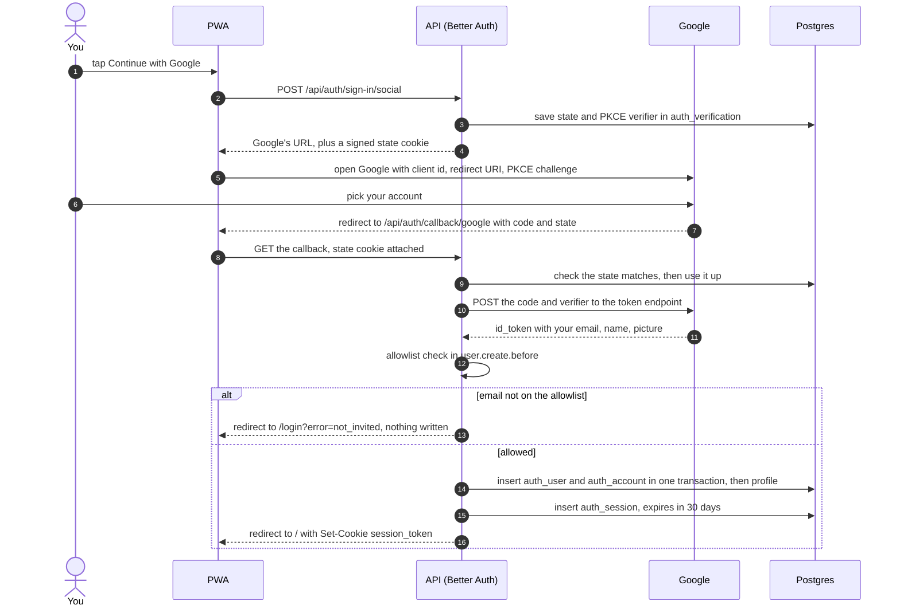

# Auth

> **Background:** [[HTTP basics]] · [[Origin]] · [[Cookies and sessions]] · [[Hashing and signing]] · [[OAuth sign-in]]

How you sign in, and how the API knows it's you on every request after that. Built in v0.0 with Better Auth 1.7.7 (D-058–D-060). Concepts: [[OAuth sign-in]], [[Cookies and sessions]], [[Origin]]. Choices: [[API stack choices]].

## Files

| File | What it does |
|---|---|
| `apps/api/src/auth/auth.ts` | `createAuth`: Better Auth's whole configuration (Google, tables, cookie, sessions, the allowlist hooks) |
| `apps/api/src/auth/allowlist.ts` | `isEmailAllowed` and the `not_invited` code |
| `apps/api/src/auth/require-session.ts` | The gate: every `/api/*` except `/api/auth/*` needs a session |
| `apps/api/src/auth/dev-session.ts` | Mints a session without Google, for localhost only |
| `apps/api/src/scripts/dev-session.ts` | The `dev:session` command around it |
| `apps/api/src/profile/profile.ts` | Creates and reads the `profile` row |
| `apps/api/src/auth/auth.test.ts` | The whole flow with Google faked, the allowlist, cookies, CSRF |

## Signing in, step by step

The same steps as a picture (the numbers don't match the list below one to one; the picture merges some):



Your phone, the installed PWA, `https://tasks.ahmedatif.in`:

1. **You tap "Sign in with Google".** The PWA sends `POST /api/auth/sign-in/social` with `{ provider: "google", callbackURL: "/", errorCallbackURL: "/login" }`.
2. **Better Auth prepares a one-time ticket.** It makes a random `state` and a PKCE `code_verifier` (both explained in [[OAuth sign-in]]), saves them in `auth_verification` for 10 minutes, sets a signed `better-auth.state` cookie, and answers with Google's URL.
3. **The browser goes to Google.** The URL names our client id, the redirect URI `https://tasks.ahmedatif.in/api/auth/callback/google`, `prompt=select_account` (so you pick your personal account, not your KIIT one by accident) and the PKCE challenge. Those come from our configuration:

   *From `apps/api/src/auth/auth.ts` (shortened):*
   ```ts
     const google =
       env.GOOGLE_CLIENT_ID && env.GOOGLE_CLIENT_SECRET
         ? {
             google: {
               clientId: env.GOOGLE_CLIENT_ID,
               clientSecret: env.GOOGLE_CLIENT_SECRET,
               // Always show Google's account picker: students juggle a personal
               // and a university account, and the wrong one would be refused.
               prompt: 'select_account' as const,
             },
           }
         : {};
     // …
       // The origin the browser sees (Vite's in development), so redirects and
       // the Google redirect URI point there: <BETTER_AUTH_URL>/api/auth/callback/google.
       baseURL: env.BETTER_AUTH_URL,
       basePath: paths.auth,
   ```

   What to notice:
   - `a && b ? x : y`: with both Google variables set, `google` is the provider's settings; otherwise it's an empty object and Better Auth has no Google at all (the `PROVIDER_NOT_FOUND` case below).
   - `as const` keeps the type as the exact text `'select_account'` instead of "any string", which Better Auth's types require.
   - The redirect URI is never written down whole: it's `baseURL` + `basePath` (`/api/auth`) + `/callback/google`.

4. **You pick your account.** Google never shows us your password; it only vouches for you.
5. **Google sends the browser back** to `/api/auth/callback/google?code=…&state=…`.
6. **Better Auth checks the ticket**: the `state` must match the cookie from step 2 and the saved row (and is then used up). A forged or replayed callback stops here.
7. **Better Auth trades the code for your identity**, server to server: it POSTs the `code` and the `code_verifier` to `https://oauth2.googleapis.com/token` and gets an `id_token` holding your Google id (`sub`), email, name and picture.
8. **The allowlist.** First sign-in: before the `auth_user` row is written, our `user.create.before` hook checks your email against `AUTH_ALLOWED_EMAILS`. Not on it → no row is ever written, and the browser lands on `/login?error=not_invited`. On it → `auth_user` and `auth_account` are written together (one transaction), then our `after` hook creates your `profile` with the defaults.

   ```ts
   // apps/api/src/auth/auth.ts (shortened)
       databaseHooks: {
         user: {
           create: {
             // Runs before the user row is inserted: a stranger never gets a row at all.
             before: async (user) => {
               if (!isEmailAllowed(env.AUTH_ALLOWED_EMAILS, user.email)) throw notInvited();
               return { data: user };
             },
             // Runs after the row (and its transaction) is committed.
             after: async (user) => {
               await ensureProfile(db, user.id);
             },
           },
         },
   // apps/api/src/auth/allowlist.ts
   export function isEmailAllowed(allowed: readonly string[], email: string): boolean {
     return allowed.includes(email.trim().toLowerCase());
   }
   ```

   What to notice:
   - A **hook** is a function Better Auth promises to call at a fixed moment: `before` runs just before the `INSERT`, `after` once it's committed.
   - `throw notInvited()` cancels the insert, and Better Auth turns the error into the `/login?error=not_invited` redirect. `return { data: user }` means "go ahead, insert it unchanged".
   - The list from the environment is already trimmed and lower-case (`env.ts` did it); the email from Google might not be, hence `.trim().toLowerCase()` here.

9. **A session row.** Our `session.create.before` hook checks the allowlist again (someone removed from the list keeps their user row but can't get a new session). Better Auth inserts `auth_session`: a random 32-character token, expiry in 30 days, IP and user agent.

   *From `apps/api/src/auth/auth.ts`:*
   ```ts
         session: {
           create: {
             // Someone taken off the list keeps their user row but can't start new sessions.
             before: async (session) => {
               const [owner] = await db
                 .select({ email: authUser.email })
                 .from(authUser)
                 .where(eq(authUser.id, session.userId));
               if (!owner || !isEmailAllowed(env.AUTH_ALLOWED_EMAILS, owner.email)) {
                 throw notInvited();
               }
               return { data: session };
             },
           },
         },
   ```

   What to notice:
   - A session row only knows its `userId`, so the hook first looks the email up: Drizzle turns `.select().from().where(eq(…))` into `select "email" from "auth_user" where "id" = $1`.
   - `const [owner] = …` takes the first row of the result, or `undefined` when there is none (a deleted user), which also counts as "not allowed".

10. **The cookie.** The response is a redirect to `/` with `Set-Cookie: __Secure-better-auth.session_token=<token>.<signature>; HttpOnly; Secure; SameSite=Lax; Path=/; Max-Age=2592000` (30 days). On plain `http://localhost` there is no `Secure` and no `__Secure-` prefix. No `Domain`, so the cookie is **host-only**: never sent to any other subdomain.
11. **`/me`.** The PWA loads, calls `GET /api/v1/me`; the browser attaches the cookie by itself. `requireSession` asks Better Auth to check the signature and look the token up in `auth_session` (not expired?). Once a day of use it pushes the expiry 30 days out and re-sends the cookie with a fresh `Max-Age` (the **sliding** expiry, so an app you use daily never logs you out). The route answers `{ user, profile, serverTime }`.

The cookie and session rules of steps 10 and 11 are a few lines of configuration:

*From `apps/api/src/auth/auth.ts` (shortened):*
```ts
    session: {
      modelName: 'auth_session',
      // 30 days, sliding: each day of use pushes the expiry 30 days out again.
      expiresIn: 30 * DAY_SECONDS,
      updateAge: DAY_SECONDS,
      // …
      // Look the session up in Postgres on every request rather than trusting a
      // cached copy in a second cookie: signing out anywhere takes effect at once.
      cookieCache: { enabled: false },
    },
    // …
      // `Secure` cookies (and the `__Secure-` name prefix) exactly when the
      // site is served over https. No `crossSubDomainCookies`: the cookie is
      // host-only, sent to this host and no other (D-063).
      useSecureCookies: env.BETTER_AUTH_URL.startsWith('https:'),
```

What to notice:
- `expiresIn` is the 30 days, in seconds (`DAY_SECONDS` is `24 * 60 * 60`). `updateAge: DAY_SECONDS` is the "at most once a day" of the sliding expiry.
- `useSecureCookies` is `true` exactly when `BETTER_AUTH_URL` starts with `https:`. That one boolean is why production gets `Secure` and the `__Secure-` name, and `http://localhost` gets neither.
- Nothing sets a `Domain`, and that absence is what makes the cookie host-only.

## What the login page receives on failure

Failed sign-ins land on `/login?error=<code>&error_description=<text>`. The code is what the PWA should branch on:

| `error` | When |
|---|---|
| `not_invited` | Your email isn't in `AUTH_ALLOWED_EMAILS` (our code) |
| `access_denied` | You pressed "Cancel" on Google's page (Google's code, passed through) |
| `state_mismatch`, `state_not_found`, `please_restart_the_process` | The ticket from step 2 is missing, expired or forged (e.g. you took over 10 minutes) |
| `invalid_code`, `unable_to_get_user_info` | Google refused the code, or its answer was unusable |
| `unable_to_create_user` | Better Auth couldn't write the new user for another reason (say, a database error). The PWA shows the same "not allowed" message as `not_invited` |

If the PWA passes `errorCallbackURL`, that page is used; otherwise our config sends errors to `<BETTER_AUTH_URL>/login` anyway (`onAPIError.errorURL`).

*From `apps/api/src/auth/auth.ts` (shortened):*
```ts
/** Thrown from a hook, Better Auth turns it into `?error=not_invited` on the error page. */
function notInvited(): APIError {
  return new APIError('FORBIDDEN', {
    code: NOT_INVITED,
    message: 'This app is private. Your Google account is not on its list.',
  });
}
// …
    // Where a failed sign-in lands when the PWA didn't name a page itself:
    // our login screen, as /login?error=<code> (e.g. `not_invited`).
    onAPIError: { errorURL: `${env.BETTER_AUTH_URL}/login` },
```

What to notice:
- `APIError` is Better Auth's own error class; its `code` is what reaches the login page as `?error=`.
- `NOT_INVITED` is the constant `'not_invited'` from `allowlist.ts`, so the code is spelled in exactly one place.

When Google isn't configured (no `GOOGLE_CLIENT_ID`, normal in development), step 1 answers `404 {"code":"PROVIDER_NOT_FOUND"}` instead. Better Auth's routes answer with its own `{ code, message }` JSON, not our problem shape ([[Error responses]]).

## The gate (`requireSession`)

| Request | Answer |
|---|---|
| `/healthz`, PWA files | Public, the gate isn't involved |
| `/api/auth/*` | Skipped: Better Auth handles its own routes |
| any other `/api/*`, no or bad cookie | `401 unauthenticated`, **even for paths that don't exist**, so a stranger can't discover which routes we have |
| valid cookie, email removed from the list | `403 forbidden` |
| valid cookie | continues; `c.get('user')` holds `{ id, email, name, image }` |

Each row of that table is a line or two of the middleware:

*From `apps/api/src/auth/require-session.ts` (shortened):*
```ts
  return async (c, next) => {
    if (c.req.path.startsWith(`${paths.auth}/`)) return next();
    // … getSession: check the cookie, look up the session (see "One request, line by line")
    if (!session) throw new AppError('unauthenticated');
    // Taken off the allowlist after signing in: the session still exists, but it's no longer enough.
    if (!isEmailAllowed(allowedEmails, session.user.email)) {
      throw new AppError('forbidden', {
        detail: 'This account is no longer allowed to use the app.',
      });
    }

    c.set('user', {
      id: session.user.id,
      email: session.user.email,
      name: session.user.name,
      image: session.user.image ?? null,
    });
    await next();
  };
```

What to notice:
- The first line lets Better Auth's own `/api/auth/*` paths straight through, so the gate itself knows about them, whatever order `app.ts` registers things in.
- `throw new AppError(…)` doesn't answer here: it jumps to `onError`, which builds the 401 or 403 problem ([[Error responses]]).
- `c.set('user', …)` is how one middleware hands something to the next ones; the route reads it back with `c.get('user')`. `?? null` turns a missing picture into `null`.
- `await next()` is only reached on the success path: without a session, no route ever runs.

Every query after that uses `user.id` from the session, never an id from the URL or body. For `profile` that rule is still the whole of our data isolation; the cross-user test in `routes/me.test.ts` checks it. The v0.2 calendar tables add row-level security on top (A10, [[Row-level security in our database]]).

## CSRF on our own routes

Better Auth checks the `Origin` header on its own state-changing requests. For `/api/v1/*`, Hono's `csrf()` refuses **form-style** POSTs (the only kind another site can make your browser send without asking) unless they come from `BETTER_AUTH_URL`. A cross-site `fetch` with JSON is blocked by the browser itself: it needs a CORS "preflight" permission check, and we never grant one. Details in [[Cookies and sessions]].

```ts
// apps/api/src/app.ts
  // Our own routes refuse form-style POSTs from other sites (CSRF). JSON
  // requests from another site can't happen without CORS, which we never allow.
  app.use(`${paths.apiV1}/*`, csrf({ origin: env.BETTER_AUTH_URL }));
// apps/api/src/auth/auth.ts (shortened)
    // Requests that change state must come from this exact origin, no wildcards.
    trustedOrigins: [env.BETTER_AUTH_URL],
    // …
      // Better Auth skips its origin check when NODE_ENV=test. Keep it on, so
      // the tests exercise the same protection production has.
      disableOriginCheck: false,
```

What to notice:
- Both guards trust one origin and nothing else: `BETTER_AUTH_URL` (`https://tasks.ahmedatif.in` in production, `http://localhost:5173` on your laptop).
- `disableOriginCheck: false` looks like it does nothing, but it overrides Better Auth's habit of switching the check off under `NODE_ENV=test`, so `auth.test.ts` tests the real protection.

Note: an earlier version of [[Origin]] said the cookie would use the `__Host-` prefix. Better Auth actually uses `__Secure-` and leaves out `Domain`; the effect (host-only, https-only) is the same, but `__Host-` would have the browser *enforce* it. Changing it isn't worth fighting the library for now.

## Without Google: `dev:session`

`pnpm --filter @tasks/api dev:session you@example.com` creates the user (if needed), their profile and a fresh session through Better Auth's own functions, signs the token with `BETTER_AUTH_SECRET`, and prints the cookie name and value plus a ready `curl` line. It refuses unless `BETTER_AUTH_URL`'s host is `localhost` or `127.0.0.1`, and the email must still be on the allowlist. It works with `NODE_ENV=production` too, so the production Docker image can be checked locally.

*From `apps/api/src/auth/dev-session.ts` (shortened):*
```ts
  if (!isLocalOrigin(env.BETTER_AUTH_URL)) {
    throw new Error(
      `refusing to mint a session for ${env.BETTER_AUTH_URL}: dev sessions are for localhost only`,
    );
  }
  // …
  const ctx = await auth.$context;
  const existing = await ctx.internalAdapter.findUserByEmail(email);
  const user =
    existing?.user ??
    (await ctx.internalAdapter.createUser(
      { email, name: email.split('@')[0] ?? email, emailVerified: true },
      { method: 'dev-session' },
    ));
  await ensureProfile(db, user.id);

  const session = await ctx.internalAdapter.createSession(user.id);
```

What to notice:
- The localhost check is the very first thing, before any database work. `isLocalOrigin` parses the URL and compares only the host name, so `http://localhost:5173` passes and `https://tasks.ahmedatif.in` never does.
- `ctx.internalAdapter` is Better Auth's own code for writing its rows, so the user and session look exactly like a real sign-in's, and the allowlist hooks above still run.
- `existing?.user ?? (…)`: use the user if one exists, otherwise create one. `?.` gives `undefined` instead of crashing when `existing` is empty; `??` then picks the right-hand side.
- How the cookie value is signed from `session.token` is in [[Hashing and signing]].

## Check yourself
- Mallory signs in with Google. List every table she gets a row in. (Careful with `auth_verification`.)
- You remove your email from `AUTH_ALLOWED_EMAILS` and restart. What does your phone see on its next `/me`, and what happens when you tap "Sign in" again?
- Someone copies a row from `auth_session` out of a leaked database backup and puts the `token` in a cookie. Why doesn't it work?
- You use the app every day for two months. Why are you never logged out, even though sessions last 30 days?
