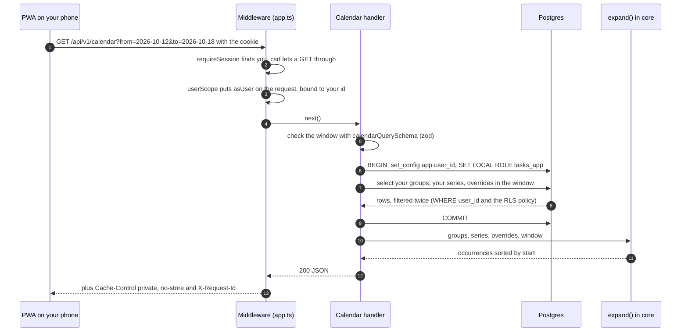
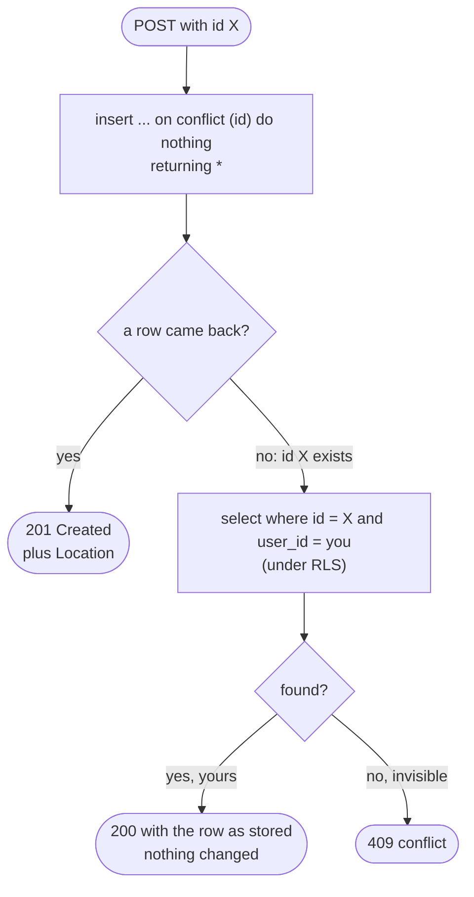

# Calendar API

> **Background:** [[REST resources and CRUD]] · [[Idempotency and retries]] · [[Validating input with schemas]] · [[Transactions]] · [[Error responses]] · [[Middleware]]

The v0.2 routes that put your timetable on the home screen: groups ("Classes · Sem 3"), series ("Data Structures, Mondays 08:00 for 60 minutes") and the calendar itself ("everything happening from Monday to Sunday"). They live in `apps/api`, next to `/me` ([[API server]]). Every query they run goes through row-level security: [[Row-level security in our database]]. The occurrences come from the engine: [[Recurrence engine]]. How data gets in before there's a form: [[Timetable files and seeding]]. Why the routes look like this and not otherwise: [[Calendar API choices]].

## The routes

| Request | On success | When it goes wrong |
|---|---|---|
| `GET /api/v1/groups` | `200 { groups: [...] }`, oldest `activeFrom` first, then by name | |
| `POST /api/v1/groups` | `201` + the new group + a `Location` header. The same `id` again: `200` + the group as it is now, nothing changed | `400` not JSON · `422` a field is wrong · `409` the id belongs to someone else's row |
| `GET /api/v1/groups/:id` | `200` + the group | `404` no such group, someone else's, or `:id` isn't a UUID |
| `PATCH /api/v1/groups/:id` | `200` + the changed group (only the fields you sent change) | `404` · `400` · `422`, including a rule that needs the stored row (below) |
| `DELETE /api/v1/groups/:id` | `204`, no body. Its series and their overrides go too | `404` |
| the same five for `/api/v1/series` | Same, sorted by title. A create without `tzid` takes your profile's zone | Also `422` on `groupId` when the group isn't one of yours |
| `GET /api/v1/calendar?from=2026-10-12&to=2026-10-18` | `200 { from, to, occurrences: [...] }`, sorted by start | `422` naming `from` or `to`: missing, not a real date, `to` before `from`, or wider than 62 days |

Two rules apply to all of them:
- **No session, no answer:** `401`, from `requireSession`, before any of this code runs ([[Auth]]).
- **Every answer is marked `Cache-Control: private, no-store`**, errors and `204`s included. It's your timetable, and no shared cache (a college proxy, say) may keep a copy.

## Try it

With `pnpm dev` running and your local user created:

```sh
pnpm --filter @tasks/api dev:session you@example.com   # prints a cookie
pnpm --filter @tasks/api seed:sample                    # the made-up sample timetable
curl -H 'Cookie: better-auth.session_token=<the value it printed>' \
  'http://localhost:5173/api/v1/calendar?from=2026-10-12&to=2026-10-18'
```

The first occurrence in the answer is Data Structures on Monday 12 October: `"start": "2026-10-12T02:30:00Z"`, which is 08:00 in Kolkata (UTC+05:30). Change `to` to `2026-12-31`, and you get a `422` with `"errors": [{ "path": "to", "message": "the window can span at most 62 days" }]`.

## One request, traced: `GET /calendar`

You open the app on your phone on Monday morning, and the calendar screen asks for this week.



Step by step, with the files open:

1. **`app.ts`**: the request passes `requestContext`, `secureHeaders`, `bodyLimit`, `requireSession` (which sets `c.var.user`) and `csrf`, exactly as for `/me` ([[API server]]).
2. **`http/user-scope.ts`**, `userScope(db)`: mounted on `/api/v1/groups/*`, `/api/v1/series/*` and `/api/v1/calendar/*` (in Hono, `/x/*` also matches `/x`). It sets `c.var.asUser`, a function that runs a callback in one transaction as you, so the handler never sees your id as something it could change. After the handler, on the way out, it adds `Cache-Control`.

   *From `apps/api/src/app.ts` and `apps/api/src/http/user-scope.ts` (shortened):*
   ```ts
   // apps/api/src/app.ts
     const scoped = userScope(db);
     for (const prefix of [paths.groups, paths.series, paths.calendar]) {
       app.use(`${prefix}/*`, scoped);
     }
   // apps/api/src/http/user-scope.ts
   export function userScope(db: Database): MiddlewareHandler<AppEnv> {
     return async (c, next) => {
       const userId = c.get('user').id;
       c.set('asUser', (fn) => withUser(db, userId, fn));
       await next();
       // …
       c.header('Cache-Control', 'private, no-store');
     };
   }
   ```

   What to notice:
   - One middleware, `scoped`, is mounted on three path prefixes. `paths.groups` is `/api/v1/groups`, from core's shared list of paths.
   - `c.get('user').id` was put there by `requireSession`, earlier in the chain. The arrow function `(fn) => withUser(db, userId, fn)` *remembers* `db` and `userId` (a closure), so the handler calls `c.var.asUser(fn)` and never touches the id.
   - `c.header('Cache-Control', …)` comes after `await next()`, so it runs on the way out, once the handler (or the error handler) has made the answer.
3. **`routes/calendar.ts`**: `calendarQuerySchema.safeParse(c.req.query())`, the shared rule from core. A failure becomes `422` through `validationFailed` ([[Validating input with schemas]]). Why that rule needed a fix first: see "A pitfall we hit" below.

   *From `apps/api/src/routes/calendar.ts`:*
   ```ts
       // A missing, malformed or too wide window is a 422 naming `from` or `to`.
       const query = calendarQuerySchema.safeParse(c.req.query());
       if (!query.success) throw validationFailed(query.error);
       const window: DateWindow = { from: query.data.from, to: query.data.to };
   ```

   `c.req.query()` is every query-string value as text: `{ from: '2026-10-12', to: '2026-10-18' }`. `safeParse` never throws; it returns `success` and either `data` or `error`. The handler throws the 422 itself, and `onError` in `http/errors.ts` turns it into the response. After that line, `query.data` is known to hold two checked dates.
4. **`c.var.asUser(async (scope) => ...)`** → **`db/user-scope.ts`**, `withUser`: `BEGIN`, `set_config('app.user_id', <your id>, true)`, `SET LOCAL ROLE tasks_app` ([[Row-level security in our database]]).
5. Three reads, in **`calendar/groups.ts`**, **`calendar/series.ts`** and **`calendar/overrides.ts`**: all your groups and series (you have tens, so filtering them by the window would cost more than it saves), and only the overrides whose original date *or* new date is in the window. A lab moved from last Friday into this Monday has its new date here, but not its original date.

   *From `apps/api/src/calendar/overrides.ts`:*
   ```ts
     const rows = await scope.tx
       .select()
       .from(occurrenceOverride)
       .where(
         and(
           eq(occurrenceOverride.userId, scope.userId),
           or(
             between(occurrenceOverride.originalDate, window.from, window.to),
             between(occurrenceOverride.newDate, window.from, window.to),
           ),
         ),
       );
   ```

   Drizzle's `and`, `or`, `eq` and `between` build the SQL `where user_id = $1 and (original_date between $2 and $3 or new_date between $4 and $5)`. The `or` is the "moved in or moved out" rule: last Friday's lab has its `original_date` outside this week but its `new_date` inside it, so the second `between` catches it. `eq(…userId, scope.userId)` is the app's own filter, on top of the RLS policy.
6. **`COMMIT`**. The transaction lasted three short queries, and the pooled connection goes back as the owner, naming nobody.
7. **`expand()`** from `@tasks/core` runs *after* the commit. It's pure computation, and no database connection should wait on it. `dayExceptions` is `[]` until v0.3b adds holidays.

   *From `apps/api/src/routes/calendar.ts`:*
   ```ts
       const rows = await c.var.asUser(async (scope) => ({
         groups: await listGroups(scope),
         series: await listSeries(scope),
         overrides: await listOverridesIn(scope, window),
       }));

       // Pure computation, after the transaction ended, so no connection waits on it.
       // Holidays and days off (`day_exception`) arrive in v0.3b.
       const occurrences = expand({ ...rows, dayExceptions: [], window });
       const body: CalendarResponse = { ...window, occurrences };
       return c.json(body);
   ```

   What to notice:
   - `async (scope) => ({ … })`: the round brackets around `{ … }` make the arrow function return an object, instead of treating the braces as a function body.
   - The `}));` line is where the transaction ends. The callback's promise resolves, `withUser` sends `COMMIT`, and only then does `expand` run on the next line.
   - `{ ...rows, dayExceptions: [], window }` copies `groups`, `series` and `overrides` out of `rows` and adds two more fields: exactly the input `expand()` takes.
8. `c.json(...)`, then `userScope` adds `Cache-Control`, and `requestContext` adds `X-Request-Id` and logs one line.

Each row is turned into the contract's shape on the way out, field by field, in **`calendar/rows.ts`**:

| In Postgres | In the JSON | Why |
|---|---|---|
| `start_time` = `08:00:00` (`time`) | `"startTime": "08:00"` | The contract's `WallTime` is `HH:MM` |
| `archived_at` = a `Date` (`timestamptz`) | `"archivedAt": "2026-10-12T04:30:00.000Z"` or `null` | Instants go out in UTC with a `Z` (D-035) |
| `active_from` = `2026-07-13` (`date`) | `"activeFrom": "2026-07-13"` | Already a plain date string |
| `user_id`, `created_at`, `updated_at` | (left out) | Not in the contract. Mapping field by field means a column added later never leaks out by accident |
| an override row, `kind` = `extra` | `{ kind: 'extra', originalDate: null, newDate, newStartTime }` | Core's `OccurrenceOverride` is a union on `kind` |

*From `apps/api/src/calendar/rows.ts` (shortened):*
```ts
export function toInstant(value: Date | null): Instant | null {
  return value === null ? null : value.toISOString();
}
// …
export function toWallTime(value: string): WallTime {
  return value.slice(0, 5);
}
// …
export function toSeries(row: SeriesRow): Series {
  return {
    id: row.id,
    groupId: row.groupId,
    title: row.title,
    // … one line per field the contract has …
    startTime: toWallTime(row.startTime),
    durationMin: row.durationMin,
    tzid: row.tzid,
    previousSeriesId: row.previousSeriesId,
  };
}
```

What to notice:
- `value.slice(0, 5)` keeps the first five characters: `08:00:00` → `08:00`. `toISOString()` always writes UTC with a `Z`.
- `Date | null` is a union type, "a `Date` or `null`" ([[TypeScript essentials]]). The return type `Series` comes from core, so if the contract gains a field, `pnpm typecheck` fails here until it's mapped.
- There's no `...row`. Every field is named, which is why `userId`, `createdAt` and `updatedAt` never reach the JSON.

## Creating a row: idempotent, and the 409

Your phone on campus Wi-Fi sends "create Data Structures", the answer is lost, and it sends the same request again, with the same `id` ([[Idempotency and retries]]). `createGroup` and `createSeries` (`calendar/groups.ts`, `calendar/series.ts`, with the helpers in `calendar/writes.ts`) handle all three cases with one insert and at most one lookup:



The `409` case: the id is taken, but neither your `WHERE user_id` nor the RLS policy lets you see the row, so it's someone else's. The answer doesn't say whose. With UUIDv7 ids made on the phone, this never happens by accident; it takes a copied id.

The whole flowchart in code, from the insert to the status:

*From `apps/api/src/calendar/series.ts`, `writes.ts` and `routes/series.ts`:*
```ts
// apps/api/src/calendar/series.ts
export async function createSeries(scope: UserScope, input: NewSeries): Promise<Created<Series>> {
  const [row] = await guardedWrite(Object.keys(input), () =>
    scope.tx
      .insert(series)
      .values({ ...input, userId: scope.userId })
      .onConflictDoNothing({ target: series.id })
      .returning(),
  );
  if (row) return { row: toSeries(row), created: true };
  return alreadyCreated(await findSeries(scope, input.id));
}
// apps/api/src/calendar/writes.ts
export function alreadyCreated<T>(visible: T | undefined): Created<T> {
  if (visible === undefined) {
    throw new AppError('conflict', {
      detail: 'That id is already in use. Make a new one and try again.',
    });
  }
  return { row: visible, created: false };
}
// apps/api/src/routes/series.ts
    const { row, created } = await c.var.asUser((scope) => createSeries(scope, { ...input, tzid }));
    if (!created) return c.json(row, 200);
    c.header('Location', `${paths.series}/${row.id}`);
    return c.json(row, 201);
```

What to notice:
- `const [row] = …` takes the first element of the array `returning()` gives back. When `on conflict do nothing` inserted nothing, the array is empty and `row` is `undefined`.
- `{ ...input, userId: scope.userId }`: the owner comes from the scope, written after the spread so it wins over anything in `input`.
- `findSeries` filters by `scope.userId` and runs under RLS, so someone else's row comes back `undefined`, and `alreadyCreated` throws the 409. `<T>` makes it work for groups and series alike ([[TypeScript essentials]], generics).
- The route only reads `created`: `true` gives 201 plus `Location`, `false` gives 200.

## Refused writes become 422s that name the field

zod checks every body first. But some rules need the stored row, which only the database has. Example: the semester group runs `2026-07-13` to `2026-11-27`, and you send `PATCH { "activeFrom": "2026-12-01" }` alone. zod sees one valid date. Postgres compares it with the stored `active_to`, and the CHECK `schedule_group_active_range` refuses it (SQLSTATE `23514`).

`calendar/constraints.ts` turns that into a `422`. It reads the error's code and constraint name (`db/pg-errors.ts` finds Postgres' error inside Drizzle's wrapper), looks the constraint up in a table, and names a field. A rule about two fields lists both sides, and the side you actually sent gets the blame. So the answer is `{ "path": "activeFrom", "message": "must be on or before activeTo" }`, not a message about `activeTo`, which you never touched.

*From `apps/api/src/calendar/constraints.ts` and `apps/api/src/db/pg-errors.ts` (shortened):*
```ts
// apps/api/src/calendar/constraints.ts
  schedule_group_active_range: [
    { path: 'activeTo', message: 'must be on or after activeFrom' },
    { path: 'activeFrom', message: 'must be on or before activeTo' },
  ],
  // … (inside rejectedWrite)
  const pg = pgErrorOf(error);
  if (!pg?.constraint) return undefined;

  let problem: FieldProblem | undefined;
  if (pg.code === SQLSTATE.checkViolation) {
    const sides = CHECKS[pg.constraint] ?? [];
    problem = sides.find((side) => sent.includes(side.path)) ?? sides[0];
  } else if (pg.code === SQLSTATE.foreignKeyViolation) {
    problem = FOREIGN_KEYS[pg.constraint];
  } else {
    return undefined;
  }
// apps/api/src/db/pg-errors.ts
  for (let current: unknown = error; current instanceof Error; current = current.cause) {
    if (current instanceof DatabaseError) return current;
  }
```

What to notice:
- `sent` is `Object.keys(changes)`, the fields the `PATCH` carried: here `['activeFrom']`. `sides.find(…)` picks the side whose `path` you sent, and `?? sides[0]` falls back to the first side if you sent neither.
- `pg?.constraint` is optional chaining: `undefined` instead of a crash when there's no Postgres error at all.
- `return undefined` means "not a constraint problem". `guardedWrite` then rethrows the original error, and it becomes a 500.
- The `for` loop walks the `cause` chain, because Drizzle's error wraps the driver's `DatabaseError`, which is the one carrying `code` and `constraint`.

| Postgres says | SQLSTATE | We answer |
|---|---|---|
| a CHECK failed (`series_until_date`, `schedule_group_active_range`, …) | `23514` | `422`, the field from the table in `constraints.ts` |
| the composite foreign key `series_group_fk` failed: no group `(you, groupId)` | `23503` | `422` on `groupId`: "must be one of your groups" |
| a constraint not in the table (added later, forgotten here) | `23514`/`23503` | `422` with the constraint's name in `detail` |
| anything else | | stays a `500`, logged with the stack: a bug, not your input |

## A pitfall we hit: a bad date crashed the window check

The first version passed the query straight to core's `calendarQuerySchema`, and a test asking for `?from=2026-02-30&to=2026-03-01` got a **500**. Here's why. The schema's whole-object check ("at most 62 days") parses both dates with Temporal, and zod 4 runs that check **even when a field's own check already failed**, as long as the field still has the right type (a string). Temporal throws on `2026-02-30`, and a throw inside a schema is a crash, not a validation error.

The first fix, in `routes/calendar.ts`, was a **pipe**: `z.object({ from: isoDateSchema, to: isoDateSchema }).pipe(calendarQuerySchema)`. A pipe runs its second schema only if the first passed, so the window check only ever saw real dates. The proper fix then went into the shared rule itself (`packages/core/src/schemas.ts`, branch `fix/calendar-window-bad-date`): the window check now returns early unless both dates are real. The route uses `calendarQuerySchema` directly, and any other caller (the PWA) is safe too. The lesson: in zod 4, a `.refine` on an object can run on fields that failed, so it must never assume they're valid.

*From `packages/core/src/schemas.ts` (shortened):*
```ts
export const isoDateSchema = z
  .string()
  .regex(/^\d{4}-\d{2}-\d{2}$/, { error: 'must be a date like 2026-10-13', abort: true })
  .refine(isRealDate, 'is not a real date');
// …
export const calendarQuerySchema = z
  .object({ from: isoDateSchema, to: isoDateSchema })
  .superRefine(({ from, to }, ctx) => {
    // zod runs this even when a date above already failed its own check (only
    // type errors stop it), and counting the days of `2026-02-30` would throw.
    // Those dates already have their error; there's nothing more to say.
    if (!isRealDate(from) || !isRealDate(to)) return;
    if (to < from) {
      ctx.addIssue({ code: 'custom', path: ['to'], message: 'must be on or after from' });
    } else if (daysInclusive(from, to) > MAX_CALENDAR_DAYS) {
      ctx.addIssue({
        code: 'custom',
        path: ['to'],
        message: `the window can span at most ${MAX_CALENDAR_DAYS} days`,
      });
    }
  });
```

What to notice:
- `2026-02-30` passes the `.regex` (it looks like a date) and fails only `.refine(isRealDate)`. That failure doesn't stop zod, so the `.superRefine` below still runs. `abort: true` on the regex does stop it: `13/10/2026` never reaches the window check.
- The early `return` is the fix: no real dates, nothing to compare. `daysInclusive` (Temporal) is the call that threw.
- `to < from` compares two strings. That's safe only because `YYYY-MM-DD` sorts alphabetically in date order.
- `.superRefine((value, ctx) => …)` is a `.refine` that can add several issues, each with its own `path`.

## Files

| File | What it does |
|---|---|
| `src/app.ts` | Mounts `userScope` on the three calendar paths, then `groupsRoutes`, `seriesRoutes`, `calendarRoute` |
| `src/http/user-scope.ts` | `userScope(db)`: `c.var.asUser`, plus `Cache-Control: private, no-store` on every answer |
| `src/http/context.ts` | Declares `asUser` among the request's variables |
| `src/http/row-id.ts` | `rowId()`: `:id` must be a UUID, else `404`. `noSuchRow()`: the one 404 for "missing or not yours" |
| `src/routes/groups.ts`, `series.ts`, `calendar.ts` | The handlers: parse, call the repository inside `asUser`, answer |
| `src/calendar/groups.ts`, `series.ts`, `overrides.ts` | Repositories: every query takes a `UserScope` and filters by `scope.userId` |
| `src/calendar/writes.ts` | `alreadyCreated()` (200 or 409) and `guardedWrite()` (constraint failure → 422) |
| `src/calendar/constraints.ts` | Constraint name → field and message |
| `src/calendar/rows.ts` | Row → contract shape: `toGroup`, `toSeries`, `toOverride` |
| `src/db/pg-errors.ts` | `SQLSTATE` codes and `pgErrorOf()`, which digs Postgres' error out of Drizzle's |
| `src/db/user-scope.ts` | `withUser`, `UserScope`, `AsUser` ([[Row-level security in our database]]) |

## What the tests prove

| Test file | Proves |
|---|---|
| `src/routes/groups.test.ts` | Every group route: defaults filled in, `Location`, the idempotent repeat, `409`, `422` from zod and from the CHECK (both sides), `400`, `404` for unknown and non-UUID ids, `204`, the header on errors too |
| `src/routes/series.test.ts` | The same for series, plus the profile zone default, days stored Monday first, blank location → `null`, `422` on `groupId`, moving a series between your groups, cascade on group delete |
| `src/routes/calendar.test.ts` | The answer equals `expand()` of your rows; times in your zone; a cancel, two moves (one into the window from outside) and an extra, written straight into `occurrence_override`; exactly 62 days works; every bad window is a `422` naming the field |
| `src/routes/calendar-isolation.test.ts` | Alice and bob: see [[Row-level security in our database]] |
| `src/calendar/seed.test.ts` | The seeded sample's calendar equals `expand()` of the seeded rows ([[Timetable files and seeding]]) |

## Check yourself
- Predict first: your phone sends `POST /api/v1/series` with an id, the Wi-Fi drops, and it sends it again. What does each answer say, and how many rows exist? Now trace the same with the second request sent by your friend's phone, using your id.
- `PATCH /api/v1/series/<id>` with `{ "untilDate": "2026-07-01" }` on a series starting `2026-07-13`. Which layer refuses it, with which SQLSTATE, and which field does the `422` name? What if you sent `{ "startDate": "2026-12-01" }` to a series ending `2026-11-27` instead?
- Break it: in `packages/core/src/schemas.ts`, delete the line `if (!isRealDate(from) || !isRealDate(to)) return;`. Which API test fails, with which status, and why does zod let it happen?
- Why does `expand()` run after `COMMIT` and not inside `asUser`? What would a slow `expand()` inside the transaction hold on to?
- A group `PATCH` sends both `activeFrom` and `activeTo`, and `schedule_group_active_range` refuses it. Using the `rejectedWrite` excerpt, which field does the `422` name, and why that one and not the other?
