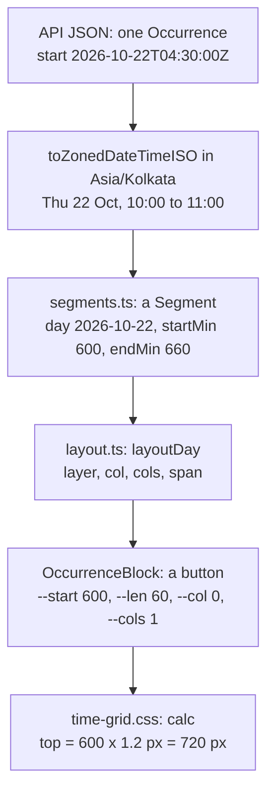
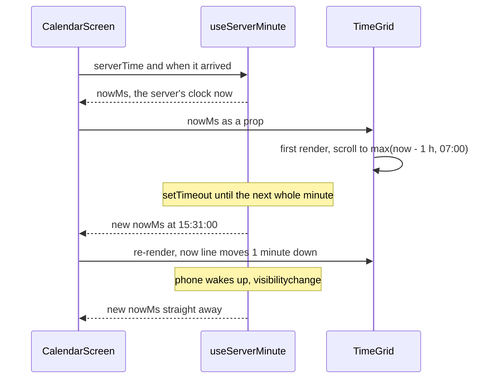

# Calendar grid (`apps/web/src/calendar/`)

> **Background:** [[Dates, times and instants]] · [[Time zones and daylight saving]] · [[Interval partitioning]] · [[Responsive layouts]] · [[CSS variables]] · [[Server state and caching]]

The home screen of v0.2: your week as a timetable, hours down the side, one column per day, one coloured block per class. On your phone it shows one day with a Mon–Sun strip on top; on a laptop it shows the whole week. It is **render-only**: it draws what the server computed and reports taps, but it can't change anything yet (cancelling arrives in v0.3). Why it's built this way and not with a library: [[Calendar grid choices]].

## Predict first

Before reading on, write down how *you* would draw this: the API sends "OOP (Java), start `2026-10-22T04:30:00Z`, end `2026-10-22T05:30:00Z`". How do you get from that string to a rectangle at the right height in Thursday's column? What if a club meeting overlaps it? What if the class was skipped?

## Files

| File | What it does |
|---|---|
| `model/dates.ts` | Pure date maths with Temporal: `mondayOf`, `weekDays`, `todayIn(zone, now)`, `minuteOfDayIn`, the ±8-week range (`navRange`, `stepAnchor`) and `initialScrollMinute` |
| `model/segments.ts` | Step 1 of drawing: occurrences (instants) → per-day **segments** in the display zone (`toSegments`) |
| `model/layout.ts` | Step 2: segments of one day → columns, by [[Interval partitioning]] (`layoutDay`) |
| `model/format.ts` | The words: `9 AM` on the axis, `10:00–11:00 AM` on blocks, `13–19 Oct 2026` in the title, and the sentence a screen reader hears |
| `model/palette.ts` | Group colour token → CSS variable (`teal` → `var(--palette-teal)`), grey for unknown tokens |
| `model/test-builders.ts` | Factories for the tests (`occurrence()`, `segment('A', '10:00', '11:00')`) |
| `model/*.test.ts` | The model's tests: plain Node, no browser ([[Testing pure code]]) |
| `TimeGrid.tsx` | The grid component and **`TimeGridProps`**, the adapter boundary (below) |
| `OccurrenceBlock.tsx` | One block: a `<button>` with data attributes and CSS variables; decides only the words |
| `time-grid.css` | All the grid's geometry and state styles, as calculations on CSS variables |
| `css-vars.ts` | `cssVars({ '--start': 600 })`: the one place that tells TypeScript a `--name` style is fine |
| `CalendarScreen.tsx` | The screen around the grid: title bar, Previous / Today / Next, the day strip, data fetching, loading / empty / error states |
| `use-server-minute.ts` | The server's clock, re-rendering once a minute (for the now line) |
| `use-media-query.ts` | `useMediaQuery('(min-width: 768px)')`: is this a wide screen right now? |

Outside the folder: `src/routes/index.tsx` (the `/` route: the session check, then `<CalendarScreen>`), `src/routes/__root.tsx` (a wide, full-height layout for routes that ask for it), `src/index.css` (the colours, light and dark) and `src/components/AccountMenu.tsx` (avatar → name, Sign out, deployed commit).

## One occurrence, from JSON to pixels



Take two blocks from the sample timetable's busy week. Thursday 22 Oct: OOP (Java) at 10:00 was **skipped**, and a made-up club meets 10:30–11:30.

1. **Instant → wall clock.** `start: '2026-10-22T04:30:00Z'` is a moment in UTC ([[Dates, times and instants]]). Temporal turns it into a `ZonedDateTime` in the **display zone**, your `profile.tzid` (`Asia/Kolkata`): 10:00 on Thursday 22 Oct. Never the phone's own zone: a laptop left on UTC still shows your class at 10:00.
2. **Wall clock → segment.** `toSegments` writes the minutes since midnight: OOP is `startMin 600, endMin 660`, the club `630, 690`. A block that crosses midnight (a 23:00–01:00 night shift) becomes **two** segments, one cut at the bottom of Monday (`continuesAfter`) and one at the top of Tuesday (`continuesBefore`). To find where a day starts it asks Temporal for the start of that day instead of adding 24 hours, because a daylight-saving day is 23 or 25 hours long ([[Time zones and daylight saving]]). Tests run this in New York on 8 March and 1 November 2026.

*From `apps/web/src/calendar/model/segments.ts` (shortened):*
```ts
  for (const occ of occurrences) {
    const start = Temporal.Instant.from(occ.start).toZonedDateTimeISO(zone);
    const end = Temporal.Instant.from(occ.end).toZonedDateTimeISO(zone);
    // …
    for (; Temporal.PlainDate.compare(day, lastDay) <= 0; day = day.add({ days: 1 })) {
      const dayStart = startOfDay(day, zone);
      if (compare(dayStart, end) >= 0) break; // it ended before this day began
      const nextDayStart = startOfDay(day.add({ days: 1 }), zone);
      if (!visible.has(day.toString())) continue;

      const pieceStart = later(start, dayStart);
      const pieceEnd = earlier(end, nextDayStart);
      const continuesBefore = compare(start, dayStart) < 0;
      const continuesAfter = compare(end, nextDayStart) > 0;

      const startMin = continuesBefore ? 0 : wallMinute(pieceStart);
      let endMin = compare(pieceEnd, nextDayStart) === 0 ? MINUTES_PER_DAY : wallMinute(pieceEnd);
      // …
      out.push({ occ, day: day.toString(), startMin, endMin, continuesBefore, continuesAfter });
    }
  }
```

What to notice:
- The two `toZonedDateTimeISO(zone)` lines are step 1: they read the instant on the display zone's wall clock. `zone` is passed in (`profile.tzid`); the phone's own zone is never asked.
- The inner loop walks one day at a time, and `startOfDay` asks Temporal where each day really begins instead of adding 24 hours.
- `later`/`earlier` clip the occurrence to this one day. `continuesBefore`/`continuesAfter` say "it started on an earlier day" or "it runs past the next midnight": the night shift gets one piece on each day.
- `wallMinute` is `hour * 60 + minute`, so 10:00 is 600. An end exactly at the next midnight becomes 1440, not 0.
- `if (!visible.has(...)) continue` drops days that aren't on screen. Remember it for `keepPreviousData` below.

3. **Segment → column.** `layoutDay` puts cancelled occurrences (OOP, skipped) in the **background layer**: full width, behind, never taking a column. The club is alone in the foreground, so `col 0, cols 1, span 1`. Because its cluster overlaps a cancelled block it also gets `overCancelled`, so it's drawn at 85% of the width and the stripes still show on the right: "my class was skipped and I used the hour" (D-077). With two *active* overlapping classes you'd get `cols 2`, each half the width. The algorithm: [[Interval partitioning]].

*From `apps/web/src/calendar/model/layout.ts` (shortened):*
```ts
export function layoutDay(segments: readonly Segment[]): Positioned[] {
  const sorted = [...segments].sort(compareSegments);
  const background = sorted.filter((s) => s.occ.status === 'cancelled');
  const foreground = sorted.filter((s) => s.occ.status !== 'cancelled');

  const out: Positioned[] = background.map((s) => ({
    ...s,
    layer: 'background',
    col: 0,
    cols: 1,
    span: 1,
    overCancelled: false,
  }));
  // …
}

// …
function packCluster(cluster: Segment[], background: Segment[]): Positioned[] {
  // …
  const cols = columnEnds.length;
  const overCancelled = cluster.some((s) => background.some((b) => overlaps(s, b)));
  // …
}
```

What to notice:
- One test picks the layer: `status === 'cancelled'` (a holiday, the prof, or your own skip). Moved and extra classes are `scheduled`, so they take columns like any other class.
- Background blocks get a fixed `col 0, cols 1, span 1`: the full width, whatever else is on.
- `overCancelled` asks "does any block in this cluster overlap any cancelled one?" (`some` means "at least one"). The club's answer is yes, because of OOP.

4. **Column → CSS variables.** `OccurrenceBlock` renders a `<button>` with `style="--start: 630; --len: 60; --col: 0; --cols: 1; --span: 1; --c: var(--palette-violet)"` and `data-over-cancelled`. React computes no pixels at all.

*From `apps/web/src/calendar/OccurrenceBlock.tsx` (shortened):*
```tsx
    <button
      type="button"
      className="tg-block"
      data-layer={block.layer}
      data-status={occ.status}
      // A cancellation with no reason (a group without attendance) looks "not held".
      data-reason={cancelled ? (occ.cancelReason ?? 'not_held') : undefined}
      // …
      data-over-cancelled={block.overCancelled || undefined}
      // …
      style={cssVars({
        '--start': block.startMin,
        '--len': block.endMin - block.startMin,
        '--col': block.col,
        '--cols': block.cols,
        '--span': block.span,
        '--c': groupColor(group?.colorToken),
      })}
```

What to notice:
- `|| undefined`: React leaves out an attribute whose value is `undefined`, so `data-over-cancelled` is either there or not, which is exactly what the CSS selector `[data-over-cancelled]` tests.
- `data-reason` is how CSS tells "Skipped" (dashed, coloured stripes) from "Cancelled" (grey stripes) for blocks with the same `data-status`.
- Every value in `style` is a number from the model (minutes, columns), never pixels. `cssVars` only exists to keep TypeScript happy ([[CSS variables]]). `groupColor` turns the token into `var(--palette-violet)`, or grey for an unknown group.

5. **CSS → pixels.** `time-grid.css` does the arithmetic ([[CSS variables]]): `top: calc(var(--start) * var(--px-per-min) * 1px)`. On a laptop `--px-per-min` is 1.2 (72 px an hour), so the club's top is 630 × 1.2 = 756 px into the column, and its height `max(22px, 60 × 1.2 px − 2px)` = 70 px. Its width is `span / cols` of the lane (85% here).

*From `apps/web/src/calendar/time-grid.css` (shortened):*
```css
.tg-block {
  --lane: 100%;
  position: absolute;
  z-index: 1;
  top: calc(var(--start) * var(--px-per-min) * 1px);
  /* At least 22 px, so even a 15-minute block can be read and tapped. */
  height: max(22px, calc(var(--len) * var(--px-per-min) * 1px - 2px));
  left: calc(var(--col) / var(--cols) * var(--lane));
  width: calc(var(--span) / var(--cols) * var(--lane) - 3px);
  /* … */
}

/* … */
.tg-block[data-over-cancelled] {
  --lane: 85%;
}
```

What to notice:
- `--lane` is the share of the day the cluster may use. The attribute from step 4 switches it from 100% to 85%, so for the club `left` = 0 / 1 × 85% = 0 and `width` = 1 / 1 × 85% − 3 px.
- `--px-per-min` isn't set in this file. `TimeGrid` sets it once on the whole grid: 1 in Day view, 1.2 in Week view (`PX_PER_MIN` in `CalendarScreen.tsx`).
- The `- 2px` and `- 3px` leave a small gap below and to the right of each block, so neighbours never touch.

## The adapter boundary: `TimeGridProps`

*From `apps/web/src/calendar/TimeGrid.tsx` (each prop's doc comment shortened to a note at the end of its line):*
```ts
export interface TimeGridProps {
  days: ISODate[];                 // 1 (Day view) or 7 (Week view)
  zone: IanaZone;                  // the display zone
  occurrences: Occurrence[];       // what the server computed
  groups: Record<string, GridGroup>; // id → name and colour token
  nowMs: number;                   // the server-corrected now
  pxPerMin?: number;               // zoom
  onOpen?: (occurrence: Occurrence) => void; // a block was tapped
}
```

An **adapter boundary** is a small, fixed interface between your code and a part you might swap out. The screen and the data code only ever talk to the grid through these seven props. If the custom grid ever blocks the dogfood for days, D-076's fallback is FullCalendar: you'd write a `FullCalendarGrid` that takes the *same* props and translates them, and nothing else in the app changes. That's also why the props are kept small: every prop is something a replacement would have to support too.

What is *inside* the boundary: segments, layout, colours, the now line, the scroll position. What is *outside*: which days to show, fetching, the clock, what a tap does.

Inside, the two model steps meet in one place:

*From `apps/web/src/calendar/TimeGrid.tsx`:*
```tsx
  const columns = useMemo(() => {
    const byDay = new Map<ISODate, Segment[]>(days.map((day) => [day, []]));
    for (const segment of toSegments(occurrences, days, zone))
      byDay.get(segment.day)?.push(segment);
    return days.map((day) => ({ day, blocks: layoutDay(byDay.get(day) ?? []) }));
  }, [occurrences, days, zone]);
```

What to notice:
- `toSegments` runs once for all the visible days; a `Map` (a lookup table, day → its segments) sorts the pieces into days; then `layoutDay` runs per day, because columns never cross from one day into the next.
- `useMemo(..., [occurrences, days, zone])` keeps the result and redoes the work only when one of those three changes, not when `nowMs` moves every minute.

## How each state looks

States differ by **pattern, border and words**, never only by colour, so they still read in grey-scale or for colour-blind eyes.

| State | Fill | Edge | Words | Example in the sample week |
|---|---|---|---|---|
| Scheduled | group colour at 20% over the surface | 3 px solid, group colour | title, time, room | Data Structures, Mon 8:00 |
| Not held (holiday or prof) | grey with grey diagonal stripes | faded group colour | title ~~struck through~~, a "Cancelled" pill | the three classes on Tue 20 Oct, "Holiday (example)" |
| Skipped (my choice) | faint group tint with group-coloured stripes | **dashed**, group colour | struck through, "Skipped" pill | OOP (Java), Thu 22 Oct |
| Moved | as scheduled | as scheduled | "MOVED" | Discrete Mathematics, moved to Sat 24 Oct |
| Extra (make-up) | as scheduled | as scheduled | "EXTRA" | OOP (Java), Sat 24 Oct 12:00 |

The state words sit on a solid pill so stripes never run under text. A block shows the most important lines first (title, time, state word, then room) and drops the room when it wouldn't fit whole. Everything, including the full subject, the group and any note, is in the button's `aria-label`: "OOP (Java), 10:00–11:00 AM, C-204, Classes · Sem 3 (sample), skipped".

## The screen around it (`CalendarScreen`)

**Two pieces of UI state** ([[Server state and caching]] calls this "UI state"):
- the **anchor date**: the day you're looking at. It starts as today in your zone. Previous and Next move it a day (Day view) or a week (Week view), and stop 8 weeks either side of this week: `stepAnchor` returns `null` at the edge, which disables the button.
- the **view**: `useMediaQuery('(min-width: 768px)')` → Week, else Day ([[Responsive layouts]]). Rotate a tablet and it switches; the anchor stays.

*From `apps/web/src/calendar/CalendarScreen.tsx` (shortened):*
```tsx
const WEEK_VIEW_QUERY = '(min-width: 768px)';
// …
  const view: CalendarView = useMediaQuery(WEEK_VIEW_QUERY) ? 'week' : 'day';
  const [anchor, setAnchor] = useState<ISODate>(today);
  // …
  const monday = mondayOf(anchor);
  const week = useMemo(() => weekDays(monday), [monday]);
  const days = useMemo(() => (view === 'week' ? week : [anchor]), [view, week, anchor]);
  // …
  const previous = stepAnchor(anchor, view, -1, today);
  const next = stepAnchor(anchor, view, 1, today);
```

What to notice:
- Only `anchor` is `useState`. `view` is worked out fresh on every render from the screen width, which is why rotating flips the view and leaves the anchor alone.
- `days` is what the grid gets: seven dates, or a list of one.
- `previous` and `next` are `null` at the ±8-week edge, and the buttons are drawn with `disabled={previous === null}`.

**Server state**, all through TanStack Query:
- `calendarQuery({ from: monday, to: sunday })`: always the **whole week** around the anchor, even in Day view. Tapping Tue → Wed on the strip costs no request, and the whole week is in the cache for later offline use.
- `placeholderData: keepPreviousData`: while next week loads, keep last week's answer instead of going back to "loading", so the screen doesn't flash. Last week's blocks never appear in this week's columns, because `toSegments` only keeps the visible days.
- **Prefetch**: after showing a week, it fetches the week before and after in the background (`queryClient.prefetchQuery`), so Previous and Next are instant. Never outside the ±8-week range.
- `staleTime: 60_000` on both: a week fetched less than a minute ago is shown without asking again. Without it, the prefetched week would be fetched a *second* time the moment you paged to it (TanStack Query judges freshness by the settings of whoever is asking).
- `groupsQuery` for colours and names; `meQuery` (already cached by the route) for `profile.tzid` and the server's clock.

*From `apps/web/src/calendar/CalendarScreen.tsx`:*
```tsx
  const calendar = useQuery({
    ...calendarQuery(weekWindow(monday)),
    staleTime: CALENDAR_STALE_MS,
    placeholderData: keepPreviousData,
  });
  const groups = useQuery(groupsQuery);

  const queryClient = useQueryClient();
  useEffect(() => {
    const range = navRange(today);
    for (const neighbour of [addDays(monday, -7), addDays(monday, 7)]) {
      if (!isWithin(neighbour, range)) continue;
      void queryClient.prefetchQuery({
        ...calendarQuery(weekWindow(neighbour)),
        staleTime: CALENDAR_STALE_MS,
      });
    }
  }, [monday, today, queryClient]);
```

What to notice:
- `weekWindow(monday)` is always Monday to Sunday, in both views. `...calendarQuery(...)` copies the shared definition (key and fetch, from `lib/queries.ts`), then this screen adds its own settings.
- `CALENDAR_STALE_MS` (60 000) appears in both calls: that's the "judged by whoever is asking" point above.
- The `useEffect` runs again whenever `monday` changes, so every week you land on fetches its two neighbours. `void` marks a promise the code deliberately doesn't wait for.

**What you see when things go wrong**: "Loading your week…" (first load), "No classes this week" (an empty week), an error box with **Try again** (the first load failed), or the week as last loaded plus an amber "Can't reach the server" line (a refresh failed but there's data). A 401 at any point sends you to `/login`.

## The now line and the first scroll



- **Whose clock?** The server's, estimated from `/api/v1/me` (`serverNow` in `lib/time.ts`, see [[Web app]]): a phone set 5 minutes fast still draws the line at the right place.
- **How often?** Once a minute, on a timer set to fire just after the next whole minute, not a once-a-second interval that would redraw the grid 60 times for nothing. Phones pause timers in background tabs, so when the app comes back to the front (the `visibilitychange` event) it reads the clock at once.

*From `apps/web/src/calendar/use-server-minute.ts` (shortened):*
```ts
  useEffect(() => {
    let timer: ReturnType<typeof setTimeout> | undefined;
    const tick = () => {
      const now = Date.now();
      setDeviceNow(now);
      const server = serverNow(serverTime, receivedAt, now) ?? now;
      // A few ms late, so the new minute has surely started when we look.
      timer = setTimeout(tick, msUntilNextMinute(server) + 20);
    };
    const onVisibilityChange = () => {
      if (document.visibilityState !== 'visible') return;
      clearTimeout(timer);
      tick();
    };
    // …
  }, [serverTime, receivedAt]);

  return serverNow(serverTime, receivedAt, deviceNow) ?? deviceNow;
```

`tick` sets a one-off `setTimeout` that calls `tick` again: a chain of single timers, each one aimed at the next whole minute (a `setInterval` can't do that: it repeats a fixed delay counted from whenever it started). The delay is measured on the *server's* clock (`serverNow`: the server's reading from `/me` plus the time that passed on the phone since), so the line moves when the server's minute changes. `setDeviceNow` is what makes React draw again; the hook returns the server time worked out from it.

- **Scroll on open**: `initialScrollMinute` = an hour before now, but never earlier than 07:00 (07:00 when today isn't on screen). At 15:30 that's 14:30. On a phone the grid shows about 13½ hours at once, so it can't put 14:30 at the top (that would leave empty space below midnight): it stops at the bottom, about 10:30 at the top, the closest it can get. It happens in `useLayoutEffect`, before the first paint, so you never see it start at midnight and jump.
- **"Today"** sets the anchor to today *and* bumps a `key` on `<TimeGrid>`. A changed `key` makes React throw the old grid away and mount a new one, which runs the first-scroll code again. That's React's standard way to say "start this component fresh".

*From `apps/web/src/calendar/model/dates.ts`, `TimeGrid.tsx` and `CalendarScreen.tsx` (shortened):*
```tsx
// apps/web/src/calendar/model/dates.ts
export function initialScrollMinute(nowMinute: number | null): number {
  if (nowMinute === null) return DEFAULT_SCROLL_MINUTE;
  return Math.max(nowMinute - 60, DEFAULT_SCROLL_MINUTE);
}

// apps/web/src/calendar/TimeGrid.tsx
  const scroller = useRef<HTMLDivElement>(null);
  const [firstMinute] = useState(() => initialScrollMinute(nowMinute));
  useLayoutEffect(() => {
    if (scroller.current !== null) scroller.current.scrollTop = firstMinute * pxPerMin;
  }, [firstMinute, pxPerMin]);

// apps/web/src/calendar/CalendarScreen.tsx
            onClick={() => {
              setAnchor(today);
              setGridKey((key) => key + 1);
            }}
            // …
        <TimeGrid
          key={gridKey}
```

What to notice:
- `DEFAULT_SCROLL_MINUTE` is 07:00, 420 minutes. `Math.max` picks the later of "an hour before now" and 07:00: at 15:30 (930) that's 870, 14:30.
- `useState(() => ...)` with no setter used: the first minute is worked out once, when the grid appears, so the minute ticks never yank your scroll back.
- `scrollTop` is in pixels (minutes × pixels per minute). Asked for more than it can scroll, the browser stops at the bottom: the 10:30 case above.
- The "Today" button's `setGridKey` changes `key`, so React builds a new `TimeGrid` and its `useState` runs again.

## The layout around the screen

`/login` is a narrow centred column; the calendar needs the whole window. The `/` route declares `staticData: { wide: true }`, and `__root.tsx` reads it with `useMatches()`: wide routes get a full-height, up-to-72rem column (`h-dvh`, so the grid fills what's under the title bar and scrolls *inside* itself), padded clear of the notch and the gesture bar. Everything else keeps the v0.0 column.

Sign out and the deployed commit (the v0.0 demo: merge a PR, see the new commit) moved behind the **avatar**: a native HTML popover (`popover` and `popoverTarget` attributes). The browser opens it, closes it on Escape or a tap outside, and draws it above everything, with no JavaScript of ours.

## Tested, and how

- **Model** (55 of the 149 tests in `apps/web`, about 0.4 s in all, run under UTC, Asia/Kolkata and New York with `pnpm --filter @tasks/web test:tz`): date helpers and the ±8-week edges, segments across midnight and both 2026 New York clock changes, every layout case from 09 §7 (L1–L5) plus 500 random days checked for "no overlapping blocks share a column" and "columns = deepest overlap", the 12-hour labels, the palette fallback, the minute timer.
- **Components**: no unit tests (they'd need a fake DOM, and a fake DOM has no layout, so geometry bugs would pass). Checked instead in a real browser against a mock API serving the sample timetable: phone and laptop sizes, light and dark, the busy week of 19 Oct, the ±8-week stops, loading, empty, error and stale-data states, and keyboard focus.

## Check yourself

- Predict: a class runs 23:00–01:00 India time on Monday. How many `<button>`s draw it in the Week view, which corners are square, and what does each one's `aria-label` say about the time?
- Trace: you tap Next in the Week view. Which queries run, which come from the cache, and why doesn't the screen go blank while the new week loads?
- Break it: in `layout.ts`'s `packCluster`, change `end <= s.startMin` to `end < s.startMin`. Predict what you'd see on a day with 10:00–11:00, 10:30–11:30 and 11:00–12:00, then run the tests: which one fails, and why is "touching isn't overlapping" the whole difference?
- Your phone's clock is 3 minutes slow. Where is the now line, and which file makes that true?
