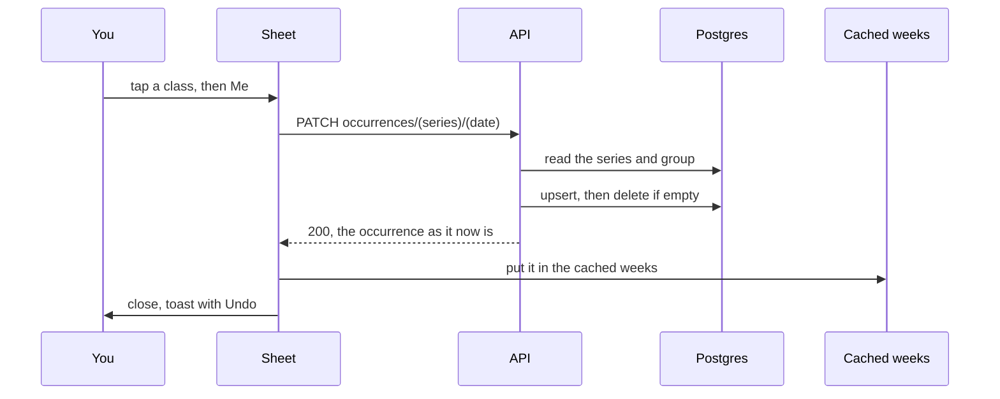

# Cancelling one occurrence

> **Background:** [[Upserts and row locks]] · [[Transactions]] · [[Idempotency and retries]] · [[Server state and caching]] · [[Dialogs and toasts]]

The first thing v0.3 lets you *change* from the calendar. Tap a class and a sheet opens for that one occurrence. In a group that tracks attendance you cancel it with **Prof** (it didn't happen: not held) or **Me** (it happened, you didn't go: skipped). In a group without attendance, one **Not today** cancels it with no reason. The class stays on the calendar, striped, with the reason in words. **Restore** and **Change reason** work at any time, and an 8-second **Undo** catches a mis-tap. Ticket #8; why the words and buttons are what they are: [[Cancel and group choices]].

## Predict first

You tap **Me** on Wednesday's Data Structures. What row, if any, does the server write, and to which table? Now you tap **Restore** on it. Does a row remain? What if that occurrence also had a note, "Bring the lab manual"?

## Files

| File | What it does |
|---|---|
| `packages/core/src/api.ts` | `paths.occurrences`: the URL both sides share |
| `packages/core/src/schemas.ts` | `updateOccurrenceSchema`: the body, `{ status, cancelReason }`, and "a reason needs a cancel" |
| `packages/core/src/recurrence/expand.ts` | `occurrenceOn`: one occurrence by its original date, computed exactly as `expand()` would |
| `apps/api/src/routes/occurrences.ts` | The route: checks the path, parses the body, answers 200 or 404 |
| `apps/api/src/calendar/occurrences.ts` | `changeOccurrence`: finds the series and group, checks the date, writes, computes the answer |
| `apps/api/src/calendar/overrides.ts` | `setCancellation`: the upsert, then "delete it if it says nothing" |
| `apps/web/src/calendar/model/sheet.ts` | `sheetActions`: which buttons the sheet shows. Pure, tested in Node |
| `apps/web/src/calendar/OccurrenceSheet.tsx` | The sheet: a native `<dialog>`, bottom sheet on a phone, centred from 768 px |
| `apps/web/src/components/Toast.tsx` | The app's first toast, with one optional button |
| `apps/web/src/lib/mutations.ts` | `changeOccurrence`, `putOccurrence`, `useChangeOccurrence` |
| `apps/web/src/calendar/CalendarScreen.tsx` | Holds which sheet is open and the toast; Undo lives here |

## From tap to stripes



## The request

An occurrence isn't a row ([[Recurrence engine]]: occurrences are computed every time). So the URL names it the way the engine does, by its series and the date the rule generated, its **original date**:

```text
PATCH /api/v1/occurrences/0198…/2026-10-14
{ "status": "cancelled", "cancelReason": "skipped" }     Me
{ "status": "cancelled", "cancelReason": "not_held" }    Prof
{ "status": "cancelled", "cancelReason": null }          Not today
{ "status": null,        "cancelReason": null }          Restore, and Undo
```

`status: null` means "inherit from the series", which is "scheduled". A reason with no cancel (`{ status: null, cancelReason: "skipped" }`) is a 422 on `cancelReason`. The server doesn't check the reason against the group's attendance setting: that setting only decides which buttons the sheet shows.

It's a `PATCH` that *sets* a state, not one that toggles, so sending it twice leaves the same result and the same answer. A retry on bad Wi-Fi is harmless ([[Idempotency and retries]]).

The answers:

- **200** with the occurrence as the engine now computes it.
- **404** `not_found` when the series doesn't exist, isn't yours, or never produces that date: a Tuesday for a Mon/Wed/Fri class, a day before its first day, after its last day, or after its group's last day. A path that can't be a series id or a date gets the same 404.
- **422** `validation_failed` for a body that breaks the schema.

## The write: one row, or none

What was said about one occurrence lives in `occurrence_override`, at most one row per (series, original date). The client never knows whether that row exists. The server makes it say what you asked, creating it if needed, and deletes it when nothing is left on it:

*From `apps/api/src/calendar/overrides.ts`:*
```ts
  const [row] = await scope.tx
    .insert(occurrenceOverride)
    .values({ userId: scope.userId, seriesId, kind: 'modified', originalDate, ...change })
    .onConflictDoUpdate({
      target: [occurrenceOverride.seriesId, occurrenceOverride.originalDate],
      set: { ...change, updatedAt: new Date() },
      // Never false here: the series is this user's, so its overrides are too (D-034).
      setWhere: eq(occurrenceOverride.userId, scope.userId),
    })
    .returning();
  // …
  const emptied = await scope.tx
    .delete(occurrenceOverride)
    .where(
      and(
        eq(occurrenceOverride.userId, scope.userId),
        eq(occurrenceOverride.id, row.id),
        saysNothing,
      ),
    )
    .returning({ id: occurrenceOverride.id });
```

What to notice:

- `onConflictDoUpdate` is drizzle's spelling of `insert … on conflict … do update`, the upsert. Two requests for one class at the same moment can't both insert and trip the unique constraint ([[Upserts and row locks]]).
- `saysNothing` is "every field that says something is null": status, reason, a move, a length, a confirmation, a note. It's built from the table's columns minus the ones that only identify the row, so a column added in v0.3b counts by itself.
- So a restore on an override that holds only a cancel deletes it, and a restore on one that also holds a note just clears the status. The note survives, which is what "Restore keeps anything else said about the occurrence" means.
- The delete is a second statement. The ticket asked for one; Postgres can't delete in the same statement a row that statement's upsert just wrote, so the delete runs next, inside the same transaction, while the upsert's row lock keeps everyone else out. [[Upserts and row locks]] has the full argument.
- `setWhere` and the delete's `userId` check are the "filter by user too" habit from [[Row-level security in our database]]. Row-level security would stop a foreign row anyway; one forgotten filter must never be a leak.

## The answer: computed, not guessed

After the write, the route doesn't build the answer by hand. It asks the engine:

*From `apps/api/src/calendar/occurrences.ts`:*
```ts
  const override = await setCancellation(scope, seriesId, originalDate, change);
  // Holidays and days off (`day_exception`) arrive in v0.3b, as in the calendar route.
  return occurrenceOn({ series, group, override, dayExceptions: [] }, originalDate);
```

`occurrenceOn` runs the same layers `expand()` runs, for one date. So the answer is byte for byte what `GET /api/v1/calendar` would show, and a test checks exactly that, including for an occurrence moved to another day.

The phone then puts that answer straight into its cache, in every cached week that shows it:

*From `apps/web/src/lib/mutations.ts`:*
```ts
export function putOccurrence(queryClient: QueryClient, occurrence: Occurrence): void {
  queryClient.setQueriesData<CalendarResponse>({ queryKey: ['calendar'] }, (window) => {
    if (!window?.occurrences.some((o) => o.key === occurrence.key)) return window;
    return {
      ...window,
      occurrences: window.occurrences.map((o) => (o.key === occurrence.key ? occurrence : o)),
    };
  });
}
```

Until now every write *invalidated* the calendar ([[Server state and caching]]): "this is stale, fetch it again". Here the server already sent the new truth, so we write it in and fetch nothing. `setQueriesData` with the `['calendar']` prefix visits every cached window; a week without that occurrence is returned unchanged, which tells TanStack Query nothing changed there.

## The sheet: which buttons

Which buttons show is one pure function of three things: the occurrence, its group's attendance setting, and any change still on its way to the server.

*From `apps/web/src/calendar/model/sheet.ts`:*
```ts
  const status = pending ? (pending.status ?? 'scheduled') : occ.status;
  const reason = pending ? (pending.cancelReason ?? null) : occ.cancelReason;

  if (status !== 'cancelled') {
    return { ...NOTHING, cancel: group.attendance ? [PROF, ME] : [NOT_TODAY] };
  }
  return {
    state: reasonInWords(reason, group.attendance),
    cancel: [],
    restore: RESTORE,
    changeReason: group.attendance
      ? [PROF, ME].filter((b) => b.change.cancelReason !== reason)
      : [],
  };
```

| The class | Attendance group | Other group |
|---|---|---|
| On | Prof, Me | Not today |
| Prof cancelled | "Prof cancelled", Restore, change to Me | "Prof cancelled", Restore |
| I skipped | "I skipped", Restore, change to Prof | "I skipped", Restore |
| Cancelled, no reason | "No reason given", Restore, change to Prof or Me | "Cancelled", Restore |

What to notice:

- **Restore never shows on a class that's on.** The state decides; there's no separate "can restore" flag to fall out of step.
- **A saved reason is shown as saved.** Turn a group's attendance off and its "I skipped" still reads "I skipped". Settings never rewrite history.
- **No reason is never guessed.** A Not today cancel in a group that later tracks attendance reads "No reason given", and Change reason offers both Prof and Me. The calendar keeps drawing it like "not held".
- **Prof and Me keep their first word.** Under each sits a small line ("Class didn't happen", "I didn't go"); ticket #15 makes the line rotate, never the word, so the right button is found at 8 am without reading.
- **A change in flight shows as done.** While the request is out, the sheet already shows the state it will leave, with every button disabled.

The sheet itself is a native `<dialog>` opened with `showModal()`: focus, Escape and the inert page behind come from the browser ([[Dialogs and toasts]]). "Edit all Data Structures…" at the bottom links to the series form, which is what tapping a class used to do.

## Undo

After every cancel (not after Change reason, not after Restore) a toast says "Data Structures · I skipped" with **Undo**. Undo sends exactly Restore's body. It's greyed out offline, because writes are online-only until ticket #9 queues them.

The offer is made from the mutation hook, not from the `mutate` call:

*From `apps/web/src/calendar/OccurrenceSheet.tsx`:*
```tsx
  const mutation = useChangeOccurrence((updated, sent) => {
    if (sent.change.status === 'cancelled' && occurrence.status !== 'cancelled') {
      onCancelled(updated);
    }
  });
```

The first version used the call's own `onSuccess`, which TanStack Query skips once the screen that made the call is gone. The review spotted it: close the sheet with Escape while the request is out, and you got the stripes without the Undo. [[Dialogs and toasts]] explains the two kinds of callback.

## What the tests prove

Over HTTP against a real Postgres (`apps/api/src/routes/occurrences.test.ts`):

- cancel, change reason, Not today and restore, each answering what the calendar then shows;
- the override row gone after a restore, kept when it holds a note, and a moved occurrence keeping its move;
- the same body twice gives the same answer and leaves the same rows;
- six requests at once for one class, then four restores, then cancels and restores mixed: all 200, never an empty row left;
- 404 for a missing series, an id or date that can't be one, a date off the rule, before the first day, after the last day, after the group's last day;
- 422 for a reason without a cancel, and for unknown values;
- in `calendar-isolation.test.ts`, bob's `PATCH` on alice's class: 404, and her calendar unchanged.

In plain Node: the action table above (`sheet.test.ts`), the reason words (`format.test.ts`), and `putOccurrence` writing into the right weeks without refetching (`mutations.test.ts`). The core suite checks `occurrenceOn` against `expand()`.

## Check yourself

1. Why does the URL name an occurrence by series id and original date, not by an override id?
2. You restore a class whose override also holds a note. What happens to the row?
3. Why can the phone skip refetching the week after a cancel, when every series write refetches?
4. A Health run was cancelled with Not today, then Health turned attendance on. What does the sheet show?
5. Why does the Undo offer live on the hook rather than on `mutate`?
