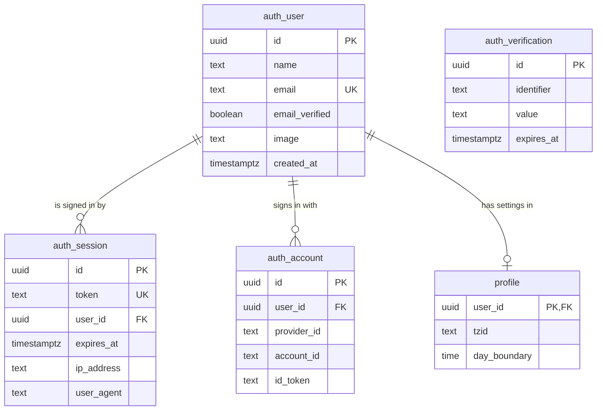
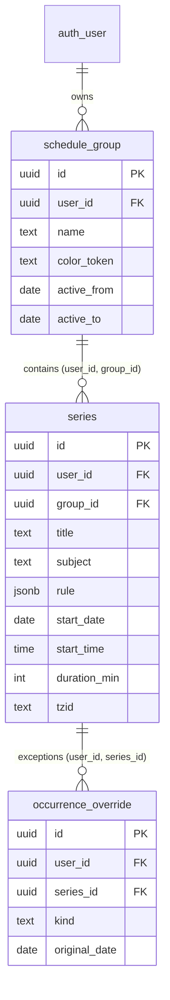
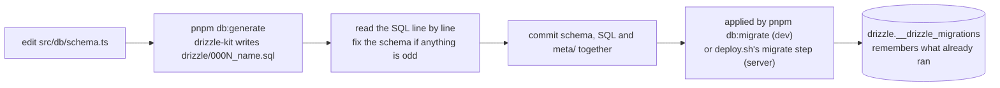

# Database and migrations

> **Background:** [[Postgres and SQL basics]] · [[Database migrations]] · [[Connection pools]]

How the API stores data: one Postgres 18 database, eight tables, three migrations. v0.0 made the five identity and settings tables; v0.2 added the three calendar tables and row-level security. Concepts behind it: [[Database migrations]], [[Connection pools]], [[Row-level security]]. Choices: [[API stack choices]], [[v0.2 contracts]].

New to databases? Read [[Postgres and SQL basics]] first: tables, keys, indexes, transactions, and how to open `psql` on our database.

## Files

| File | What it does |
|---|---|
| `compose.yaml` (repo root) | Development Postgres: image `postgres:18.6`, user/password/database `tasks`, port `127.0.0.1:5432`, a named volume, a health check |
| `apps/api/drizzle.config.ts` | Settings for drizzle-kit: schema file in, `drizzle/` out |
| `apps/api/src/db/schema.ts` | The tables, written in TypeScript |
| `apps/api/drizzle/0000_init.sql` | v0.0: the auth tables and `profile`, generated from the schema, reviewed and committed |
| `apps/api/drizzle/0001_calendar_tables.sql` | v0.2: `schedule_group`, `series`, `occurrence_override`, generated the same way |
| `apps/api/drizzle/0002_calendar_rls.sql` | v0.2: row-level security, **written by hand** (drizzle-kit can't express it). Read its comments: they explain each statement |
| `apps/api/drizzle/meta/` | drizzle-kit's bookkeeping: a snapshot of the schema after each migration, and a journal listing them in order. Generated; commit it, never edit it |
| `apps/api/src/db/pool.ts` | `createPool` (the [[Connection pools]] settings) and `pingDatabase` (`select 1`, used by `/healthz`) |
| `apps/api/src/db/client.ts` | `createDb(pool)`: Drizzle on top of the pool; `Database` is its type |
| `apps/api/src/db/migrations.ts` | `runMigrations(pool)`; finds `drizzle/` relative to its own file |
| `apps/api/src/db/migrate.ts` | The `db:migrate` command |
| `apps/api/src/db/user-scope.ts` | `withUser`: runs queries in one transaction as one user, so row-level security applies ([[Row-level security in our database]]) |
| `apps/api/src/db/pg-errors.ts` | Reads Postgres' error codes (`23505` duplicate, `23503` foreign key, `23514` check) out of Drizzle's wrapped errors |
| `apps/api/src/db/schema.test.ts` | Checks the migrations against real Postgres: defaults, cascades, uniqueness, the rule CHECKs, the composite foreign keys, and that row-level security is on and works |

## The tables

How the tables connect (only the important columns shown). `||--o{` reads "one user has zero or more sessions"; `||--o|` reads "zero or one profile".



| Table | One row per | Written by | Notes |
|---|---|---|---|
| `auth_user` | person who signed in | Better Auth | `email` unique (Better Auth lower-cases it). Email is an attribute, not the key: KIIT addresses die after graduation |
| `auth_session` | signed-in browser | Better Auth | `token` unique (looked up on every request), `expires_at`, `ip_address`, `user_agent` |
| `auth_account` | way of signing in (your Google account) | Better Auth | `(provider_id, account_id)` unique: one Google identity → one user. Holds Google's tokens. `password` stays empty: passwords are off |
| `auth_verification` | short-lived secret | Better Auth | Holds the OAuth `state` and PKCE verifier for 10 minutes during sign-in ([[OAuth sign-in]]) |
| `profile` | user | our code | `tzid` (default `Asia/Kolkata`), `day_boundary` (default `04:00`) |

### The calendar tables (v0.2)



| Table | One row per | Notes |
|---|---|---|
| `schedule_group` | group ("Classes · Sem 3") | `color_token` must be one of the ten palette names; `active_to` null = open-ended |
| `series` | repeating class ("DS, Wednesdays 10:00, 60 min") | `rule` is JSON (`{"freq": "weekly", "interval": 1, "byDay": ["WE"]}`); `start_time` is a wall-clock time in `tzid`, never an instant |
| `occurrence_override` | thing said about one occurrence | Unique on `(series_id, original_date)`; empty until v0.3's cancel button |

Three things are new compared with the v0.0 tables:
- **CHECK constraints**: rules Postgres checks on every write. `series` refuses a `freq` other than daily or weekly, a weekly rule with no days, an end date before the start, a duration outside 1–1440 minutes. The API's zod rules catch all of these first; the CHECKs are the last line of defence if some future code forgets.
- **Composite foreign keys**: a series points at the *pair* `(user_id, group_id)` in `schedule_group`, not just `group_id`. So a series can only belong to a group of the same user, and the database refuses "my class in your group" by itself. `schedule_group` has a unique `(user_id, id)` so the pair can be pointed at.
- **Row-level security** on all three ([[Row-level security in our database]]): even a query with no `where` sees only the current user's rows.

The first two, as they're written in the schema:

*From `apps/api/src/db/schema.ts` (shortened):*
```ts
// in scheduleGroup: the pair (user_id, id) is unique, so it can be pointed at
    unique('schedule_group_user_id_id_unique').on(table.userId, table.id),
// in series:
    foreignKey({
      name: 'series_group_fk',
      columns: [table.userId, table.groupId],
      foreignColumns: [scheduleGroup.userId, scheduleGroup.id],
    }).onDelete('cascade'),
    // …
    check('series_rule_freq', sql`${table.rule}->>'freq' in ('daily', 'weekly')`),
    // …
    check('series_duration_min', sql`${table.durationMin} between 1 and 1440`),
```

What to notice:
- `columns: [userId, groupId]` must match `foreignColumns: [scheduleGroup.userId, scheduleGroup.id]` *as a pair*: your `user_id` with Bob's group id is a pair that doesn't exist, so Postgres refuses it.
- ``sql`…` `` is Drizzle's way of writing raw SQL, and `${table.rule}` becomes the column's name. `->>'freq'` is Postgres for "the `freq` field of this JSON, as text".
- Every constraint has a name (`'series_duration_min'`). When Postgres refuses a write, its error names the constraint, and `calendar/constraints.ts` turns that name into a 422 for the right field (`durationMin`).

Deleting a group deletes its series, and deleting a series deletes its overrides (`on delete cascade`).

What's **not** stored: the occurrences themselves. "DS on 14 Oct" is computed from the series on every request ([[Recurrence engine]]).

Every table has `created_at` and `updated_at` as `timestamptz`: an instant, stored in UTC, never a wall-clock time ([[Dates, times and instants]]).

Every `user_id` column is a **foreign key** to `auth_user.id` with `on delete cascade`. A foreign key is a promise the database enforces: "this value must exist over there". You can't create a profile for a user who doesn't exist. Cascade means deleting a user deletes their sessions, accounts and profile in the same statement, so nothing is left pointing at nobody. `schema.test.ts` checks it.

Here is `profile` in TypeScript, then the SQL drizzle-kit generated from it:

*From `apps/api/src/db/schema.ts`:*
```ts
export const profile = pgTable('profile', {
  userId: uuid('user_id')
    .primaryKey()
    .references(() => authUser.id, { onDelete: 'cascade' }),
  /** IANA zone used for "today" and the calendar, e.g. `Asia/Kolkata`. */
  tzid: text('tzid').notNull().default(DEFAULT_PROFILE.tzid),
  /** When one day rolls over into the next, as a wall time in `tzid` (D-035). */
  dayBoundary: time('day_boundary').notNull().default(DEFAULT_PROFILE.dayBoundary),
  createdAt: createdAt(),
  updatedAt: updatedAt().$onUpdate(() => new Date()),
});
```

*From `apps/api/drizzle/0000_init.sql` (shortened):*
```sql
CREATE TABLE "profile" (
	"user_id" uuid PRIMARY KEY NOT NULL,
	"tzid" text DEFAULT 'Asia/Kolkata' NOT NULL,
	"day_boundary" time DEFAULT '04:00' NOT NULL,
	"created_at" timestamp with time zone DEFAULT now() NOT NULL,
	"updated_at" timestamp with time zone DEFAULT now() NOT NULL
);
-- …
ALTER TABLE "profile" ADD CONSTRAINT "profile_user_id_auth_user_id_fk" FOREIGN KEY ("user_id") REFERENCES "public"."auth_user"("id") ON DELETE cascade ON UPDATE no action;--> statement-breakpoint
```

What to notice:
- `.references(() => authUser.id, { onDelete: 'cascade' })` became the separate `ALTER TABLE … FOREIGN KEY … ON DELETE cascade` at the end of the file: drizzle-kit creates every table first and adds the foreign keys after, so the order of the tables doesn't matter.
- `DEFAULT_PROFILE.tzid` (from `packages/core`) was copied into the SQL as the plain text `'Asia/Kolkata'` when the migration was generated. Changing it in core later changes nothing in the database until a new migration is generated.
- `.$onUpdate(() => new Date())` has no SQL at all: Drizzle fills `updated_at` itself when *our code* updates a row. An `UPDATE` typed into psql leaves it alone.

**Indexes** (a sorted copy of one column that makes lookups fast, like the index at the back of a textbook) exist on every `user_id`, on `auth_session.token` and on `auth_verification.identifier`: the columns queries search by.

### Why the `auth_` prefix?

Better Auth would call its tables `user`, `session`, `account` and `verification`. In v1 the app gets *work sessions* (a timer running while you study), and "session" would mean two things. D-058 renamed them; the prefix also makes the identity tables easy to spot and keep separate from the app's own ones (the boundary a future shared login at `accounts.ahmedatif.in` would cut along, D-063).

### Why UUIDv7 ids?

An id like `01a1307f-b42d-7297-9423-bf3e74a4aa70`. A **UUID** is a 128-bit random-looking id that any computer can make without asking the database, with no realistic chance of two being equal. **Version 7** starts with the current time in milliseconds, so ids made later sort later (Postgres's index stays tidy, and "newest first" is just "biggest id first"). The app makes them (`uuid` package, through Better Auth's `generateId`); the columns also default to Postgres 18's built-in `uuidv7()` in case a row is ever typed in by hand. Alternatives in [[API stack choices]].

```ts
// apps/api/src/db/schema.ts: every table's id column
const id = () => uuid('id').primaryKey().default(sql`uuidv7()`);
// apps/api/src/auth/auth.ts: the ids Better Auth makes for its rows
      database: { generateId: () => uuidv7() },
```

Two different `uuidv7()`s: in `schema.ts` it's SQL text (inside ``sql`…` ``), copied into each migration as `DEFAULT uuidv7()` for Postgres to run; in `auth.ts` it's the `uuid` package's function (`import { v7 as uuidv7 } from 'uuid'`), run by Node. Same kind of id either way.

## Naming

TypeScript uses camelCase (`emailVerified`), Postgres uses snake_case (`email_verified`). `schema.ts` maps each one explicitly: `emailVerified: boolean('email_verified')`. Better Auth finds columns by the TypeScript names, so those must match its own field names.

*From `apps/api/src/db/schema.ts`:*
```ts
export const authUser = pgTable('auth_user', {
  id: id(),
  name: text('name').notNull(),
  email: text('email').notNull().unique(),
  emailVerified: boolean('email_verified').notNull().default(false),
  image: text('image'),
  createdAt: createdAt(),
  updatedAt: updatedAt(),
});
```

Each line reads `nameInTypeScript: columnType('name_in_postgres')`, then the rules: `.notNull()`, `.unique()` and `.default(false)` become `NOT NULL`, `UNIQUE` and `DEFAULT false` in the SQL. `id()`, `createdAt()` and `updatedAt()` are small helpers at the top of the file, so every table spells those columns the same way.

## Changing the schema (the routine)



1. Edit `src/db/schema.ts`.
2. `pnpm --filter @tasks/api db:generate --name add-reminders` writes the next file, e.g. `drizzle/0003_add-reminders.sql`.
3. **Read the SQL line by line.** It is what will run on your real data. Look for: a `DROP` you didn't mean, a `NOT NULL` column added to a table that already has rows (fails), a missing index.
4. `pnpm db:migrate`, run the tests, commit the schema change, the SQL and `meta/` together.

   `db:migrate` (and the server's deploy step) ends up here:

   *From `apps/api/src/db/migrations.ts`:*
   ```ts
   export const MIGRATIONS_FOLDER = path.resolve(import.meta.dirname, '../../drizzle');

   export async function runMigrations(pool: Pool): Promise<void> {
     await migrate(createDb(pool), { migrationsFolder: MIGRATIONS_FOLDER });
   }
   ```

   `import.meta.dirname` is the folder this file sits in (`apps/api/src/db`), so `../../drizzle` is always `apps/api/drizzle`, whichever folder you run the command from. `migrate` is Drizzle's: it reads the journal in `drizzle/meta/`, checks `drizzle.__drizzle_migrations` for what this database already has, and runs only the newer files, in order.

Never edit a migration that has already been applied anywhere: write a new one.

**SQL drizzle-kit can't write** (row-level security, roles, functions): `pnpm --filter @tasks/api db:generate --custom --name <what>` makes an empty numbered file that you fill by hand, the way `0002_calendar_rls.sql` was made. It's applied in order like the others. Each statement is separated by a `--> statement-breakpoint` line, because Drizzle runs them one by one.

*From `apps/api/drizzle/0002_calendar_rls.sql` (shortened):*
```sql
CREATE FUNCTION app_current_user_id() RETURNS uuid
  LANGUAGE sql STABLE
  AS $$ SELECT nullif(current_setting('app.user_id', true), '')::uuid $$;
--> statement-breakpoint
-- …
ALTER TABLE series ENABLE ROW LEVEL SECURITY;
--> statement-breakpoint
ALTER TABLE series FORCE ROW LEVEL SECURITY;
--> statement-breakpoint
CREATE POLICY series_owner ON series
  USING (user_id = app_current_user_id())
  WITH CHECK (user_id = app_current_user_id());
```

To Postgres, `--> statement-breakpoint` is just a comment (anything after `--`); to Drizzle it's the cut between two statements. What the function and the policy mean is in [[Row-level security in our database]].

## Check yourself
- You delete Alice's row from `auth_user` in psql. Which other rows disappear, and which rule makes it happen?
- `auth_session.token` has a unique constraint. Besides preventing duplicates, why does that make every API request faster?
- You add `week_starts smallint not null` to `profile` and generate a migration. It works on the test database but fails in production. Why, and what would you change?
- Why is `drizzle/` committed to git, when it's generated from `schema.ts`?
- A bug makes the API insert a series with your `user_id` but Bob's `group_id`. Which rule refuses it, and would it still be refused if row-level security were switched off?
