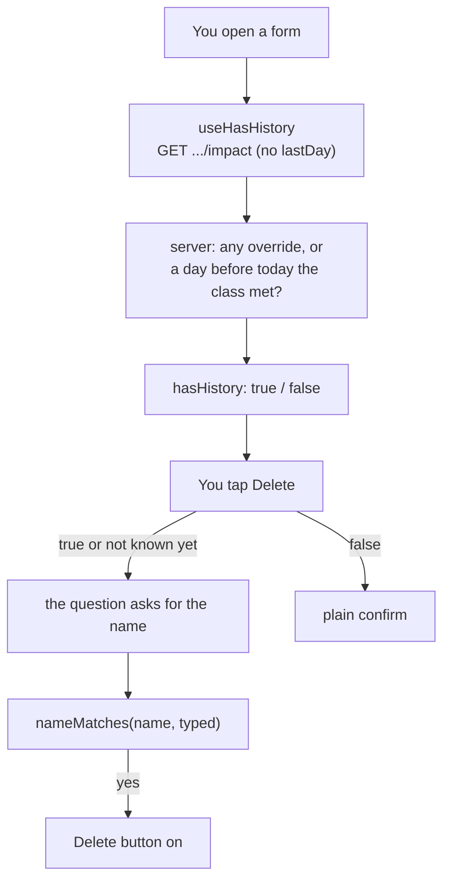

# Delete with the typed name

> **Background:** [[Archive and last days]] · [[Series form]] · [[Groups screen]] · [[Shared form pieces]] · [[Validating input with schemas]] · [[Testing pure code]]

Delete used to be two taps: "Delete this class", then "Delete". Two quick taps could take a whole semester with them. Now the form first asks the server whether deleting would **lose anything**, and if it would, you type the name of the class or group to confirm. If nothing would be lost, a plain confirm is enough. Delete always offers **Archive instead** next to it, because Archive keeps everything up to yesterday. Groups can now be deleted from their own form too. This is ticket #14, built in PR #25. Why it's built this way: [[Delete choices]].

## Predict first

Made-up data, with today as Tue 10 Nov 2026. "Physics (sample)" meets Mon and Wed at 10:00 since Tue 1 Sep. "Classes · Sem 3" is a group that holds it.

1. You open Physics (sample) and tap Delete. Does it ask for the name?
2. A second class, "Chemistry (sample)", starts Mon 16 Nov and has no cancels. Does Delete ask for the name?
3. You give Chemistry (sample) a cancel on Wed 18 Nov, which is in the future. Now?
4. You open the group "Classes · Sem 3" and type `classes sem 3`. Does the Delete button turn on?
5. A group is named 🎓 and nothing else. You type 🎓. Does it match? What if the box is empty?

## Files

| File | What it does |
|---|---|
| `packages/core/src/api.ts` | `Impact.hasHistory`: the new answer |
| `packages/core/src/days.ts` | `dayBefore`, now shared by Archive and by the history check |
| `apps/api/src/calendar/impact.ts` | `metBefore`, and `hasHistory` in `groupImpact` and `seriesImpact` |
| `apps/api/src/profile/profile.ts` | `todayOf`: the user's today, read on the server |
| `apps/api/src/routes/groups.ts`, `series.ts` | The impact routes work out `today` before they ask |
| `apps/web/src/lib/name-match.ts` | `nameMatches`: the typed-name check |
| `apps/web/src/lib/impact.ts` | `useHasHistory`: asks the read with no question |
| `apps/web/src/lib/mutations.ts` | `deleteGroup` and `useDeleteGroup`, next to `deleteSeries` |
| `apps/web/src/components/form-controls.tsx` | `DeleteSection`: the question both forms share |
| `apps/web/src/groups/GroupForm.tsx`, `series/SeriesForm.tsx` | Both forms use it |
| `apps/api/src/routes/archive.test.ts`, `apps/web/src/lib/name-match.test.ts` | The tests (see the end) |



## What counts as history: `hasHistory`

The impact read from #12 now answers one more thing:

*From `packages/core/src/api.ts` (the shape):*
```ts
  hasHistory: boolean;
```

It is `true` when deleting would lose anything. Two things count, either one is enough:
- **Any override.** A cancel, a note, an extra class. Overrides are things you did on purpose; deleting the class deletes them.
- **A day before today that the class met.** A class that already happened has attendance and a past on the calendar.

*From `apps/api/src/calendar/impact.ts`:*
```ts
function metBefore(series: Series, group: ScheduleGroup, today: ISODate): boolean {
  const yesterday = dayBefore(today);
  if (series.startDate > yesterday) return false;
  return expandDates(series, { from: series.startDate, to: yesterday }, group).length > 0;
}
```

What to notice:
- **Yesterday, the same as Archive.** The day you delete in doesn't count as the past, so a class that starts today has no history, which matches Archive refusing a class that starts today ([[Archive and last days]]). `dayBefore` moved into core so both use one line of date maths.
- **It asks the rule, not the calendar.** `expandDates` is the engine's own list of the days the series generates inside the group's dates. A group that ended before the class could meet, or a first day after yesterday, gives an empty list: no history.
- **The server decides "today".** The phone holds only the weeks it loaded, and its clock can be wrong. The routes read the user's day boundary from their profile (`todayOf`, which uses the same `localDateOf` as the web's `todayFor`) and pass the date down ([[The user's day]]).
- **A group is any of its series.** `groupImpact` says `true` when there is an override on any series in the group, or when any of them has `metBefore`. An empty group has no history.

The answer for the Predict list: 1) Yes: it met on 2 Sep and many days since. 2) No: it starts after yesterday and has no override, so a plain confirm. 3) Yes: the cancel is an override, so deleting would lose it, even though the date is in the future.

## The name check: `nameMatches`

Typing the name is a speed bump, not a password, so it forgives what a person gets wrong on a phone keyboard: capitals, spaces, the middle dot in "Classes · Sem 3".

*From `apps/web/src/lib/name-match.ts`:*
```ts
function lettersAndDigits(text: string): string {
  // NFKC first, so an accent typed as its own character joins its letter.
  return text
    .normalize('NFKC')
    .toLowerCase()
    .replace(/[^\p{L}\p{N}]/gu, '');
}

export function nameMatches(name: string, typed: string): boolean {
  const wanted = lettersAndDigits(name);
  if (wanted === '') return typed.trim() === name.trim();
  return lettersAndDigits(typed) === wanted;
}
```

What to notice:
- **Both sides get the same treatment**, then compare. "Classes · Sem 3" becomes `classessem3`, and so does `classes sem 3`.
- **`\p{L}` and `\p{N}` are Unicode classes.** `\p{L}` is any letter in any script, `\p{N}` any digit. `[^\p{L}\p{N}]` means "anything else", and the `u` flag turns Unicode mode on. So Cyrillic, Arabic and Chinese names are kept whole, where a plain `[a-z0-9]` would turn them into nothing.
- **`normalize('NFKC')` first.** Unicode can write "é" as one character or as `e` plus a separate accent mark. NFKC joins them into the one-character form, and also maps lookalikes such as full-width `ＡＢＣ` to `ABC`. Without it, the same name typed on two keyboards could differ.
- **Marks are dropped, on both sides.** The combining marks in Hindi, Thai and Arabic vowels aren't letters or digits (they're `\p{M}`), so they vanish: this is the spec's wording ("letters and digits"). It is forgiving, never blocking: `कि` and `क` compare equal, and nobody is stopped from deleting.
- **An emoji-only name normalises to nothing.** Then `wanted` is `''`, and an empty input would match it. So that name has to be typed **exactly**, give or take spaces at the ends. An empty box never matches (edge case 5 in the spec).

Answer for Predict 5: typing 🎓 matches; an empty box doesn't. One gap that follows from the exact rule: if an emoji's name includes an invisible variation selector (some emoji have one), typing it from a keyboard that leaves it out won't match. The spec asks for exact, so it stays.

## The question both forms share: `DeleteSection`

The series form had its own two-step Delete. The group form had none. Both now use one `DeleteSection` in `form-controls.tsx`, next to `ArchiveSection` ([[Shared form pieces]]).

*From `apps/web/src/components/form-controls.tsx`:*
```ts
  const askName = hasHistory !== false;
  const allowed = !askName || nameMatches(name, typed);
```

What to notice:
- **Not known yet asks for the name.** `hasHistory` is `undefined` while the read is on its way, or if it never comes (offline, an error). `!== false` is then true. The form errs toward the question that protects you, and drops it only when the server said `false`.
- **The Delete button is off until `allowed`**, and Enter in the name box deletes once the name is right instead of saving the form (Enter in a form's text box would submit it). The Enter that picks a word while composing Japanese or Chinese is ignored (`isComposing`), so a half-written name never triggers a delete.
- **The name is the saved one** (`series.title`, `group.name`), not what is typed in the form's own field above. Someone who renames the class half way through and then deletes it is still asked for the name they know it by.
- **Archive instead is there whenever Archive is possible** (`onArchive` is defined), and it saves the whole form like the Archive button does ([[Archive and last days]]).
- **The focus follows the question**: into the name box when it opens, back to the Delete button after Keep it. A screen reader user who taps Delete lands where the next thing to do is.

The group form's delete goes through `deleteGroup`, `DELETE /api/v1/groups/<id>`. The server cascade is unchanged: deleting a group removes its series and every override on them, and the tests check it by looking at what is gone through the API.

## How it was checked

- **API**, over HTTP against Postgres (`archive.test.ts`): `hasHistory` is true for a class that has met before today (and for its group), true for a class with an override even on a day to come, false for a class that first meets today (and its group), and false when the first day has passed but the group's last day came before it. The group delete takes its series and their overrides and nothing else; deleting one class leaves the group's others.
- **Web** (`name-match.test.ts`): case, spaces and symbols; the refusals; Cyrillic, Arabic and Chinese; Devanagari marks; an accent typed apart; an emoji-only name, and an empty box.
- **In Chrome** at phone width with made-up data: a group with history, a class with history, a class not yet started (plain confirm), and an emoji-named empty group. Each delete went back to its list.
- **Not done:** a real phone keyboard, a screen reader, and a Playwright test for delete.

## Check yourself

- **Predict:** a class has no override, started last week, and you delete it today. Does it ask for the name? What if it starts today?
- **Trace:** you type `classes  SEM-3` for a group named "Classes · Sem 3". What does `lettersAndDigits` give for each side?
- **Break it:** remove the `wanted === ''` line. What happens for a group named 🎓, and why is that dangerous?
- **Explain:** why does `askName` use `!== false` and not `=== true`?
- **Explain:** why does the server work out "today" instead of the phone sending it?
