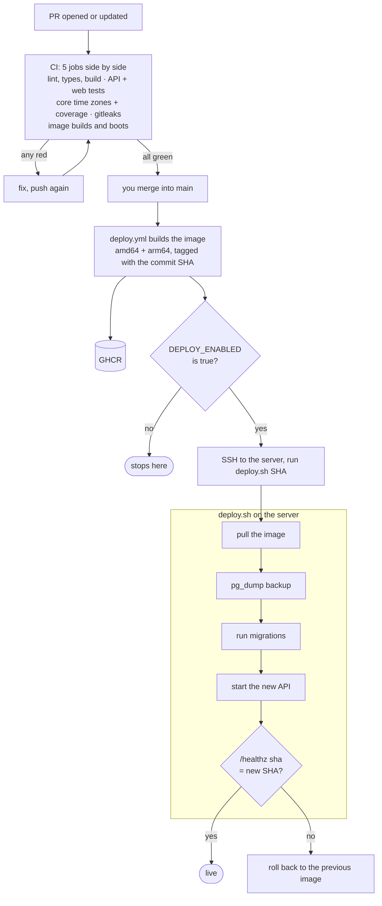

# Deploy and CI

> **Background:** [[Containers and images]] · [[Docker Compose]] · [[Reverse proxies and TLS]] · [[Database migrations]] · [[CI and CD]] · [[Secret scanning]]

Everything that turns the repo into a running app on the box: the image, the production stack, the deploy script, and the two GitHub workflows. Concepts: [[Containers and images]], [[Docker Compose]], [[Reverse proxies and TLS]], [[CI and CD]], [[Secret scanning]]. Why it's built this way: [[Deploy choices]]. The one-time setup (box, Cloudflare, secrets) is a runbook in the repo: `deploy/README.md`.

## Files

| File | What it does |
|---|---|
| `Dockerfile` | Builds the image in three stages: `web-build` (builds the PWA), `prod-deps` (the API's runtime packages), `runtime` (the image itself) |
| `.dockerignore` | An allowlist of what the build may read. `private/`, `vault/` and `.env` files can never enter an image |
| `deploy/compose.prod.yaml` | The stack on the box: `caddy`, `api`, `db`, and a one-off `migrate` |
| `deploy/Caddyfile` | HTTPS, compression, HSTS, visitor IP from Cloudflare, forwarding to `api:3000` |
| `deploy/deploy.sh` | Runs on the box for each deploy: pull, dump, migrate, swap, check, roll back on failure |
| `deploy/env.example` | Template for the box's `~/tasks/.env`, every setting commented |
| `deploy/.gitignore` | Keeps `backups/` and the deploy log out of git when you run the stack on a laptop |
| `deploy/README.md` | The runbook: one-time setup in order, rollback, restoring a dump, local runs |
| `.github/workflows/ci.yml` | The five checks on every pull request |
| `.github/workflows/deploy.yml` | On `main`: build and push the image, then deploy it (once `DEPLOY_ENABLED` is set) |
| `.gitleaks.toml` | gitleaks' rules, with one narrow exception for made-up secrets in test files |

## What's inside the image

```
/app
├── package.json, pnpm-lock.yaml, pnpm-workspace.yaml
├── node_modules/.pnpm/…          the API's runtime packages (no dev tools)
├── apps/api/{package.json, src/, drizzle/, node_modules/}
│        node_modules/@tasks/core → ../../../../packages/core   (a symlink)
├── packages/core/{package.json, src/, node_modules/}
└── apps/web/dist/                the built PWA, served by the API
```

It starts with `node apps/api/src/main.ts`, as the unprivileged user `node`, with `NODE_ENV=production HOST=0.0.0.0 PORT=3000 STATIC_DIR=/app/apps/web/dist TZ=UTC` and `GIT_SHA` set to the commit it was built from. No compile step: Node 24 strips the types itself ([[TypeScript checking vs running]]). The symlink matters: Node refuses to strip types from files inside `node_modules`, and through the link `@tasks/core`'s real location is `packages/core/src`, outside it.

The last two stages of the `Dockerfile`, where all of that is decided:

*From `Dockerfile` (shortened):*
```dockerfile
FROM ${NODE_IMAGE} AS prod-deps
# …
RUN pnpm install --frozen-lockfile --prod --filter @tasks/api...

FROM ${NODE_IMAGE} AS runtime
WORKDIR /app
ENV NODE_ENV=production \
  HOST=0.0.0.0 \
  PORT=3000 \
  STATIC_DIR=/app/apps/web/dist \
  TZ=UTC
COPY --from=prod-deps /app ./
COPY packages/core/src packages/core/src
COPY apps/api/src apps/api/src
COPY apps/api/drizzle apps/api/drizzle
COPY --from=web-build /app/apps/web/dist apps/web/dist

# Last, because it changes on every commit and would otherwise invalidate the layers above.
ARG GIT_SHA=dev
ENV GIT_SHA=${GIT_SHA}
# …
USER node
EXPOSE 3000
CMD ["node", "apps/api/src/main.ts"]
```

What to notice:
- `--prod` skips dev tools; `--filter @tasks/api...` (with the three dots) means "the API and the workspace packages it depends on", so `@tasks/core` comes along as the symlink.
- `COPY --from=prod-deps` and `COPY --from=web-build` take files out of earlier stages. Everything else those stages had (pnpm's store, Vite, TypeScript) is left behind.
- `HOST=0.0.0.0`: inside a container, `127.0.0.1` is reachable only from that same container, so Caddy (another container) couldn't connect.
- `ARG GIT_SHA` is filled by `--build-arg GIT_SHA=<commit>` at build time, and `ENV` keeps it in the image, where `/healthz` reads it.

## From "PR opened" to "new SHA live"



1. **You open a PR.** `ci.yml` starts five jobs on fresh machines, side by side:

   | Job (the exact required-check name) | What it runs |
   |---|---|
   | `Lint, typecheck and build` | `pnpm check`, `pnpm typecheck`, `pnpm build` |
   | `Test API and web` | the tests of every package in `apps/`, with Postgres 18 next to them |
   | `Test core` | core's tests under UTC, Asia/Kolkata and America/New_York, then the 90% coverage gate |
   | `Scan for secrets` | gitleaks over the full history |
   | `Build and boot the image` | builds the image (x86, not pushed), runs migrations, starts it, checks `/healthz` reports this commit |

   The end of that last job, where "boots" is checked:

   *From `.github/workflows/ci.yml` (shortened):*
   ```sh
          docker run --rm --network host "${vars[@]}" tasks:ci node apps/api/src/db/migrate.ts
          docker run -d --name api --network host "${vars[@]}" tasks:ci
          sha=""
          for _ in $(seq 30); do
            if body="$(curl -fsS http://127.0.0.1:3000/healthz)"; then
              sha="$(jq -r .sha <<< "$body")"
              break
            fi
            sleep 1
          done
          docker logs api
          docker rm -f api > /dev/null
          echo "/healthz reports: ${sha:-no answer}"
          test "$sha" = "$GITHUB_SHA"
   ```

   - The loop tries `/healthz` up to 30 times, a second apart. `curl -f` fails on an error status, so only a real answer gets past the `if`.
   - `jq -r .sha` pulls one field out of the JSON answer.
   - The last line is the verdict: `test` exits non-zero when the two differ, which turns the step, and the PR's check, red. `docker logs api` runs first so a failure shows why.

2. **All green, you merge.** Branch protection on `main` won't allow it otherwise.
3. **`deploy.yml`, job `Build and push the image`.** Builds for amd64 and arm64 with `GIT_SHA=<commit>` and pushes `ghcr.io/signioratif/tasks:<commit>` and `:main`.

   *From `.github/workflows/deploy.yml` (shortened):*
   ```yaml
      - name: Build and push
        uses: docker/build-push-action@c3c9e263c25d99ce0380d002d59b67737d91b0dc # v7.4.0
        with:
          context: .
          platforms: linux/amd64,linux/arm64
          push: true
          # Baked into the image; /healthz reports it, which is how a deploy is verified.
          build-args: GIT_SHA=${{ github.sha }}
          tags: |
            ${{ env.IMAGE }}:${{ github.sha }}
            ${{ env.IMAGE }}:main
          cache-from: type=gha
          cache-to: type=gha,mode=max
   ```

   `platforms` is the line that makes the image multi-arch. `${{ github.sha }}` is GitHub filling in the commit being built. `cache-from`/`cache-to: type=gha` keep Docker's layers in GitHub's cache, so the next build reuses the dependency layers.
4. **Job `Deploy to the box`** (skipped until the repository variable `DEPLOY_ENABLED` is `true`). Copies `compose.prod.yaml`, `Caddyfile` and `deploy.sh` to `~/tasks` over SSH, then runs `~/tasks/deploy.sh <commit>` there.

   *From `.github/workflows/deploy.yml` (shortened):*
   ```yaml
    deploy:
      name: Deploy to the box
      needs: image
      if: vars.DEPLOY_ENABLED == 'true'
      # …
        - name: Copy the stack files to ~/tasks
          working-directory: deploy
          run: scp compose.prod.yaml Caddyfile deploy.sh box:tasks/

        - name: Run deploy.sh on the box
          run: |
            # The SHA is filled in here, on the runner, on purpose (it's plain hex).
            # shellcheck disable=SC2029
            ssh box ./tasks/deploy.sh "$GITHUB_SHA"
   ```

   `needs: image` waits for the build job; `if:` is the on/off switch. `box` isn't a real hostname: the "Set up SSH" step before these writes an SSH config entry named `box` with the server's address, user and key, all from repository secrets.
5. **`deploy.sh` on the box:**
   1. Takes a lock, so two deploys can't overlap.
   2. Pulls the image (skipped if already there: a commit's image never changes).
   3. Starts Postgres if needed and dumps it to `backups/tasks-<time>-before-<commit>.sql.gz`, keeping the newest 10.
   4. Runs the new image's migrations in a one-off `migrate` container.
   5. `docker compose up --wait`: replaces the API container and waits for its health check.
   6. Asks the API, from inside its container, for `/healthz` until it answers `200` with the new commit (2 minutes at most).
   7. Writes the new tag into `.env`, appends to `deploy-history.log`, deletes images older than the previous one.

   Steps 1 to 6 in the script itself:

   *From `deploy/deploy.sh` (shortened):*
   ```sh
   exec 9> .deploy.lock
   flock --nonblock 9 || die "another deploy is already running"
   # …
   export TAG=$new_tag
   # …
   compose pull --quiet --policy missing api || die "couldn't pull $image:$new_tag"
   # …
   compose up --detach --wait --wait-timeout 120 db || die "the database didn't start"
   # …
   if ! compose exec -T db pg_dump --username=tasks --dbname=tasks | gzip > "$dump.partial"; then
     rm -f "$dump.partial"
     die "the dump failed; nothing was changed"
   fi
   mv "$dump.partial" "$dump"
   # …
   compose run --rm migrate || die "migrations failed; the running API is unchanged"
   # …
   compose up --detach --wait --wait-timeout 120 --remove-orphans ||
     fail "the new containers didn't become healthy"
   # …
   deadline=$((SECONDS + smoke_timeout))
   until [[ $(running || true) == "200 $new_tag" ]]; do
     ((SECONDS < deadline)) || fail "/healthz didn't report $new_tag within ${smoke_timeout}s"
     sleep 3
   done
   ```

   What to notice:
   - `compose` is a tiny function defined at the top: `docker compose -f compose.prod.yaml "$@"`.
   - `a || die "…"` reads "do `a`, or else stop with this message". `die` only stops; `fail` (used once the new API has started) rolls back first. That split is the "When something fails" table below.
   - `export TAG=$new_tag` is how the new image is chosen: `compose.prod.yaml` names the image `…:${TAG}`, and a variable set in the shell wins over the old `TAG=` still written in `.env`.
   - The dump goes to `"$dump.partial"` and is renamed only when complete, so a half-written file can never be mistaken for a backup.
   - `flock --nonblock 9` takes a lock on the open file `.deploy.lock` or fails at once if another deploy holds it. The lock is released automatically when the script exits, however it exits.
   - `SECONDS` is a bash variable that counts seconds since the script started, which makes the 2-minute deadline one line.
6. **The workflow checks the public URL**, through Cloudflare and Caddy, until `https://tasks.ahmedatif.in/healthz` reports the commit (3 minutes at most). Green: it's live.

   *From `.github/workflows/deploy.yml` (shortened):*
   ```sh
             deadline=$((SECONDS + 180))
             until [[ "$(curl -fsS --max-time 10 "$PUBLIC_URL/healthz" | jq -r .sha)" == "$GITHUB_SHA" ]]; do
               if ((SECONDS >= deadline)); then
                 echo "::error::$PUBLIC_URL/healthz didn't report $GITHUB_SHA within 3 minutes"
                 exit 1
               fi
               sleep 5
             done
   ```

   The same "ask until it says the right commit, with a deadline" loop as in `deploy.sh`, but from the outside: this request travels through DNS, Cloudflare and Caddy before it reaches the API. `::error::` is a GitHub Actions convention that shows the line as a red error on the run's page.

## When something fails

| Fails at | What happens | What's running afterwards |
|---|---|---|
| Any CI job | The PR can't merge | Unchanged |
| Pull | `deploy.sh` stops | Unchanged |
| Dump | Stops; the half-written file is deleted | Unchanged |
| Migrations | Stops before touching the API | The old API on the old schema: drizzle applies pending migrations in one transaction, so a failure applies none of them |
| Health check or SHA check | **Rolls back**: starts the previous tag again, exits with an error | The previous API on the new schema, which is fine because migrations only add (expand/contract) |
| Public URL check only | The workflow goes red; the box itself is healthy | New version; look at Cloudflare/DNS/Caddy |

Every attempt, ok or failed, is a line in `~/tasks/deploy-history.log`.

The "rolls back" row is this function, which `fail` calls before stopping:

*From `deploy/deploy.sh`:*
```sh
rollback() {
  if [[ -z $previous_tag || $previous_tag == "$new_tag" ]]; then
    log "no earlier tag to roll back to; leaving the containers as they are"
    return
  fi
  log "rolling back to $previous_tag"
  if TAG=$previous_tag compose up --detach --wait --wait-timeout 120 api; then
    log "rolled back: $previous_tag is serving again"
  else
    log "ROLLBACK FAILED: check 'docker compose -f compose.prod.yaml ps' and the logs"
  fi
}
```

- `previous_tag` was read from `.env` at the start, before anything changed. Since `.env` is only updated after a successful deploy, it always names the last version that worked.
- `TAG=$previous_tag compose up … api` sets `TAG` for that one command only, and recreates just the `api` service: Postgres and its (already migrated) data are left alone.
- No previous tag (the very first deploy), or a redeploy of the same tag: there's nothing different to go back to, so it says so and leaves things as they are.

## Running the production stack on a laptop

Step by step, with what to edit in `deploy/.env`: [[Local workflow]] ("Try the production image on your laptop"). It also maps each CI job to the local command that runs the same check.

The commands are in `deploy/README.md` ("The production stack on a laptop"). In short: build the image with `GIT_SHA=local`, copy `deploy/env.example` to `deploy/.env` with `SITE_ADDRESS=http://localhost`, `HTTP_PORT=8080` and `IMAGE=tasks-local`, then `deploy/deploy.sh local` and open `http://localhost:8080`. The project is named `tasks-prod`, so it doesn't collide with the dev database from `compose.yaml`.

## Check yourself
- Trace a merge: which file decides the image is built for arm64 too, and which one decides it's deployed at all?
- A migration adds a column, then the new API fails its health check. After the rollback, which code runs against which schema? Why is that safe?
- You run `./deploy.sh <same sha>` twice in a row. List what the second run changes.
- Where would you look first if the Deploy run is red but `deploy-history.log` on the box says `ok`?
