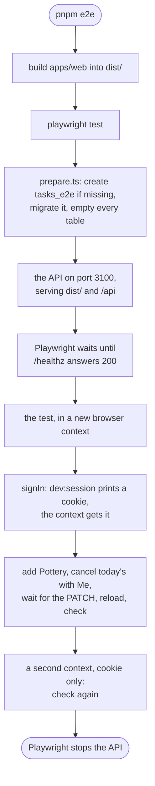

# End-to-end test

> **Background:** [[End-to-end tests and Playwright]] · [[Integration tests]] · [[Cookies and sessions]] · [[Offline reads]] · [[CI and CD]]

Since v0.3 (ticket #10), one test drives the app in a real Chromium: it adds a class called Pottery on every day of the week, opens today's, taps **Me** ("I didn't go"), reloads, and checks that the stripes and "I skipped" are still there. Then it opens a second, empty browser and checks again. It runs on your laptop with `pnpm e2e` and in CI on every pull request. Every value in it is made up.

It proves the path behind user story 56 of spec #6: the class form, the API, the database, the cancel, the saved copy on the phone and the reload, all at once. The general ideas (browser contexts, locators, waiting, traces) are in [[End-to-end tests and Playwright]]. Why it's built this way and not another: [[End-to-end test choices]].

## Predict first

The test cancels a class, waits for the server to say "saved", and reloads. Before reading on: where does the calendar get the week it draws right after the reload? If the server had quietly lost the cancel, would the reload show the stripes or not?

## Files

| File | What it does |
|---|---|
| `e2e/package.json` | A workspace package of its own, `@tasks/e2e`. Its script is `e2e`, not `test`, so `pnpm test` stays fast and never needs a browser |
| `e2e/playwright.config.ts` | One worker, no retries, a phone-sized Chromium, and the `webServer` that starts the API |
| `e2e/support/server.ts` | Where the test's server lives: port 3100, the `tasks_e2e` database, the API's environment, and `runApiScript` |
| `e2e/support/prepare.ts` | Runs before the API starts: checks the app is built, creates the database if needed, migrates it, empties it |
| `e2e/support/sign-in.ts` | `signIn(context)`: a session cookie from the API's own `dev:session` script, no Google |
| `e2e/tests/cancel-survives-reload.spec.ts` | The test |
| `package.json` (root) | `pnpm e2e`: builds the web app, then runs Playwright |
| `.github/workflows/ci.yml` | The sixth CI job, `End-to-end test` |

## What `pnpm e2e` does



## The server: the API, serving the build

The test doesn't use `pnpm dev`. Vite's dev server serves source files, rebuilt as you save, with no service worker; that's not what a phone gets. Instead the API serves the built app from `STATIC_DIR`, exactly as it does in production, so the page and `/api` share one origin ([[Origin]]) and the session cookie is first-party.

*From `e2e/support/server.ts`:*
```ts
export const SERVER_ENV = {
  NODE_ENV: 'test',
  HOST: '127.0.0.1',
  PORT: String(PORT),
  LOG_LEVEL: 'warn',
  DATABASE_URL,
  BETTER_AUTH_URL: ORIGIN,
  AUTH_ALLOWED_EMAILS: TEST_EMAIL,
  STATIC_DIR,
};
```

What to notice:
- `PORT` is 3100 and `DATABASE_URL` names `tasks_e2e`, so a run never touches the dev server (3000 and 5173) or your dev data in `tasks`.
- `BETTER_AUTH_URL` is the origin the browser sees, `http://localhost:3100`. Better Auth names its cookie and checks requests against it ([[Cookies and sessions]]).
- `NODE_ENV` is `test`, not `production`, so the API signs cookies with the public development secret. That matters below: the `dev:session` script signs with the same one.
- No `BETTER_AUTH_SECRET` and no Google client: the development defaults in `apps/api/src/env.ts` fill them, as on your laptop.

Playwright starts it through `webServer`:

*From `e2e/playwright.config.ts`:*
```ts
  webServer: {
    command: `node support/prepare.ts && node "${API_MAIN}"`,
    env: SERVER_ENV,
    // Ready once /healthz answers 200, which means it reached the database too.
    // The address the API listens on, so `localhost` resolving to IPv6 first can't stall it.
    url: `http://127.0.0.1:${SERVER_ENV.PORT}/healthz`,
    // Never test against something already on the port: it could be older code.
    reuseExistingServer: false,
    stderr: 'pipe',
  },
```

- `&&` runs the API only if `prepare.ts` succeeded.
- `/healthz` answers 200 only when the API can reach Postgres, so "ready" means the whole server side is up.
- `localhost` can resolve to `::1` (IPv6) before `127.0.0.1`. The API listens on `127.0.0.1` only, so the readiness check asks there directly. The browser handles both on its own.
- `reuseExistingServer: false`: if something already listens on 3100, the run fails instead of testing it. A server left over from an earlier run would be running older code.

## Before the server starts: an empty database

The test adds a class called Pottery. Run it twice on the same data and there are two Pottery blocks today, and the test can't tell which one it cancelled. So `prepare.ts` empties the database before every run.

*From `e2e/support/prepare.ts` (shortened):*
```ts
runApiScript('src/db/migrate.ts');

// Every table in `public`, listed by Postgres so a new one is never missed. The
// migrations' own bookkeeping lives in the `drizzle` schema and stays.
const db = await connect(DATABASE_URL);
try {
  const { rows } = await db.query<{ name: string }>(
    `select format('%I', tablename) as name from pg_tables where schemaname = 'public'`,
  );
  if (rows.length > 0) await db.query(`truncate ${rows.map((row) => row.name).join(', ')} cascade`);
// …
```

- Before this, it creates `tasks_e2e` if it's missing, connecting to the `postgres` database because a database can't be created from inside itself. In CI, the Postgres service creates it.
- `runApiScript('src/db/migrate.ts')` runs the API's own migration script with the server's environment. The test never copies the API's migration code, so it can't drift from it.
- `truncate … cascade` empties every table at once, users and sessions included. The list comes from Postgres (`pg_tables`), so a table added next month is emptied too. This is the same query as `resetDatabase()` in the API's tests ([[Integration tests]]).

## Signing in without Google

Signing in for real means Google, and a test can't type a Google password. The API already has a way round it for your laptop: `pnpm --filter @tasks/api dev:session you@example.com` makes the user and a session, and prints the cookie a real sign-in would have set. It refuses to run for any origin but localhost ([[Auth]]). The test uses the same script.

*From `e2e/support/sign-in.ts` (shortened):*
```ts
export async function signIn(context: BrowserContext): Promise<void> {
  const output = runApiScript('src/scripts/dev-session.ts', [TEST_EMAIL]);
  // The lines apps/api/src/auth/dev-session.test.ts pins.
  const name = /^Cookie name: +(\S+)$/m.exec(output)?.[1];
  const value = /^Cookie value: (\S+)$/m.exec(output)?.[1];
  // …
  await context.addCookies([{ name, value, url: ORIGIN, httpOnly: true, sameSite: 'Lax' }]);
}
```

- The script prints lines meant for people (`Cookie name:  better-auth.session_token`). Reading them with a regular expression would be fragile, except that the API's own test pins exactly those lines, so a change to them fails that test first.
- `addCookies` puts the cookie into this browser context, for `http://localhost:3100`. From the first page load on, the browser sends it, and the app sees a signed-in user.

## The test, step by step

The browser is 412 × 915 pixels, phone-sized, so the calendar shows one day: today. Pottery repeats on every day of the week, so today has one, whatever day the test runs.

1. **Add the class.** Through the real form: Title, Location, Group name (a new user has no groups, so the class makes the first one), all seven day buttons, Starts at 10:00, Save. A new group tracks attendance, so the sheet will offer Prof and Me.
2. **Cancel today's with a reason.** Tap the block, tap Me, and wait for the server:

*From `e2e/tests/cancel-survives-reload.spec.ts`:*
```ts
    await todaysPottery(page).click();
    const saved = page.waitForResponse(
      (response) =>
        response.request().method() === 'PATCH' && response.url().includes('/api/v1/occurrences/'),
    );
    await page.getByRole('button', { name: /^Me / }).click();
    // Reload only once the server has it, or the reload would test a waiting change instead.
    expect((await saved).ok()).toBe(true);
```

   The wait starts *before* the tap, so the response can't arrive before anyone is listening. Without it, the reload could land while the `PATCH` was still on its way. The change would be saved as a waiting change and sent again after the reload ([[Offline cancels]]): a real path, but not the one this test is about.

3. **Reload, and check.** The same checks run three times: after the cancel, after the reload, and in a fresh browser.

*From `e2e/tests/cancel-survives-reload.spec.ts`:*
```ts
async function expectSkipped(page: Page) {
  const block = todaysPottery(page);
  // The block's label ends with the reason, and with nothing after it: no
  // ", waiting to sync".
  await expect(block).toHaveAccessibleName(/, I skipped$/);
  await expect(block.getByText('I skipped', { exact: true })).toBeVisible();
  // The stripes, as drawn (time-grid.css), and the dashed edge that says "skipped".
  await expect(block).toHaveCSS('background-image', /^repeating-linear-gradient\(/);
  await expect(block).toHaveCSS('border-left-style', 'dashed');
}
```

   - The block's accessible name is its whole description, such as `Pottery, 10:00–11:00 AM, Studio 4, Evening classes, I skipped` ([[Calendar grid]]). `$` means "and nothing after it", so a change still waiting, which would add `, waiting to sync`, fails the check.
   - `toHaveCSS` reads the style the browser actually computed. The stripes are a `repeating-linear-gradient` background, so this proves they're drawn, not only that some attribute is set.

4. **A fresh browser.** The last step is where the test earns its name.

## Why the reload isn't enough: the saved copy

Since v0.2 the app keeps a copy of its cache on the phone and draws from it the moment it opens ([[Offline reads]]). So after a reload the stripes can come from that copy, not from the server. If the server had answered "cancelled" and then lost it, the reload would still show the stripes, for a while.

So the test opens a second browser context with the session cookie and nothing else: no saved copy, no queue. Its calendar can only come from the server.

*From `e2e/tests/cancel-survives-reload.spec.ts`:*
```ts
async function signedInLike(browser: Browser, context: BrowserContext): Promise<BrowserContext> {
  return browser.newContext({ storageState: { cookies: await context.cookies(), origins: [] } });
}
```

`storageState` is what a context starts with: `cookies`, plus `origins`, the `localStorage` of each site. Passing the first context's cookies and no origins gives a new "device" that is signed in as the same user and has nothing saved.

## The bug it found on its first run

The first run failed at the reload. The page said **"No classes this week"**, a second after it had shown Pottery. The trace's network log said why: after the reload the app fetched `me` and `groups`, and **no week**.

What happened, in order:
- The saved copy of the reads is written at most once a second.
- The whole test, from the first page load to the reload, took less than that second. So the last copy written was from the very start: an empty week, from before Pottery existed.
- The reload restored that empty week. It had been fetched 1.7 s earlier, and the calendar counts a week as fresh for a minute (`CALENDAR_STALE_MS`), so it wasn't asked for again.

On a phone, the same happens if you close the app within a second of a change and open it again within a minute. The fix marks every restored answer to be fetched again: it's still drawn at once, then replaced by the server's answer. How, and the test that pins it: [[Offline reads]] ("A trap found by the end-to-end test").

## How we know it can fail

A test that can't fail proves nothing, so it was broken on purpose twice:
- **Without the fix:** it fails at the reload step, as above.
- **With a server that forgets:** for one run, the API was changed to answer "cancelled" and then delete the override. The test failed at the reload step. (That change was never committed.)

Five runs in a row passed, each in about 3 seconds.

## In CI

*From `.github/workflows/ci.yml` (shortened):*
```yaml
  e2e:
    name: End-to-end test
    # …
      # Headless Chromium and the system libraries it needs, the version Playwright pins.
      - name: Install Chromium
        run: pnpm --filter @tasks/e2e exec playwright install --with-deps --only-shell chromium
      # Builds the app, starts the API serving it, and runs the test (e2e/playwright.config.ts).
      - name: Build the app and run the test
        run: pnpm e2e
      # A failed run keeps a trace: download it and open it with `playwright show-trace`.
      - name: Keep the trace of a failed run
        if: ${{ failure() }}
```

- The job has its own Postgres service, which creates `tasks_e2e` for it.
- `--with-deps` installs the Linux libraries Chromium needs; `--only-shell` downloads only the headless shell, which is all a machine with no screen uses.
- `if: ${{ failure() }}`: the trace is uploaded only when something failed, and kept for 7 days.
- The job takes about a minute. It only *blocks* a merge once it's added to the required checks in GitHub's branch protection settings, which is a setting, not a file.

## Running it yourself

1. Postgres running: `docker compose up -d --wait db` (`pnpm dev` starts it too).
2. Once per machine: `pnpm --filter @tasks/e2e exec playwright install chromium`. On Arch it warns that the OS isn't officially supported and downloads the Ubuntu build, which works.
3. `pnpm e2e`.
4. A failure prints the step that failed and saves a trace under `e2e/test-results/`. Open it with `pnpm --filter @tasks/e2e exec playwright show-trace <path to trace.zip>`.

## Check yourself

- **Predict:** delete the second context step. Which of the two deliberate breakages above would the test still catch, and why?
- **Trace:** the test starts `waitForResponse` after the tap on Me instead of before. Usually it still passes. Why only usually?
- **Break it:** set `retries: 2` in the config and make the test fail once in its last step. What does the second try find on the calendar, and why does it fail for a different reason?
- **Explain:** why does the test read the stripes with `toHaveCSS` instead of checking `data-status="cancelled"` on the block?
- **Design:** the dev server is already running on your laptop. Why does the test start its own API on 3100 instead of using it?
