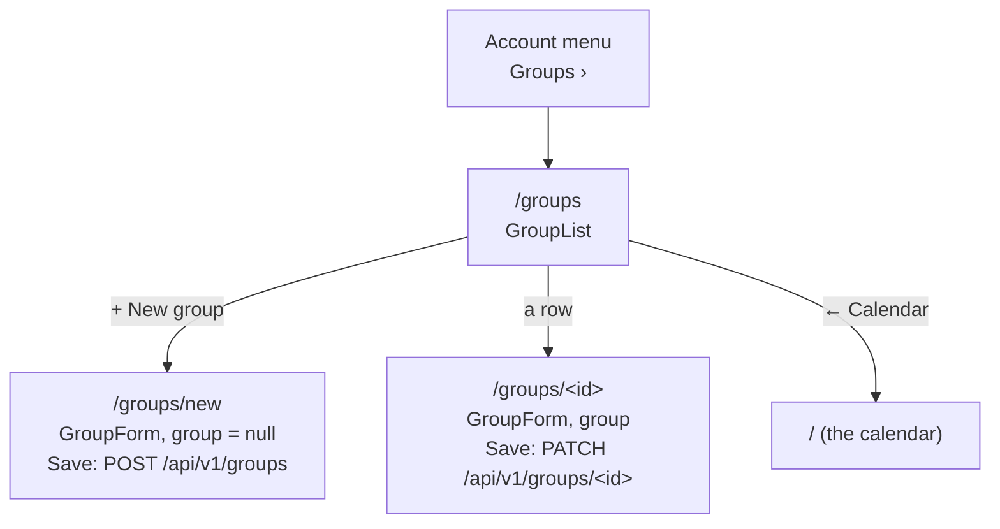

# Groups screen

> **Background:** [[Single-page apps and routing]] · [[REST resources and CRUD]] · [[Validating input with schemas]] · [[Idempotency and retries]] · [[Server state and caching]]

A **group** is a folder of classes you manage together, like a semester ("Classes · Sem 3") or "Health". It gives its classes a colour, decides whether cancelling one asks why (attendance), and can have a last day, after which every class in it stops. Until ticket #11 the only way to make a group was "New group…" inside the [[Series form]], and there was no way to change one. Now the account menu has a **Groups** row: it lists your groups, the running ones first and the ended ones under "Archived", and each opens a form for its name, colour, attendance and last day. Why it's built this way: [[Groups screen choices]].

## Predict first

You have five groups: "Sem 10", "art club", "Sem 9", "Health", and "Summer school", whose last day was 31 Aug. In what order does the screen list them, and under which headings? Then you open "Health", untick **Count attendance** and tap Save: what does the request body contain?

## Files

All in `apps/web/src/` unless marked.

| File | What it does |
|---|---|
| `components/AccountMenu.tsx` | The menu under your avatar: now with a **Groups** link above Sign out |
| `routes/groups.index.tsx` | `/groups`: the list, with "+ New group" beside the title |
| `routes/groups.new.tsx` | `/groups/new`: `<GroupForm group={null}>` |
| `routes/groups.$groupId.tsx` | `/groups/<id>`: finds the group in the cached list, or shows "This group doesn't exist any more" |
| `groups/group-list.ts` | Pure functions: `sortedByName`, `groupSections` (running vs archived), `groupSummary` (the line under each name) |
| `groups/GroupList.tsx` | Draws the list: the rows, the Archived heading, the empty states |
| `groups/group-form.ts` | Pure functions: starting values, the create body, the changed fields, the check |
| `groups/GroupForm.tsx` | The form: its state, Save, the error banner |
| `lib/mutations.ts` | `useCreateGroup` (already there) and the new `useUpdateGroup` |
| `routeTree.gen.ts` | The route list TanStack Router generates from the `routes/` files |
| `groups/*.test.ts`, `lib/mutations.test.ts`, `apps/api/src/routes/groups.test.ts` | Tests: the pure functions in plain Node, the API against a real Postgres |

The pieces both forms share (the field frame, colour swatches, the error banner, the Save row, the error-to-field machinery) are in [[Shared form pieces]].



Save, Cancel and "← Groups" on either form all lead back to the list.

## Three routes, three files

TanStack Router uses **file-based routing**: a file's name is its address. A dot in the name is a `/` in the address, `index` means "exactly this address, nothing after it", and a `$` part is a blank filled from the address ([[Single-page apps and routing]]):

| File | Address | Example |
|---|---|---|
| `groups.index.tsx` | `/groups/` | the list |
| `groups.new.tsx` | `/groups/new` | the blank form |
| `groups.$groupId.tsx` | `/groups/$groupId` | `/groups/0199d8a2-…`, with `groupId` = `'0199d8a2-…'` |

The router's build step reads these names and writes `routeTree.gen.ts`, a typed list of every route. That's why `<Link to="/groups">` is checked by TypeScript: a misspelt address is a type error, not a broken link.

Each route checks the session first and loads the groups before drawing:

*From `apps/web/src/routes/groups.index.tsx`:*
```tsx
export const Route = createFileRoute('/groups/')({
  beforeLoad: ({ context }) => requireSession(context.queryClient),
  // From the cache when there is one (offline too), from the server otherwise.
  loader: ({ context }) => context.queryClient.ensureQueryData(groupsQuery),
  component: GroupsRoute,
});
```

What to notice:
- `beforeLoad` runs before anything is drawn. `requireSession` sends you to `/login` if nobody is signed in.
- `ensureQueryData(groupsQuery)` returns the cached group list if there is one, and fetches it otherwise. The calendar loads the same list for its colours, so opening Groups from the calendar usually costs no request, and it opens offline from the saved copy ([[Offline reads]]).
- There's no "one group" request: `/groups/<id>` finds its group in that same list. An id that isn't there (deleted on another device, or a stale link) shows "This group doesn't exist any more" with a link back to Groups (`GoneScreen`).

`/groups/<id>` also draws its form with `key={groupId}`. A `key` tells React "this is a different thing now": going from one group's form to another's throws the old form away and starts fresh, instead of keeping the first group's half-typed values.

## The list

*From `apps/web/src/groups/group-list.ts`:*
```ts
const byName = new Intl.Collator(undefined, { numeric: true, sensitivity: 'base' });

/** Groups by name, the one order every screen lists them in. */
export function sortedByName(groups: readonly ScheduleGroup[]): ScheduleGroup[] {
  // The id breaks a tie, so two groups with one name keep a fixed order.
  return [...groups].sort((a, b) => byName.compare(a.name, b.name) || a.id.localeCompare(b.id));
}
```

`Intl.Collator` is the browser's built-in way to compare text the way people read it, in a given language. `undefined` means "the browser's language". The two settings:

- `numeric: true` reads a run of digits as one number. Plain text comparison goes character by character, so "Sem 10" vs "Sem 9" compares `1` with `9`, and "Sem 10" comes first. With `numeric`, it compares 10 with 9, and "Sem 9" comes first. This is often called **natural sort**.
- `sensitivity: 'base'` ignores case and accents, so "art club" sits between "Advanced" and "Biology", not after every capitalised name.

The server already sorts groups by name, but with Postgres's rules, which put "Sem 10" before "Sem 9". So the browser sorts again, and the series form's Group select uses the same `sortedByName`: one order everywhere.

`byName.compare(...)` returns 0 for two equal names, and `0 || x` is `x`, so the id decides. Without that, two groups both called "Lab" could swap places between two visits.

Then the split:

*From `apps/web/src/groups/group-list.ts`:*
```ts
export function groupSections(
  groups: readonly ScheduleGroup[],
  today: ISODate,
): { active: ScheduleGroup[]; archived: ScheduleGroup[] } {
  const sorted = sortedByName(groups);
  return {
    active: sorted.filter((group) => !isArchived(group, today)),
    archived: sorted.filter((group) => isArchived(group, today)),
  };
}
```

`today` is your day from `todayFor`, and `isArchived` is core's one helper: a group is archived once its last day is before your day, which starts at 04:00, not midnight ([[The user's day]]). Sorting once, before filtering, keeps both halves in order.

Under each name, `groupSummary` writes one line from what the group has: "Counts attendance · Last day 18 Dec 2026", or "Ended 30 Apr 2026" once it's archived, or nothing for a group with neither. The answer to *Predict first*: under no heading, art club, Health, Sem 9, Sem 10; under "Archived", Summer school.

Two empty states: no groups at all shows "No groups yet" and what a group is for; only archived groups shows "No group is running now. The ones that have ended are below."

## The form

| Field | Input | Starts as (new) | Sent as |
|---|---|---|---|
| Name | text | empty | `name` |
| Colour | 10 swatches, real radio buttons | blue (`DEFAULT_COLOR_TOKEN`) | `colorToken` |
| Count attendance | checkbox | on, like the API's default | `attendance` |
| Last day | date, optional | empty | `untilDate`, or `null` for none |

**Count attendance** changes what cancelling a class asks ([[Cancelling one occurrence]]): on, it asks why, **Prof** (it wasn't held) or **Me** (I skipped it), so a skip can be counted later; off, a cancel is just **Not today**. Classes yes, gym no.

**Last day** ends every class in the group on that day. Once it has passed, the group moves to Archived by itself.

"Observes holidays" exists in the database but stays hidden until v0.3b, when days off arrive. Archive and Delete come in tickets #12 and #14, below the Save row.

### Save

*From `apps/web/src/groups/GroupForm.tsx` (shortened):*
```tsx
    const found = checkGroupForm(values);
    if (hasProblems(found)) return showProblems(found);

    try {
      if (group === null) {
        pendingId.current ??= newId();
        await createGroup.mutateAsync(groupCreateBody(values, pendingId.current));
      } else {
        const changes = groupChanges(values, initial);
        if (Object.keys(changes).length > 0) {
          await updateGroup.mutateAsync({ id: group.id, changes });
        }
      }
    } catch (error) {
// …
    }
    await router.navigate({ to: '/groups' });
```

What to notice:
- **Checked before sending.** `checkGroupForm` runs the API's own `updateGroupSchema` on what you typed, so an empty name shows "Name must not be empty" under the field, with the focus on it, and nothing is sent. The update schema has the same fields as create minus the id, which is why it fits both.
- **A new group's id is made once** (`pendingId.current ??= newId()`, a UUIDv7). `??=` assigns only when the slot is empty, so Save again after a lost answer sends the same id, and the server answers with the group it already has instead of making a second one (D-042, [[Idempotency and retries]]).
- **An edit sends only what changed.** `groupChanges` compares each field with what the form started with. Untick Count attendance on "Health" and the `PATCH` body is just `{ "attendance": false }`, so a colour changed on your laptop in the meantime isn't overwritten. Nothing changed means no request.
- **After Save, back to Groups.** The write invalidates the cached group list (`useUpdateGroup` passes `{ groups: true }`), so the list you land on refetches and shows the change, and so do the calendar's colours.
- **Offline,** Save is greyed out with "You're offline. Changes need a connection.", as in the series form (D-048).

*From `apps/web/src/lib/mutations.ts`:*
```ts
export function updateGroup({ id, changes }: { id: string; changes: UpdateGroup }) {
  return apiSend<ScheduleGroup>('PATCH', `${paths.groups}/${id}`, changes);
}
```

The API side needed no change: `POST` and `PATCH /api/v1/groups` already took every field. Two tests now pin what this form sends: a create with a colour, attendance off and a last day, and an edit that turns attendance off and leaves the other fields alone.

## How it was checked

- Unit tests: `group-list.test.ts` (3: the split and order, Sem 9 before Sem 10, the summary line), `group-form.test.ts` (6: blank and filled values, the create body, only the changed fields, the check, the server's 422 on the right field), `mutations.test.ts` (+1: the `PATCH`). API: 2 group route tests against Postgres.
- In Chrome at 412×915 and 1280×800, with made-up groups: the account menu's Groups link, the list with an Archived section, create, edit, Cancel, an empty name (message under the field, focus on it), and Sem 9 before Sem 10 here and in the series form's select.

## Check yourself

- **Predict:** you rename "Health" to "health" and tap Save. Is a request sent? What's in its body?
- **Trace:** you tap Save on a new group, the server saves it, and the answer is lost. You tap Save again. Which id goes, and what does the server answer?
- **Break it:** remove `numeric: true` from the collator. Which test fails, and what changes on screen?
- **Explain:** why does the browser sort the groups again when the server already sorted them by name?
