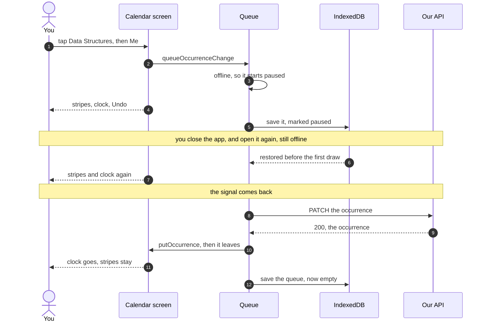
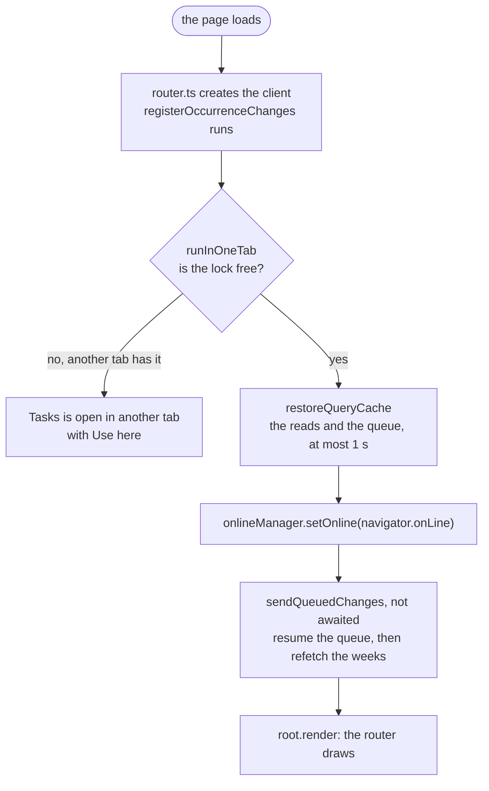
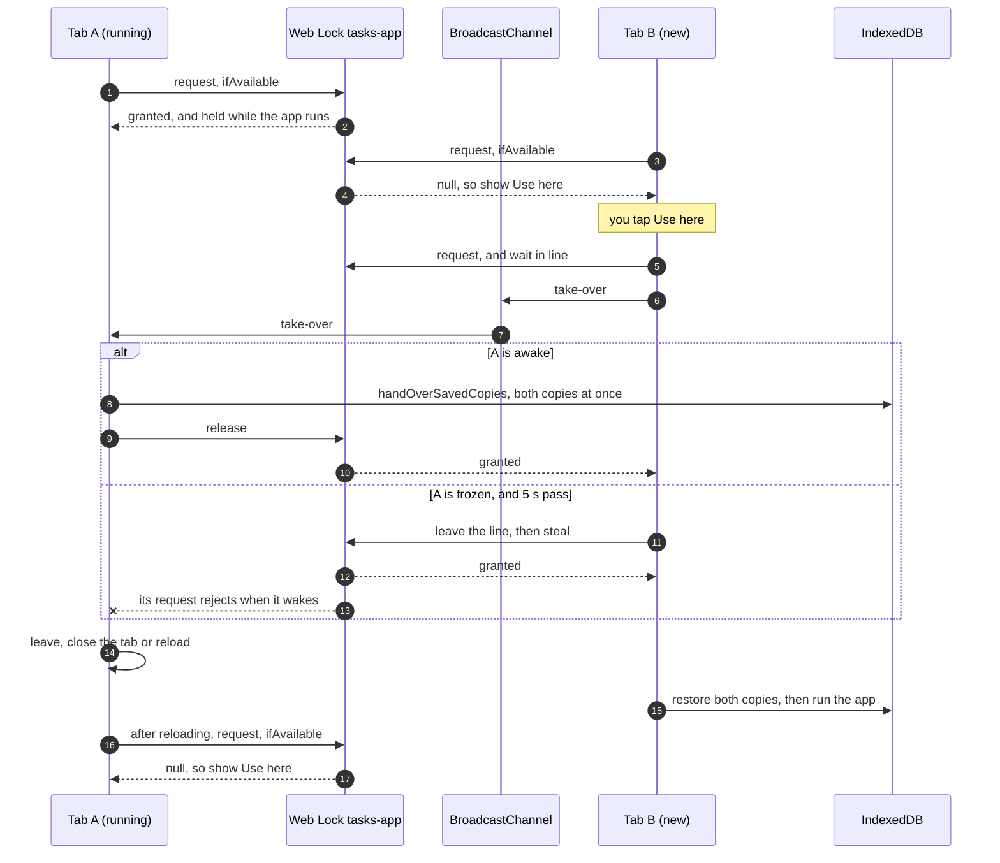
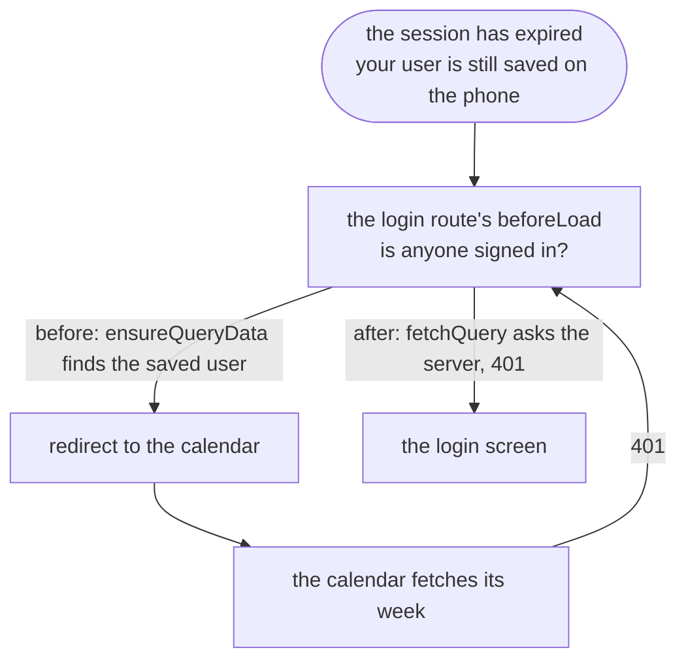

# Offline cancels

> **Background:** [[Mutations and offline queues]] · [[Web Locks and BroadcastChannel]] · [[Offline reads]] · [[Cancelling one occurrence]] · [[Idempotency and retries]]

You're on the bus with no signal, and you already know you're skipping Monday's Data Structures. Since ticket #9, tapping **Me** works anyway. The stripes appear at once with a small clock in the block's corner, the badge says "offline · 1 change waiting", and the toast offers Undo. The change waits on the phone and reaches the server when the signal does: a minute later, after you closed the app, or after you signed in again. Cancel, Restore and Change reason all work this way. Every other write still needs a connection (D-048).

`CONTEXT.md` calls this a **waiting change**: a cancel, restore or reason change made on the phone that the server doesn't have yet. It shows at once, marked "waiting to sync", and signing out loses it. Why it's built this way and not another: [[Offline cancel choices]].

## Predict first

You tap Me on Data Structures in aeroplane mode, close the app, and open it again an hour later, still offline. Where was the change in the meantime? When the app opens, what must already exist in memory before the saved change is read back, and what must happen before it can be sent? Then: you open the app in a second tab. What could go wrong if both tabs ran it?

## Files

All in `apps/web/src/`.

| File | What it does |
|---|---|
| `lib/occurrence-queue.ts` | The queue: `registerOccurrenceChanges` (the options every queued change gets), `queueOccurrenceChange`, `shouldRetryChange`, `isWaiting`, `sendQueuedChanges`, `onChangeDropped`, `signOutWarning` |
| `lib/query-client.ts` | Creates the client, and calls `registerOccurrenceChanges` on it before anything is restored |
| `lib/use-queued-changes.ts` | `useQueuedChanges()`: the unconfirmed changes as a React hook, with a timer for the 2-second mark |
| `calendar/model/queued.ts` | `withQueuedChanges`: the cached weeks with the queue applied on top. Also `applyChange` and `droppedNotice`. Pure, tested in Node |
| `calendar/CalendarScreen.tsx` | Draws the weeks through `withQueuedChanges`, queues a change from the sheet, offers Undo, shows a dropped change's toast |
| `calendar/OccurrenceBlock.tsx`, `calendar/time-grid.css` | The clock mark on a block, and "waiting to sync" in its label |
| `calendar/OccurrenceSheet.tsx` | Hands the tapped change to the screen and closes; says "Waiting to sync" for a waiting one |
| `lib/persist.ts` | The queue's saved copy: `tasks-queued-changes`, `QUEUE_FORMAT`, `savedAsPaused`, `handOverSavedCopies` |
| `main.tsx` | The startup order, and the one-tab gate around it |
| `lib/sync-status.ts`, `lib/use-sync-status.ts` | The badge's "3 changes waiting" |
| `components/SignOutButton.tsx` | The warning before signing out with changes queued, and the offline message |
| `lib/one-tab.ts`, `components/OtherTabScreen.tsx` | One tab at a time: the lock, the hand-over, "Tasks is open in another tab" |
| `routes/login.tsx` | The login loop, fixed on the way |

## One offline cancel, end to end



The rest of this note follows that diagram: the queue (steps 2–3 and 8–10), how the screen draws a change before the server has it (4, 7 and 11), the saved copy (5 and 12), and startup (6–7). Then the parts around it: the badge, signing out, one tab at a time, a login bug found on the way, and what's still missing.

## The queue

### Queuing a change

*From `apps/web/src/lib/occurrence-queue.ts`:*
```ts
export function queueOccurrenceChange(queryClient: QueryClient, change: QueuedChange): void {
  queryClient
    .getMutationCache()
    .build<Occurrence, Error, QueuedChange, unknown>(queryClient, {
      mutationKey: OCCURRENCE_CHANGE,
    })
    .execute(change)
    .catch(() => {
      // Dropped: `onError` above and `onChangeDropped` deal with it.
    });
}
```

What to notice:
- No `useMutation`. The mutation is built straight in the mutation cache from a plain function ([[Mutations and offline queues]]). The sheet's buttons and the toast's Undo both call it, and the change belongs to no screen.
- It gives only the key, `['occurrence-change']`. Everything else (the request, the retry rule, the order) comes from the defaults registered under that key, next.
- `QueuedChange` is `{ seriesId, originalDate, change, title }`. The title is never sent. It's there so a message about the change, maybe hours later and after a reload, can name the class.
- `.catch` swallows the promise's rejection when a change is dropped. The drop is reported another way (below), so nothing is lost by ignoring it here.

### The options every queued change gets

*From `apps/web/src/lib/occurrence-queue.ts`:*
```ts
export function registerOccurrenceChanges(queryClient: QueryClient): void {
  queryClient.setMutationDefaults<Occurrence, Error, QueuedChange>(OCCURRENCE_CHANGE, {
    mutationFn: changeOccurrence,
    // Wait while offline, unlike every other write (query-client.ts).
    networkMode: 'online',
    scope: QUEUE_SCOPE,
    retry: (_failures, error) => shouldRetryChange(error),
    onSuccess: (occurrence) => {
      putOccurrence(queryClient, occurrence);
      // A fetch of the weeks that set off before the server had this change
      // would land after it and draw the old state over it. Fetch those again,
      // which cancels them.
      void queryClient.refetchQueries({ queryKey: CALENDAR, fetchStatus: 'fetching' });
    },
    // Not awaited: the screen should hear about the drop now, not after the refetch.
    onError: () => void refetchCalendar(queryClient),
  });
  // …
}
```

What to notice:
- `mutationFn: changeOccurrence` is the same `PATCH` as ticket #8's ([[Cancelling one occurrence]]). The request didn't change; only when it's sent did.
- `networkMode: 'online'` overrides the app's `'always'` for these mutations only. Offline, they start paused instead of failing.
- `scope: QUEUE_SCOPE` is `{ id: 'occurrence-changes' }`, so every change waits behind the one before it.
- `retry` has no limit on the count: it says yes for as long as `shouldRetryChange` does. The wait between tries is TanStack's default backoff, 1 s, 2 s, 4 s and so on, at most 30 s apart.
- `onSuccess` is ticket #8's `putOccurrence`, plus one guard explained below. It's registered on the client, so it also runs for a change restored after a reload, which no screen started.
- `onError` runs when a change is dropped for good, and fetches the weeks again so the screen shows what the server really has.
- `createQueryClient` calls this the moment the client exists, so the options are in place before `main.tsx` restores the saved queue. If they weren't, a restored change would have no `mutationFn`, fail with an app error, and be dropped.

### Order: the newest change stays

Offline, you tap Me on Tuesday's Discrete Mathematics, then think again and tap Prof, then Restore. All three share the scope, so when the signal returns they're sent one at a time, in that order, and the server ends at "restored", the last thing you said. Without the scope they'd race, and the server could keep "skipped". A change waiting its turn behind another counts as paused, so its block shows the clock too.

### Which failures are tried again

*From `apps/web/src/lib/occurrence-queue.ts`:*
```ts
/** Statuses worth asking again: no session yet, a timeout, too many requests. */
const RETRIED_4XX: ReadonlySet<number> = new Set([401, 408, 429]);
// …
export function shouldRetryChange(error: unknown): boolean {
  if (error instanceof NetworkError) return true;
  if (!(error instanceof ApiError)) return false;
  if (error.status < 400 || error.status >= 500) return true;
  return RETRIED_4XX.has(error.status);
}
```

Read it top to bottom. No answer at all (`NetworkError`): try again. Any error that isn't from the API (a bug in our own code): give up. A status outside 400–499: try again. A 4xx: try again only for the three in `RETRIED_4XX`.

| What came back | For example | Then |
|---|---|---|
| `200` with the occurrence | the server saved it | `putOccurrence`; the change leaves the queue and the mark goes |
| No answer (`NetworkError`) | one bar of signal, or the server is down | try again later |
| `5xx` | a `503` while the server restarts | try again later |
| `401` | the session expired | try again later, and go to sign in (next section) |
| `408` Request Timeout | a proxy gave up waiting for the request to arrive | try again later |
| `429` Too Many Requests | the server asked us to slow down | try again later |
| A "success" that isn't JSON | campus Wi-Fi's login page answered instead of our API | try again later: `api.ts` turns it into an `ApiError` with status `200`, and `status < 400` counts |
| `404` | the series was deleted, or no longer has that date | drop it, fetch the weeks again, toast "it's no longer on the calendar" |
| Any other `4xx` (`403`, `422`) | the server said no, and will say it again | drop it, fetch the weeks again, toast "the server refused the change" |
| An error from the app itself | a bug, a missing `mutationFn` | drop it: it would fail every time and hold every change behind it forever |

The last rows are what keeps head-of-line blocking ([[Mutations and offline queues]]) from turning into a queue that never moves.

### What the queue listens for

Two things need more than the defaults: a `401` and a drop. Both are heard by a listener on the mutation cache, set up in the same `registerOccurrenceChanges`:

*From `apps/web/src/lib/occurrence-queue.ts`:*
```ts
  queryClient.getMutationCache().subscribe((event) => {
    if (event.type !== 'updated' || !isOccurrenceChange(event.mutation)) return;
    const { action } = event;
    // A try that met a 401: the session is gone. A change is no read, so
    // nothing on screen noticed; fetching the weeks again makes the screen meet
    // the 401 too, and send you to sign in.
    if (action.type === 'failed' && isUnauthenticated(action.error)) {
      void refetchCalendar(queryClient);
    }
    // Dropped for good. Told to whoever listens, or kept for the next screen
    // that does: a drop while you're on another screen still gets its toast.
    if (action.type === 'error') {
      const dropped = {
        ...(event.mutation.state.variables as QueuedChange),
        gone: action.error instanceof ApiError && action.error.status === 404,
      };
      const line = dropLine(queryClient);
      if (line.listeners.size === 0) line.unheard.push(dropped);
      for (const listener of line.listeners) listener(dropped);
    }
  });
```

What to notice:
- `action.type === 'failed'` is one failed try, with a retry still to come. `'error'` is the end: `retry` said no.
- `isUnauthenticated` checks for the API's `unauthenticated` code, which a `401` carries.
- A dropped change becomes a `DroppedChange`: the change, plus `gone` for a `404`.

### A 401: keep the change, go to sign in

1. A try gets `401`: the session ended (it expired, or you signed out on the laptop). `401` is in `RETRIED_4XX`, so the change stays queued and keeps trying.
2. Nothing on screen noticed. The calendar goes to sign in only when one of *its* reads fails with `401` (`CalendarScreen` returns `<Navigate to="/login" replace />`), and a change isn't a read. So the listener fetches the weeks again.
3. That fetch gets `401` too, and the calendar sends you to `/login`.
4. The login screen asks the server whether you're signed in (the fix near the end of this note), hears no, and shows the button.
5. You sign in with Google. Google sends the browser back to `/`, a full page load, so `main.tsx` runs from the top: it restores the saved queue and sends it, now with a fresh session.

A tab that stayed open on its own would get there too: the change's next try after the session is back goes through, at most 30 s later.

### Dropped changes, and a toast heard later

The calendar listens for drops while it's on screen:

*From `apps/web/src/calendar/CalendarScreen.tsx`:*
```tsx
  useEffect(
    () => onChangeDropped(queryClient, (dropped) => setToast({ text: droppedNotice(dropped) })),
    [queryClient],
  );
```

`onChangeDropped` returns the function that stops listening, and returning that from the effect makes React call it when the calendar leaves the screen.

If no screen is listening, the drop waits in a list of unheard drops, and `onChangeDropped` hands those to the next listener first. Say you cancel Monday's Data Structures Lab offline, then open the new-series form. Meanwhile, on the laptop, you delete the Data Structures Lab series. The phone's signal returns while the form is open: the change gets `404` and is dropped, but no calendar is on screen to say so. Back on the calendar, the toast arrives: "Data Structures Lab, Mon 9 Nov: it's no longer on the calendar, so the change wasn't saved." The block is gone too, because `onError` fetched the weeks again.

The lists are kept in a **`WeakMap`** keyed by the client: a map whose keys are objects it doesn't keep alive. Each client gets its own list, and a client that's thrown away (the tests make dozens) takes its list with it.

### A fetch that read the week too early

The guard in `onSuccess` is for a race between a read and a write. Say:

1. At 7:30:00.0 you switch back to the app, and TanStack refetches the week. The server reads Data Structures as on.
2. At 7:30:00.1 the queued Me reaches the server and is saved.
3. At 7:30:00.3 its answer arrives. `putOccurrence` writes "skipped" into the cached week, and the change leaves the queue.
4. At 7:30:00.5 the refetch's answer lands. It was read before the change, so it says "on", and the stripes vanish, though the server has them.

While a change is queued, a late answer like that can't hurt, because the change is applied on top (next section). The gap is the moment just after it leaves the queue. `refetchQueries({ queryKey: CALENDAR, fetchStatus: 'fetching' })` refetches only the weeks with a fetch in flight. A refetch cancels the fetch already running and starts a new one, which reads the server after the change. The test "can't be undone on screen by a fetch of the week that read it before the change" plays exactly this out.

## Drawing it: the cache plus the queue

The cache only ever holds what the server said. The screen draws the cached weeks with every queued change applied on top:

*From `apps/web/src/calendar/model/queued.ts`:*
```ts
export function withQueuedChanges(
  occurrences: readonly Occurrence[],
  queued: readonly ShownChange[],
): { occurrences: readonly Occurrence[]; waitingKeys: ReadonlySet<OccurrenceKey> } {
  if (queued.length === 0) return { occurrences, waitingKeys: NOTHING_WAITING };
  const waitingKeys = new Set<OccurrenceKey>();
  const shown = occurrences.map((occ) => {
    let result = occ;
    for (const q of queued) {
      // Extras have no original date, so a queued change never matches one.
      if (q.seriesId !== occ.seriesId || q.originalDate !== occ.originalDate) continue;
      result = applyChange(result, q.change);
      if (q.waiting) waitingKeys.add(occ.key);
    }
    return result;
  });
  return { occurrences: shown, waitingKeys };
}
```

What to notice:
- The input is the cached week, exactly as the server sent it, and nothing is written back to the cache.
- Changes are applied oldest first, so for one class the newest decides what you see, the same order the server will get them in.
- `applyChange` is a local guess. A cancel sets the status, the reason and `cancelOrigin: 'user'`, and clears any holiday label, as the engine does for a cancel you made. A restore sets the class back to scheduled. The server's answer replaces the guess once it arrives.
- With nothing queued, the very same array comes back, so the grid sees nothing new and doesn't lay itself out again.
- `waitingKeys` collects the blocks that get the mark.

This is "draw the guess on top" from [[Mutations and offline queues]]. A refetch can't wipe a waiting change, and a dropped change needs no rollback: it leaves the queue, so it stops being applied.

`CalendarScreen` runs it in a `useMemo` over the cached week and `useQueuedChanges()`, and hands the result to the grid and to the sheet. So the sheet opens on the class as you see it, with any queued change already applied: tap a class you just skipped offline, and it offers Restore.

### When the mark shows

*From `apps/web/src/lib/occurrence-queue.ts`:*
```ts
export function isWaiting(change: QueueState, now: number): boolean {
  return change.stuck || now - change.sentAt >= SLOW_MS;
}
```

`stuck` is `isPaused || failureCount > 0`, `sentAt` is the mutation's `submittedAt`, and `SLOW_MS` is 2 000. So a change shows as waiting when it's paused (offline, or waiting its turn), when a try has already failed, or when its first try has taken 2 seconds. With good signal the answer comes in a few hundred milliseconds, so a tap never flashes the mark. On one bar of signal the phone says "online" and the request just hangs; after 2 s the mark appears anyway.

Time passing changes nothing in the mutation cache, so nothing would redraw at the 2-second moment. `useQueuedChanges` sets a timer for it:

*From `apps/web/src/lib/use-queued-changes.ts`:*
```ts
  const states = useMutationState({ filters: QUEUED_CHANGES, select: queueState });
  // Time passing changes nothing in the mutation cache, so a timer redraws at
  // the moment the next quick try turns slow.
  const [now, setNow] = useState(Date.now);
  const next = nextWaitingAt(states, now);
  useEffect(() => {
    if (next === null) return;
    const timer = setTimeout(() => setNow(Date.now()), Math.max(0, next - Date.now()));
    return () => clearTimeout(timer);
  }, [next]);
  return useMemo(() => states.map((state) => queueEntry(state, now)), [states, now]);
```

What to notice:
- `QUEUED_CHANGES` is the filter `{ mutationKey: OCCURRENCE_CHANGE, status: 'pending' }`: every change the server hasn't confirmed, paused ones included.
- `nextWaitingAt` gives the earliest moment a change that isn't waiting yet will turn waiting, or `null` if none will. The effect sets one timer for that moment, and setting `now` redraws.
- `useState(Date.now)` passes the function itself, not its result, so React calls it once for the first value.
- The `useMemo` keeps the same list while nothing changes, so the calendar's own `useMemo` over it doesn't rerun for nothing.

What you see: a small clock on a solid circle in the block's top-right corner (`.tg-waiting`), so the stripes never run through it. A screen reader hears it in words, because the block's label ends with ", waiting to sync". The sheet adds a line: "Waiting to sync: saved on this phone, not yet on the server."

## The saved copy

The reads are saved under `tasks-query-cache` ([[Offline reads]]). The queue gets a second saved copy of its own, beside it in `savedCopies`:

*From `apps/web/src/lib/persist.ts`:*
```ts
    {
      persister: createAsyncStoragePersister({
        storage: toAsyncStorage(store),
        key: QUEUE_KEY,
        throttleTime,
        serialize: (client) => JSON.stringify(savedAsPaused(client)),
      }),
      buster: QUEUE_FORMAT,
      maxAge: Number.POSITIVE_INFINITY,
      dehydrateOptions: queueDehydrateOptions,
    },
```

| | The reads | The queue |
|---|---|---|
| IndexedDB key | `tasks-query-cache` | `tasks-queued-changes` (`QUEUE_KEY`) |
| Holds | `me`, groups, series, calendar weeks | occurrence changes the server hasn't confirmed |
| Buster | `CACHE_BUSTER` (`'v0.3.0'`), bumped when a cached shape changes | `QUEUE_FORMAT` (`'v1'`), never bumped to start clean |
| Kept | 30 days | until sent, however long that takes (`maxAge` is infinite) |
| If it's lost | the next open with signal fetches it again | a change you made is gone |

Why its own buster: bumping `CACHE_BUSTER` throws away the saved reads, which costs one slow start. If the queue shared that buster, the same bump would throw away changes the server never got (spec #6, edge case 8). `QUEUE_FORMAT`'s comment in `persist.ts` says it plainly: if a queued change's shape ever has to change, convert the old ones as they're read back.

`queueDehydrateOptions` lets only queued occurrence changes into this copy (`isQueuedChange`), and the reads copy takes no mutations at all. No other write is ever saved (D-048). Both copies save at most once a second (`throttleTime`): at once if nothing was saved in the last second, otherwise a moment later.

Every change is saved as paused:

*From `apps/web/src/lib/persist.ts`:*
```ts
export function savedAsPaused(client: PersistedClient): PersistedClient {
  const mutations = client.clientState.mutations.map((mutation) => ({
    ...mutation,
    state: { ...mutation.state, isPaused: true, failureReason: null },
  }));
  return { ...client, clientState: { ...client.clientState, mutations } };
}
```

What to notice:
- It has the same shape as `lastGoodAnswers` ([[Offline reads]]): it changes the copy being saved, never the mutations in memory.
- Why paused: a change caught mid-request is pending but not paused. Saved like that, `resumePausedMutations` would skip it after the reload, and since it's first in its scope, every change behind it would wait forever. Whatever it was doing, after a reload it has to be sent again.
- `failureReason: null` drops the last error. An error object doesn't survive JSON anyway, and it belongs to that moment.

## Starting up

*From `apps/web/src/main.tsx`:*
```tsx
async function startApp() {
  // …
  await restoreQueryCache(queryClient);
  // …
  onlineManager.setOnline(navigator.onLine);

  // Then send any changes queued before the app was closed, or before the
  // session ran out (signing in again reloads the app, which lands here).
  void sendQueuedChanges(queryClient);

  root.render(
    // …
  );
}
```



Each step needs the one before it:

1. **The options first.** `router.ts` creates the client as the page loads, and `createQueryClient` registers the queue's options on it. Restoring builds the saved changes, and a change built before its options exist can't be sent.
2. **One tab.** `runInOneTab` calls `startApp` only once this tab holds the lock (below).
3. **Restore before drawing.** Both copies come back, at most a second later, as in [[Offline reads]].
4. **Seed the online flag.** TanStack starts out believing it's online. Opened with no signal, the queue would try, fail and back off, and the `online` event later would be no news to it, so a cancel waited up to 30 s after the signal came back. Starting from the browser's reliable `false` keeps the queue paused until the real `online` event. It's read here, not when the page loaded, because TanStack hears `online` and `offline` only while a mounted client listens, and a tab that sat on the "open in another tab" screen had none ([[Mutations and offline queues]]).
5. **Send.** `sendQueuedChanges` resumes the restored queue, in order, then fetches the weeks again: a week saved or fetched while the changes were on their way may predate them. Offline, the resumed changes simply stay paused.
6. **Draw.** The calendar draws the restored weeks with the restored queue on top, so the stripes are there on the first frame.

## The badge

*From `apps/web/src/lib/sync-status.ts`:*
```ts
export function syncBadgeText(status: SyncStatus, now: number, tzid?: IanaZone): string | null {
  const parts: string[] = [];
  if (status.state !== 'synced') parts.push(status.state === 'offline' ? 'offline' : "can't sync");
  const waiting = status.waitingChanges;
  if (waiting > 0) parts.push(`${waiting} ${waiting === 1 ? 'change' : 'changes'} waiting`);
  if (parts.length === 0) return null;
  if (status.state !== 'synced' && status.lastSyncedAt !== null) {
    parts.push(`last synced ${formatSyncedAt(status.lastSyncedAt, now, tzid)}`);
  }
  return parts.join(' · ');
}
```

The pill now answers a third question: how many of my changes is the server still waiting for? Online, with one change hanging on a weak signal, it reads "1 change waiting". Offline, "offline · 1 change waiting · last synced 8:02 AM". With nothing waiting and everything fresh, it's empty, as before. `useSyncStatus` counts only the changes that are visibly waiting (`useQueuedChanges().filter((change) => change.waiting).length`), so a tap with good signal doesn't flash "1 change waiting" for a quarter of a second.

## Signing out

Signing out forgets everything on the phone (`forgetCachedData`): `queryClient.clear()` empties the mutation cache with the query cache, and both saved copies are deleted. A waiting change would vanish without a word. So with changes queued, the button asks first: "2 changes haven't synced. Sign out anyway? They'll be lost.", with **Stay signed in** and **Sign out anyway** (spec #6, edge case 1). This one counts every unconfirmed change, `useQueuedChanges().length`, even one on its first second, because signing out would lose that one too.

Offline, the button still works and still warns, but signing out needs the server:

*From `apps/web/src/components/SignOutButton.tsx`:*
```tsx
    try {
      // Deletes the session on the server and clears the cookie.
      const { error } = await authClient.signOut();
      if (error) throw error;
    } catch {
      // Still signed in on the server: say so rather than pretend. Offline,
      // forgetting only this phone's copy would leave the session open for
      // whoever brings the phone back online, so nothing is forgotten.
      setFailed(navigator.onLine ? 'refused' : 'offline');
      setBusy(false);
      return;
    }
```

With no signal it says "You're offline. Signing out needs the server, so nothing was deleted." The session lives on the server, and the phone holds only its id, in a cookie marked `HttpOnly` that the page can't read or delete ([[Cookies and sessions]]). Forgetting the phone's data while that cookie still works would look signed out and not be. The reasoning in full: [[Offline cancel choices]].

## One tab at a time

Each tab runs its own copy of the app and saves its own copy of the queue under the same IndexedDB key, so two tabs erase each other's changes ([[Web Locks and BroadcastChannel]] traces how). Since #9 the app runs in one tab at a time. Open it in a second tab and you get "Tasks is open in another tab", with **Use here**.



The running tab holds the lock with a promise that settles only on a hand-over:

*From `apps/web/src/lib/one-tab.ts`:*
```ts
  const run = () =>
    new Promise<void>((release) => {
      running = true;
      channel.onmessage = (event: MessageEvent) => {
        if (event.data !== TAKE_OVER) return;
        channel.onmessage = null;
        void app.handOver().finally(() => {
          release();
          app.leave();
        });
      };
      app.start();
    });
```

What to notice:
- The lock is held for as long as this promise is pending, which is as long as the app runs here.
- `release()` comes only after `handOver()` has finished, so tab B can't get the lock, and read IndexedDB, before tab A's last save is in.
- `channel.onmessage = null` makes a second "take-over" do nothing.

`main.tsx` fills in what `start`, `showElsewhere`, `handOver` and `leave` mean for our app:

*From `apps/web/src/main.tsx`:*
```tsx
runInOneTab({
  start: () => void startApp(),
  showElsewhere: (useHere) =>
    root.render(
      <StrictMode>
        <OtherTabScreen onUseHere={useHere} />
      </StrictMode>,
    ),
  handOver: () => handOverSavedCopies(queryClient),
  leave: () => {
    // Saved already, or the other tab took over without waiting: either way
    // what's saved is the other tab's now.
    stopSavingCopies();
    // Browsers only let a page close a tab that a script opened. Otherwise
    // this tab starts over, and finds the app running in the other one.
    window.close();
    setTimeout(() => location.reload(), 100);
  },
});
```

What to notice:
- `handOverSavedCopies` stops the usual saving first, then writes both copies at once (`throttleTime: 0`). Normally a save can come up to a second late. Here, a late save from tab A could land after tab B had started, and write A's old queue over B's.
- `leave` stops saving too. After a `steal` that matters most: tab A wakes up holding an old queue, and what's saved belongs to tab B now.
- `window.close()` works only for a tab a script opened. For any other tab it does nothing, and 100 ms later the reload starts the page over. The fresh page asks for the lock, finds it held, and shows the "open in another tab" screen.
- Browsers without Web Locks or BroadcastChannel (older than 2022) skip all of this and just run the app.

The cost: startup now waits on a lock. A bug in `one-tab.ts` would leave a tab stuck on the "open in another tab" screen.

## The login loop, fixed on the way

Testing the `401` path turned up an older bug, already in `release/0.0.3`. Let a session expire with the app closed, and open it: a blank page.



The login route's `beforeLoad` skips the login screen for someone already signed in. It used to ask the cache:

```ts
    const signedIn = await context.queryClient.ensureQueryData({ ...meQuery, retry: false }).then(
      () => true,
      () => false,
    );
```

`ensureQueryData` returns a cached answer without asking the server. Since v0.2 the cached `me` is restored from the phone and kept for 30 days, so it outlives the session. The login screen saw your saved user and sent you to the calendar, whose week came back `401`, which sent you to the login screen, round and round. Now it asks the server every time:

*From `apps/web/src/routes/login.tsx`:*
```tsx
  beforeLoad: async ({ context }) => {
    const signedIn = await context.queryClient
      .fetchQuery({ ...meQuery, retry: false, staleTime: 0 })
      .then(
        () => true,
        () => false,
      );
    if (signedIn) throw redirect({ to: '/' });
  },
```

`fetchQuery` fetches unless the cached answer is still fresh, and `staleTime: 0` means no cached answer ever counts as fresh. So it always asks. Offline, the request fails, and that means "show the login screen", as before.

## What it doesn't cover

- **A server that stays broken.** When the browser says it's back online, and when the app gets focus back, TanStack first resumes the paused changes, *awaited*, and only then refetches what's on screen ([[Mutations and offline queues]]). A change stuck retrying a `5xx` that never clears never finishes, so those refetches wait behind it. A `401` can't stall this way, because the queue fetches the weeks itself. And a server that stays broken shows "can't sync" anyway: the once-a-minute check of `me` doesn't wait behind the queue.
- **Two devices.** If the phone (offline) says "skipped" and the laptop says "Prof cancelled" for one class, whichever reaches the server last wins, and nothing tells you. Accepted before any code ([[Cancel and group choices]]).
- **Storage the browser takes back.** The queue lives in the same best-effort storage as the reads ([[IndexedDB and offline storage]]). The app doesn't ask for persistent storage (`navigator.storage.persist()`) yet, so a phone short on space could evict a waiting change.
- **Not yet checked on a real phone:** the mark after 2 s on a weak signal, and the 5-second takeover from a frozen tab. Both are covered by unit tests only.

## What the tests prove

In plain Node, with TanStack's real client, a stand-in `fetch`, and fake timers (`vi.useFakeTimers`) that jump through minutes of backoff in milliseconds:

- `lib/occurrence-queue.test.ts` (17): a change waits offline and arrives once online; changes go one at a time and the newest stays; no mark on a quick first try, a mark after 2 s; a late fetch of the week can't undo a change; `404` and `422` drop, with the right toast; no answer and `5xx` retry 1 s, 2 s, 4 s apart; a `401` keeps the change and refetches the weeks, then sends it once the session is back; a failing change holds the ones behind it; a drop nobody heard reaches the next listener; the retry rule; `sendQueuedChanges`; the sign-out warning.
- `lib/persist.test.ts` (+5): a change survives a reload and is sent once resumed; one caught mid-request is saved as paused; a `CACHE_BUSTER` bump drops the reads and keeps the queue; the hand-over writes both copies at once; nothing else is saved.
- `calendar/model/queued.test.ts` (8): `withQueuedChanges` and the drop messages.
- `lib/one-tab.test.ts` (5): the second tab asks; Use here hands over in order (save, leave, start); many taps start the app once; a frozen tab has the lock stolen and leaves; the tab that left can take it back. Node has real Web Locks and BroadcastChannel, so these use the real ones.
- `lib/sync-status.test.ts`: the waiting count in the badge's text.

## How it was checked

In Chrome at phone size (412 × 915), on the built app (`vite preview`) with the API and a scratch database holding the sample timetable (`you@example.com`):

- An offline reload kept the change, and the reconnect delivered it within 2 s.
- Skip, then Restore, both offline: the server ended restored, with its override row deleted.
- An expired session with a change queued: the change stayed, the screen went to sign in, and after signing in the server's row appeared and the badge emptied.
- One tab: an offline restore made in tab 1 moved to tab 2 on Use here and reached the server. Tab 1 started over on the asking screen; a tab opened by a script closed itself.
- The series deleted while the phone was offline on the new-series form: back on the calendar, the toast arrived and the block was gone.

## Check yourself

1. **Trace:** you tap Me offline, the app is killed, you open it offline, then the signal returns. Name each function that runs, in order, from the tap to the clock disappearing.
2. Why does a `401` keep the change and retry, instead of dropping it like a `404`? How does the screen end up on the login page when no read was on its way?
3. **Break it:** move `registerOccurrenceChanges(queryClient)` so it runs after `restoreQueryCache` in `main.tsx`. What happens to a change restored from the phone? (Hint: what does `shouldRetryChange` say to an error that isn't an `ApiError`?)
4. Why does the badge count only waiting changes, while the sign-out warning counts every queued one?
5. A refetch of the week lands while your skip still waits. What does the calendar show, and why? What if it lands just after the skip was confirmed, and the `fetchStatus: 'fetching'` refetch had been deleted?
6. Tab A is frozen in the background, and you tap Use here in tab B. What happens over the next 5 seconds? What does tab A do when it wakes?
7. Why can't Sign out just forget the phone's data when it's offline?
8. **Predict:** you change `QUEUE_FORMAT` to `'v2'` and ship it. What happens on a phone holding two waiting changes?
