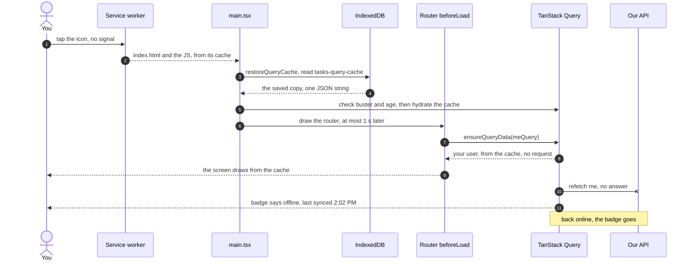
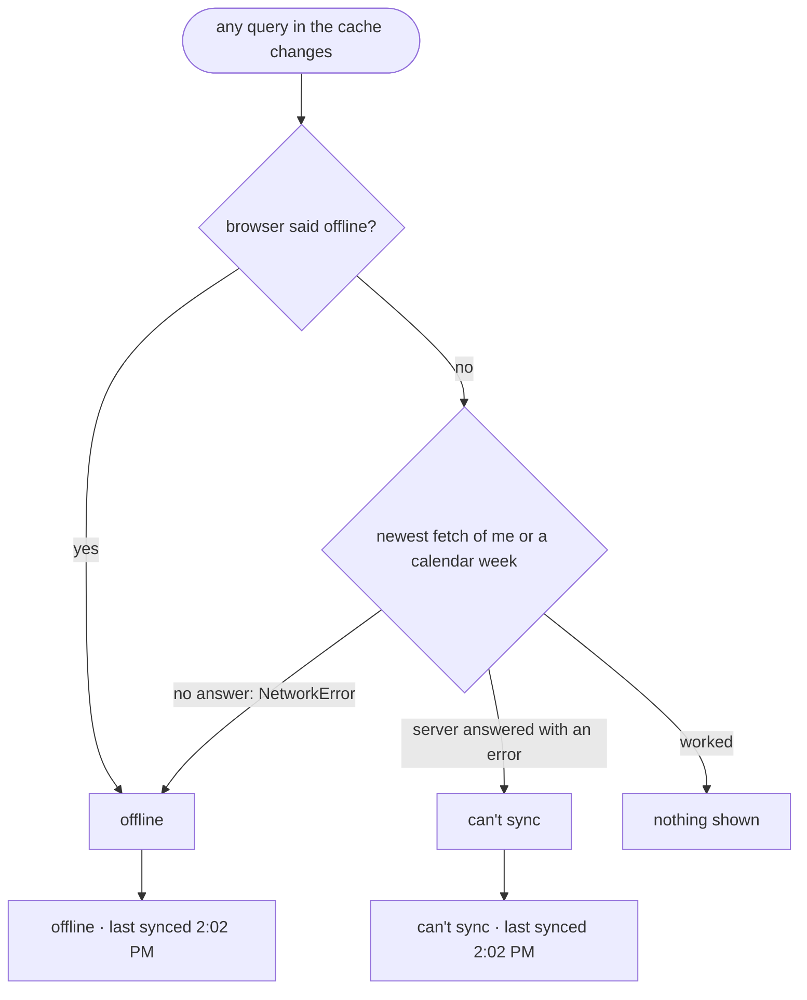

# Offline reads

> **Background:** [[Server state and caching]] · [[IndexedDB and offline storage]] · [[PWAs and service workers]] · [[Single-page apps and routing]]

You're on the bus to KIIT with no signal, and you open the app to check which room your 10:00 class is in. Since v0.2, the app opens with your name, your groups, your classes and every week you looked at in the last 30 days, drawn from a copy saved on the phone. A small pill says **"offline · last synced 2:02 PM"**, so you know it's the server's last answer and not a fresh one. Changing anything (adding a class, moving one) still needs a connection in v0.2 (D-048).

The general ideas (where a browser can keep data, quotas, why `navigator.onLine` lies) are in [[IndexedDB and offline storage]]. This note is how *our* code does it. Why it's built this way and not another: [[Offline and form choices]].

## Predict first

Before reading on: the app is closed, the phone is in aeroplane mode, and you tap the icon. Write down the order in which things must happen for your name to appear. Where does the HTML come from? Where does your name come from? What has to be finished before the router asks "is anyone signed in?"

## Files

All in `apps/web/src/`.

| File | What it does |
|---|---|
| `lib/persist.ts` | The saved copy. `restoreQueryCache(queryClient)` puts it back at start-up and keeps saving after every change; `shouldPersistQuery` decides what goes in; `lastGoodAnswers` saves a query whose refetch failed as its last good answer; `forgetCachedData(queryClient)` deletes both copies on sign-out. Constants: `CACHE_BUSTER = 'v0.2.0'`, `CACHE_MAX_AGE_MS` (30 days), `RESTORE_TIMEOUT_MS` (1 s) |
| `lib/query-client.ts` | TanStack Query's settings: `networkMode: 'offlineFirst'`, `gcTime: Infinity`, the retry rule, and writes that fail fast instead of waiting |
| `main.tsx` | Awaits `restoreQueryCache` **before** drawing the router |
| `lib/require-session.ts` | `requireSession(queryClient)`, the `beforeLoad` of the series screens: is someone signed in? Offline, the restored user counts |
| `lib/sync-status.ts` | Pure rules for the badge: `syncStatus` (offline? last synced when?), `formatSyncedAt` (`2:02 PM`), `syncBadgeText` |
| `lib/use-sync-status.ts` | `useSyncStatus()`: those rules as a React hook that re-renders when the cache changes. The badge and the series form both use it |
| `lib/use-online.ts` | `useOnline()`: what TanStack Query's `onlineManager` believes about the network |
| `components/SyncBadge.tsx` | `<SyncBadge />`, the pill |
| `lib/persist.test.ts`, `lib/sync-status.test.ts`, `lib/query-client.test.ts` | Tests of the pure parts, in plain Node ([[Testing pure code]]) |

## A cold open with no signal, step by step



1. **The shell.** The service worker answers with the `index.html`, JavaScript and CSS it precached ([[PWAs and service workers]]). No network needed.
2. **The restore.** `main.tsx` calls `restoreQueryCache(queryClient)` and **waits** for it. It reads one value from IndexedDB, the key `tasks-query-cache` in idb-keyval's database `keyval-store`: the whole cache as one JSON string. If the copy was saved by another app version (a different `buster`) or more than 30 days ago (`maxAge`), it's deleted instead. Otherwise, every saved query is put back into memory. TanStack Query calls this **hydrating** the cache; the opposite, turning the cache into plain data to save, is **dehydrating**.

*From `apps/web/src/lib/persist.ts`:*
```ts
export async function restoreQueryCache(
  queryClient: QueryClient,
  timeoutMs: number = RESTORE_TIMEOUT_MS,
): Promise<void> {
  const [, restored] = persistQueryClient({
    queryClient,
    persister,
    buster: CACHE_BUSTER,
    maxAge: CACHE_MAX_AGE_MS,
    dehydrateOptions,
  });
  let timer: ReturnType<typeof setTimeout> | undefined;
  const timeout = new Promise<void>((resolve) => {
    timer = setTimeout(resolve, timeoutMs);
  });
  // A failed restore has already deleted the broken copy; start from an empty cache.
  await Promise.race([restored.catch(() => undefined), timeout]);
  clearTimeout(timer);
}
```

What to notice:
- `persistQueryClient` does both jobs: it restores the copy now, and from then on saves the cache after every change. It returns a pair, and `[, restored]` skips the first item and keeps the second, a promise that settles when the restore is done.
- `buster` and `maxAge` are the two checks of this step. Another version's copy, or one older than 30 days, is deleted instead of restored.
- `Promise.race` waits for whichever finishes first: the restore, or the 1-second timer (the wait explained below). `.catch(() => undefined)` turns a failed restore into "carry on with an empty cache", so this function never fails.

3. **The router draws.** Only now. The `/` route's `beforeLoad` (and `requireSession` on the series screens) calls `ensureQueryData(meQuery)`, which returns what's cached without asking the server, so your user is there. If the restore had run *after* the first draw, `beforeLoad` would have found an empty cache, tried the network, and shown "You're offline" instead of your name.

*From `apps/web/src/main.tsx` and `apps/web/src/lib/require-session.ts` (shortened):*
```tsx
// apps/web/src/main.tsx
await restoreQueryCache(queryClient);

createRoot(root).render(
  // …
);

// apps/web/src/lib/require-session.ts
    await queryClient.ensureQueryData(meQuery);
```

The `await` at the top level of `main.tsx` pauses the whole file, so `render`, and with it the router and every `beforeLoad`, only runs once the cache is back. By then `ensureQueryData` finds `['me']` in the cache and makes no request.

4. **The screen.** It draws from the restored answers. Each screen then refetches what it shows, because the answers are "stale" ([[Server state and caching]]). With no signal, the fetch fails at once with a `NetworkError` (`lib/api.ts`).
5. **The badge.** The newest fetch of `me` or a calendar week got no answer, so `<SyncBadge />` says "offline · last synced 2:02 PM". 2:02 PM is when the server last answered (`dataUpdatedAt`, saved with each answer), shown in your profile's zone (`Asia/Kolkata`).
6. **Back online.** The browser fires `online`, TanStack Query refetches everything on screen, the answers arrive, the badge disappears, and about a second later the saved copy is updated.

**The 1-second wait.** Reading IndexedDB takes a few milliseconds. The timeout is for a broken IndexedDB (some private modes, a full disk, an old Safari bug where opening it hangs): the app draws anyway, with an empty cache, as v0.0 did. If the restore finishes later, it can't overwrite anything newer, because hydrating keeps whichever answer arrived last.

**Nothing cached at all** (the first open ever, or after signing out) and offline: `ensureQueryData` has to ask the server, the request fails, and you get v0.0's "You're offline" screen with Try again.

## What's saved, and for how long

| Rule | In the code | Why |
|---|---|---|
| Only `me`, `groups`, `series` and `calendar` windows | `PERSISTED_KEYS` in `shouldPersistQuery` | What a screen needs offline. Never `healthz`: an old "deployed commit" is useless |
| Only queries holding an answer | `query.state.data !== undefined` | A query that never worked has nothing to show later |
| Only answers from the last 30 days | `dataUpdatedAt` vs `CACHE_MAX_AGE_MS` | Weeks you stopped looking at fall out, so the copy doesn't grow forever |
| The whole copy is dropped if saved more than 30 days ago | `maxAge` on restore | A copy that old would mislead more than help |
| The whole copy is dropped if saved by another version | `buster: CACHE_BUSTER` | Bump `'v0.2.0'` when a cached shape changes (a renamed field in `Me`, say), so a new app never misreads old data |
| Saved at most once a second | `throttleTime: 1_000` | A refetch of ten queries is one write, not ten |
| Writes in progress are never saved | `shouldDehydrateMutation: () => false` | Writes are online-only in v0.2 (D-048) |

*From `apps/web/src/lib/persist.ts` (shortened):*
```ts
const PERSISTED_KEYS: ReadonlySet<unknown> = new Set(['me', 'groups', 'series', 'calendar']);
// …
export function shouldPersistQuery(
  query: Pick<Query, 'queryKey' | 'state'>,
  now: number = Date.now(),
): boolean {
  return (
    PERSISTED_KEYS.has(query.queryKey[0]) &&
    query.state.data !== undefined &&
    now - query.state.dataUpdatedAt <= CACHE_MAX_AGE_MS
  );
}

/** What goes into the saved copy. */
export const dehydrateOptions = {
  shouldDehydrateQuery: (query: Query) => shouldPersistQuery(query),
  // Writes are online-only in v0.2 (D-048): no queued mutation is ever saved.
  shouldDehydrateMutation: () => false,
};
// …
export function createPersister(store: KeyValueStore, throttleTime = 1_000) {
  return createAsyncStoragePersister({
    storage: toAsyncStorage(store),
    key: STORAGE_KEY,
    throttleTime,
    serialize: (client) => JSON.stringify(lastGoodAnswers(client)),
  });
}
```

What to notice:
- The three conditions joined by `&&` ("and") in `shouldPersistQuery` are the first three rows of the table. `queryKey[0]` is the first item of a key, so every week (`['calendar', from, to]`) counts as `'calendar'`.
- `Pick<Query, 'queryKey' | 'state'>` means "anything with these two fields", which lets the tests pass a plain object instead of a real query ([[TypeScript essentials]]).
- `serialize` is the last step before IndexedDB: `lastGoodAnswers` (the trap below), then `JSON.stringify`, giving the one string stored under `tasks-query-cache`.

**`gcTime: Infinity`, and a timer trap.** `gcTime` is how long TanStack Query keeps a query in memory once no screen shows it (5 minutes by default). The persister saves what's in memory, so a query dropped from memory is also dropped from the saved copy at the next save. With the default, the week you looked at yesterday would be restored at start-up and then deleted 5 minutes later, because nobody's looking at it. So `gcTime` must be at least the 30 days the copy is kept. But 30 days can't be written as a timer. Browsers store a `setTimeout` delay in 32 bits, and anything over 2³¹ − 1 ms (about 24.8 days) **fires immediately**, so `setTimeout(drop, 30 days)` would drop the query at once, the opposite of what we want. Instead, queries are never dropped from memory (`Infinity` means no timer at all), and the 30-day limit is applied when saving (the third rule above).

*From `apps/web/src/lib/query-client.ts` (shortened):*
```ts
  return new QueryClient({
    defaultOptions: {
      queries: {
        // …
        gcTime: Number.POSITIVE_INFINITY,
```

`Number.POSITIVE_INFINITY` is JavaScript's `Infinity`. TanStack Query sees it and never starts a removal timer for the query.

**A trap found while checking: a failed refetch erased the saved user.** TanStack Query's default saves only queries whose status is `success`. But a refetch that fails offline sets the status to `error` while keeping the old answer, so the copy shown on screen was quietly left out of the next save. The first offline open worked; the second showed "You're offline". Now `shouldPersistQuery` keeps any query holding an answer, and `lastGoodAnswers` saves it as a plain success with that answer. (The error belongs to that moment, and an error object doesn't survive JSON anyway.) Test: `lastGoodAnswers` in `lib/persist.test.ts`.

*From `apps/web/src/lib/persist.ts`:*
```ts
export function lastGoodAnswers(client: PersistedClient): PersistedClient {
  const queries = client.clientState.queries.map((query) =>
    query.state.status === 'error'
      ? {
          ...query,
          state: {
            ...query.state,
            status: 'success' as const,
            error: null,
            fetchFailureCount: 0,
            fetchFailureReason: null,
          },
        }
      : query,
  );
  return { ...client, clientState: { ...client.clientState, queries } };
}
```

What to notice:
- It builds a changed *copy* for the saved version. The cache in memory, and so the screen, keeps its error state.
- `...query.state` copies every field, `data` and `dataUpdatedAt` included, and the four lines after it overwrite only the failure fields.
- A query that isn't in error goes through unchanged (`: query`).

## offlineFirst, and when to stop retrying

A query's **network mode** decides what TanStack Query does when the browser says it's offline:

| `networkMode` | While the browser says offline | Used |
|---|---|---|
| `'online'` (default) | Doesn't even try; the query waits, "paused", until the browser says online | |
| `'always'` | Tries anyway, like the browser is online | v0.0 (nothing was saved, so failing fast showed the offline screen) |
| `'offlineFirst'` | Tries **once**; if that fails, further retries pause until the browser says online | v0.2 queries |

`'offlineFirst'` fits a saved copy: the screen shows the copy, and one real try finds out whether the network really is gone, since the browser can be wrong ([[IndexedDB and offline storage]]).

The retry rule (`shouldRetry`) is v0.0's (never retry a 4xx; retry network failures and 5xx twice) plus one line: **don't retry a `NetworkError` once the browser has said it's offline**. Under `'offlineFirst'`, that retry would pause until the connection came back, and a screen waiting for it (say the series form's loader, on a week you never opened) would spin forever. Failing at once lets it say "You're offline", and the `online` event refetches everything anyway.

*From `apps/web/src/lib/query-client.ts` (shortened):*
```ts
export function shouldRetry(failureCount: number, error: unknown): boolean {
  if (error instanceof ApiError && error.status < 500) return false;
  if (error instanceof NetworkError && !onlineManager.isOnline()) return false;
  return failureCount < 2;
}
// …
      queries: {
        retry: shouldRetry,
        // …
        networkMode: 'offlineFirst',
```

What to notice:
- In `shouldRetry`, the first `if` is v0.0's rule (a 4xx won't change if asked again), and the second is the line v0.2 added. `failureCount < 2` allows two retries after the first try.
- `onlineManager.isOnline()` is TanStack Query's belief about the browser's network flag, the one that starts out `true` (next paragraph).
- `retry: shouldRetry` plugs the rule in for every query, beside `networkMode: 'offlineFirst'`.

A detail that matters: TanStack Query's `onlineManager` starts out believing it's **online**, and changes its mind only on the browser's `offline` event. On a cold open in aeroplane mode no event fires, so it still believes "online", tries, retries twice (about 3 s), then gives up. That's why the badge doesn't rely on `onlineManager` alone (next section).

Writes are different: `mutations: { networkMode: 'always' }`. The default would hold a write made offline and send it later, maybe after you'd left the screen. In v0.2, a write either goes now or fails with a `NetworkError` that the form shows.

## The badge



- **Offline** when the browser says so (`onlineManager`), **or** when the newest fetch of `me` or a calendar week got no answer at all. On KIIT's Wi-Fi before the portal login, the phone says "online" but every request fails, and the second rule catches it.
- **"Newest"** compares when each query's last fetch ended (`dataUpdatedAt` for a success, `errorUpdatedAt` for a failure). A query still fetching after a failed try (waiting to retry) counts as newest of all. So one old failed week doesn't keep the badge on after `me` has refetched fine.
- **"can't sync"** when the server did answer, but with an error (a 503 while it restarts). "Offline" would be wrong there.
- **Last synced** is the newest `dataUpdatedAt` of `me` and the calendar windows, restored ones included: the last time the server confirmed what you see.

*From `apps/web/src/lib/sync-status.ts`:*
```ts
export function syncStatus(queries: readonly CachedQuery[], browserOnline: boolean): SyncStatus {
  let lastSyncedAt: number | null = null;
  let newest: Outcome | null = null;
  for (const query of queries) {
    if (!WATCHED_KEYS.has(query.queryKey[0])) continue;
    const { state } = query;
    if (state.dataUpdatedAt > 0) lastSyncedAt = Math.max(lastSyncedAt ?? 0, state.dataUpdatedAt);
    const outcome = latestOutcome(state);
    if (outcome !== null && (newest === null || outcome.at > newest.at)) newest = outcome;
  }

  let state: SyncStatus['state'] = 'synced';
  if (!browserOnline || newest?.result === 'no-answer') state = 'offline';
  else if (newest?.result === 'error') state = 'failing';
  return { state, lastSyncedAt };
}
```

`WATCHED_KEYS` is `'calendar'` and `'me'`, and every other query is skipped. `latestOutcome` (just above it in the file) turns one query into `{ at, result }`: `'no-answer'` when its error is a `NetworkError`, `'error'` for any other failure, `'ok'` for a success. A query still retrying gets `at: Infinity`, so it always counts as newest. The last three lines are the flowchart: the browser's word, or the newest outcome, decides.

- **The time** is 12-hour (B11), in `profile.tzid` from the cached `me`, through `Intl.DateTimeFormat` with `hourCycle: 'h12'`. When it wasn't today in that zone, it gets the date too: "12 Oct, 2:02 PM". It's built from parts (`hour`, `minute`, `dayPeriod`) instead of taken whole, because newer versions of the browser's date library put an invisible narrow space before "PM", which would make the tests differ by machine.
- **Accessibility:** the pill sits in a `role="status"` element, a polite **live region**: a screen reader announces its text when it changes, without moving the focus. The element stays in the page even when empty, because live regions added or un-hidden at the last moment often aren't announced.
- **How it re-renders:** `useSyncStatus` subscribes to the query cache with React's `useSyncExternalStore` and returns plain values (`'offline'`, a number), so React re-renders only when one of those values changes, not on every cache event.

*From `apps/web/src/lib/use-sync-status.ts` (shortened):*
```ts
  const subscribe = useCallback(
    (onChange: () => void) => queryClient.getQueryCache().subscribe(onChange),
    [queryClient],
  );
  const read = () => syncStatus(queryClient.getQueryCache().getAll(), online);
  const state = useSyncExternalStore(subscribe, () => read().state);
  const lastSyncedAt = useSyncExternalStore(subscribe, () => read().lastSyncedAt);
  return { state, lastSyncedAt };
```

What to notice:
- `useSyncExternalStore(subscribe, snapshot)`: React calls `subscribe` to hear about changes, and after each one calls `snapshot`. It re-renders only if the result differs (`!==`) from last time.
- That's why there are two calls, each returning a plain string or number. One call returning `{ state, lastSyncedAt }` would build a new object every time, which is never `===` the last one, so React would re-render on every cache event.

The series form uses the same `useSyncStatus()` to turn Save off, so the badge and the button always agree ([[Series form]]).

Where it goes: in the calendar's title bar (`src/routes/index.tsx`), and in the header of the series screens. On a phone the title bar has no room for it next to the buttons, so it takes a line of its own just under them (the bar wraps, and the badge's wrapper is `basis-full` below 1024 px). While online and up to date, it's empty and takes no space. The first version sat inline and pushed the date and the buttons off a 412 px screen. That was found in the production-image check and fixed in `fix/web-offline-badge-layout`.

## Signing out

`forgetCachedData(queryClient)` empties the cache in memory (`queryClient.clear()`) **and** deletes the saved copy (`persister.removeClient()`). Without the second half, the next person to open the app on that phone would see your timetable, offline, without signing in. A save already scheduled by the clear may still land afterwards, but it holds an empty cache, so nothing of yours survives either way. If IndexedDB is broken, the delete fails quietly: there was most likely nothing saved, and the sign-out on the server already worked.

*From `apps/web/src/lib/persist.ts`:*
```ts
export async function forgetCachedData(queryClient: QueryClient): Promise<void> {
  queryClient.clear();
  // A save already scheduled by the clear may still land after this; it holds
  // an empty cache, so nothing of the user's survives either way.
  try {
    await persister.removeClient();
  } catch {
    // IndexedDB is broken, so it most likely never held a copy. Signing out on
    // the server already worked; don't make the button fail over this.
  }
}
```

`removeClient` deletes the one IndexedDB value, `tasks-query-cache`. `catch {` with no `(error)` swallows the failure on purpose.

The sign-out button (`src/components/SignOutButton.tsx`) calls `await forgetCachedData(queryClient)` after the server has ended the session. (Its first version only called `queryClient.clear()`, which left the saved copy on the phone. That was fixed when the slices were joined.)

## What doesn't work offline yet, and why

- **Any change:** adding, editing or deleting a class, or making a group. Save and Delete are greyed out with "You're offline. Changes need a connection." D-048 keeps v0.2's writes online-only, because a form like this one changes many fields and maybe creates a group first, and checking that against stale data offline is where bugs hide. v0.3 adds the first offline write, cancelling or skipping one class, as a **paused mutation** that's saved and replayed when you're back online. That needs `setMutationDefaults`, so a replayed write still knows which request to send after a reload (D-046).
- **A week you never opened** (or not in the last 30 days): nothing was saved, so the calendar can't show it.
- **Anything newer than the last sync:** a class moved at 3 PM still shows at its old time until a refetch works. The badge is the warning.
- **Storage the browser takes back:** low disk space on Android, or 7 days without opening the site in Safari unless it's installed ([[IndexedDB and offline storage]]). The server still has everything, and the next open with a network fills the copy again.

## How it was checked

Unit tests cover the filter, the adapter against an in-memory map, a save-and-restore round trip, the buster, `lastGoodAnswers`, and every badge rule and format. In a real browser (`vite build` then `vite preview`, Chrome at phone size): load `/` and the form online, switch the network off, and reload. The shell came from the service worker, the user from IndexedDB, the badge said "offline · last synced 3:48 PM" (10:18 UTC in Kolkata), and Save was off. Switching the network off with the form open turned Save off at once. A fresh browser that never had a user, opened offline, showed "You're offline".

## Check yourself

- **Predict:** you move `await restoreQueryCache(queryClient)` in `main.tsx` to after `createRoot(...).render(...)`. What do you see when you open the app in aeroplane mode, and why? (Hint: what does `ensureQueryData` find?)
- **Trace:** you're on KIIT Wi-Fi before logging in to the portal, and `navigator.onLine` is `true`. Follow the `me` refetch: how many tries, what error, and what do the badge and the Save button show?
- **Break it:** delete `gcTime: Number.POSITIVE_INFINITY` from `lib/query-client.ts`. You look at next week, close the app, and open it an hour later, offline. Is next week still there? What if you open it 3 minutes later?
- **Break it:** change `shouldPersistQuery` back to `query.state.status === 'success' && ...`. Open the app offline twice in a row. What does the second open show, and which test fails?
