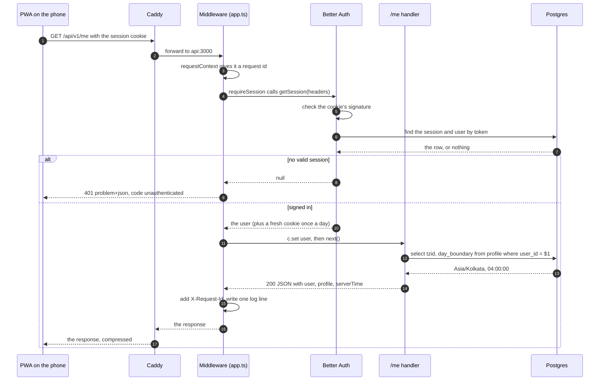

# One request, line by line

> **Background:** [[HTTP basics]] · [[How a request travels]] · [[Middleware]] · [[Cookies and sessions]] · [[Postgres and SQL basics]] · [[Server state and caching]]

Follow one real request through every file it touches: you open the installed app on your phone, and it asks `GET /api/v1/me`. Open each file as you read. The big-picture version is [[How a request travels]]; this is the same trip at the level of functions. Terms: [[HTTP basics]], [[Middleware]], [[Cookies and sessions]].

## The whole trip in one picture

The numbered sections below zoom into each arrow.



## 0. Before any request: the server starts

`apps/api/src/main.ts` runs once, when the container starts (`node apps/api/src/main.ts`):

1. `loadEnv()` (`env.ts`) reads and checks every setting with zod, or exits naming the bad ones ([[Environment variables and config]]).
2. `createLogger(env)` (`logger.ts`) makes the pino logger ([[Structured logging]]).
3. `createPool(env.DATABASE_URL)` (`db/pool.ts`) prepares up to 10 database connections ([[Connection pools]]). `createDb(pool)` (`db/client.ts`) puts Drizzle on top.
4. `createAuth(...)` (`auth/auth.ts`) configures Better Auth: Google, the allowlist hooks, the cookie rules.
5. `createApp(...)` (`app.ts`) builds the Hono app: the list of middleware and routes, in order.
6. `serve(...)` from `@hono/node-server` opens port 3000. Node's built-in HTTP server receives raw connections; `serve` turns each request into a standard `Request` object and hands it to `app.fetch`.
7. `process.once('SIGTERM', shutdown)` prepares a clean stop for when Docker replaces the container.

*From `apps/api/src/main.ts` (shortened):*
```ts
const env = loadEnv();
const logger = createLogger(env);

const pool = createPool(env.DATABASE_URL);
// …
const db = createDb(pool);
const auth = createAuth({ env, db, logger });
// …
const app = createApp({ env, logger, pool, db, auth, now: () => new Date() });

const server = serve({ fetch: app.fetch, hostname: env.HOST, port: env.PORT }, (address) => {
  // … logs "listening" with the host, port and commit
});
```

What to notice:
- Each line uses what the lines above it made, so the order isn't a choice: no logger without `env`, no Drizzle without the pool, no app without all of them.
- `serve` is given `app.fetch`, a function that takes a `Request` and returns a `Response`. That one function is the whole meeting point between Node's HTTP server and Hono.
- No database connection is open yet: the pool connects the first time a query needs one.

## 1. Phone → server

1. The installed PWA's code runs `meQuery` (`apps/web/src/lib/queries.ts`). It calls `apiGet('/api/v1/me')` (`apps/web/src/lib/api.ts`), a `fetch` with no host: it goes to the page's own origin, so the cookie rides along automatically.
   - Who triggers it: the `/` route's `beforeLoad` (`apps/web/src/routes/index.tsx`), which runs before the screen draws, and then a refetch every 60 s.
   - Since v0.2, `beforeLoad` calls `requireSession` (`apps/web/src/lib/require-session.ts`), and the cache may already hold `me`, restored from IndexedDB at start-up ([[Offline reads]]). Then the screen draws from that copy straight away and this request happens in the background; offline, it doesn't happen at all.

   The chain, from the route down to `fetch`:

   ```ts
   // apps/web/src/routes/index.tsx
     beforeLoad: ({ context }) => requireSession(context.queryClient),
   // apps/web/src/lib/require-session.ts
   export async function requireSession(queryClient: QueryClient): Promise<void> {
     try {
       await queryClient.ensureQueryData(meQuery);
     } catch (error) {
       if (isUnauthenticated(error)) throw redirect({ to: '/login' });
       throw error;
     }
   }
   // apps/web/src/lib/queries.ts
   export const meQuery = queryOptions({
     queryKey: ['me'],
     queryFn: ({ signal }) => apiGet<Me>(paths.me, { signal }),
     // …
     refetchInterval: 60_000,
   });
   // apps/web/src/lib/api.ts: inside `send`, which `apiGet` calls
       return await fetch(path, {
         ...init,
         // …
         credentials: 'same-origin',
       });
   ```

   What to notice:
   - This `requireSession` is the PWA's (go to `/login` if nobody is signed in). The server has its own function with the same name: the gate in section 2.
   - `ensureQueryData(meQuery)` returns the cached `me` when there is one, and only calls `queryFn` (the network) when there isn't.
   - `paths.me` is `'/api/v1/me'`, a path with no host, so `fetch` sends it to the page's own origin. `credentials: 'same-origin'` is what lets the cookie ride along.

2. The browser adds the `Cookie: __Secure-better-auth.session_token=<token>.<signature>` header. It's HttpOnly, so our JavaScript can't read it, but the browser sends it.
3. DNS → Cloudflare → your box (see [[How a request travels]]). On the box, **Caddy** (`deploy/Caddyfile`) receives it over HTTPS:
   - `trusted_proxies` + `client_ip_headers CF-Connecting-IP`: trust Cloudflare's note of your real IP, but only when the request really comes from Cloudflare's IP ranges;
   - `reverse_proxy api:3000`: forward to the API container, setting `X-Forwarded-For` to your IP.

   *From `deploy/Caddyfile` (shortened):*
   ```sh
   		# … trusted_proxies static, then Cloudflare's published IP ranges: one very long line
   		client_ip_headers CF-Connecting-IP
   # …
   	reverse_proxy api:3000 {
   		# Hand the API exactly one visitor IP: the one Caddy worked out above. Passing the
   		# incoming X-Forwarded-For along would let a visitor put a fake IP at its front.
   		header_up X-Forwarded-For {client_ip}
   ```

   What to notice: `api:3000` is a name on the private Docker network, not a public address, and `{client_ip}` is the IP Caddy settled on after the `trusted_proxies` check. Why both are needed: [[Reverse proxies and TLS]].

In development the same request goes to Vite on `localhost:5173`, which forwards `/api` to `127.0.0.1:3000` ([[Dev server proxy]]). Everything from here on is identical.

## 2. Through the middleware (`apps/api/src/app.ts`, top to bottom)

Middleware wraps the route like layers of an onion: each one runs its "before" part, calls `await next()`, then runs its "after" part on the way out.

1. **`requestContext(logger)`** (`http/context.ts`)
   - Before: reads `X-Request-Id` from the request if it's safe, or makes one with `randomUUID()`. Stores the id and a child logger tagged with it in `c` (Hono's context object for this request). Starts a timer.
   - After (step 4): sets the `X-Request-Id` response header and logs one line: method, path, status, duration.

   *From `apps/api/src/http/context.ts` (shortened):*
   ```ts
     return async (c, next) => {
       const incoming = c.req.header(REQUEST_ID_HEADER);
       const requestId = incoming && SAFE_REQUEST_ID.test(incoming) ? incoming : randomUUID();
       const log = logger.child({ requestId });
       c.set('requestId', requestId);
       c.set('log', log);

       const started = performance.now();
       await next(); // ← the rest of the app runs here
       // …
       c.header(REQUEST_ID_HEADER, requestId);

       const status = c.res.status;
       // The path only, never the query string: OAuth callbacks carry one-time codes there.
       log[status >= 500 ? 'error' : 'info'](
         {
           method: c.req.method,
           path: c.req.path,
           status,
           durationMs: Math.round((performance.now() - started) * 10) / 10,
         },
         'request',
       );
     };
   ```

   What to notice:
   - Everything above `await next()` is the "before" part. Everything below runs once the route (or `onError`) has produced the response, `c.res`.
   - `SAFE_REQUEST_ID` is the pattern `/^[\w-]{1,128}$/`: a caller's own id is reused only if it's letters, digits, `_` and `-`, so nobody can smuggle quotes or line breaks into our logs.
   - `log[status >= 500 ? 'error' : 'info'](…)` picks the method by name: `log.error(…)` for a 5xx, `log.info(…)` for everything else.

2. **`secureHeaders()`** (Hono): adds headers like `X-Content-Type-Options: nosniff` on the way out.
3. **`bodyLimit(256 KB)`** (Hono): a GET has no body, so it passes.
4. **`healthzRoute`**: only matches `/healthz`. Not ours; skipped.
5. **Better Auth's routes**: only match `/api/auth/*`. Skipped.
6. **`requireSession(auth, allowlist)`** (`auth/require-session.ts`), on every `/api/*` path:
   1. `auth.api.getSession({ headers })` is the Better Auth call that does the real work:
      - parse the cookie;
      - check its HMAC signature with `BETTER_AUTH_SECRET` ([[Hashing and signing]]); a bad signature means no session, with no database query at all;
      - look up the token in `auth_session`, joined to `auth_user` ([[Postgres and SQL basics]]);
      - check `expires_at` hasn't passed;
      - if the session was last extended more than a day ago, push the expiry 30 days out (an `UPDATE`) and prepare a fresh `Set-Cookie`.
   2. Any `Set-Cookie` Better Auth produced is copied onto our response, so the browser's copy of the cookie gets the new expiry too.
   3. No session → `throw new AppError('unauthenticated')`. Jump to step 5.
   4. Session, but the email is no longer on `AUTH_ALLOWED_EMAILS` → `throw new AppError('forbidden')`.
   5. Otherwise `c.set('user', { id, email, name, image })` and `await next()`.

   Steps 6.1 to 6.3 in the code:

   *From `apps/api/src/auth/require-session.ts` (shortened):*
   ```ts
       // Reads the cookie, checks its signature, looks the session up in Postgres
       // and, once a day, pushes its expiry 30 days out (the "sliding" part).
       const { headers, response: session } = await auth.api.getSession({
         headers: c.req.raw.headers,
         returnHeaders: true,
       });
       // …
       for (const cookie of headers.getSetCookie()) c.header('Set-Cookie', cookie, { append: true });

       if (!session) throw new AppError('unauthenticated');
   ```

   What to notice:
   - `const { headers, response: session } = …` takes two fields out of the result and renames `response` to `session` on the way ([[TypeScript essentials]]).
   - `returnHeaders: true` asks Better Auth to also return the headers it would like to send, which is where the refreshed cookie is. The `for` loop copies each `Set-Cookie` onto our response; `append: true` adds a header rather than replacing one, so several `Set-Cookie` lines can sit side by side.
   - The 403 branch and `c.set('user', …)` that come next are shown in [[Auth]].

7. **`csrf({ origin })`** (Hono), on `/api/v1/*`: blocks state-changing requests from other sites. `GET` is safe, so it passes.

## 3. The route handler (`apps/api/src/routes/me.ts`)

*From `apps/api/src/routes/me.ts` (shortened):*
```ts
  app.get(paths.me, async (c) => {
    // …
    const user = c.get('user'); // set by requireSession; never from the URL or body
    const body: Me = {
      user,
      profile: await getProfile(deps.db, user.id),
      serverTime: deps.now().toISOString(),
    };
    // Personal data: never store it in a shared cache.
    c.header('Cache-Control', 'private, no-store');
    return c.json(body);
  });
```

- The user id comes **only** from the session. There's no `?userId=` anyone could change, which is the most important security line in the file.
- `getProfile` (`profile/profile.ts`) calls `findProfile`. Drizzle builds `select "tzid", "day_boundary" from "profile" where "user_id" = $1` and sends it with the id as parameter `$1`. A pooled connection is borrowed and returned.
  - Postgres answers `04:00:00`; `.slice(0, 5)` makes it `04:00` to match the contract's `WallTime`.
  - If there's no row (the sign-in hook failed once, say), `ensureProfile` inserts the defaults with `on conflict do nothing`, and it reads again.

  *From `apps/api/src/profile/profile.ts` (shortened):*
  ```ts
  export async function findProfile(db: Database, userId: string): Promise<Profile | undefined> {
    const [row] = await db
      .select({ tzid: profile.tzid, dayBoundary: profile.dayBoundary })
      .from(profile)
      .where(eq(profile.userId, userId));
    if (!row) return undefined;
    // Postgres returns `time` as `HH:MM:SS`; the contract's WallTime is `HH:MM`.
    return { tzid: row.tzid, dayBoundary: row.dayBoundary.slice(0, 5) };
  }
  // …
  export async function getProfile(db: Database, userId: string): Promise<Profile> {
    const existing = await findProfile(db, userId);
    if (existing) return existing;
    await ensureProfile(db, userId);
    return (await findProfile(db, userId)) ?? DEFAULT_PROFILE;
  }
  ```

  Each Drizzle call adds one clause of the SQL above: `.select({…})` picks the two columns, `.from(profile)` the table, `.where(eq(profile.userId, userId))` the `user_id = $1`. The `userId` travels as a separate parameter, never pasted into the SQL text, so it can't change the query. The final `?? DEFAULT_PROFILE` is a last resort: even if the insert somehow left no row, `/me` still answers with the defaults.

- `deps.now()` is the clock, passed in so tests can freeze time.
- `Me` is the type from `packages/core/src/api.ts`. If this object didn't match it, `pnpm typecheck` would fail ([[v0.0 contracts]]).
- `c.json(body)` builds the response: status 200, `Content-Type: application/json`, the JSON text.

## 4. Back out, and back to the phone

The response passes the middleware in reverse: `secureHeaders` adds its headers, `requestContext` adds `X-Request-Id` and writes the log line:

```json
{"level":30,"time":1791815740478,"requestId":"…","method":"GET","path":"/api/v1/me","status":200,"durationMs":3.1,"msg":"request"}
```

`@hono/node-server` writes it to the socket → Caddy (which compresses it) → Cloudflare → the phone. In the PWA, `apiGet` checks the status, parses the JSON, and TanStack Query stores it under the key `['me']` ([[Server state and caching]]). React draws the screen from that cache.

*From `apps/web/src/lib/api.ts`:*
```ts
export async function apiGet<T>(path: string, options: GetOptions = {}): Promise<T> {
  const response = await send(path, {
    headers: { Accept: 'application/json' },
    signal: options.signal ?? null,
  });

  const body = await readJson(response);
  const requestId = response.headers.get('X-Request-Id');
  const isOk = response.ok || (options.okStatuses ?? []).includes(response.status);

  if (!isOk) throw toApiError(response.status, body, requestId);
  if (body === undefined) throw notJson(path, response, requestId);
  return body as T;
}
```

What to notice:
- `<T>` makes `apiGet` generic: `apiGet<Me>(…)` hands back a `Me` ([[TypeScript essentials]]). `body as T` is a promise to the compiler, not a check; the shared `Me` type in `packages/core` is what keeps the two sides in step.
- `response.ok` is true for statuses 200 to 299. Anything else becomes an `ApiError` built from the problem body, with the request id attached, which is what section 5 relies on.
- `readJson` gives `undefined` when the body isn't JSON, so a `200` with an HTML page (a request that missed the API) is caught as an error too.

## 5. When it fails

Any `throw` above lands in **`onError`** (`http/errors.ts`), the one place errors become responses ([[Error responses]]):
- `AppError('unauthenticated')` → 401 with the `Problem` body `{ type, title, status, code: 'unauthenticated', requestId }`, as `application/problem+json`;
- a Hono `HTTPException` (body too large, a CSRF block) → mapped to our codes;
- anything else (a bug, the database down) → the stack goes to the log under the request id, and the client gets a bare 500 `internal_error` with the id.

*From `apps/api/src/http/errors.ts`:*
```ts
export const onError: ErrorHandler<AppEnv> = (error, c) => {
  if (error instanceof AppError) return problemResponse(c, error);
  if (error instanceof HTTPException) return problemResponse(c, fromHttpException(error));
  if (error instanceof ZodError) return problemResponse(c, validationFailed(error));
  // Anything else is a bug or an outage. The stack goes to the log, under the
  // request id; the client gets the id and nothing about our internals.
  c.get('log').error({ err: error }, 'unhandled error');
  return problemResponse(c, new AppError('internal_error'));
};
```

What to notice: `instanceof` asks "was this error made by that class?", and each line handles one kind. Only the last two lines ever see an unknown error, and they log it with `c.get('log')`, the child logger `requestContext` made, so the stack trace carries the same request id the client receives.

In the PWA, `apiGet` turns the `Problem` into an `ApiError` with `.code`. The route's `beforeLoad` sees `isUnauthenticated(error)` and redirects to `/login` before anything is drawn.

## Next: a write

This note follows a read. [[One write, line by line]] follows v0.2's "add a class" the same way, through the session check, the shared validation rules, the row-level-security transaction and back to the calendar.

## Check yourself
- Find the one line in `me.ts` that stops user B from reading user A's profile. What would the bug look like if the id came from the URL instead?
- A forged cookie with a made-up token arrives. At which step is it rejected, and does Postgres receive any query?
- Add a `console.log` in `requireSession` after `c.set('user', …)` and call `/healthz`. Does it print? Why not?
- Put `throw new Error('boom')` at the top of the `/me` handler and run `curl -i` against it. What does the body contain, and where do you find the stack trace?
