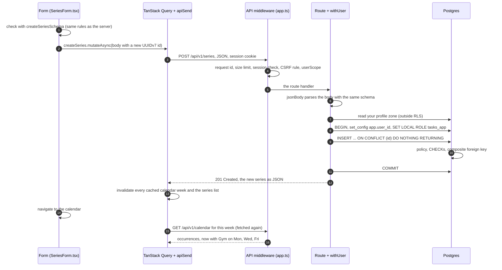

# One write, line by line

> **Background:** [[One request, line by line]] · [[REST resources and CRUD]] · [[Idempotency and retries]] · [[Validating input with schemas]] · [[Transactions]] · [[Row-level security]] · [[Server state and caching]]

[[One request, line by line]] followed a **read** (`GET /api/v1/me`) from your phone to the database and back. This note follows a **write**, v0.2's most involved request: you add a class, and it appears on your calendar. Every step names the file that does it, so you can open each one and follow along.

The example: on your phone, you tap **+ Add class** and fill in title "Gym", Monday, Wednesday and Friday at 6:00 PM, 60 minutes, group "Classes · Sem 3". Then you tap **Save**.

## The whole trip in one picture



## 1. In the browser: before anything is sent

**`apps/web/src/series/SeriesForm.tsx`, `save()`**

1. `event.preventDefault()` stops the browser's own form submission (which would reload the page). From here, our code decides what happens.
2. If you're offline, nothing happens: the Save button was already disabled, with "You're offline. Changes need a connection." (Writes need a connection in v0.2.)

   *From `apps/web/src/series/SeriesForm.tsx` (shortened):*
   ```tsx
     const online = useSyncStatus().state !== 'offline';
     // …
     async function save(event: FormEvent<HTMLFormElement>) {
       event.preventDefault();
       if (busy || !online) return;
   ```

   `online` is worked out again on every render, from the same state as the sync badge. The Save button has `disabled={busy || !online}`, and `save()` checks the same thing again, so even a tap that slips through sends nothing. `busy` is true while an earlier save or delete is still running: a double tap can't send two requests.
3. **An id is made on the phone.** `pendingId('series')` calls `newId()` in `src/lib/mutations.ts`, which returns a **UUIDv7** such as `01a1…`. It's kept in a `useRef`, so if this save fails and you tap Save again, **the same id** goes again. That's what makes a retry safe: the server will recognise the id instead of creating a second Gym ([[Idempotency and retries]]).

   *From `apps/web/src/series/SeriesForm.tsx` and `apps/web/src/lib/mutations.ts` (shortened):*
   ```tsx
   // apps/web/src/series/SeriesForm.tsx
     const pendingIds = useRef<{ group?: string; series?: string }>({});
     // …
     function pendingId(kind: 'group' | 'series'): string {
       const id = pendingIds.current[kind] ?? newId();
       pendingIds.current[kind] = id;
       return id;
     }
   // apps/web/src/lib/mutations.ts
   export function newId(): string {
     return uuidv7();
   }
   ```

   `useRef` gives the component a box (`.current`) that survives re-renders and doesn't cause one when it changes. `pendingIds.current[kind] ?? newId()` makes an id only the first time; every later tap finds the stored one. `uuidv7` is the `uuid` package's `v7`, renamed when it's imported.
4. **The body is built** by `toCreateSeries` in `src/series/form-values.ts`: `{ id, groupId, title: 'Gym', rule: { freq: 'weekly', interval: 1, byDay: ['MO', 'WE', 'FR'] }, startDate, startTime: '18:00', durationMin: 60, … }`. The subject is left out, because you didn't type one; the server will set it to the title. The time is `'18:00'`, never "6:00 PM": 12-hour is only how the screen shows it.

   *From `apps/web/src/series/form-values.ts`:*
   ```ts
   export function toCreateSeries(
     values: SeriesFormValues,
     ids: { series: string; group: string },
   ): CreateSeries {
     return {
       id: ids.series,
       ...seriesFields(values, ids.group),
       ...(values.subject.trim() === '' ? {} : { subject: values.subject }),
     };
   }
   ```

   `...(cond ? {} : { subject: … })` spreads either nothing or one field, so an empty Subject box leaves `subject` out of the body altogether. `seriesFields`, in the same file, turns the rest of the form into the API's fields (the day buttons into `rule.byDay`, Monday first). The return type `CreateSeries` comes from core, so a misspelt field is a type error.
5. **It's checked before sending**, with `createSeriesSchema` from `packages/core/src/schemas.ts`. These are the very same rules the server uses. If you'd picked no days, the form would show "Pick at least one day" under the day buttons and stop here, without a request.

   *From `apps/web/src/series/SeriesForm.tsx` and `apps/web/src/series/form-values.ts` (shortened):*
   ```tsx
   // apps/web/src/series/SeriesForm.tsx
       // Check everything before sending anything.
       const groupBody = makingGroup ? toCreateGroup(values, groupId) : null;
       const createBody =
         series === null
           ? toCreateSeries(values, { series: pendingId('series'), group: groupId })
           : null;
       const found = mergeProblems(
         groupBody === null ? NO_PROBLEMS : checkGroup(groupBody),
         createBody === null
           ? checkUpdateSeries(toFullUpdate(values, groupId))
           : checkCreateSeries(createBody),
       );
       if (hasProblems(found)) return showProblems(found);
   // apps/web/src/series/form-values.ts
   export function checkCreateSeries(input: CreateSeries): Problems {
     return mergeProblems(
       problemsFromErrors(check(createSeriesSchema, input), 'series'),
       checkDateOrder(input),
     );
   }
   ```

   `series === null` means "adding a class", since the same form also edits one. `groupBody` is `null` here because you picked an existing group; with "New group" chosen, the group is checked in the same pass. `return showProblems(found)` ends `save()` before any request. `createSeriesSchema` is imported from `@tasks/core`: the same object the server hands to `jsonBody` in step 15.
6. `createSeries.mutateAsync(body)` hands the write to TanStack Query (`useCreateSeries` in `src/lib/mutations.ts`). It's a **mutation**: a request that changes something, tracked (running / failed / done) but not cached.

   *From `apps/web/src/series/SeriesForm.tsx` and `apps/web/src/lib/mutations.ts` (shortened):*
   ```tsx
   // apps/web/src/series/SeriesForm.tsx
         if (createBody !== null) {
           await createSeries.mutateAsync(createBody);
   // apps/web/src/lib/mutations.ts
   export function createSeries(input: CreateSeries): Promise<Series> {
     return apiSend<Series>('POST', paths.series, input);
   }
   // …
   export function useCreateSeries() {
     const queryClient = useQueryClient();
     return useMutation({
       mutationFn: createSeries,
       onSuccess: () => invalidateAfterWrite(queryClient),
     });
   }
   ```

   Two things share the name `createSeries`: in the form it's the hook's result (`const createSeries = useCreateSeries();`), in `mutations.ts` it's the plain function that sends the request. `mutationFn` is what `mutateAsync` runs; `onSuccess` runs after a 2xx (step 29). `mutateAsync` returns a promise that rejects when the request fails, which is how `save()`'s `try`/`catch` sees a 422.

**`apps/web/src/lib/api.ts`, `apiSend('POST', '/api/v1/series', body)`**

7. `fetch` sends `POST /api/v1/series` with `Content-Type: application/json` and the body as JSON. `credentials: 'same-origin'` makes the browser attach the session cookie, because the URL is on the page's own origin ([[Origin]]).

   *From `apps/web/src/lib/api.ts` (shortened):*
   ```ts
     // … (inside apiSend)
     const response = await send(path, {
       method,
       // Only say the body is JSON when there is one: a plain DELETE has none.
       headers:
         body === undefined
           ? { Accept: 'application/json' }
           : { Accept: 'application/json', 'Content-Type': 'application/json' },
       body: body === undefined ? null : JSON.stringify(body),
     });
     // … (inside send)
       return await fetch(path, {
         ...init,
         // …
         credentials: 'same-origin',
       });
   ```

   `path` is `/api/v1/series`, with no host, so the browser sends it to the origin the page came from. `JSON.stringify(body)` turns the object into the text that travels. `send` wraps `fetch` so that "no answer at all" becomes a `NetworkError`, while any answer, even a 422, comes back for `apiSend` to read.

## 2. On the way to the API

8. **On your laptop** (`pnpm dev`): the browser talks to Vite on port 5173, and Vite forwards `/api/…` to the API on port 3000 ([[Dev server proxy]]).
   **In production:** the phone talks to Cloudflare, Cloudflare to Caddy on the server, and Caddy to the API container ([[How a request travels]]). Either way, the browser only ever sees one origin.

## 3. Through the middleware

**`apps/api/src/app.ts`** runs these in order ([[Middleware]]). It's the same stack as for `/me`, plus one layer.

*From `apps/api/src/app.ts` (shortened):*
```ts
  app.use(requestContext(logger));
  app.use(secureHeaders({ strictTransportSecurity: false }));
  app.use(bodyLimit({ maxSize: MAX_BODY_BYTES }));
  // …
  app.use('/api/*', requireSession(auth, env.AUTH_ALLOWED_EMAILS));
  // …
  app.use(`${paths.apiV1}/*`, csrf({ origin: env.BETTER_AUTH_URL }));
  // …
  const scoped = userScope(db);
  for (const prefix of [paths.groups, paths.series, paths.calendar]) {
    app.use(`${prefix}/*`, scoped);
  }
  groupsRoutes(app);
  seriesRoutes(app, { db });
```

The order of the `app.use` lines is the order a request meets them (steps 9 to 14). The first argument, when there is one, is a path pattern: `requireSession` guards everything under `/api/` (it lets Better Auth's own `/api/auth/…` routes through), `userScope` only the three calendar prefixes. `MAX_BODY_BYTES` is `256 * 1024`. The routes are added last, so every layer above runs before them.

9. `requestContext` gives the request an id, used in the log and the `X-Request-Id` header.
10. `secureHeaders` adds the browser safety headers to the answer.
11. `bodyLimit` refuses a body over 256 KB with 413 before reading it.
12. `requireSession` (`src/auth/require-session.ts`) asks Better Auth to check the cookie: is its signature valid, does that session exist in `auth_session`, has it expired? Is your email still allowed? If any answer is no, it stops here with 401 or 403. If yes, it puts you on the request (`c.get('user')`).
13. `csrf()` refuses **form-style** posts from other websites. A JSON `POST` isn't form-style, so it passes. Another site can't send one with your cookie anyway: the browser blocks that unless the server allows it (CORS), and ours never does.
14. **New in v0.2: `userScope`** (`src/http/user-scope.ts`). It gives the route `c.var.asUser(fn)`, a way to run database work **as you**. The route never passes a user id itself, so it can't pick the wrong one.

    *From `apps/api/src/http/user-scope.ts` (shortened):*
    ```ts
      return async (c, next) => {
        const userId = c.get('user').id;
        c.set('asUser', (fn) => withUser(db, userId, fn));
        await next();
        // After `next()`, so it lands on whatever response was made, 204s and
        // problem responses too (like the request id in `requestContext`).
        c.header('Cache-Control', 'private, no-store');
      };
    ```

    `c.get('user')` is what step 12 stored. The arrow function `(fn) => withUser(db, userId, fn)` remembers `userId` (a closure), so the route only ever says "run this as whoever is signed in". Everything after `await next()` waits for the route to answer: that's step 27.

## 4. The route

**`apps/api/src/routes/series.ts`, the `POST` handler**

*From `apps/api/src/routes/series.ts`:*
```ts
  app.post(paths.series, async (c) => {
    const input = await jsonBody(c, createSeriesSchema);
    // No zone sent: the series takes the user's. The profile isn't one of the
    // row-level-security tables (and tasks_app may not read it), so it's read
    // here, before the scoped transaction, the same way /me reads it.
    const tzid = input.tzid ?? (await getProfile(deps.db, c.get('user').id)).tzid;
    const { row, created } = await c.var.asUser((scope) => createSeries(scope, { ...input, tzid }));
    if (!created) return c.json(row, 200);
    c.header('Location', `${paths.series}/${row.id}`);
    return c.json(row, 201);
  });
```

Steps 15 to 17 are its first three lines; step 23 decides `created`, and step 26 is its last three.

15. **`jsonBody(c, createSeriesSchema)`** (`src/http/json-body.ts`) reads the body. Not JSON at all → **400** `malformed_request`. JSON with wrong values → **422** `validation_failed`, with one `errors` entry per field. The rules are the same as in step 5. The server can't trust that the form checked them, because anyone can send a request without our form ([[Validating input with schemas]]). The parsed value has the defaults filled in: `subject` is now `'Gym'` and `location` is `null`.

    *From `apps/api/src/http/json-body.ts`:*
    ```ts
    export async function jsonBody<Schema extends z.ZodType>(
      c: Context,
      schema: Schema,
    ): Promise<z.output<Schema>> {
      let raw: unknown;
      try {
        raw = await c.req.json();
      } catch (error) {
        throw new AppError('malformed_request', {
          detail: 'The request body is not valid JSON.',
          cause: error,
        });
      }
      const result = schema.safeParse(raw);
      if (!result.success) throw validationFailed(result.error);
      return result.data;
    }
    ```

    What to notice:
    - Two separate `throw`s, one per step: `c.req.json()` failing means "not JSON" (400), `safeParse` failing means "JSON, wrong values" (422).
    - `raw: unknown`: until the schema has looked at it, TypeScript won't let any code use a field of it.
    - `<Schema extends z.ZodType>` with `Promise<z.output<Schema>>`: the return type follows whichever schema is passed. Called with `createSeriesSchema`, `input` is typed as a checked series whose `subject` is a `string` ([[TypeScript essentials]], "Types that come from zod").
16. **No zone was sent**, so the series takes yours: `getProfile` reads `profile.tzid` (`Asia/Kolkata`). This read happens **before** the scoped transaction, with the ordinary connection, because `profile` isn't one of the row-level-security tables and the limited role isn't allowed to read it.
17. **`c.var.asUser((scope) => createSeries(scope, { …input, tzid }))`** opens the scoped transaction (next section).

## 5. In the database, as you

**`apps/api/src/db/user-scope.ts`, `withUser`**

*From `apps/api/src/db/user-scope.ts` (shortened):*
```ts
  return db.transaction(async (tx) => {
    // `true` = local: both settings end with this transaction, so the pooled
    // connection goes back to the pool as the owner again, naming nobody.
    await tx.execute(sql`select set_config('app.user_id', ${userId}, true)`);
    await tx.execute(sql`set local role tasks_app`);
    return fn({ tx, userId } as UserScope);
  });
```

Step 18 is `db.transaction`, 19 and 20 are the two `tx.execute` lines, and `fn` is the route's `(scope) => createSeries(…)`. Inside Drizzle's `sql` tag, `${userId}` isn't pasted into the text: it travels separately as the parameter `$1`.

18. `BEGIN`: a transaction starts on one pooled connection ([[Transactions]]).
19. `select set_config('app.user_id', '<your id>', true)`: "this transaction is Atif's". `true` means *local*: it ends with the transaction.
20. `set local role tasks_app`: from now on the queries run as the limited role, so row-level security applies ([[Roles and privileges]], [[Row-level security]]).

**`apps/api/src/calendar/series.ts`, `createSeries`**

*From `apps/api/src/calendar/series.ts`:*
```ts
export async function createSeries(scope: UserScope, input: NewSeries): Promise<Created<Series>> {
  const [row] = await guardedWrite(Object.keys(input), () =>
    scope.tx
      .insert(series)
      .values({ ...input, userId: scope.userId })
      .onConflictDoNothing({ target: series.id })
      .returning(),
  );
  if (row) return { row: toSeries(row), created: true };
  return alreadyCreated(await findSeries(scope, input.id));
}
```

The chain `insert(series).values(…).onConflictDoNothing(…).returning()` is the statement in step 21, written in TypeScript. `guardedWrite` wraps it, for the refused case in step 23, and `Object.keys(input)` tells it which fields the request sent. The last two lines are step 23's outcomes.

21. Drizzle sends one statement:
    ```sql
    insert into "series" ("id", "user_id", "group_id", "title", …)
    values ($1, $2, $3, $4, …)
    on conflict ("id") do nothing
    returning *
    ```
    `user_id` is set from the scope (your id), never from the request body.
22. Postgres checks the new row against every rule before writing it:
    - **the policy** (`WITH CHECK user_id = app_current_user_id()`): the row must be yours;
    - **the CHECK constraints**: freq daily or weekly, at least one day, duration 1–1440, and so on;
    - **the composite foreign key** `(user_id, group_id)`: the group must exist **and be yours**. A bug that put Bob's group id here would fail at this line, even with row-level security switched off;
    - **the primary key**: no other row may have this id.

    *From `apps/api/drizzle/0002_calendar_rls.sql` and `0001_calendar_tables.sql` (shortened):*
    ```sql
    -- apps/api/drizzle/0002_calendar_rls.sql
    CREATE POLICY series_owner ON series
      USING (user_id = app_current_user_id())
      WITH CHECK (user_id = app_current_user_id());
    -- apps/api/drizzle/0001_calendar_tables.sql
      CONSTRAINT "series_rule_freq" CHECK ("series"."rule"->>'freq' in ('daily', 'weekly')),
      -- …
      CONSTRAINT "series_duration_min" CHECK ("series"."duration_min" between 1 and 1440)
    -- …
    ALTER TABLE "series" ADD CONSTRAINT "series_group_fk" FOREIGN KEY ("user_id","group_id") REFERENCES "public"."schedule_group"("user_id","id") ON DELETE cascade ON UPDATE no action;--> statement-breakpoint
    ```

    `WITH CHECK` is the half of the policy that judges a new row; `app_current_user_id()` reads the `app.user_id` set in step 19. `"rule"->>'freq'` reads the `freq` field out of the JSON column as text. The foreign key compares the pair `(user_id, group_id)`, so your `user_id` and Bob's group id can't match any row.
23. Three possible outcomes:
    - **Inserted** (the normal case): `returning *` gives back the new row → the answer will be **201 Created**.
    - **The id already exists and it's yours** (a retry whose first answer was lost): `do nothing` inserts nothing, the code finds your existing row and answers **200** with it, unchanged. Still only one Gym.
    - **The id exists but isn't visible to you** (someone else's; practically impossible with UUIDv7) → **409** `conflict`.
    - If a rule was broken instead (say the group isn't yours), `guardedWrite` (`src/calendar/writes.ts`) turns Postgres' error into a **422** that names the field: `groupId`.
24. `COMMIT`. The role switch and `app.user_id` end with it, so the connection goes back to the pool as nobody in particular ([[Connection pools]]).

## 6. The answer goes back

25. `toSeries` (`src/calendar/rows.ts`) turns the database row into the contract's `Series` shape: `start_time` `18:00:00` becomes `startTime: '18:00'`, and the columns the contract doesn't have (`user_id`, `created_at`, `updated_at`) are left out.
26. The handler answers **201**, with `Location: /api/v1/series/<id>` and the series as JSON.
27. On the way out through the middleware, `userScope` adds `Cache-Control: private, no-store` (your timetable must never sit in a shared cache), and `requestContext` adds `X-Request-Id` and writes one log line with the method, the path, the status (201) and how long it took ([[Structured logging]]).

## 7. Back in the browser

28. `apiSend` sees a 2xx status, parses the JSON and returns the `Series`.
29. **The mutation's `onSuccess`** runs `invalidateAfterWrite` (`src/lib/mutations.ts`). It marks every cached calendar window as out of date: the key `['calendar']` is a *prefix*, so it covers `['calendar', '2026-10-12', '2026-10-18']`, last week and next week alike. It does the same for the series list. Out-of-date queries that are on screen are fetched again now; the others when they're next shown.

    *From `apps/web/src/lib/mutations.ts`:*
    ```ts
    export async function invalidateAfterWrite(
      queryClient: QueryClient,
      { groups = false }: { groups?: boolean } = {},
    ): Promise<void> {
      await Promise.all([
        // A prefix: every cached window, `['calendar', from, to]`, whatever its dates.
        queryClient.invalidateQueries({ queryKey: ['calendar'] }),
        queryClient.invalidateQueries({ queryKey: seriesListQuery.queryKey }),
        groups ? queryClient.invalidateQueries({ queryKey: groupsQuery.queryKey }) : undefined,
      ]);
    }
    ```

    What to notice:
    - `{ groups = false }: { groups?: boolean } = {}` is an optional settings object with a default. Adding Gym passes nothing, so the groups list isn't refetched; only `useCreateGroup` passes `{ groups: true }`.
    - `Promise.all` waits for all the invalidations together. Because `onSuccess` returns this promise, `mutateAsync` in step 6 only finishes once the refetches of what's on screen are back, and only then does step 30 run.
30. `router.navigate({ to: '/' })` goes back to the calendar.
31. The calendar screen asks for this week, finds its cached copy marked out of date, and fetches it again: `GET /api/v1/calendar?from=2026-10-12&to=2026-10-18`. On the server, `expand()` now has one more series, and returns Gym on Monday, Wednesday and Friday at 18:00 Kolkata time.
32. The grid draws the three new blocks ([[Calendar grid]]). About a second later, the persister writes the updated cache to IndexedDB, so the new week opens offline too ([[Offline reads]]).

## When something goes wrong, where it stops

| What happened | Where it stops | What you see |
|---|---|---|
| No days picked | Step 5, in the browser | "Pick at least one day", no request sent |
| Offline | Step 2: Save is disabled | "You're offline. Changes need a connection." |
| Session expired | Step 12, 401 | A banner with the code `unauthenticated` on the form; the app's next check of `/me` (at most a minute later) sends you to the login screen |
| Some other client sends `durationMin: -30` | Step 15, 422 | (Our form never sends it: step 5 caught it) |
| The answer is lost on bad Wi-Fi, you tap Save again | Step 23, 200 with the existing row | One Gym, not two |
| The database is down | Step 12 (`requireSession` looks the session up in Postgres on every request, so that's the first query), 500 | A banner with the request id, to find the log line |

## Check yourself
- Predict before reading step 15 again: the form already checked the body in step 5. Why does the server check it a second time?
- In step 21 the insert sets `user_id` from the scope. What would go wrong if it came from the request body instead, and which two rules would still stop a forged one?
- You tap Save, the server inserts Gym, and the answer never reaches your phone. You tap Save again. Trace both requests through steps 21–23: what does each one answer, and how many Gym series exist afterwards?
- Break it: in step 3's excerpt, change `pendingId` to just `return newId();`, with no `pendingIds`. Your first Save reaches the server but the answer is lost, and you tap Save again. What does the server do with the second request, and what does your Monday look like afterwards?
- Break it: in `src/lib/mutations.ts`, remove the `['calendar']` line from `invalidateAfterWrite`. You add a class. What does the calendar show when you get back to it, and when would the new class finally appear?
