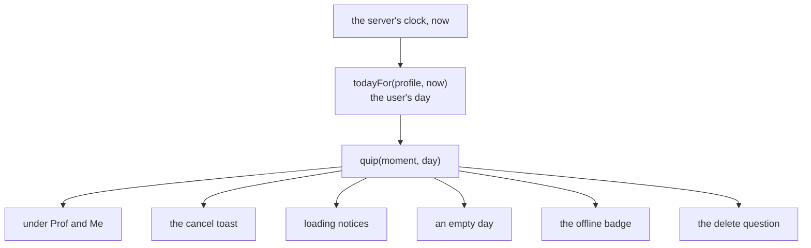

# Quips

> **Background:** [[Cancelling one occurrence]] · [[Offline cancels]] · [[The user's day]] · [[Delete with the typed name]] · [[Dialogs and toasts]] · [[Testing pure code]]

A **quip** is a line of humour the app says at a small moment: after a cancel, while the week loads, on an empty day, in the offline badge, beside the delete question, and under the Prof and Me buttons. Each moment says the **same line all day** and a different one tomorrow. Three **easter eggs** show up rarely: a line when every class today is cancelled, a rare loading line, and a gentle roast after three skips in one day. No quip is ever saved or sent: the server and the stored data keep plain words like "I skipped". This is ticket #15, built in PR #26. Why it's built this way: [[Quip choices]].

## Predict first

Made-up data, with today as Tue 10 Nov 2026 and the day starting at midnight.

1. You open the app at 9 am and at 9 pm. Is the loading line the same?
2. You tap a class twice in a row. Does the small line under **Me** change between the two taps? Does the word "Me" ever change?
3. Today has no classes at all. Does the "every class today is cancelled" line show?
4. Today has "Pottery", "Chess" and "Yoga". You skip all three. What does the toast say after the third?
5. You skip Pottery, then the prof cancels Chess and Yoga. Roast or no roast?
6. The server stores a skipped class. Which words does it store?

## Files

| File | What it does |
|---|---|
| `apps/web/src/lib/quips.ts` | Every line, and the four functions that pick one |
| `apps/web/src/lib/quips.test.ts` | The tests (see the end) |
| `apps/web/src/calendar/model/sheet.ts` | `sheetActions` takes the day and puts the line under Prof and Me |
| `apps/web/src/calendar/CalendarScreen.tsx` | The toast's line, the empty notice, the all-cancelled line |
| `apps/web/src/components/LoadingLine.tsx` | The loading line, with a plain "Loading…" for screen readers |
| `apps/web/src/components/PendingScreen.tsx` | The spinner between screens uses `LoadingLine` |
| `apps/web/src/components/Toast.tsx` | A toast can carry a quieter second line, `quip` |
| `apps/web/src/components/SyncBadge.tsx` | The badge ends with a short line while out of touch |
| `apps/web/src/components/form-controls.tsx` | `DeleteSection` shows a line beside the question |



## One module holds every line

All the words live in one object, `LINES`. Each key is a **moment** (a place in the app with lines of its own), and each moment has eight lines.

*From `apps/web/src/lib/quips.ts`:*
```ts
  /** The toast after Me. */
  skipped: [
    'Bold. The percentage noticed.',
    'No judgement. Some judgement.',
    'Rest is also a subject.',
```

The nine ordinary moments are `prof` and `me` (the small lines under the two buttons), `cancelledByProf`, `skipped` and `notToday` (the toast after each kind of cancel), `loading`, `emptyDay`, `badge` and `confirmDelete`. The three easter eggs, `allCancelled`, `threeSkips` and `rareLoading`, have three or four lines each, because each one shows up rarely.

*From `apps/web/src/lib/quips.ts`:*
```ts
export type Moment = keyof typeof LINES;
```

`keyof typeof LINES` reads as "the names of the keys of that object" ([[TypeScript essentials]]). So `Moment` is exactly `'prof' | 'me' | 'skipped' | …`, and it stays right by itself: add a key to `LINES` and the type grows; mistype a moment at a call site and the compiler refuses it. There is no second list to keep in step.

Why one module: a joke that needs fixing is in one file, and so is the proof that nothing leaks. Nothing in `quips.ts` imports the API client or the queue, and only screen components import it.

## Picking the day's line: `quip`

*From `apps/web/src/lib/quips.ts`:*
```ts
export function quip(moment: Moment, day: ISODate): string {
  const lines = LINES[moment];
  // Days since 1970: a count that goes up by one each day, month ends included.
  const dayNumber = Math.floor(Date.parse(`${day}T00:00:00Z`) / DAY_MS);
  return lines[(dayNumber + MOMENTS.indexOf(moment)) % lines.length] ?? lines[0];
}
```

Walk it with `quip('skipped', '2026-11-10')`:

1. `Date.parse('2026-11-10T00:00:00Z')` gives the milliseconds from 1 Jan 1970 to that midnight in UTC. Divided by the milliseconds in a day (`DAY_MS`, 86 400 000) it is a whole number of days: 20 767. Tomorrow gives 20 768. The count goes up by exactly one each day, and a month end is nothing special to it.
2. `MOMENTS.indexOf('skipped')` is the moment's place in the list of moments: 3.
3. `%` is the **remainder** after dividing. `(20767 + 3) % 8` is 2, so the answer is line 2 of `skipped`: "Rest is also a subject." Tomorrow the remainder is 3, the day after 4, and after 7 it wraps back to 0.

What to notice:
- **The same day gives the same line.** The function reads nothing but its two arguments: no clock, no random number. Call it a hundred times in one redraw and it says the same thing, which is the whole point: a joke that changes every time the screen redraws is a flicker, not a joke.
- **The lines take turns.** With eight lines, eight days in a row give eight different lines. A random pick would repeat yesterday's line one day in eight.
- **Each moment starts somewhere else.** Adding the moment's place in the list means `loading` and `emptyDay` don't both show their line 0 on the same day and move in step.
- **`Z` matters.** The day is already the user's day by the time it gets here, so the maths treats it as a plain calendar date in UTC. Parsing it in the phone's zone could land an hour before midnight and round down to the day before ([[Dates, times and instants]]).
- **`?? lines[0]`** is for the compiler only. TypeScript can't prove an index is inside the list, so reading one gives "a string, or nothing"; the fallback turns that into a string. The remainder is always inside the list.

## Which day: the user's day

The day `quip` gets is not midnight-to-midnight on the phone. It is the **user's day**, which starts at the profile's day boundary ([[The user's day]]).

*From `apps/web/src/calendar/CalendarScreen.tsx`:*
```tsx
  // The day the quips go by: it starts at the profile's day boundary, so a
  // line read at 1 am is still yesterday's when the day starts at 4.
  const quipDay = todayFor(profile, nowMs);
```

The boundary is midnight by default (since ticket #11), so today nothing looks different. Set it to 04:00 and a line read at 1 am is still yesterday's, because for someone awake at 1 am it is still "today". The test uses a 04:00 profile to prove the hand-over happens there: 03:59 gives the old day's line and 04:00 the new one.

One loose end, on the later list: the calendar's own `today` (which column is highlighted, and the words "No classes today") still changes at midnight. The two agree while the boundary is midnight.

## Under Prof and Me: the word stays

The sheet's buttons were three constants. Two are now small functions of the day:

*From `apps/web/src/calendar/model/sheet.ts`:*
```ts
const prof = (day: ISODate): CancelButton => ({
  word: 'Prof',
  line: quip('prof', day),
  change: { status: 'cancelled', cancelReason: 'not_held' },
});
```

A button has three parts, and only one of them moves:
- `word` is always "Prof" (or "Me"). It is what you look for at 8 am without reading.
- `line` is the day's quip. Every `prof` line still says the class didn't happen ("Called off", "Nobody taught"), and every `me` line still says you didn't go, so even the joke can't point you at the wrong button.
- `change` is the body of the request. It never changes: "Me" always sends `skipped`.

A test in `sheet.test.ts` asks for the buttons on two days and checks that the lines differ while the words and the request bodies are the same. This is the rule the spec calls "humour never goes on a button that changes a number": Prof, Me, Not today, Restore and Delete always say exactly that.

## The toast: the fact first, the joke under it

*From `apps/web/src/calendar/CalendarScreen.tsx`:*
```tsx
    const cancelled = applyChange(occ, change);
    setToast({
      text: `${title} · ${statusLabel(cancelled)}`,
      quip: cancelQuip(cancelled, shown.occurrences, quipDay),
```

`text` is still the plain fact: "Pottery · I skipped". The quip is a second field, drawn smaller and dimmer under it. If the joke is unclear, the fact above it isn't.

`cancelQuip` picks which list to read from:

*From `apps/web/src/lib/quips.ts`:*
```ts
export function cancelQuip(
  cancelled: DatedOccurrence,
  shown: readonly DatedOccurrence[],
  day: ISODate,
): string {
  if (cancelled.cancelReason === 'not_held') return quip('cancelledByProf', day);
  if (cancelled.cancelReason !== 'skipped') return quip('notToday', day);
  const otherSkips = shown.filter(
    (occ) =>
      occ.key !== cancelled.key &&
      occ.date === cancelled.date &&
      occ.status === 'cancelled' &&
      occ.cancelReason === 'skipped',
  ).length;
  return quip(otherSkips + 1 >= SKIPS_FOR_ROAST ? 'threeSkips' : 'skipped', day);
}
```

What to notice:
- **Three reasons, three lists.** The prof cancelled: a line about a free hour. No reason (a Not today cancel in a group that doesn't count attendance): a line with no guilt in it. You skipped: read on.
- **The roast counts skips, not cancels.** It counts the other classes that are cancelled with the reason `skipped`, adds one for the class just skipped, and at three or more reads from `threeSkips` instead. The prof's cancels don't count: three cancelled classes that weren't your doing aren't yours to be teased about.
- **On the class's own day.** `occ.date === cancelled.date` counts the day the skipped class is on, which needn't be today. Skip three of next Monday's classes and the third gets the roast. That's why the roast lines say "in one day", never "today"; the first draft said "today", and the code review caught it.
- **`occ.key !== cancelled.key`** leaves the class itself out of "the others". `shown` is the calendar as it was before the tap; if the class were somehow in it as skipped already, it would be counted twice without this.
- **Only the toast for a cancel has a quip.** The toast that says the server refused a change stays plain. It reports that something was lost, and that is no place for a joke.

## Every class today cancelled

*From `apps/web/src/lib/quips.ts`:*
```ts
export function everyClassCancelled(
  occurrences: readonly DatedOccurrence[],
  day: ISODate,
): boolean {
  const classes = occurrences.filter((occ) => occ.date === day);
  return classes.length > 0 && classes.every((occ) => occ.status === 'cancelled');
}
```

`classes.length > 0` is the part that matters. In JavaScript, `[].every(…)` is `true`: "every one of nothing" passes any test. Without the length check, a day with no classes would count as "every class cancelled" and get the celebration. A day with nothing on it is an empty day, and it has its own line.

The screen shows the line above the grid, and only while the user's day is one of the days on screen:

*From `apps/web/src/calendar/CalendarScreen.tsx`:*
```tsx
  const allCancelled =
    days.includes(quipDay) && everyClassCancelled(shown.occurrences, quipDay)
      ? quip('allCancelled', quipDay)
      : null;
```

Any reason counts here: skipped, cancelled by the prof, or Not today. Page to next week and the line goes, because it is about today.

## The rare loading line

*From `apps/web/src/lib/quips.ts`:*
```ts
export const RARE_LOADING_CHANCE = 0.025;
```

*From `apps/web/src/lib/quips.ts`:*
```ts
export function loadingQuip(day: ISODate, roll: number): string {
  return quip(roll < RARE_LOADING_CHANCE ? 'rareLoading' : 'loading', day);
}
```

`roll` is a number from 0 up to (not including) 1. Under 0.025, about one time in forty, the line comes from `rareLoading`.

Notice that the function doesn't call `Math.random()` itself. It takes the roll as an argument. That keeps it **pure**: the same inputs always give the same answer, so a test can pass `0` and know it gets the rare line, or `0.99` and know it doesn't ([[Testing pure code]]). A function that rolled its own dice could only be tested by running it thousands of times and hoping.

The dice are rolled in the component:

*From `apps/web/src/components/LoadingLine.tsx`:*
```tsx
export function LoadingLine({ day }: { day: ISODate }) {
  // Rolled once each time a notice appears, so the line doesn't change while it waits.
  const [roll] = useState(Math.random);
  return (
    <>
      <span aria-hidden="true">{loadingQuip(day, roll)}</span>
      <span className="sr-only">Loading…</span>
    </>
  );
}
```

What to notice:
- **`useState(Math.random)`, not `useState(Math.random())`.** Passing the function itself (no brackets) tells React "call this once, when the component first appears, and keep the answer". The component may redraw many times while it waits; `roll` stays the same number, so the line doesn't change under your eyes. With the brackets it would still keep the first value, but it would roll the dice on every redraw and throw the result away.
- **Rolled each time a notice appears.** When loading ends the component goes away, and its state with it. The next loading notice is a new component with a new roll. That is the spec's "a rare loading line whose chance is rolled each time".
- **Two spans, two audiences.** `aria-hidden="true"` hides the joke from screen readers. `sr-only` is a Tailwind class that hides text from the eye and leaves it for screen readers. Someone listening hears "Loading…", which is what they need to know; "Counting the Mondays…" is no way to find out the screen is waiting.

`PendingScreen` (the spinner between screens) uses the same component when it knows who is signed in. Before sign-in there is no profile, so there is no "user's day" to ask for, and it stays a plain spinner.

## The badge, the empty day, the delete question

The **badge** adds a short line while the app is out of touch with the server:

*From `apps/web/src/components/SyncBadge.tsx`:*
```tsx
  const line = status.state !== 'synced' && profile ? quip('badge', todayFor(profile, now)) : null;
```

So it reads "offline · last synced 2:02 PM · working from memory". The `badge` lines are the shortest in the file because the badge is a pill. When the app is online and a change is simply on its way, there is no line: that state lasts a second, and a joke that flashes past is noise. The plain text still comes from `syncBadgeText`, unchanged and still tested by itself ([[Offline cancels]]).

The **empty notice** now has two lines, the fact and then the quip, and it shows more often than it used to. Before, it showed only when the whole week was empty. Now it shows when the days on screen are empty: in day view, one empty day says "No classes today" (or "No classes this day" for another day), and week view still says "No classes this week".

The **delete question** gets the line right beside it: "Delete this class? Gone means gone." The Delete and Keep it buttons keep their words ([[Delete with the typed name]]).

## Tested

- **`quips.test.ts`, 19 tests.** The same line all day. Eight days in a row give eight different lines. The line still changes across a month end. Two moments on one day say different things. With a 04:00 day boundary, 03:59 gives the old day's line and 04:00 the new one. The rare loading line appears only under the chance, and it is a line no ordinary day gets. Every class cancelled: true whatever the reasons, false while one class is on, false on a day with no classes, and it ignores other days. The roast: at the third skip, not at the second, not for the prof's cancels or another day's skips, not for a prof cancel on a day of three skips, and a class is counted once.
- **`sheet.test.ts`, 1 new test.** The line changes with the day; the word and the request don't.
- **In a browser** (Playwright, made-up classes): each moment at phone width; dark mode; week view at 1024 px; the rare loading line with `Math.random` forced to 0; and three skips in one day, where the first two toasts had the usual line and the third the roast.
- **Not done:** a screen reader, a real phone, and a test for the calendar's empty-notice rule (on the later list).

## Check yourself

- **Predict:** `quip('loading', '2026-11-10')` and `quip('loading', '2026-11-18')`. Same line or not, and why?
- **Trace:** today has Pottery (skipped) and Chess (cancelled by the prof), and you tap Me on Yoga. Walk `cancelQuip`: what is `otherSkips`, and which list is read?
- **Break it:** delete `classes.length > 0 &&` from `everyClassCancelled`. What shows on a day with no classes, and why?
- **Break it:** change `useState(Math.random)` to a plain `Math.random()` inside the component. What would you see while a slow week loads?
- **Explain:** why does `loadingQuip` take `roll` as an argument instead of calling `Math.random()`?
- **Explain:** the server stores `skipped` and the toast says "Rest is also a subject." Where does that sentence live, and what would have to go wrong for it to reach the database?
