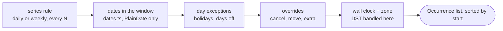

# Recurrence engine (`packages/core/src/recurrence/`)

> **Background:** [[Dates, times and instants]] · [[Time zones and daylight saving]] · [[Testing pure code]]

The engine turns stored rules into the classes and habits you see on the calendar. Milestone v0.1; the design is in `docs/brainstorm/01-recurrence.md` §5. It's **pure**: no database, no network, no clock. It takes data in and returns data out, so it's easy to test, and the server, the web app and the CLI can all run the same code.

Read first: [[Core types]], [[Dates, times and instants]].

## Predict first

Before reading on, write down how *you* would answer: "Which DBMS classes happen between 5 and 11 October, and when exactly, if Wednesday's was cancelled and Friday's moved to Saturday?" What do you loop over? Where would a holiday fit?

## The pipeline



**Precedence, the one rule to memorise:** an explicit action on one occurrence beats a bulk rule, which beats the series rule. *Override > day exception > series rule.* So a class you explicitly marked "it's on" stays on, even if a holiday is added later.

## Files

| File | What it does |
|---|---|
| `dates.ts` | Step 1, **dates only**: which local dates a rule produces. Uses `PlainDate`, so daylight saving can't affect it. Also `occursOn`, `untilDateForCount` ("ends after 10 times" → an end date), and `assertValidRule` |
| `expand.ts` | Steps 2–4: `expand()` applies day exceptions and overrides, then converts to instants. Also `findOrphans()` |
| `split.ts` | `splitSeries()`: "this and following" changes without rewriting the past |
| `keys.ts` | `occurrenceKey(seriesId, date)` and `extraKey(id)` |
| `*.test.ts` | Tests, next to the code they test. See [[Testing pure code]] |
| `__fixtures__/sample-timetable.ts` | A made-up, KIIT-shaped week used by the golden tests. Your real timetable stays private (`private/`, never committed) |
| `__snapshots__/*.txt` | The golden weeks, as readable text |

## Step 1: dates (`ruleDates`, `seriesDates`)

- **Daily, every N days.** Count from the series start. Instead of walking day by day, jump straight to the first aligned day in the window (`Math.ceil(daysSinceStart / N)` steps), so the loop costs one step per occurrence.
- **Weekly, every N weeks on some weekdays.** Weeks are counted from the **Monday of the series' start week** (the *anchor*). Find the window's first Monday. If it's an "off" week, skip ahead to the next "on" week. Then emit the chosen weekdays of every N-th week.
- **Clipping.** The effective range is *series start..until* ∩ *group active range* ∩ *window*, all inclusive. The phase always comes from the series start, never from the clipped start, so if the semester's group starts a week later, a fortnightly lab still falls in the same weeks.

The first two bullets are `ruleDates`. It gets the rule, the `anchor` (the series start) and the already-clipped range `lo..hi`:

*From `packages/core/src/recurrence/dates.ts` (shortened):*
```ts
  if (rule.freq === 'daily') {
    // Jump straight to the first aligned day >= lo: the loop costs one step per occurrence,
    // not one per day.
    const steps = Math.ceil(daysBetween(anchor, lo) / rule.interval);
    for (
      let d = anchor.add({ days: steps * rule.interval });
      compare(d, hi) <= 0;
      d = d.add({ days: rule.interval })
    ) {
      out.push(d);
    }
    return out;
  }

  const days = [...new Set(rule.byDay)].map((day) => WEEKDAY_NUMBER[day]).sort((a, b) => a - b);
  const anchorWeek = mondayOf(anchor);
  let week = mondayOf(lo);
  // Both are Mondays, so this division is exact.
  const weeksSinceAnchor = daysBetween(anchorWeek, week) / 7;
  const offPhase = weeksSinceAnchor % rule.interval;
  if (offPhase !== 0) week = week.add({ weeks: rule.interval - offPhase });

  for (; compare(week, hi) <= 0; week = week.add({ weeks: rule.interval })) {
    for (const dayNumber of days) {
      const d = week.add({ days: dayNumber - 1 });
      if (compare(d, lo) >= 0 && compare(d, hi) <= 0) out.push(d);
    }
  }
  return out;
```

What to notice:
- Daily, "every 3 days" from 5 Oct with the window starting 9 Oct: 4 days since the anchor, `Math.ceil(4 / 3) = 2` steps, so the first date is 5 Oct + 6 = 11 Oct. No walking through 6, 7, 8…
- Weekly: `offPhase` is "how many weeks into the cycle is the window's first Monday?". If it's not 0, jump ahead to the next "on" week. After that the loop steps `interval` weeks at a time, so it never visits an "off" week.
- `[...new Set(rule.byDay)]` drops a repeated day, and `.sort` puts the days in Monday-first order, so dates come out ascending within each week.
- The inner `if` matters for the first and last week: the window may start on a Wednesday, so that week's Monday must not slip in.

The third bullet, clipping, is `seriesDates`. Notice that `start` (not `lo`) is what goes to `ruleDates` as the anchor:

*From `packages/core/src/recurrence/dates.ts` (shortened):*
```ts
  assertValidRule(series.rule);
  const start = Temporal.PlainDate.from(series.startDate);
  let lo = later(window.from, start);
  let hi = window.to;
  if (series.untilDate !== null) hi = earlier(hi, Temporal.PlainDate.from(series.untilDate));
  if (group) {
    lo = later(lo, Temporal.PlainDate.from(group.activeFrom));
    if (group.activeTo !== null) hi = earlier(hi, Temporal.PlainDate.from(group.activeTo));
  }
  return ruleDates(series.rule, start, lo, hi);
```

`later` and `earlier` pick the later or the earlier of two dates. An intersection of ranges is just "the latest start and the earliest end", and if that leaves `lo` after `hi`, `ruleDates` returns nothing.

A worked example (test E3): every 2 weeks on Monday, starting **Tuesday** 6 Oct. The anchor week is Mon 5 Oct, which is "on", but 5 Oct is before the start. So the first class is Mon 19 Oct, then 2 Nov, 16 Nov and 30 Nov.

## Steps 2–4: `expand(input)`

The input is groups, series, overrides, day exceptions and a date window, and it works in **three passes**:

1. **Generated dates in the window.** For each series, each date from step 1 gets its override (looked up by key) and the day layer, then times. If an override moved it *out* of the window, it's dropped here.
2. **Moved in from outside.** An occurrence originally on 19 Oct but moved to 10 Oct belongs in the week of 5–11 Oct, yet pass 1 never saw it, because its original date isn't in the window. Pass 2 scans overrides whose *new* date is in the window and whose original isn't.
3. **Extras.** Make-up classes, exactly where the user put them, untouched by holidays or group ranges.

Here are the three loops, with the middle of passes 2 and 3 cut (pass 2 is shown whole, line by line, in [[v0.1 in plain words]]):

*From `packages/core/src/recurrence/expand.ts` (shortened):*
```ts
  // Pass 1: dates the rule generates inside the window.
  for (const s of input.series) {
    const g = groupOf(s);
    for (const d of seriesDates(s, { from, to }, g)) {
      const occ = resolve(s, g, d, modified.get(occurrenceKey(s.id, d.toString())), days);
      // An occurrence moved to a date outside the window doesn't belong here.
      if (inWindow(occ.date)) out.push(occ);
    }
  }

  // Pass 2: occurrences moved INTO the window from a date outside it.
  // Pass 1 never saw them, because their original date isn't in the window.
  for (const o of input.overrides) {
    if (o.kind !== 'modified' || o.newDate === null) continue;
    // …
    if (inWindow(original) || !inWindow(Temporal.PlainDate.from(o.newDate))) continue;
    // …
    out.push(resolve(s, g, original, o, days));
  }

  // Pass 3: extras, such as make-up classes.
  for (const o of input.overrides) {
    if (o.kind !== 'extra') continue;
    const s = seriesById.get(o.seriesId);
    if (s && inWindow(Temporal.PlainDate.from(o.newDate))) out.push(resolveExtra(s, o));
  }
```

What to notice:
- `modified` is a `Map` from occurrence key to override, built once before the loops. Pass 1 finds a date's override with one lookup, `modified.get(occurrenceKey(...))`, instead of searching the whole list every time.
- Pass 1 pushes only if `inWindow(occ.date)`, and pass 2 only if the original date is *outside* the window. Together they make sure a moved class appears exactly once, wherever you look from.
- Pass 3 calls `resolveExtra`, not `resolve`, so no day exception or group range is consulted at all.

Then it sorts by real start time, with the key as a tie-breaker, so the order is always the same.

### The layers for one occurrence (`resolve`)

- **Place it.** Date = the override's `newDate`, else the original date. Time = `newStartTime`, else the series time. Duration likewise. `moved` is true only if the result really differs from the rule.
- **Status:**
  - override says `cancelled` → cancelled, with the user's reason, origin `user`;
  - override says `scheduled` → scheduled, whatever else is true;
  - otherwise, if the group observes holidays, there's a day exception on the *original* date, and the user hasn't placed this occurrence (no new date or time) → cancelled with the exception's effect, origin `holiday`, and its label.
- **Carry-through:** `confirmedAt` and `note` are copied from the override as they are. A note never counts as "placed" and never touches the status, so a note-only override still lets a holiday cancel the class (test "a note alone still lets the holiday apply"; property "notes are inert").
- **Zone** (`withTimes`): date + time + zone → `ZonedDateTime` with the `'compatible'` rule, `end = start + duration` in real minutes, and `dstShifted` if the clock time had to move. See [[Time zones and daylight saving]].

"Place it" and "Status", in `resolve`:

*From `packages/core/src/recurrence/expand.ts` (shortened):*
```ts
  const newDate = ov?.newDate ?? null;
  const newStartTime = ov?.newStartTime ?? null;
  const date = newDate === null ? original : Temporal.PlainDate.from(newDate);
  const time = Temporal.PlainTime.from(newStartTime ?? s.startTime);
  const moved = !date.equals(original) || !time.equals(Temporal.PlainTime.from(s.startTime));
  // …
  if (ov?.status === 'cancelled') {
    // Layer 3: the user cancelled this one occurrence.
    status = 'cancelled';
    cancelReason = ov.cancelReason;
    cancelOrigin = 'user';
  } else if (ov?.status !== 'scheduled') {
    // Layer 2: a day exception, unless the user already decided about this occurrence:
    // an explicit "it's on" (status 'scheduled') or a placement on a new date or time.
    const placed = newDate !== null || newStartTime !== null;
    const exception = g.observesHolidays && !placed ? days.get(original.toString()) : undefined;
    if (exception) {
      status = 'cancelled';
      cancelReason = exception.effect;
      cancelOrigin = 'holiday';
      holidayLabel = exception.label;
    }
  }
```

What to notice:
- `ov?.newDate ?? null`: `ov` may be `undefined` (no override for this date). `?.` returns `undefined` instead of crashing, and `?? null` turns that into `null`. See [[TypeScript essentials]].
- `moved` compares the *result* with the rule, so an override that "moves" a class to the time it already had doesn't count as moved.
- Precedence is the order of the `if`s. The user's `cancelled` is checked first, and `else if (ov?.status !== 'scheduled')` means an explicit "it's on" skips the holiday check entirely.
- `placed` looks only at `newDate` and `newStartTime`. `note` isn't in it, which is exactly why a note-only override still lets a holiday cancel the class.
- The holiday is looked up with `original.toString()`, the date the rule generated, never the date the class was moved to.

"Zone", in `withTimes`:

*From `packages/core/src/recurrence/expand.ts` (shortened):*
```ts
  const wanted = date.toPlainDateTime(time);
  const start = wanted.toZonedDateTime(tzid);
  const end = start.add({ minutes: durationMin });
  return {
    occurrence: {
      ...base,
      date: date.toString(),
      start: start.toInstant().toString(),
      end: end.toInstant().toString(),
      tzid,
      dstShifted: !start.toPlainDateTime().equals(wanted),
    },
    // …
  };
```

- `toZonedDateTime(tzid)` with no options uses Temporal's default, `'compatible'`: a time in a gap moves forward, and a time that happens twice takes the first.
- `dstShifted` compares the wall clock Temporal actually produced with the one asked for. In Kolkata they're always equal.
- `.toInstant().toString()` writes the moment in UTC with a `Z`, which is how every `Instant` leaves the engine.

### Inputs it refuses

`expand` throws on a window that ends before it starts, a series whose group wasn't passed in, an invalid rule (an interval of 0 would loop forever), an unknown zone like `IST`, or a raw offset like `+05:30`. Failing loudly on caller bugs beats returning a quietly wrong calendar. It *ignores* overrides for series it wasn't given, so callers may pass a broad set.

The offset check is the engine's own, because Temporal itself would happily accept `+05:30`:

*From `packages/core/src/recurrence/expand.ts` (shortened):*
```ts
  for (const s of input.series) assertZoneName(s.tzid);
  // …
function assertZoneName(tzid: string): void {
  if (/^[+-]/.test(tzid)) {
    throw new RangeError(`Use an IANA zone name such as Asia/Kolkata, not an offset: ${tzid}`);
  }
}
```

`/^[+-]/` is a regular expression meaning "starts with `+` or `-`". Zone names never do, and offsets always do. `IST` needs no check here: Temporal throws on it as soon as a time is converted in that zone.

## Splits: `splitSeries`

"From 19 Oct, DBMS is at 11:00." Past classes carry attendance, so they must not change. The plan:

- **Split on or before the start** → nothing in the past, so update in place (`in_place`).
- **Otherwise**, end the old series the day before (never *extending* it if it already ended earlier), and start a new one linked by `previousSeriesId` (`split`).
  - **Same rule:** the new half starts on the old rule's **first real occurrence** on or after the split. That keeps "every 2 weeks" in the same weeks. Starting it on the split date itself can flip the phase (test S1).
  - **New rule:** it starts on its first matching weekday on or after the split.
- **Nothing left after the split** → just end the old series (`end_only`).
- Overrides on or after the split move to the new series if it still generates their date (`rekeyed`). Otherwise they're `orphaned`, so the UI can ask: "2 changes on Mondays won't apply any more."

It returns a *plan*, not database writes, and the API (v0.3b) applies it in one transaction. The new series' id comes from the caller, because making a UUID needs randomness and the clock, which core doesn't touch.

The decision points, in order:

*From `packages/core/src/recurrence/split.ts` (shortened):*
```ts
  if (compare(split, Temporal.PlainDate.from(series.startDate)) <= 0) {
    const updated = { ...series, ...changes };
    const orphaned = own.filter((o) => !occursOn(updated, o.originalDate));
    return { kind: 'in_place', series: updated, orphaned: orphaned.map((o) => o.id) };
  }

  const until = series.untilDate === null ? null : Temporal.PlainDate.from(series.untilDate);
  const dayBefore = split.subtract({ days: 1 });
  // Clamp: a split after the series has ended must not extend it.
  const oldUntil = until !== null && compare(until, dayBefore) < 0 ? until : dayBefore;
  const old: Series = { ...series, untilDate: oldUntil.toString() };
  // …
  const ruleChanged = newRule !== undefined && !sameRule(newRule, series.rule);
  const nextStart = ruleChanged
    ? firstMatchOnOrAfter(newRule, split)
    : seriesDates(series, { from: split, to: split.add({ weeks: 53 }) })[0];

  if (nextStart === undefined || (until !== null && compare(nextStart, until) > 0)) {
    return { kind: 'end_only', series: old, orphaned: ownFrom(split).map((o) => o.id) };
  }
  // …
  for (const o of ownFrom(split)) {
    (occursOn(next, o.originalDate) ? rekeyed : orphaned).push(o.id);
  }
  return { kind: 'split', old, next, rekeyed, orphaned };
```

What to notice:
- `{ ...series, ...changes }` copies the series, then lets `changes` overwrite the fields it has. Nothing is modified in place; each plan holds new objects.
- "Same rule" asks `seriesDates` for the *old* series' first date from the split onwards: its real next occurrence, so the phase is kept. `[0]` is `undefined` when no date is left, which is one of the two ways to reach `end_only`.
- The last loop sorts each override into one of two lists with a single expression: `(condition ? rekeyed : orphaned).push(o.id)`.
- The return type `SplitPlan` is a discriminated union on `kind`, like `Rule` in [[Core types]], so the caller switches on `'in_place' | 'end_only' | 'split'`.

## Orphans: `findOrphans`

An orphan is an override whose date its series no longer generates (the series moved from Mondays to Tuesdays, say). It's never drawn, but it's kept until you confirm, so nothing is silently lost.

*From `packages/core/src/recurrence/expand.ts` (shortened):*
```ts
  return overrides.filter((o): o is ModifiedOverride => {
    if (o.kind !== 'modified') return false;
    const s = seriesById.get(o.seriesId);
    return s !== undefined && !occursOn(s, o.originalDate);
  });
```

`occursOn` is called without the group, on purpose: an override outside a shortened semester is *dormant*, not orphaned, and it comes back if the semester is extended. `(o): o is ModifiedOverride` is a *type guard*: it tells TypeScript that whatever passes the filter is a `ModifiedOverride`, so the result is typed `ModifiedOverride[]`.

## Trace it yourself

1. Open `expand.test.ts`, at the test "O4: moved into the window from a date far outside it".
2. Predict which pass produces the occurrence.
3. Add `console.log('pass 2', o.id)` inside the pass-2 loop in `expand.ts`, run `pnpm --filter @tasks/core exec vitest run -t O4`, and check.
4. Remove the log.

## Check yourself
- Why does `dates.ts` use only `PlainDate`, with times and zones added later?
- An occurrence was moved from 19 Oct to 10 Oct. Which pass returns it for the window 5–11 Oct, and why doesn't pass 1?
- A holiday is on Tue 20 Oct. Which of these are cancelled by it: (a) a plain Tuesday class, (b) a Tuesday class whose duration you changed, (c) a Monday class moved onto Tuesday, (d) a class in the "Health" group?
- In `splitSeries`, why does the new half start on its first real occurrence instead of on the split date?
- Why must a note not count as "placing" an occurrence, when a new start time does?
