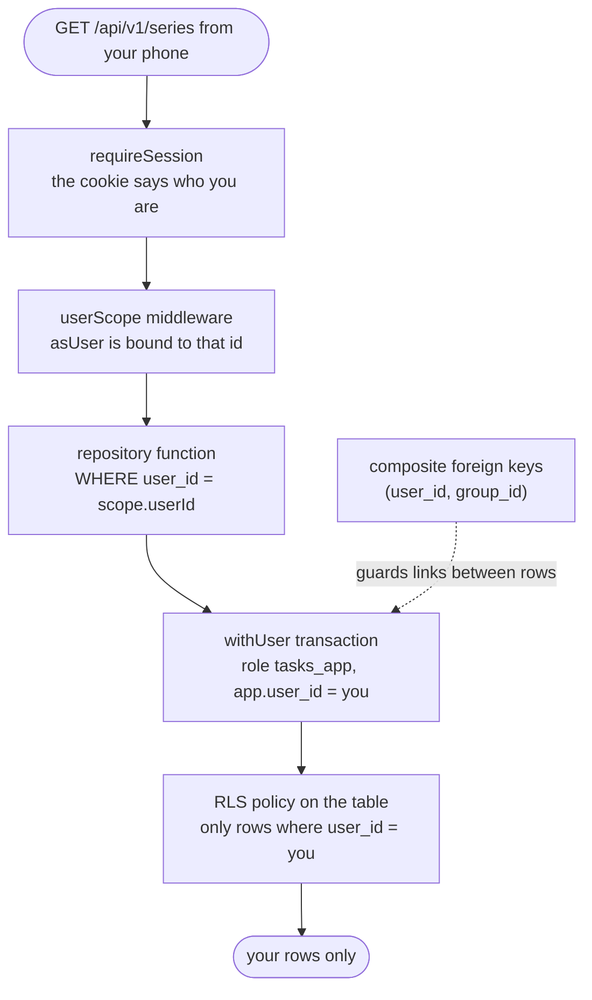

# Row-level security in our database

> **Background:** [[Transactions]] · [[Roles and privileges]] · [[Row-level security]] · [[Connection pools]]

How our code makes sure your timetable is only ever yours, now that a second person can exist (A10, D-034). The general idea, with the SQL explained from zero, is in [[Row-level security]]. This note is our setup, file by file, and what the tests prove. The routes that use it: [[Calendar API]].

## Four guards, one request

When your phone asks for this week, four separate things stand between a request and someone else's classes. Any one of them failing alone still leaks nothing.



| Guard | Where | What it stops |
|---|---|---|
| 1. The session | `auth/require-session.ts` | Anyone without a valid cookie (401). The user id comes from the cookie, never from the URL or the body |
| 2. `asUser` bound to that id | `http/user-scope.ts` | A handler passing the wrong user: it never passes one |
| 3. `WHERE user_id = scope.userId` | every function in `calendar/*.ts` | The obvious way to read someone else's rows |
| 4. The RLS policy | migration `0002_calendar_rls.sql` | A query that forgot guard 3 |
| (links) Composite foreign keys | migration `0001_calendar_tables.sql` | Your series pointing at someone else's group, which RLS can't stop because foreign-key checks ignore it |

## The database side (migrations, written before this slice)

- **`0002_calendar_rls.sql`** creates the role `tasks_app` (`NOLOGIN`: it can't connect, only be switched into) and grants it `SELECT, INSERT, UPDATE, DELETE` on `schedule_group`, `series` and `occurrence_override`, and nothing else. It defines `app_current_user_id()` (the `app.user_id` setting, with `''` read as "nobody"), and gives each table `ENABLE` + `FORCE ROW LEVEL SECURITY` and one policy, whose `USING` and `WITH CHECK` both say `user_id = app_current_user_id()`.

  *From `apps/api/drizzle/0002_calendar_rls.sql` (shortened):*
  ```sql
  DO $$
  BEGIN
    IF NOT EXISTS (SELECT FROM pg_catalog.pg_roles WHERE rolname = 'tasks_app') THEN
      CREATE ROLE tasks_app NOLOGIN;
    END IF;
  END
  $$;
  --> statement-breakpoint
  -- Lets the owner switch to it with SET ROLE (superusers can anyway).
  GRANT tasks_app TO CURRENT_USER;
  --> statement-breakpoint
  GRANT USAGE ON SCHEMA public TO tasks_app;
  --> statement-breakpoint
  GRANT SELECT, INSERT, UPDATE, DELETE ON schedule_group, series, occurrence_override TO tasks_app;
  -- …
  CREATE FUNCTION app_current_user_id() RETURNS uuid
    LANGUAGE sql STABLE
    AS $$ SELECT nullif(current_setting('app.user_id', true), '')::uuid $$;
  -- … then, for each of the three tables:
  ALTER TABLE series ENABLE ROW LEVEL SECURITY;
  --> statement-breakpoint
  ALTER TABLE series FORCE ROW LEVEL SECURITY;
  --> statement-breakpoint
  CREATE POLICY series_owner ON series
    USING (user_id = app_current_user_id())
    WITH CHECK (user_id = app_current_user_id());
  ```

  What to notice:
  - `CREATE ROLE` sits inside `IF NOT EXISTS` because a role belongs to the whole Postgres server, not one database. `tasks` and `tasks_test` share it, so the second database to migrate must not fail on "role already exists".
  - Besides the three tables, `tasks_app` gets `USAGE` on the schema (without it, even granted tables are invisible) and nothing else. `GRANT tasks_app TO CURRENT_USER` makes the migrating role a member, so it may switch into it.
  - `app_current_user_id()` holds the `nullif(…, '')::uuid` trick once, and all three policies call it. `STABLE` promises Postgres the answer doesn't change during one query, so it can work it out once and use the `user_id` index.
  - `--> statement-breakpoint` is Drizzle's marker between statements; to Postgres it's a comment.
- **`0001_calendar_tables.sql`** gives `schedule_group` a `UNIQUE (user_id, id)` and makes `series` point at it by the pair: `FOREIGN KEY (user_id, group_id) REFERENCES schedule_group (user_id, id)`. Overrides point at series the same way.

  *From `apps/api/drizzle/0001_calendar_tables.sql` (shortened):*
  ```sql
  CREATE TABLE "schedule_group" (
    -- …
    CONSTRAINT "schedule_group_user_id_id_unique" UNIQUE("user_id","id"),
    -- …
  );
  -- …
  ALTER TABLE "occurrence_override" ADD CONSTRAINT "occurrence_override_series_fk" FOREIGN KEY ("user_id","series_id") REFERENCES "public"."series"("user_id","id") ON DELETE cascade ON UPDATE no action;--> statement-breakpoint
  -- …
  ALTER TABLE "series" ADD CONSTRAINT "series_group_fk" FOREIGN KEY ("user_id","group_id") REFERENCES "public"."schedule_group"("user_id","id") ON DELETE cascade ON UPDATE no action;--> statement-breakpoint
  ```

  The `UNIQUE("user_id","id")` looks redundant, since `id` alone is already unique. But a foreign key may only point at columns declared unique, so the pair needs its own constraint. `ON DELETE cascade` is why deleting a group takes its series, and their overrides, with it.
- `auth_*` and `profile` have **no** RLS, and `tasks_app` has no privilege on them at all.

Why is the role switch needed at all? The API logs into Postgres as `tasks`, which the Docker image makes a **superuser**, and superusers skip RLS even with `FORCE` ([[Roles and privileges]]). Inside the transaction, `tasks_app` is neither superuser nor owner, so the policies apply.

## The code side

### `withUser` (`apps/api/src/db/user-scope.ts`)

*From `apps/api/src/db/user-scope.ts`:*
```ts
export function withUser<T>(
  db: Database,
  userId: string,
  fn: (scope: UserScope) => Promise<T>,
): Promise<T> {
  return db.transaction(async (tx) => {
    // `true` = local: both settings end with this transaction, so the pooled
    // connection goes back to the pool as the owner again, naming nobody.
    await tx.execute(sql`select set_config('app.user_id', ${userId}, true)`);
    await tx.execute(sql`set local role tasks_app`);
    return fn({ tx, userId } as UserScope);
  });
}
```

Line by line:
1. `db.transaction(...)` borrows one connection from the pool, sends `BEGIN`, and runs the callback. If the callback throws, Drizzle sends `ROLLBACK`; otherwise `COMMIT` ([[Transactions]]). `<T>` is whatever `fn` resolves to, and `withUser` hands it back unchanged ([[TypeScript essentials]], generics).
2. `set_config('app.user_id', $1, true)`: the third argument, `true`, means "local to this transaction". The id is a **parameter** (`$1`), so it can never be read as SQL; Drizzle's `sql` tag sends `${userId}` separately instead of pasting it into the text.
3. `set local role tasks_app`: from here to the end of the transaction, Postgres checks permissions and policies as `tasks_app`.
4. `fn({ tx, userId })`: the repository code runs with both. `as UserScope` is a cast, and this is the one place allowed to call that object a `UserScope` (next section).
5. After `COMMIT` (or `ROLLBACK`), both settings are gone. The connection returns to the pool as `tasks`, naming nobody, so the next request (maybe your friend's, a second later) can't inherit you.

### `UserScope`: a type only `withUser` can make

Repository functions take a `UserScope`, not the plain `db`:

*From `apps/api/src/calendar/series.ts` (shortened):*
```ts
const mine = (scope: UserScope, id: string) =>
  and(eq(series.userId, scope.userId), eq(series.id, id));
// …
export async function findSeries(scope: UserScope, id: string): Promise<Series | undefined> {
  const [row] = await scope.tx.select().from(series).where(mine(scope, id));
  return row && toSeries(row);
}
```

`UserScope` carries the transaction (`tx`) and the user (`userId`) together, so the `WHERE` always names the same person the transaction was opened for. It also has a hidden marker property, typed with a `unique symbol` that only `user-scope.ts` can name. You can't write that property yourself, so the only way to get a `UserScope` is from `withUser`. The marker exists only for TypeScript, and Node strips it before running ([[TypeScript checking vs running]]). The effect: `findSeries(db, id)` is a **type error**, caught by `pnpm typecheck` before it ever runs, so you can't accidentally query the calendar tables as the owner, where RLS doesn't apply.

*From `apps/api/src/db/user-scope.ts`:*
```ts
declare const scoped: unique symbol;

/** One user's view of the database: the transaction `withUser` opened, and whose it is. */
export interface UserScope {
  /** Runs as `tasks_app` with `app.user_id` set: queries see only this user's rows. */
  readonly tx: Transaction;
  /** The signed-in user. Repositories filter by it too (defence in depth). */
  readonly userId: string;
  readonly [scoped]: true;
}
```

What to notice:
- `declare const scoped: unique symbol;` tells TypeScript "a value with its own one-of-a-kind type exists" without creating anything, because `declare` emits no code. It isn't exported, so no other file can name it.
- `readonly [scoped]: true` is the marker. A plain `{ tx, userId }` lacks it, so TypeScript refuses it as a `UserScope`; only the `as UserScope` cast inside `withUser` gets past ([[TypeScript essentials]], "A trick: types only one function can make").
- `mine(scope, id)` in `findSeries` reads `tx` and `userId` from the same object, so the filter and the transaction can't name two different people.

### `userScope` middleware (`apps/api/src/http/user-scope.ts`)

*From `apps/api/src/http/user-scope.ts` (shortened):*
```ts
  return async (c, next) => {
    const userId = c.get('user').id;
    c.set('asUser', (fn) => withUser(db, userId, fn));
    await next();
    // …
  };
```

`c.get('user')` is what `requireSession` stored. The arrow function `(fn) => withUser(db, userId, fn)` remembers that `userId` (a closure), so every later call to `asUser` is bound to the signed-in user. Handlers call `c.var.asUser((scope) => findSeries(scope, id))` and never handle a user id, so there's none to get wrong. One request is one transaction: open it, run a few queries, close it. Nothing slow happens inside, because the calendar route runs `expand()` after the commit.

### What runs outside the scope, on purpose

`POST /api/v1/series` without a `tzid` needs your profile's zone. `profile` has no RLS and `tasks_app` may not read it, so the handler reads it first with the existing `getProfile(db, user.id)`, then opens the scoped transaction:

*From `apps/api/src/routes/series.ts`:*
```ts
    const input = await jsonBody(c, createSeriesSchema);
    // No zone sent: the series takes the user's. The profile isn't one of the
    // row-level-security tables (and tasks_app may not read it), so it's read
    // here, before the scoped transaction, the same way /me reads it.
    const tzid = input.tzid ?? (await getProfile(deps.db, c.get('user').id)).tzid;
    const { row, created } = await c.var.asUser((scope) => createSeries(scope, { ...input, tzid }));
```

`??` uses the right-hand side only when `input.tzid` is `undefined` (or `null`), so the profile is read only when no zone was sent. `getProfile` takes `deps.db`, the plain owner connection, not a `UserScope`: it runs before, and outside, the transaction the next line opens.

The seed script finds the user by email in `auth_user` the same way, then writes the timetable through `withUser` ([[Timetable files and seeding]]).

## What each guard does to your friend's requests

Say your friend (in the tests, bob) has your group's and series' ids.

| Bob sends | What stops it | Bob gets |
|---|---|---|
| `GET /api/v1/series` | guard 3 (and 4) | `{ "series": [] }`, only bob's own |
| `GET`, `PATCH`, `DELETE /api/v1/series/<your id>` | guard 3: `WHERE user_id = bob` matches nothing; even without it, `USING` hides your row | `404`, the same as an id nobody has. Your row doesn't change |
| `POST /api/v1/series` with `groupId` = your group | the composite foreign key: no group `(bob, your group id)` | `422` on `groupId` |
| `POST /api/v1/groups` with `id` = your group's id | the primary key sees your hidden row: `on conflict do nothing` inserts nothing, and the lookup under RLS finds nothing | `409 conflict` |
| `PATCH` on bob's own series with `groupId` = your group | the composite foreign key again | `422` on `groupId` |

## What the tests prove

| Test | Claim |
|---|---|
| `db/user-scope.test.ts` | Inside `withUser`, `current_user` is `tasks_app` and `app.user_id` is the user. Afterwards, on a pool of **one** connection (so the next query surely reuses it), the role is the owner again and the setting reads `''`. A query with no `WHERE` sees only the user's rows. A throw rolls everything back. Writing a row for another user fails with `42501` (the `WITH CHECK`) |
| `routes/calendar-isolation.test.ts` | Alice and bob, both signed in through the real app (`signInWithGoogle`), run every row of the table above over HTTP; alice's rows are compared before and after and are unchanged. Then, at the repository level: inside `withUser(bob)`, `tx.select().from(series)` with **no** `WHERE` returns only bob's series, while the owner connection (`testDb`) sees both; and queries that filter by id only (`select`, `update`, `delete`) find nothing of alice's |
| `db/schema.test.ts` (from the contracts) | RLS is on and forced on exactly the three tables; the policies, the composite keys and "forgets the user when the transaction ends" at the SQL level |

Here's the "hands the connection back clean" test, the one that would catch a plain `SET` instead of `set_config(…, true)`:

*From `apps/api/src/db/user-scope.test.ts` (shortened):*
```ts
    // A pool of one connection, so the next query surely reuses the same one.
    const pool = new Pool({ connectionString: testDatabaseUrl(), max: 1 });
    try {
      await withUser(createDb(pool), alice, ({ tx }) => tx.select().from(scheduleGroup));
      const { rows } = await pool.query<{ role: string; userId: string | null }>(
        `select current_user as role, current_setting('app.user_id', true) as "userId"`,
      );
      // The login role from the URL (the owner), no longer tasks_app.
      expect(rows[0]?.role).toBe(new URL(testDatabaseUrl()).username);
      // After a SET LOCAL ends, an unset setting reads back as '' rather than NULL.
      expect(rows[0]?.userId).toBe('');
      // …
```

What to notice:
- `max: 1`: with one connection in the pool, the `pool.query` after `withUser` is guaranteed to land on the connection `withUser` just used, like your friend's request a second later.
- That query runs outside any transaction, as the owner, just as the next borrower would.
- It expects `''`, not `NULL`: the empty-string trap that `nullif` in `app_current_user_id()` exists for ([[Row-level security]]).

## Pitfalls

- **`psql` and the tests' `testDb` see everything.** Both connect as `tasks`, a superuser. That's how the tests insert alice's rows directly, and why "I can see both users in psql" proves nothing. To see what the app sees, do what `withUser` does: `begin; select set_config('app.user_id', '<id>', true); set local role tasks_app; select ...; rollback;`.
- **An error inside the transaction ends it.** After Postgres refuses a statement, it refuses everything else until `ROLLBACK` (an "aborted transaction", [[Transactions]]). So `guardedWrite` turns the error into a `422` and rethrows; it never tries another query in the same transaction.
- **A new calendar table needs its own policy.** RLS is per table. A v0.3 table such as `day_exception` must get `ENABLE`, `FORCE`, a policy, grants to `tasks_app` and composite foreign keys in its migration, or `tasks_app` can't touch it at all. (No grant means "permission denied", which fails safe but breaks the feature.)

## Check yourself
- Predict first: you remove `eq(series.userId, scope.userId)` from `listSeries`. Which test would notice, and what would bob's `GET /api/v1/series` return? Now also remove `set local role tasks_app` from `withUser`. What changes?
- Why does `UserScope` carry `userId`, instead of each repository function taking `(tx, userId)` as two arguments? What mistake does that rule out?
- Trace bob's `POST /api/v1/groups` with your group's id through `createGroup`: which statement runs, what does it return, what does the lookup return, and which status comes back?
- `POST /api/v1/series` reads your profile before opening the transaction. What error would you get if it read the profile inside `asUser` instead, and why?
