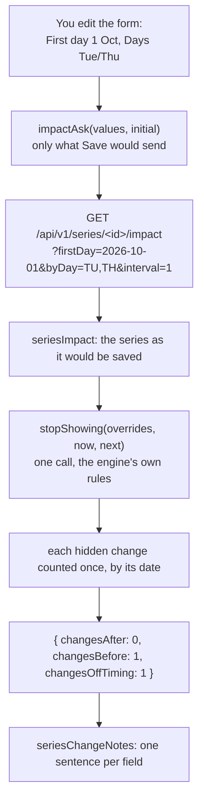

# Series change warnings

> **Background:** [[Archive and last days]] · [[Recurrence engine]] · [[Series form]] · [[Validating input with schemas]] · [[Server state and caching]]

A class's form now warns before **any** edit hides your changes, not only a new last day. Move the first day later, pick other days, or switch to every 2 weeks, and the form says how many cancels would stop showing, under the field that causes it, before you tap Save. A **change** is an override, as in [[Archive and last days]]: a cancel, a note, an extra class. Hidden, never erased: the rows stay, and putting the old value back shows them again. This is ticket #13, built in PR #24. Why it's built this way: [[Series warning choices]].

## Predict first

Made-up data. "Physics (sample)" meets Mon and Wed at 10:00 in Room 101, every week, since Tue 1 Sep. It has two cancels: Wed 9 Sep and Wed 18 Nov. You open its form.

1. You change Days to Tue and Thu. What does the form say, and under which field?
2. You keep Tue/Thu and also move First day to 1 Oct. What does it say now, and where?
3. You undo both and set Repeats to every 2 weeks instead. How many changes does it warn about?
4. Another day, the class is already every 2 weeks, and it has a cancel on Wed 11 Nov. You move its first day one week later, from 1 Sep to 8 Sep, and change nothing else. Does any warning show?

## Files

| File | What it does |
|---|---|
| `packages/core/src/schemas.ts` | `seriesImpactQuerySchema`: the question a series can be asked (first day, last day, timing); `SeriesImpactQuery`, its type |
| `packages/core/src/api.ts` | `SeriesImpact`: the answer, `changesAfter` plus `changesBefore` and `changesOffTiming` |
| `apps/api/src/calendar/impact.ts` | `seriesImpact`: the series as it would be saved, one `stopShowing` call, each hidden change counted once |
| `apps/api/src/routes/series.ts` | `GET /api/v1/series/:id/impact?firstDay=&lastDay=&byDay=&interval=` |
| `apps/web/src/series/form-values.ts` | `impactAsk`: the question, built from what Save would send |
| `apps/web/src/lib/impact.ts` | `impactQuery` (asks it), `seriesChangeNotes` (the sentences), `useSeriesChangeNotes` (both, for the form), `halfTyped` |
| `apps/web/src/series/SeriesForm.tsx` | Each sentence under its field: First day, Last day, Repeats |
| `apps/api/src/routes/archive.test.ts`, `lib/impact.test.ts`, `form-values.test.ts` | The tests (see the end) |



## The question: `seriesImpactQuerySchema`

In #12 the impact read took one thing, `?lastDay=`. A series can now be asked about three:

*From `packages/core/src/schemas.ts`:*
```ts
export const seriesImpactQuerySchema = impactQuerySchema
  .extend({
    firstDay: isoDateSchema.optional(),
    byDay: z
      .string()
      .transform((days) => days.split(','))
      .pipe(weeklyRuleSchema.shape.byDay)
      .optional(),
    interval: z.coerce.number().pipe(weeklyRuleSchema.shape.interval).optional(),
  })
  .superRefine(({ byDay, interval }, ctx) => {
    if (byDay === undefined && interval !== undefined) {
      ctx.addIssue({ code: 'custom', path: ['byDay'], message: 'is needed with interval' });
    } else if (byDay !== undefined && interval === undefined) {
      ctx.addIssue({ code: 'custom', path: ['interval'], message: 'is needed with byDay' });
    }
  });
```

What to notice:
- **`.extend` adds fields to a schema that exists.** The group's question is `{ lastDay? }`; the series' is that plus `firstDay`, `byDay` and `interval`. The group read is untouched, and its answer is still `{ changesAfter }`.
- **A query string is always text.** `?byDay=MO,FR&interval=2` arrives as `{ byDay: 'MO,FR', interval: '2' }`. So `byDay` is split on commas first (`.transform`), and `interval` is turned into a number first (`z.coerce.number()`, "coerce" meaning "convert, then check").
- **The checks come from the rule itself.** `.pipe(b)` runs `b` on the converted value, and `b` here is the weekly rule's own field schema: `weeklyRuleSchema.shape.byDay` (known weekdays, at least one, sorted Monday first) and `.shape.interval` (a whole number from 1 up to the maximum). `shape` is how zod hands you one field's schema out of an object schema. So the read refuses exactly what saving would refuse, and the two can't drift apart. To make that possible, #13 pulled the weekly rule out of `ruleSchema` into its own `weeklyRuleSchema`; `ruleSchema` uses it unchanged.
- **Days and interval come together, or not at all.** A timing is both: "Mon and Fri, every 2 weeks". `.superRefine` is a check over the whole object that can blame any field it likes, here the missing one. `?byDay=MO` alone answers 422 with `{ path: 'interval', message: 'is needed with byDay' }`. The form always knows both, so only a hand-typed URL can trip it.

The query's type, `SeriesImpactQuery`, is this schema's `z.output`: the days as a list (`['MO', 'FR']`) and the interval a number. The API's `seriesImpact` takes it, and so does the web's `impactQuery`, so one type describes the question on both sides ([[Validating input with schemas]] explains `z.input` and `z.output`).

## One request, three counts: `seriesImpact`

*From `apps/api/src/calendar/impact.ts` (shortened):*
```ts
  const overrides = await listOverridesOf(scope, [id]);
  const { byDay, interval } = ask;
  const next = {
    ...series,
    startDate: ask.firstDay ?? series.startDate,
    untilDate: ask.lastDay ?? series.untilDate,
    rule:
      byDay === undefined || interval === undefined
        ? series.rule
        : { freq: 'weekly' as const, interval, byDay },
  };
  const hidden = stopShowing(
    overrides,
    { groups: [group], series: [series] },
    { groups: [group], series: [next] },
  );

  // Each change once, by the date it shows on: before the new first day, after
  // the new last day, or else on a day the new timing doesn't produce.
  const counts: SeriesImpact = { changesAfter: 0, changesBefore: 0, changesOffTiming: 0 };
  for (const o of hidden) {
    const date = o.kind === 'extra' ? o.newDate : o.originalDate;
    if (date < next.startDate) counts.changesBefore += 1;
    else if (next.untilDate !== null && date > next.untilDate) counts.changesAfter += 1;
    else counts.changesOffTiming += 1;
  }
  return counts;
```

What to notice:
- **`next` is the series as Save would leave it.** `{ ...series, startDate: … }` copies the row and replaces some fields; nothing is written. Anything not asked about keeps its saved value (`??`, "use the right side when the left is missing").
- **One question to the engine, not three.** `stopShowing` from #12 already answers "which changes show now and wouldn't after this edit?", whatever the edit is, because it asks `occursOn`, the same function the calendar draws with ([[Archive and last days]]). Give it the whole proposed series and it accounts for the first day, the last day and the timing at once, including how they combine.
- **Then sort what it found, each change once, by its date.** Before the new first day → `changesBefore`. After the new last day → `changesAfter`. Neither → it must be on a day the class no longer meets → `changesOffTiming`. The order matters: a cancel on Wed 9 Sep, with a new first day of 1 Oct *and* Wednesdays dropped, is hidden for both reasons, but it lands in `changesBefore` only. So the counts never add up to more changes than there are.
- **The extra branch is for safety.** An extra is only hidden by its group's last day, and this read never changes the group, so `hidden` holds no extras today. The date line still picks `newDate` for one, so the sorting stays right if that ever changes.

A real exchange from the tests: Data Structures (sample) meets Mon, Wed and Fri since 13 Jul, with cancels on Wed 9 Sep, Mon 14 Sep, Wed 16 Sep and Wed 25 Nov. It's asked about a first day of 10 Sep, Mon and Fri only, and a last day of 20 Nov:

```text
GET /api/v1/series/<id>/impact?firstDay=2026-09-10&byDay=MO,FR&interval=1&lastDay=2026-11-20
→ 200 { "changesAfter": 1, "changesBefore": 1, "changesOffTiming": 1 }
```

9 Sep is before the first day; 14 Sep is a Monday and still happens; 16 Sep is a Wednesday, off the new days; 25 Nov is after the last day.

## The case review found: every 2 weeks and a new first day

"Every 2 weeks" has to count from somewhere. The engine counts weeks from the **Monday of the week the series starts**, its anchor week ([[Recurrence engine]], `ruleDates`). So the first day decides which weeks are "on":

| First day | Anchor week (Monday) | Thursdays it meets |
|---|---|---|
| Thu 16 Jul | 13 Jul | 16 Jul, 30 Jul, … 10 Sep, **24 Sep**, 8 Oct |
| Thu 23 Jul | 20 Jul | 23 Jul, 6 Aug, … 17 Sep, 1 Oct, 15 Oct |

Move the first day one week later and the class swaps onto the other weeks. A cancel on 24 Sep was on an "on" week and now isn't. That's not before the new first day, and the timing didn't change, but the class no longer meets that day: the server counts it in `changesOffTiming`.

The first build missed it in the form. The form only showed the timing sentence when the timing was asked about, so here nothing showed, and Save hid the cancel without a word. The spec review found it; the fix is in the form, below. Moving by an even number of weeks keeps the same weeks, and so does an every-week class, so most first-day moves never see this.

## In the form

The question is built from what Save would send:

*From `apps/web/src/series/form-values.ts`:*
```ts
export function impactAsk(
  values: SeriesFormValues,
  initial: SeriesFormValues,
): SeriesImpactQuery | undefined {
  const { startDate, untilDate, rule } = changedFields(values, initial, values.groupId);
  const ask: SeriesImpactQuery = {};
  if (startDate) ask.firstDay = startDate;
  if (untilDate) ask.lastDay = untilDate;
  if (rule?.freq === 'weekly' && rule.byDay.length > 0) {
    ask.byDay = rule.byDay;
    ask.interval = rule.interval;
  }
  return Object.keys(ask).length > 0 ? ask : undefined;
}
```

What to notice:
- **`changedFields` is Save's own diff** ([[Series form]]): the fields that differ from the row as it was opened. So the form asks about exactly the edit you'd save, and nothing for a room or title change, which can't hide anything.
- **A rule change always carries both halves.** `changedFields` sends the whole rule when either the days or the interval change, so `byDay` and `interval` arrive together, as the schema wants.
- **Not yet a change: an empty first day, no days picked, a cleared last day.** `if (startDate)` is false for `''`. A cleared last day means "until the group ends", which hides nothing. No days is an error the form shows anyway.
- **`undefined` means "nothing to ask"**, and then the query sits idle (`skipToken`, [[Archive and last days]]).

Asking is #12's `impactQuery`, now given the whole question. The key is `['impact', rowPath, ask]`, so each different question is its own short-lived query. TanStack Query compares keys by content, so a new object with the same fields is the same query. The days go into the URL as text:

*From `apps/web/src/lib/impact.ts` (shortened):*
```ts
        : ({ signal }) => {
            // String() writes the days as `MO,FR`, the way the query string has them.
            const search = Object.entries(ask).map(([key, value]) => [key, String(value)]);
            return apiGet<T>(`${rowPath}/impact?${new URLSearchParams(search)}`, { signal });
          },
```

`Object.entries` turns `{ firstDay: '2026-10-01', byDay: ['TU', 'TH'], interval: 1 }` into pairs. `String(['TU', 'TH'])` is `'TU,TH'`, because a list turned into text joins its items with commas, and `String(1)` is `'1'`. `URLSearchParams` then escapes what needs escaping, so the comma goes out as `%2C`, and the server reads it back as a comma.

Then each count becomes a sentence under its field:

*From `apps/web/src/lib/impact.ts`, the body of seriesChangeNotes:*
```ts
  const { firstDay, lastDay, byDay } = ask;
  const notes: SeriesChangeNotes = {};
  if (firstDay !== undefined) {
    const lines = [note(impact.changesBefore, `before ${dateLabel(firstDay)}`, 'An earlier date')];
    // Every 2 weeks counts from the first day's week, so a new first day alone can
    // move the class off a change's week. With a new timing, its own warning says so.
    if (byDay === undefined) {
      lines.push(
        note(impact.changesOffTiming, 'in weeks the class no longer meets', 'The old first day'),
      );
    }
    notes.firstDay = lines.filter(Boolean).join(' ') || undefined;
  }
  if (lastDay !== undefined) notes.lastDay = hiddenChangesNote(impact.changesAfter, lastDay);
  if (byDay !== undefined) {
    notes.timing = note(
      impact.changesOffTiming,
      "on days the new timing doesn't produce",
      'The old timing',
    );
  }
  return notes;
```

What to notice:
- **`note(count, where, undo)`** writes every sentence the same way, and nothing for 0: "1 change before 1 Oct 2026 will stop showing. An earlier date brings it back." #12's last-day sentence now goes through it too.
- **Only what was asked gets a sentence.** No new first day, no First day warning, even if the answer has numbers in it.
- **`changesOffTiming` has two homes.** With a new timing, it's the timing's fault, and it goes under Repeats. Without one, the only edit that can move the class off a day is a new first day (the anchor week above), so it goes under First day, worded for that: "1 change in weeks the class no longer meets will stop showing. The old first day brings it back." The server sends one number either way; the form knows which edit you made.
- **Two sentences can share a field.** `lines.filter(Boolean)` drops the ones that are `undefined` (0 changes), `join(' ')` puts the rest one after the other, and `|| undefined` turns an empty result into "no warning".

In `SeriesForm.tsx`, `const notes = useSeriesChangeNotes(rowPath, impactAsk(values, initial));` asks once per edit, and each field takes its part: `warning={notes.firstDay ?? ''}` under First day, `notes.lastDay` under Last day, `notes.timing` under Repeats. The timing warning sits under the Repeats select but covers the day buttons above it too. It's the same `warning` line as #12's, a polite live region that a screen reader reads out when the count arrives ([[Archive and last days]]). Archive keeps its own `useHiddenChangesNote`, because its day isn't typed into the form.

## A bug from #12: the half-typed year

Typing a year into a date box doesn't jump straight to 2026. Chrome fills the year as you type: 0002-11-20, then 0020-11-20, then 0202-11-20, and only then 2026-11-20. Each of those is a valid date, so each asked the read, and the field flashed "1 change after 20 Nov 2 will stop showing" for a moment. It came with #12's Last day warning, on both forms, and #13's First day box would have done the same. The fix:

*From `apps/web/src/lib/impact.ts`:*
```ts
const halfTyped = (date: ISODate | undefined) => date !== undefined && date < '1000';
```

and the query asks nothing while either date is half typed:

*From `apps/web/src/lib/impact.ts`:*
```ts
      rowPath === null || ask === undefined || halfTyped(ask.lastDay) || halfTyped(ask.firstDay)
        ? skipToken
```

- **`date < '1000'` compares text**, which works for dates in this shape ([[Archive and last days]], "Dates compared as text"): `'0202-11-20' < '1000'` is true, `'2026-11-20' < '1000'` is false. No class is dated before the year 1000.
- **The browser showed it, not a test.** The requests went out with `lastDay=0002-11-20`, `0020-11-20` and `0202-11-20`. After the fix, only `lastDay=2026-11-20` went.

The answers to *Predict first*: 1) Under Repeats: "2 changes on days the new timing doesn't produce will stop showing. The old timing brings them back." Both cancels are on Wednesdays. 2) Under First day: "1 change before 1 Oct 2026 will stop showing…" (9 Sep), and under Repeats: "1 change on days…" (18 Nov). Still two changes in all, each counted once, by its date. 3) Two. The anchor week is Mon 31 Aug, so the "on" weeks start 31 Aug, 14 Sep, … 9 Nov, 23 Nov. 9 Sep and 18 Nov fall in the "off" weeks of 7 Sep and 16 Nov. 4) Yes, under First day: "1 change in weeks the class no longer meets will stop showing. The old first day brings it back." From 8 Sep the "on" weeks start 7 Sep, 21 Sep, … 16 Nov, so 11 Nov is off.

## How it was checked

- **API**, over HTTP against Postgres (`archive.test.ts`), on the sample Data Structures and its lab: a later first day (before 1), new days (off timing 1), every 2 weeks (off timing 1), a first day one week later on an every-2-weeks lab (off timing 1), a change that hides nothing (all 0), one count per change (1/1/1), half or bad timing (422), and saving new days, then going back to the old days, shows the cancel again.
- **Web:** `impact.test.ts` (the sentences for each field, the anchor-week sentence, nothing for 0 or for what wasn't asked, the request URL, nothing asked while a year is half typed); `form-values.test.ts` (the question is only what Save would send).
- **In Chrome** at 412×915 and 1280×800 with made-up data: each warning in *Predict first*, `aria-describedby` on each input, and saving every 2 weeks made the 18 Nov cancel disappear; going back to every week showed it as cancelled again.
- **Not yet tested:** saving a later first day, then an earlier one, to see the change come back. It's the same save as the days test, and it's on the later list.

## Check yourself

- **Predict:** an every-week class meets Mon/Wed/Fri since 13 Jul with a cancel on Wed 16 Sep. You move the first day to 20 Jul. What does First day say, and why does an every-2-weeks class behave differently?
- **Trace:** you pick Tue and Thu, then pick Wed again so the days are Tue/Wed/Thu. What does `impactAsk` return after each tap, and what goes in the URL?
- **Break it:** in `seriesImpact`, check `date > next.untilDate` before `date < next.startDate`. Can any count change? What if a cancel is both before the new first day and after the new last day?
- **Explain:** why does the server count the anchor-week case in `changesOffTiming` instead of a fourth number, and how does the form still word it for the first day?
- **Explain:** why does the read reuse `weeklyRuleSchema.shape.byDay` instead of checking the days itself?
