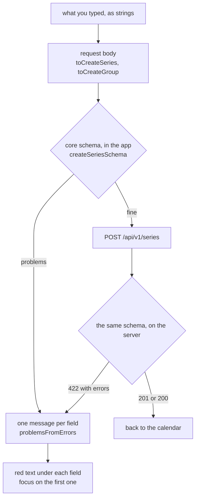
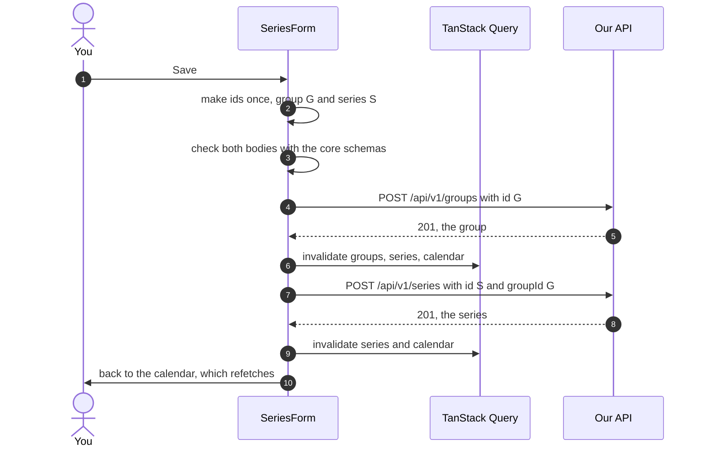

# Series form

> **Background:** [[REST resources and CRUD]] · [[Validating input with schemas]] · [[Idempotency and retries]] · [[Server state and caching]] · [[Single-page apps and routing]]

The screen where you type in a class: "Data Structures, Monday, Wednesday and Friday at 8 AM, one hour, room C-301". `/series/new` adds one, and `/series/<id>` changes or deletes one (the calendar opens it when you tap a block). A **series** is one timing pattern of a class ([[Core types]]), and the calendar expands it into the blocks you see ([[Recurrence engine]]). Why it's built this way: [[Offline and form choices]].

## Predict first

You fill in a new class, pick "New group…" for a new semester, and tap Save. How many requests go to the server, in which order, and what does each body contain? What happens if the Wi-Fi drops just after the server saved the group, but before you got the answer?

## Files

All in `apps/web/src/`.

| File | What it does |
|---|---|
| `routes/series.new.tsx` | `/series/new`: session check, loads the groups, draws `<SeriesForm series={null}>` |
| `routes/series.$seriesId.tsx` | `/series/<id>`: session check, loads the series list and the groups, finds the series, or shows "This class doesn't exist any more" |
| `lib/require-session.ts` | `requireSession(queryClient)`: the `beforeLoad` both routes share. No session → `/login` |
| `series/SeriesForm.tsx` | The form: its state, Save, Delete, the error banner |
| `series/controls.tsx` | Drawing pieces: `Field` (label + input + hint + error), `DayToggles`, `ColorSwatches`, `describedBy` (the ARIA links) |
| `series/form-values.ts` | Everything that isn't drawing, as pure functions: starting values, request bodies, "what changed", checking with the schemas, error messages |
| `series/SeriesScreen.tsx` | The frame: "← Calendar", the sync badge, the title; and the not-found screen |
| `lib/mutations.ts` | The writes: `useCreateGroup`, `useCreateSeries`, `useUpdateSeries`, `useDeleteSeries`, and `newId()` |
| `lib/api.ts` | `apiSend(method, path, body)`: POST, PATCH, DELETE as JSON; a 422's field errors stay on the `ApiError` |
| `series/form-values.test.ts`, `lib/mutations.test.ts`, `lib/api.test.ts` | Tests in plain Node |

## The fields

The form keeps exactly what the inputs hold, as strings (`''` for an empty box), in one `SeriesFormValues` object. Only on Save are they turned into a request body.

| Field | Input | Starts as | Sent as |
|---|---|---|---|
| Title | text: "DS" | empty | `title` |
| Subject | text; its placeholder shows the title | empty, meaning "same as the title" | `subject` only if you typed one (on create); the server copies the title (B8) |
| Location | text: "C-301" | empty | `location`, or `null` when blank |
| Group | `<select>` of your groups that aren't archived, plus "New group…" | your first group, or "New group" if you have none | `groupId` |
| New group | name, colour (10 swatches), "Group starts on" | blue, today | a separate `POST /api/v1/groups` first |
| Days | Mon–Sun toggle buttons, Monday first (B11) | none | `rule.byDay`, always Monday first |
| Repeats | every 1 to 4 weeks | every week | `rule.interval` (`rule.freq` is always `weekly`) |
| Starts at | `<input type="time">` | empty | `startTime` `"08:00"` |
| Duration in minutes | number box, plus "1 hour" and "2 hours" | 60 | `durationMin` as a number |
| First day | `<input type="date">` | today in your zone | `startDate` |
| Last day | date, optional | empty | `untilDate`, or `null`: until the group ends |

The "Sent as" column, in code:

*From `apps/web/src/series/form-values.ts`:*
```ts
function seriesFields(values: SeriesFormValues, groupId: string) {
  const minutes = values.durationMin.trim();
  return {
    groupId,
    title: values.title,
    location: values.location.trim() === '' ? null : values.location,
    rule: { freq: 'weekly' as const, interval: values.interval, byDay: orderedDays(values.days) },
    startDate: values.startDate,
    untilDate: values.untilDate === '' ? null : values.untilDate,
    startTime: values.startTime,
    // An empty box is "no number", which the schema refuses, not 0.
    durationMin: minutes === '' ? Number.NaN : Number(minutes),
  };
}
```

What to notice:
- An empty box (`''`) becomes `null` for Location and Last day: "no room", "no last day".
- `orderedDays` puts the days Monday first, whatever order you tapped them in. `'weekly' as const` tells TypeScript the value is exactly `'weekly'`, not just any string ([[TypeScript essentials]]).
- An empty minutes box becomes `NaN` ("not a number"), not `0`, so the schema refuses it instead of saving a zero-minute class.

"Today in your zone" uses your profile's zone, not the phone's. At 1:30 AM in Kolkata it's already the 14th, even on a laptop set to London, where it's still the 13th (`todayIn` in `form-values.ts`).

Time zone isn't a field: the server uses your profile's zone for a new series.

## One schema, checked twice



The schemas live in `packages/core/src/schemas.ts` ([[Validating input with schemas]]). The API parses every body with them, and this form runs the **same** schema on the body it's about to send, before sending. So the two can't disagree about what's valid. An empty title, no day picked, a last day before the first day: all are caught here, in the API's own wording, without a round trip.

*From `apps/web/src/series/form-values.ts` (shortened):*
```ts
function check(schema: Schema, input: unknown): FieldError[] {
  const { error } = schema.safeParse(input, { error: friendlierMessages });
  if (error === undefined) return [];
  return error.issues.map((issue) => ({
    path: issue.path.map(String).join('.'),
    message: issue.message,
  }));
}

// …
function checkDateOrder(input: { startDate?: string; untilDate?: string | null }): Problems {
  const dates = { startDate: input.startDate, untilDate: input.untilDate };
  return problemsFromErrors(check(updateSeriesSchema, dates), 'series');
}

/** A new series, checked by the API's own `createSeriesSchema`. */
export function checkCreateSeries(input: CreateSeries): Problems {
  return mergeProblems(
    problemsFromErrors(check(createSeriesSchema, input), 'series'),
    checkDateOrder(input),
  );
}
```

`createSeriesSchema` and `updateSeriesSchema` are imported from `@tasks/core`: the very objects the API parses bodies with. `safeParse` runs a zod schema without throwing and returns every problem in `error.issues`, and `check` turns each into `{ path: 'rule.byDay', message }`, the same shape as the server's 422, so one function, `problemsFromErrors`, handles both. `checkDateOrder` is the "All at once" trick below: the update schema (every field optional) run on just the two dates.

- **Messages.** The schemas word their messages to follow a field's name ("must not be empty"), so the form puts the label in front: "Title must not be empty". Names of other fields are swapped for what the screen calls them, so it says "Last day must be on or after the first day", not "...after startDate". For the few checks the schemas leave to zod's default wording ("Too small: expected number to be >=1"), the form passes its own (`friendlierMessages`): "Duration in minutes must be at least 1".
- **All at once.** zod skips a check that compares two fields (last day vs first day) when any field has the wrong *type*. An empty title doesn't stop it (`""` is still a string), but an empty duration box does: the form turns it into `NaN`, which zod counts as "not a number". With an empty duration as well, you'd fix the duration, tap Save, and only then hear about the dates. So the form also checks just the two dates with the same schema, and every problem shows in one go ([[Validating input with schemas]] has the exact rule).
- **The server's 422.** If the server still refuses (a rule the schema can't know, like "that group isn't yours"), its `errors` list (`{ path: 'rule.byDay', message: '...' }`, kept on the `ApiError` by `apiSend`) goes through the same `problemsFromErrors`, so it lands under the same field. A path no field shows (`tzid`) goes in a red box at the top.
- **Any other failure** (offline, a 500) shows in the same box at the top, with the error code and the request id in small print (`describeError`), so a bug report can find the server's log line ([[Error responses]]).
- **Focus.** After Save, the focus moves to the first field with a problem, in screen order. The messages are drawn first (React's `flushSync`), so the input that gets the focus already points at its message, and a screen reader reads it out. Editing a field takes its message away.

*From `apps/web/src/series/SeriesForm.tsx`:*
```tsx
  function showProblems(found: Problems) {
    // Draw the messages first, so the input that gets the focus already
    // points at its error and a screen reader reads it out.
    flushSync(() => setProblems(found));
    const field = firstProblemField(found);
    if (field === undefined) banner.current?.focus();
    else inputs.current[field]?.focus();
  }
```

What to notice:
- Normally React draws a state change a moment later. `flushSync` makes it draw right now, so by the next line the red messages exist on the page.
- `firstProblemField` walks the fields in screen order (`FIELD_ORDER` in `form-values.ts`). `inputs.current` holds each input's element, saved through its `ref` when it was drawn.
- No field to blame (only a path like `tzid`)? The focus goes to the red box at the top instead.

**Accessibility, everywhere:** every input has a `<label>`. Its hint and its error are linked with `aria-describedby`, so a screen reader reads them when the input is focused, and an input with an error has `aria-invalid` (and a red border). The days and the colours are `<fieldset>`s with a `<legend>`. The day buttons say "Monday", not "Mon", and are toggles (`aria-pressed`). The colour swatches are real radio buttons, hidden but focusable, so arrow keys move between them and each says its name ("Violet").

## Creating a class with a new group



The group is created first, because the series must point at a group that exists (the database's foreign key). Both are checked before either is sent, so a typo in the second form never leaves you with a half-made pair.

*From `apps/web/src/series/SeriesForm.tsx` (inside `save`, shortened):*
```tsx
    const groupId = makingGroup ? pendingId('group') : values.groupId;

    // Check everything before sending anything.
    const groupBody = makingGroup ? toCreateGroup(values, groupId) : null;
    const createBody =
      series === null
        ? toCreateSeries(values, { series: pendingId('series'), group: groupId })
        : null;
    const found = mergeProblems(
      groupBody === null ? NO_PROBLEMS : checkGroup(groupBody),
      createBody === null
        ? checkUpdateSeries(toFullUpdate(values, groupId))
        : checkCreateSeries(createBody),
    );
    if (hasProblems(found)) return showProblems(found);

    let step: 'group' | 'series' = 'group';
    try {
      if (groupBody !== null) await createGroup.mutateAsync(groupBody);
      step = 'series';
      if (createBody !== null) {
        await createSeries.mutateAsync(createBody);
      } else if (series !== null) {
        const changes = changedFields(values, initial, groupId);
        if (Object.keys(changes).length > 0) {
          await updateSeries.mutateAsync({ id: series.id, changes });
        }
      }
    } catch (error) {
      // The server found something our check didn't: show it on the field too.
      if (error instanceof ApiError && error.code === 'validation_failed' && error.errors.length) {
        return showProblems(problemsFromErrors(error.errors, step));
      }
      // …
      if (error instanceof ApiError && error.code === 'conflict') delete pendingIds.current[step];
      return showFailure(error);
    }
    // The calendar refetches by itself: the save invalidated it.
    await router.navigate({ to: '/' });
```

What to notice:
- Everything up to `hasProblems` builds and checks both bodies, and `return showProblems(found)` leaves before a single request.
- `mutateAsync` sends the request through a mutation hook (`lib/mutations.ts`) and waits for the answer. Because the group's `await` finishes first, the group exists by the time the series names it.
- `step` remembers which request was running when something failed, so a 422's paths are read as group fields or series fields, and a 409 forgets the right id.
- The `catch` is where the server's 422 from [[#One schema, checked twice]] lands, and the edit branch is where "Nothing changed → no request" happens (below).

**Ids and retries (D-042).** The ids are UUIDv7s made **on the phone** (`newId()`, from `uuid`), once per thing being created, and kept in the form (`pendingIds`) until it's saved. Suppose the server saved the group, but the Wi-Fi dropped before its answer reached you ([[Idempotency and retries]]). You tap Save again: the same `G` goes again, the server answers **200 with the group it already has** instead of making a second "Sem 4", and the series goes on as normal. Checked in the browser: three tries of one create sent the same id each time. Two edge cases:
- If the server answers `409 conflict` (the id is taken by a row you can't see, practically never with UUIDv7), the form forgets that id, so the next try makes a new one.
- If the first try worked but its answer was lost, and you then change a field before tapping Save again, the server returns the row as first saved (same id, no change). Edit it afterwards. It's a rare case, and the price of having no extra machinery.

*From `apps/web/src/series/SeriesForm.tsx` and `apps/web/src/lib/mutations.ts` (shortened):*
```tsx
// apps/web/src/series/SeriesForm.tsx
  const pendingIds = useRef<{ group?: string; series?: string }>({});
  // …
  function pendingId(kind: 'group' | 'series'): string {
    const id = pendingIds.current[kind] ?? newId();
    pendingIds.current[kind] = id;
    return id;
  }

// apps/web/src/lib/mutations.ts
export function newId(): string {
  return uuidv7();
}
```

What to notice:
- `useRef` keeps a value for as long as the form is open, without redrawing anything when it changes (unlike `useState`).
- `??` reads "the id saved for this kind, or, if there isn't one yet, a new one". The first Save makes it, and every later Save finds it.
- After a `409`, the `delete pendingIds.current[step]` line in `save` empties the slot, so the next `pendingId` call makes a fresh id.

## Editing: only what changed

The edit form starts from the series (`valuesFromSeries`) and remembers those starting values. Save sends `PATCH /api/v1/series/<id>` with **only the fields that differ** (`changedFields`). An example, checked in the browser: room C-301 → C-204, Tuesday added, "2 hours" tapped:

```json
{ "location": "C-204", "rule": { "freq": "weekly", "interval": 1, "byDay": ["MO", "TU", "WE", "FR"] }, "durationMin": 120 }
```

Untouched fields aren't sent, so a change made on your laptop to another field in the meantime isn't overwritten. Nothing changed means no request, just a trip back to the calendar. The whole form is still checked first (with `updateSeriesSchema`), so a last day before the first day is caught here too.

*From `apps/web/src/series/form-values.ts`:*
```ts
export function changedFields(
  values: SeriesFormValues,
  initial: SeriesFormValues,
  groupId: string,
): UpdateSeries {
  const now = toFullUpdate(values, groupId);
  const before = toFullUpdate(initial, initial.groupId);
  const changes: Record<string, unknown> = {};
  for (const [key, value] of Object.entries(now)) {
    // JSON compares the rule object by content.
    if (JSON.stringify(value) !== JSON.stringify(before[key as keyof UpdateSeries])) {
      changes[key] = value;
    }
  }
  return changes as UpdateSeries;
}
```

What to notice:
- The form's values now and its starting values both go through the same `toFullUpdate`, so a field you didn't touch comes out identical on both sides and is left out.
- `JSON.stringify` compares by content. Two `rule` objects with the same days are still two different objects to `!==`, but they turn into the same text.
- `toFullUpdate` is also where an empty subject becomes the title, which is how renaming "DS" changes the subject too (first detail below).

Details:
- A **subject left empty follows the title**, as its placeholder promises. Rename "DS" to "Data Str." and the subject becomes "Data Str." too. Type a subject of your own, and it stays.
- A series with a **daily** rule (the sample "Evening run") shows as every day of every week, which means the same thing. The rule is only sent back if you change the days.
- The change applies to every week of the class, past ones too. "From this week on" edits come in v0.3b with `splitSeries` (D-023).

**Not found.** The series comes from the cached series list (there's no "one series" request yet), and an id that isn't in it shows "This class doesn't exist any more" with a link home. After you delete a class, the list is refetched without it while the screen is still open, so the screen keeps the series it first found until it has gone home, instead of flashing "doesn't exist".

*From `apps/web/src/routes/series.$seriesId.tsx` (shortened):*
```tsx
  const found = list.data.series.find((s) => s.id === seriesId);
  // …
  const [firstFound] = useState(found);
  const series = found ?? firstFound;

  if (isUnauthenticated(me.error)) return <Navigate to="/login" replace />;
  if (series === undefined) return <SeriesNotFound />;
```

`useState(found)` keeps only the *first* value it's given and ignores later ones. After a delete, the refetched list no longer has the class, so `found` is `undefined`, but `firstFound` still holds it until the app has gone home.

## Deleting

"Delete this class" turns into a question in place: "Delete this class? Every week of it disappears from the calendar, past weeks too.", with **Delete** and **Keep it** (the focus moves to Keep it, the safe answer). There's no pop-up. Delete sends `DELETE /api/v1/series/<id>` with no body (the server answers 204) and goes home. A 404 counts as done: if an earlier try worked but its answer was lost, the class is gone either way.

*From `apps/web/src/lib/mutations.ts`:*
```ts
export async function deleteSeries(id: string): Promise<void> {
  try {
    await apiSend<undefined>('DELETE', `${paths.series}/${id}`);
  } catch (error) {
    if (error instanceof ApiError && error.code === 'not_found') return;
    throw error;
  }
}
```

`apiSend<undefined>` says "no body expected" (the 204). A `not_found` error simply returns, as if the delete had worked, and anything else is thrown on to the form's red box.

## Offline

Writes are online-only in v0.2 (D-048). While the sync badge says offline (the browser said so, or the newest fetch got no answer), Save and Delete are greyed out with "You're offline. Changes need a connection." Both use `useSyncStatus()`, so they always agree ([[Offline reads]]). The form itself still opens offline from the saved copy, so you can look at a class's details.

## After a save: invalidation

Every write, once it worked, **invalidates** the cached reads it can change: every calendar window (the `['calendar']` prefix), the series list and, after a group create, the groups (`invalidateAfterWrite` in `lib/mutations.ts`). Invalidating marks an answer out of date. A screen showing it refetches now, and the others refetch when they're next shown. So the calendar you go back to fetches the week again and shows the new class, without the form knowing anything about the calendar ([[Server state and caching]]). The hooks return that refetch from `onSuccess`, so "Saving…" lasts until the fresh data is back.

*From `apps/web/src/lib/mutations.ts` (shortened):*
```ts
export async function invalidateAfterWrite(
  queryClient: QueryClient,
  { groups = false }: { groups?: boolean } = {},
): Promise<void> {
  await Promise.all([
    // A prefix: every cached window, `['calendar', from, to]`, whatever its dates.
    queryClient.invalidateQueries({ queryKey: ['calendar'] }),
    queryClient.invalidateQueries({ queryKey: seriesListQuery.queryKey }),
    groups ? queryClient.invalidateQueries({ queryKey: groupsQuery.queryKey }) : undefined,
  ]);
}

// …
export function useCreateSeries() {
  const queryClient = useQueryClient();
  return useMutation({
    mutationFn: createSeries,
    onSuccess: () => invalidateAfterWrite(queryClient),
  });
}
```

What to notice:
- `queryKey: ['calendar']` matches every key that *starts* with `'calendar'`: this week, last week, the week you prefetched, all of them.
- `{ groups = false }` takes an optional setting with a default; only `useCreateGroup` passes `{ groups: true }`.
- `onSuccess` returns the promise from `invalidateAfterWrite`, and `Promise.all` waits for every refetch, so the mutation stays "pending" (and the button says "Saving…") until they're back.

## How it was checked

A mock API (in a scratch folder, not the repo) checked bodies with the real core schemas and expanded the calendar with core's `expand()`. In Chrome, at phone and desktop sizes, light and dark: an empty form's errors (title, days, start time, last day before first), a create (body above), an edit (PATCH above), a delete with its confirm step, the not-found screen, a create with a new group (group POST, then series POST with that group's id, no `subject`), a server 500 (red box with "request mock-59") and a server 422 (message under Location, the unknown `tzid` path in the box), then the retry with the same id.

## Check yourself

- **Predict:** you leave Subject empty, type the title "OOP (Java)" and save. What does the request body contain for `subject`, and what does the server store?
- **Trace:** you pick "New group…", the group POST works, and the series POST gets a 500. You tap Save again. List the requests, their ids, and the server's answers.
- **Break it:** in `SeriesForm.tsx`, make `pendingId` always return `newId()`. Which retry case now creates a duplicate, and where would you see it?
- **Explain:** why does the form check the last day and the first day separately, when `updateSeriesSchema` already checks them?
