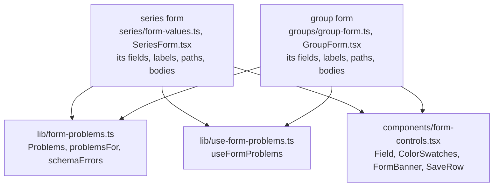

# Shared form pieces

> **Background:** [[Validating input with schemas]] · [[TypeScript essentials]] · [[Series form]]

Until ticket #11 the app had one form, the [[Series form]], and everything it needed lived beside it in `series/`: the labelled fields, the colour swatches, the red banner, the Save row, and the code that turns a schema's complaints into "Title must not be empty" under the right input. The Groups form ([[Groups screen]]) needs every one of those. So before it was written, they moved out into shared files, and both forms now use the same ones. Nothing changed on screen; the series form looks and behaves as before, and its tests and the end-to-end test say so. Why move instead of copy: [[Groups screen choices]].

## Predict first

The group form sends `{ "name": "" }` past its own check somehow, and the server answers 422 with `errors: [{ path: 'name', message: 'must not be empty' }]`. Which function decides that this message belongs under the Name input, which one writes "Name must not be empty", and where does the focus go?

## What's shared, and what each form keeps



Each form keeps what only it knows: its list of fields in screen order, their labels, which body path belongs to which field, how to build its request bodies, and what counts as "changed". The shared files know none of that; they take it as arguments.

| File | What it does |
|---|---|
| `lib/form-problems.ts` | `Problems<Field>`; `problemsFor(errors, fieldMap)`; `fieldSentence`; `schemaErrors(schema, input)`; `mergeProblems`, `firstProblem` |
| `lib/use-form-problems.ts` | `useFormProblems(firstProblem)`: the problems and the failure on screen, and where the focus goes |
| `components/form-controls.tsx` | `Field`, `ColorSwatches`, `FormBanner`, `SaveRow`, `describedBy`, `inputClass` |
| `components/ScreenFrame.tsx` | `ScreenFrame` (back link, sync badge, title) and `GoneScreen` ("doesn't exist any more") |
| `lib/api.ts` | `describeSaveError(error, gone)`: the banner's words for a failed save |

## One type for every form's problems

*From `apps/web/src/lib/form-problems.ts`:*
```ts
export interface Problems<Field extends string> {
  fields: Partial<Record<Field, string>>;
  other: string[];
}
```

This is a **generic** type: `Field` is a blank each form fills in ([[TypeScript essentials]]). For the group form, `Field` is `'name' | 'colorToken' | 'untilDate'`, so `Problems<GroupField>` means:

- `fields`: at most one message per field. `Record<Field, string>` would be "a message for **every** field"; `Partial<…>` makes each one optional. So `{ name: 'Name must not be empty' }` fits, and `{ title: '…' }` is a type error in the group form, because it has no title.
- `other`: messages that belong to no field on screen, shown in the banner at the top.

`extends string` says the blank must be some kind of string, which is what lets the shared code use a field as an object key.

## From `{ path, message }` to a sentence on a field

Problems arrive in one shape from two places: the form's own check before sending, and the server's 422 after. Both are lists of `{ path, message }`, like `{ path: 'rule.byDay', message: 'Pick at least one day' }`. Each form describes how to read them with a `FieldMap`: which path belongs to which field, and how to word the message there.

*From `apps/web/src/groups/group-form.ts`:*
```ts
const GROUP_FORM_FIELDS: FieldMap<GroupField> = {
  paths: { name: 'name', colorToken: 'colorToken', untilDate: 'untilDate' },
  sentence: (field, message) => fieldSentence(GROUP_LABELS[field], message),
};
```

For the group form the paths are just the field names. The series form's map is longer, because its body is nested: `rule.byDay` and `rule` both belong to the day buttons.

`problemsFor` walks the list:

*From `apps/web/src/lib/form-problems.ts`:*
```ts
export function problemsFor<Field extends string>(
  errors: readonly FieldError[],
  { paths, sentence }: FieldMap<Field>,
): Problems<Field> {
  const problems: Problems<Field> = { fields: {}, other: [] };
  for (const { path, message } of errors) {
    const field = fieldForPath(path, paths);
    if (field === undefined) problems.other.push(path === '' ? message : `${path}: ${message}`);
    // Only the first message per field: one thing to fix at a time.
    else problems.fields[field] ??= sentence(field, message);
  }
  return problems;
}
```

What to notice:
- `fieldForPath` tries the whole path, then shorter and shorter starts of it: `rule.byDay.0` → `rule.byDay` → `rule`. So an error about one day in the list still lands on the day buttons.
- A path no field claims (`tzid`, which no form shows) goes to `other` with its path in front, and the banner shows it.
- `??=` keeps the first message for a field and ignores later ones: one thing to fix at a time.
- `sentence` is where "must not be empty" becomes "Name must not be empty". The schemas word their messages to follow a field's name, so `fieldSentence` puts the label in front of any message that starts with "must", "is" or "has", and just capitalises the rest.

The form's own check produces the same `{ path, message }` list, from the API's own zod schema:

*From `apps/web/src/lib/form-problems.ts`:*
```ts
export function schemaErrors(schema: Schema, input: unknown): FieldError[] {
  const { error } = schema.safeParse(input, { error: friendlierMessages });
  if (error === undefined) return [];
  return error.issues.map((issue) => ({
    path: issue.path.map(String).join('.'),
    message: issue.message,
  }));
}
```

`safeParse` checks without throwing. `issue.path` is a list like `['rule', 'byDay']`, joined into `'rule.byDay'`, the server's shape. `friendlierMessages` replaces the few messages zod words itself ("Too small: expected number to be >=1") with ones that read after a label ("must be at least 1"). `Schema` is a small interface describing only the `safeParse` this function calls, so any of core's schemas can be passed in.

## Keeping them on screen: `useFormProblems`

A **hook** is a function whose name starts with `use` and that calls React's own hooks (`useState`, `useRef`) inside. Calling it from a component gives that component the state, as if it were written there. `useFormProblems` holds the problems, the last save's failure, and every input's element:

*From `apps/web/src/lib/use-form-problems.ts`:*
```ts
  const [problems, setProblems] = useState<Problems<Field>>(NO_PROBLEMS);
  const [failure, setFailure] = useState<unknown>(null);
  const inputs = useRef<Partial<Record<Field, HTMLElement | null>>>({});
  /** The alert above the form (`FormBanner`): focused for a failure or a problem with no field. */
  const banner = useRef<HTMLDivElement>(null);
```

What it hands back, and how the group form uses each:

| Returned | What it does | In `GroupForm.tsx` |
|---|---|---|
| `register(field)` | A **callback ref**: a function React calls with the input's element once it's on the page, so the hook can focus it later | `ref={register('name')}` |
| `clearProblem(field)` | Removes one field's message: you're fixing it | called on every change |
| `reset()` | Clears everything before a new try | first line of Save |
| `showProblems(found)` | Draws the messages, then focuses the first problem field, or the banner if no field has one | after the check, or a 422 |
| `showFailure(error)` | Puts the failure in the banner and focuses it | any other error |
| `problems`, `failure`, `banner` | What to draw, and the banner's ref | passed to the fields and `FormBanner` |

`showProblems` uses React's `flushSync` so the messages are on the page before the focus moves, and a screen reader reads the input together with its error ([[Series form]] has the excerpt). Which field is "first" is the form's business, so the form passes it in: `useFormProblems<GroupField>(firstGroupProblem)`.

## The drawing pieces

- **`Field`** draws a label, the input you pass as `children`, then the hint and the error. The form spreads `describedBy(id, { hint, error })` onto the input, which links it to both with `aria-describedby` and marks it `aria-invalid` when there's an error, so a screen reader reads them when the input is focused.
- **`ColorSwatches`** is the ten colours as real radio buttons, hidden but focusable, each with its name ("Violet").
- **`FormBanner`** is the red box at the top. It takes `ref` as an ordinary prop: since React 19 a component can, with no `forwardRef` wrapper. Its `role="alert"` makes a screen reader announce it.
- **`SaveRow`** is Save and Cancel, plus "You're offline. Changes need a connection." when the sync badge says offline. `cancelTo` says where Cancel goes: `'calendar'` for the series form, `'groups'` for the group form.

Where "back" goes is one map, used by the back link, Cancel and `GoneScreen` alike:

*From `apps/web/src/components/ScreenFrame.tsx`:*
```tsx
export const BACK = {
  calendar: { to: '/', label: 'Calendar', long: 'Back to the calendar' },
  groups: { to: '/groups', label: 'Groups', long: 'Back to Groups' },
} as const;

export type BackTo = keyof typeof BACK;
```

`as const` keeps the exact values (`'/groups'`, not just "a string"), so the router can type-check `to`. `keyof typeof BACK` is the type `'calendar' | 'groups'`: a screen can only name a place in the map.

## When a save fails

`describeSaveError(error, gone)` picks the banner's words. A 404 on a save means the row is gone, most likely deleted on another device, so it says that, in the form's own words:

| Form | Title | Message |
|---|---|---|
| Series | This class doesn't exist any more | It may have been deleted on another device. |
| Group | This group doesn't exist any more | It may have been deleted on another device. |

Anything else goes to `describeError` as before: offline, a 500, each with its error code and request id in small print so a bug report can find the server's log line ([[Error responses]]).

## Check yourself

- **Predict:** the server's 422 has `{ path: 'attendanceThresholdPct', message: 'must be at most 100' }`, and the group form shows no such field. Where does it appear, and in what words?
- **Trace:** in the group form, you leave Name empty and tap Save. List the functions that run, from `checkGroupForm` to the focus landing on the input.
- **Break it:** in `problemsFor`, change `??=` to `=`. What would a field with two problems show?
- **Explain:** why does each form pass its own `firstProblem` to `useFormProblems`, instead of the hook knowing the order?
