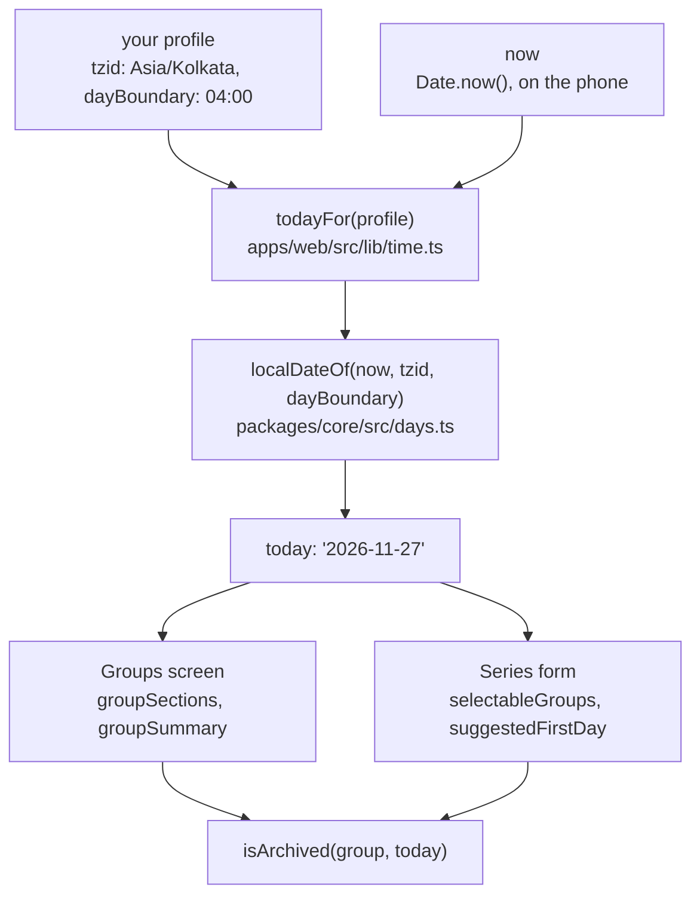

# The user's day

> **Background:** [[Dates, times and instants]] · [[Time zones and daylight saving]] · [[Testing pure code]]

"Today" in this app isn't the date on the phone's clock. It's **your day**: the date in your profile's zone (`tzid`), starting at your **day boundary** (`dayBoundary`, 04:00 unless you change it), not at midnight. A class at 01:00 after a late night still belongs to the evening before, and so does everything else that asks "is it today yet?". Since ticket #11 two questions use it: which first day the series form suggests, and whether a group has ended ("archived"). Why it works this way: [[Groups screen choices]].

## Predict first

Sem 3's last day is Fri 27 Nov. It's 03:30 on Sat 28 Nov in Kolkata, and you open the Groups screen. Is Sem 3 under "Archived" yet? What about at 04:00? And if your laptop is set to London time, where it's still 22:00 on the 27th, does that change anything?

## Files

| File | What it does |
|---|---|
| `packages/core/src/days.ts` | `localDateOf(epochMs, tzid, dayBoundary)`: the user's day at a moment. `isArchived(item, today)`: has this group or series ended? |
| `packages/core/src/days.test.ts` | Four tests: the 27 Nov boundary, a zone that isn't the machine's, a daylight-saving night, no last day |
| `apps/web/src/lib/time.ts` | `todayFor(profile)`: `localDateOf` for right now, with the profile's zone and boundary |
| `apps/web/src/lib/time.test.ts` | Two tests for `todayFor`: the boundary, and a zone the browser doesn't know |

Who asks: the Groups screen ([[Groups screen]]) splits running groups from archived ones, and the [[Series form]] hides archived groups from its select and suggests a first day.



## The day at a moment: `localDateOf`

*From `packages/core/src/days.ts`:*
```ts
export function localDateOf(epochMs: number, tzid: IanaZone, dayBoundary: WallTime): ISODate {
  const wall = Temporal.Instant.fromEpochMilliseconds(epochMs).toZonedDateTimeISO(tzid);
  const date = wall.toPlainDate();
  const beforeBoundary =
    Temporal.PlainTime.compare(wall.toPlainTime(), Temporal.PlainTime.from(dayBoundary)) < 0;
  return (beforeBoundary ? date.subtract({ days: 1 }) : date).toString();
}
```

Line by line, with 01:30 on Sat 28 Nov in Kolkata, which is 20:00 UTC on the 27th:

1. `epochMs` is the moment as one number: milliseconds since 1970-01-01T00:00Z, the number every clock agrees on ([[Dates, times and instants]]).
2. `Temporal.Instant.fromEpochMilliseconds(epochMs)` makes that number a Temporal **instant**: a moment with no zone. `.toZonedDateTimeISO(tzid)` asks what a wall clock in `Asia/Kolkata` shows at that moment: `2026-11-28T01:30+05:30[Asia/Kolkata]`. That's a `ZonedDateTime`, a moment plus a zone.
3. `wall.toPlainDate()` keeps only the calendar date, `2026-11-28`. A `PlainDate` has no time and no zone: it's what's printed on a paper calendar.
4. `wall.toPlainTime()` keeps only the wall time, `01:30`. `Temporal.PlainTime.from('04:00')` turns the boundary into the same kind of value, so the two can be compared. `compare` answers −1, 0 or 1, like a sort; `< 0` means "earlier".
5. 01:30 is before 04:00, so the answer is the day before: `2026-11-27`. At 04:00 or later it's the date itself.
6. `.toString()` gives the `YYYY-MM-DD` text the rest of the app uses (an `ISODate`).

More moments, with the boundary at 04:00:

| Wall clock in Kolkata | Calendar date | Your day |
|---|---|---|
| Fri 27 Nov, 23:59 | 27 Nov | 27 Nov |
| Sat 28 Nov, 00:00 | 28 Nov | **27 Nov** |
| Sat 28 Nov, 03:59 | 28 Nov | **27 Nov** |
| Sat 28 Nov, 04:00 | 28 Nov | 28 Nov |

Notice what the function *doesn't* take: the phone's zone. Every step uses `tzid`, so a laptop set to London gives the same answer as a phone in Kolkata. The test *follows the zone and day boundary it is given, not the machine's* pins that: 05:30 on the 28th in Kolkata is still 19:00 on the 27th in New York, and with a New York profile the answer is the 27th. The core tests also run three times, in UTC, Kolkata and New York (`pnpm test:tz`), so a hidden use of the machine's zone would fail somewhere.

### Why compare wall times

The obvious way is "midnight plus four hours". It's wrong on a daylight-saving night. On 8 Mar 2026 New York's clocks jump from 02:00 straight to 03:00 ([[Time zones and daylight saving]]), so four hours after midnight the wall shows **05:00**. Someone with a 04:00 boundary would have their day start at 05:00 that night.

Comparing what the wall shows avoids the arithmetic altogether: is the wall time before `04:00`? On the jump night 03:59 still is, and 04:00 isn't, however many real hours have passed since midnight.

*From `packages/core/src/days.test.ts`:*
```ts
  it('rolls over at the boundary on the wall clock, on a daylight-saving day too', () => {
    // 8 Mar 2026: New York's clocks jump from 02:00 to 03:00. Four hours after midnight
    // is 05:00 on the wall that night, but the day still starts at 04:00 on the wall.
    expect(localDateOf(at('2026-03-08T03:59-04:00'), 'America/New_York', '04:00')).toBe(
      '2026-03-07',
    );
```

`at(...)` builds the moment from a string with its offset (`-04:00`, New York in summer time), so the test never depends on the machine's clock or zone.

## Has it ended: `isArchived`

*From `packages/core/src/days.ts`:*
```ts
export function isArchived(item: { untilDate: ISODate | null }, today: ISODate): boolean {
  return item.untilDate !== null && item.untilDate < today;
}
```

What to notice:
- `untilDate < today` compares two `YYYY-MM-DD` strings. That works because the format puts the biggest unit first, so text order is date order: `'2026-11-27' < '2026-11-28'`.
- `<`, not `<=`: on its last day a group is still running. It's archived from the next day, **your** next day, so from 04:00.
- `untilDate: null` means "no last day", and such a group never ends.
- `item: { untilDate: ISODate | null }` asks only for the one field it reads. A group fits, and so does a series, so one function answers for both.
- "Archived" is never stored. It follows from the last day, so "Sem 3 ends 27 Nov" archives itself on the 28th with no second step and no chance of a flag that disagrees with the date ([[Cancel and group choices]]).

The test the ticket asked for:

*From `packages/core/src/days.test.ts`:*
```ts
  it('a last day of 27 Nov reads archived from 04:00 on 28 Nov, not midnight', () => {
    const archivedAt = (wall: string) =>
      isArchived(sem3, localDateOf(inKolkata(wall), 'Asia/Kolkata', '04:00'));
    expect(archivedAt('2026-11-27T23:59')).toBe(false);
    expect(archivedAt('2026-11-28T00:00')).toBe(false);
    expect(archivedAt('2026-11-28T03:59')).toBe(false);
    expect(archivedAt('2026-11-28T04:00')).toBe(true);
  });
```

## Right now, in the app: `todayFor`

Core has no clock. Its code never reads `Date.now()` (a Biome rule bans the `Date` global there, D-015), so `localDateOf` takes the moment as an argument. That's what makes it easy to test: any moment can be passed in. The web app supplies the real "now":

*From `apps/web/src/lib/time.ts`:*
```ts
export function todayFor(profile: Profile, epochMs: number = Date.now()): ISODate {
  const tzid = isKnownZone(profile.tzid) ? profile.tzid : Temporal.Now.timeZoneId();
  return localDateOf(epochMs, tzid, profile.dayBoundary);
}
```

What to notice:
- `epochMs: number = Date.now()` is a **default parameter**: the screens call `todayFor(me.data.profile)` and get now, while the tests pass a fixed moment.
- `isKnownZone` asks the browser whether it knows the zone. An old browser that doesn't know a newer zone name would make Temporal throw, so it falls back to the phone's own zone (`Temporal.Now.timeZoneId()`) instead of breaking the screen.
- The profile comes from `GET /api/v1/me`, which the app already has in its cache, so working out today costs no request and works offline.

**When the day turns while a screen is open.** Nothing watches the clock for 04:00. Instead, the `me` query refetches every minute while the app is in front (`refetchInterval: 60_000` in `lib/queries.ts`), each answer carries a new `serverTime`, so the screen draws again and calls `todayFor` again. A group whose last day was yesterday moves to Archived within a minute of 04:00.

## Not yet

The calendar's own "today" (the day it highlights) still turns at midnight in your zone. It's a different screen with its own date maths, and moving it to `todayFor` is logged as later work.

## How it was checked

- The four core tests and two web tests above, in all three zones.
- Live, at 02:14 on 10 Nov in Kolkata: "Evening classes" with a last day of 9 Nov still showed as running, and "Pottery", ended 8 Nov, sat under Archived. Made-up groups, in a test database.

## Check yourself

- **Predict:** your boundary is 04:00 and you're in Kolkata. At 03:00 on 1 Dec, what does `todayFor` return? Is a group with last day 30 Nov archived?
- **Trace:** a profile in `America/New_York` with boundary `00:00`, at 05:30 on 28 Nov in Kolkata. Walk through `localDateOf` step by step. What date comes out, and why is it not the 28th?
- **Break it:** change `<` to `<=` in `isArchived`. Which line of the 27 Nov test fails, and what would you see on the Groups screen on 27 Nov?
- **Explain:** why does `localDateOf` compare `toPlainTime()` with the boundary instead of adding four hours to midnight?
