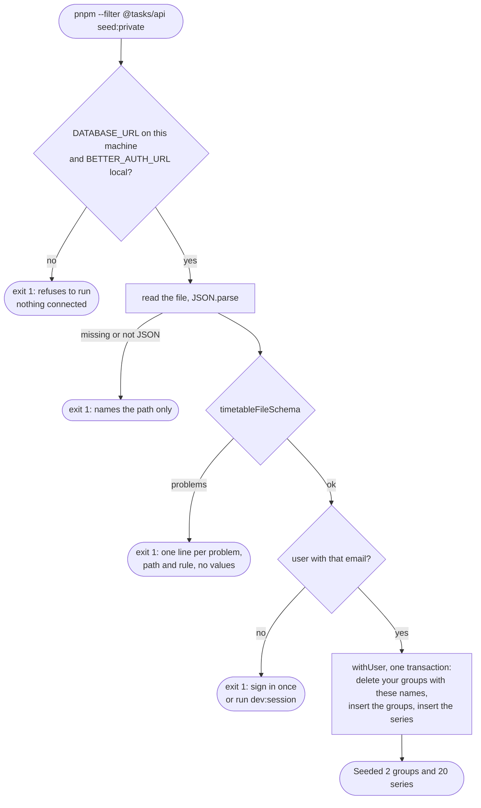

# Timetable files and seeding

> **Background:** [[Validating input with schemas]] · [[Transactions]] · [[Environment variables and config]] · [[Row-level security]]

How your real KIIT timetable gets onto your own machine's database without ever being committed to a public repo (D-020, amended). Two parts: a small JSON **file format** in `packages/core/src/timetable.ts`, and a **seed script** in `apps/api` that writes a file into the database for one user. Uses [[Row-level security in our database]] and the same code paths as the [[Calendar API]]. Why the format looks like this: [[Calendar API choices]].

**Seeding** means filling a database with starting data by running a script, instead of typing it in through the app. Here: your semester's 20-odd classes, before the series form exists.

## The file

One file describes one or more groups and their weekly class slots, the way a printed timetable does: a day, a start, an end.

```json
{
  "format": "tasks.timetable",
  "version": 1,
  "tzid": "Asia/Kolkata",
  "groups": [
    {
      "name": "Classes · Sem 3 (sample)",
      "activeFrom": "2026-07-13",
      "activeTo": "2026-11-27",
      "classes": [
        { "title": "DS", "subject": "Data Structures", "location": "C-301", "day": "MO", "start": "08:00", "end": "09:00" },
        { "title": "Digital Systems Lab", "location": "Lab 5", "day": "TH", "start": "14:00", "end": "16:00", "everyWeeks": 2, "from": "2026-07-16" }
      ]
    }
  ]
}
```

| Where | Field | Required? | Meaning |
|---|---|---|---|
| top | `format`, `version` | yes | Always `"tasks.timetable"` and `1`. Say what the file is before anything else is read |
| top | `tzid` | yes | The zone every time in the file is in. A timetable without a zone is ambiguous |
| group | `name`, `activeFrom` | yes | "Classes · Sem 3", first day of the semester |
| group | `activeTo`, `colorToken`, `observesHolidays`, `attendance`, `attendanceThresholdPct`, `attendanceTrackingFrom` | no | Same defaults as `POST /api/v1/groups`: open-ended, `blue`, `true`, `true`, `75`, none |
| class | `title`, `day`, `start`, `end` | yes | `day` is `MO`…`SU`; `end` must be after `start` on the same day |
| class | `subject` | no | What attendance counts by (B8). Defaults to the title |
| class | `location` | no | `"C-301"`, `"Lab 5"`. Blank or missing = none |
| class | `everyWeeks` | no | `2` = every other week, counted from the week of `from`. Default `1` |
| class | `from`, `until` | no | First and last day this slot runs. Default: the group's `activeFrom`, and "until the group ends" |

The field rules aren't written twice: the group fields **are** `createGroupSchema`'s fields, and `title`, `subject`, `location` are `createSeriesSchema`'s. So a file can never hold a value the API's own `POST` would refuse (an 81-character title, a colour outside the palette).

*From `packages/core/src/timetable.ts` (shortened):*
```ts
// The fields borrow the API's own rules (lengths, defaults, the palette), so a
// file can never hold something `POST /api/v1/groups` or `/series` would refuse.
// (The series schema ends in a transform, so its fields live on `.in`.)
const group = createGroupSchema.shape;
const series = createSeriesSchema.in.shape;
// …
const classSchema = z
  .strictObject({
    /** The short name on the calendar block. */
    title: series.title,
    /** What attendance is counted by (B8). Defaults to the title. */
    subject: series.subject,
    location: series.location,
    day: z.enum(WEEKDAYS),
    start: wallTimeSchema,
    /** On the same day as `start`: a class can't run past midnight. */
    end: wallTimeSchema,
    /** 2 = every other week, counted from the week of the first class. */
    everyWeeks: z.number().int().min(1).max(MAX_INTERVAL.weekly).default(1),
    // … from, until
  })
```

What to notice:
- `.shape` is an object schema's fields, by name. So `series.title` isn't a copy of the API's title rule; it **is** that rule, trimmed and 1 to 80 characters.
- `createSeriesSchema` is an object followed by a `.transform` (the subject default), and a transform has no fields. `.in` is the object before it.
- `z.strictObject` instead of `z.object`: an unknown key is an error, not silently dropped. That's the "unknown keys are refused" rule below.

### One class line → one series

`timetableToRows(file, newId)` turns each class line into one weekly series: `byDay: [day]`, `interval: everyWeeks`, `startTime: start`, `durationMin: end − start` (14:00–16:00 → `120`). Data Structures on Monday, Wednesday and Friday is **three lines and three series**, not one series with three days. That's how a timetable is printed, and it means "Wednesday's DS is now in room C-204" changes only that slot's series; Monday's and Friday's stay as they are. `newId` is passed in, so the function stays pure: the seed passes UUIDv7, the tests pass a counter.

*From `packages/core/src/timetable.ts` (shortened):*
```ts
const minutesOf = (time: string) => Number(time.slice(0, 2)) * 60 + Number(time.slice(3, 5));
// … (inside timetableToRows)
  for (const { classes, ...fields } of file.groups) {
    const groupId = newId();
    groups.push({ id: groupId, ...fields });
    for (const row of classes) {
      seriesRows.push({
        id: newId(),
        groupId,
        title: row.title,
        subject: row.subject ?? row.title,
        location: row.location,
        rule: { freq: 'weekly', interval: row.everyWeeks, byDay: [row.day] },
        startDate: row.from ?? fields.activeFrom,
        untilDate: row.until ?? null,
        startTime: row.start,
        durationMin: minutesOf(row.end) - minutesOf(row.start),
        tzid: file.tzid,
      });
    }
  }
```

What to notice:
- `{ classes, ...fields }` splits each group in two: its `classes` list, and everything else (`name`, `activeFrom`, …) in `fields`, which is exactly a group's create body.
- `byDay: [row.day]`: one day per series, always. `minutesOf('16:00') - minutesOf('14:00')` is `960 - 840 = 120`.
- `groupId` is made before the classes, so each series can point at its group before either exists in the database: the ids are the client's job ([[Idempotency and retries]]).

### Errors name the line

`timetableFileSchema` reports every problem with its path, counting from 0:

```text
groups.0.classes.3.end: must be after start, on the same day
groups.0.classes.7.until: must be on or after from
groups.1.name: is already the name of groups.0
(the whole file): Unrecognized key: "holidays"
```

Where those lines come from: a rule inside the class schema adds the issue with a path relative to the class, and the seed writes each issue's full path out with dots.

*From `packages/core/src/timetable.ts` and `apps/api/src/calendar/seed.ts`:*
```ts
// packages/core/src/timetable.ts
  .superRefine((row, ctx) => {
    // zod runs this even when a field failed above, so compare only real values.
    if (isTime(row.start) && isTime(row.end) && minutesOf(row.end) <= minutesOf(row.start)) {
      ctx.addIssue({
        code: 'custom',
        path: ['end'],
        message: 'must be after start, on the same day',
      });
    }
// apps/api/src/calendar/seed.ts
  // Paths and rules only: the messages never repeat a value from the file.
  const parsed = timetableFileSchema.safeParse(file);
  if (!parsed.success) {
    const lines = parsed.error.issues.map(
      (issue) => `  - ${issue.path.join('.') || '(the whole file)'}: ${issue.message}`,
    );
    throw new SeedError(['The timetable file has problems:', ...lines].join('\n'));
  }
```

What to notice:
- `path: ['end']` names only the field. As the issue travels up through the arrays and objects, zod puts the positions in front: `['groups', 0, 'classes', 3, 'end']`, which `.join('.')` writes as `groups.0.classes.3.end`.
- An unknown key at the top of the file has an empty path, so `join` gives `''` and `||` swaps in `(the whole file)`.
- `isTime(...) &&` first: if `start` was `"25:00"`, it already has its own error, and comparing it with an `end` of `"09:00"` would add a second, confusing "must be after start".

**Unknown keys are refused everywhere**, not ignored: `"loaction": "C-301"` is an error, so a typo can't silently drop your room. It also means v0.3b's holidays will arrive as `"version": 2`, never as an extra key that older code half-reads. Two groups with the same name are refused because the seed replaces groups by name (below).

## The sample file

`fixtures/sample-timetable.json` (committed, made up) is the same week as the recurrence engine's test fixture (`packages/core/src/recurrence/__fixtures__/sample-timetable.ts`), without its overrides and holiday. Two groups, 20 class lines:
- "Classes · Sem 3 (sample)": 13 lines, Monday to Friday, including a 120-minute Data Structures Lab and a fortnightly Digital Systems Lab.
- "Health": the fixture's daily "Evening run", written as 7 lines (`MO` … `SU`, 18:00–18:45). A daily rule every 1 day and seven weekly rules generate exactly the same dates.

`packages/core/src/timetable.test.ts` proves the match three ways: the groups have the same ranges and settings; splitting both into per-weekday slots gives identical lists (title, day, time, duration, rhythm, dates); and `expand()` over the whole semester gives the same occurrences (over 300) for the file as for the fixture.

## The seed script

```sh
pnpm --filter @tasks/api seed:sample                 # fixtures/sample-timetable.json
pnpm --filter @tasks/api seed:private                # private/kiit-sem3.json, your real one
pnpm --filter @tasks/api seed <file.json> [email]    # any file
```

The user is the first email in `AUTH_ALLOWED_EMAILS` unless you name one, and must already exist: sign in once, or run `pnpm --filter @tasks/api dev:session you@example.com`. A relative path is read **from the repo root**, wherever you run the command (pnpm runs it inside `apps/api`). It prints one line: `Seeded 2 groups and 20 series for you@example.com.`



The work is split in two so it can be tested: `src/calendar/seed.ts` has `seedRefusal(env)` and `seedTimetable(deps, file, email)`; `src/scripts/seed.ts` is the thin command around them (arguments, reading the file, printing).

**One transaction.** Everything is written inside one `withUser`, so if series 17 is refused, nothing is written: no half timetable ([[Transactions]]). Every row first goes through `createGroupSchema` / `createSeriesSchema` and then the very same `createGroup` / `createSeries` the API uses, under row-level security.

*From `apps/api/src/calendar/seed.ts`:*
```ts
  // Exactly what `POST` would store: the create schemas fill defaults and normalise.
  const rows = timetableToRows(parsed.data, uuidv7);
  const groups = rows.groups.map((group) => createGroupSchema.parse(group));
  const series = rows.series.map((row) => {
    const checked = createSeriesSchema.parse(row);
    return { ...checked, tzid: checked.tzid ?? parsed.data.tzid };
  });

  const replaced = await withUser(deps.db, user.id, async (scope) => {
    const deleted = await deleteGroupsNamed(
      scope,
      groups.map((group) => group.name),
    );
    for (const group of groups) await createGroup(scope, group);
    for (const row of series) await createSeries(scope, row);
    return deleted;
  });
```

What to notice:
- `.parse`, not `.safeParse`: it throws on a bad row. The file was already checked, so a throw here would be a bug, not a typo in your file.
- All the parsing happens **before** `withUser`, so no connection is held while it runs. Inside, the delete and every insert share one transaction: a refusal at series 17 rolls back the delete too, and your old timetable is still there.
- `for (…) await …` writes one row at a time. In a transaction the statements go over one connection in order anyway, so there'd be nothing to gain from sending them all at once.

**Repeatable.** Edit the file, run it again: your groups with the same names are deleted (their series go with them) and the file's are inserted. Groups with other names, and other users' groups, are untouched. The ids are new each time.

*From `apps/api/src/calendar/groups.ts` (`deleteGroupsNamed`):*
```ts
  const deleted = await scope.tx
    .delete(scheduleGroup)
    .where(and(eq(scheduleGroup.userId, scope.userId), inArray(scheduleGroup.name, [...names])))
    .returning({ id: scheduleGroup.id });
```

`inArray(scheduleGroup.name, [...])` is SQL's `name in ('Classes · Sem 3 (sample)', 'Health')`, and the `and(eq(…userId…))` around it keeps the delete to your own groups (RLS would too). `.returning(...)` hands back the deleted ids, so the seed can count them: ", replacing 2 groups" in its message.

> **Careful from v0.3 on:** deleting a group also deletes its series' overrides. Once you cancel classes in the app, re-seeding that group throws those cancellations away. Re-seed only before you start using cancels, or when you mean to start fresh.

## Why the real file stays private, and how that's enforced

The repo is public (MIT). Your real timetable says where you are at 08:00 every Monday, so it never goes in. It lives in `private/kiit-sem3.json` at the repo root, and `private/` is in `.gitignore`.

| Risk | Guard |
|---|---|
| Committing it | `private/` is git-ignored. Every committed example, fixture and test uses the made-up sample |
| Printing it, into a terminal log or a CI log | The script prints **counts only**. Validation messages give the path and the rule, never the value. A file that isn't valid JSON is reported as "is not valid JSON" without the parser's message, because Node's `SyntaxError` quotes the text around the mistake. A failed query is reported by its Postgres code only, because Drizzle's error message includes the query's parameters: your titles and rooms |
| Writing it into a server's database | The **localhost guard** below |

The two places in the script that could have printed your file, and don't:

*From `apps/api/src/scripts/seed.ts` (shortened):*
```ts
try {
  file = JSON.parse(await readFile(filePath, 'utf8'));
} catch (error) {
  // Not the parser's message: it quotes the text around the mistake.
  const missing = (error as NodeJS.ErrnoException).code === 'ENOENT';
  console.error(`seed: ${shownPath} ${missing ? 'does not exist' : 'is not valid JSON'}.`);
  process.exit(1);
}
// …
function reason(error: unknown): string {
  const pg = pgErrorOf(error);
  if (pg) return `Postgres error ${pg.code}${pg.constraint ? ` (${pg.constraint})` : ''}`;
  // …
}
```

What to notice:
- The `catch` never prints `error.message`. It only asks whether the file was missing (`ENOENT` is Node's code for "no such file") and prints one of two fixed phrases.
- `error as NodeJS.ErrnoException` is a cast: a caught error is `unknown` in TypeScript, and this tells it to expect Node's file-error shape, which has `.code`.
- `reason` builds its text from the SQLSTATE and the constraint name only, say `Postgres error 23514 (series_title_length)`: which rule broke, never the title that broke it.

## The localhost guard

The seed refuses to run (exit 1, before any connection is opened) unless **both**:
- `DATABASE_URL`'s host is `localhost`, `127.0.0.1` or `::1`, and
- `BETTER_AUTH_URL` is a local origin (`isLocalOrigin`, the same check `dev:session` uses).

Why both: settings copied from the server to reach its database through an SSH tunnel would have a local-looking database host (`localhost:5433`) but still `BETTER_AUTH_URL=https://tasks.ahmedatif.in`. A `.env` that keeps the local origin but points `DATABASE_URL` at another machine fails the first check instead. Each check alone catches only one of the two mistakes. It's checked twice: by the script before it creates the pool, and again inside `seedTimetable`, so the function is safe even when called from somewhere else.

*From `apps/api/src/calendar/seed.ts` and `apps/api/src/scripts/seed.ts` (shortened):*
```ts
// apps/api/src/calendar/seed.ts
const LOCAL_HOSTS = new Set(['localhost', '127.0.0.1', '[::1]']);
// … (inside seedRefusal)
  const host = new URL(env.DATABASE_URL).hostname;
  if (!LOCAL_HOSTS.has(host)) {
    return `DATABASE_URL points at ${host}, and seeding is only for a database on this machine`;
  }
  if (!isLocalOrigin(env.BETTER_AUTH_URL)) {
    return `BETTER_AUTH_URL is ${env.BETTER_AUTH_URL}, and seeding is only for a local app`;
  }
  return undefined;
// apps/api/src/scripts/seed.ts
const env = loadEnv();
// Checked before anything connects, so a wrong database is never touched.
const refusal = seedRefusal(env);
if (refusal) {
  console.error(`seed refuses to run: ${refusal}.`);
  process.exit(1);
}
// … reading the file …
const pool = createPool(env.DATABASE_URL);
```

What to notice:
- `new URL(env.DATABASE_URL).hostname` pulls the host out of `postgres://tasks:…@localhost:5432/tasks`. A URL writes an IPv6 address in square brackets, which is why the set spells `::1` as `'[::1]'`.
- `seedRefusal` returns a reason or `undefined` instead of throwing, so the script and `seedTimetable` can each report it their own way.
- `process.exit(1)` comes several lines before `createPool`: with a wrong host, no connection is ever opened.

## Check yourself
- Predict first: your timetable has Data Structures on Monday, Wednesday and Friday at 08:00. How many class lines do you write, and how many series does the seed create? What does `timetableToRows` set as `durationMin` for a 14:00–16:00 lab?
- You type `"strat": "09:00"` instead of `"start"`. What exactly does the seed print, and what does it write?
- You run `seed:private` twice, then rename the group in the file and run it a third time. How many groups do you have now, and why?
- Your `.env` has `DATABASE_URL=postgres://tasks:…@db.internal:5432/tasks` and `BETTER_AUTH_URL=http://localhost:5173`. What happens, and at which line of `scripts/seed.ts`? Why is the check done before `createPool`?
