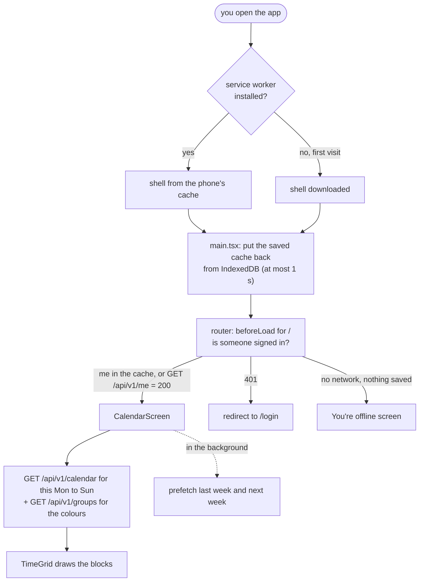

# Web app

> **Background:** [[Origin]] · [[Single-page apps and routing]] · [[Server state and caching]] · [[PWAs and service workers]] · [[Dev server proxy]] · [[TypeScript essentials]]

`apps/web` (package `@tasks/web`): the installable app you open on your phone. Why each tool was picked: [[Web stack choices]].

It has four screens:
- `/login`: the "Continue with Google" button;
- `/`: your calendar (one day on a phone, the week on a laptop);
- `/series/new`: the form to add a class;
- `/series/<id>`: the same form, to change or delete one class.

It is a **single-page app** ([[Single-page apps and routing]]). The server sends one HTML page and a JavaScript bundle once. From then on, React draws every screen in the browser and only fetches JSON from the API.

This note is the map: what each file does, and what happens when you open the app. The big parts have notes of their own: [[Calendar grid]] (drawing the week), [[Series form]] (adding and editing), [[Offline reads]] (opening without signal).

## Files

| File | What it does |
|---|---|
| `package.json` | Scripts (below) and exact versions. Runtime libraries (`react`, the router, TanStack Query and its IndexedDB persister, Better Auth's client, `temporal-polyfill`, `uuid`, `workbox-window`) are `dependencies`; build tools are `devDependencies` |
| `index.html` | The one HTML page. Holds `<div id="root">` (React draws inside it), the icon links, the theme colour, and the page-wide Tailwind classes on `<body>` |
| `vite.config.ts` | The build and dev server: plugins (router, React, Tailwind, PWA), port 5173, and the [[Dev server proxy]] for `/api` and `/healthz` |
| `vitest.config.ts` | Tests run in plain Node, without the Vite plugins and without a browser |
| `tsconfig.json` | Type-checks `src/` as **browser** code (DOM types, JSX) |
| `tsconfig.node.json` | Type-checks the config files as **Node** code (`process`, no DOM). Two configs so browser code can't use Node-only things by accident |
| `pwa-assets.config.ts` | Turns `public/logo.svg` into the PNG icons |
| `public/` | Copied as-is into the build: `logo.svg`, the generated icons, `favicon.ico` |
| `src/main.tsx` | The entry point: registers the service worker, puts the saved cache back from IndexedDB (waits at most 1 s), then renders the router inside the Query provider |
| `src/router.ts` | Creates the router and the one `QueryClient`, and passes the client to every route as `context` |
| `src/routeTree.gen.ts` | **Generated** from `src/routes/` by the router plugin. Committed so `pnpm typecheck` works in a fresh clone. Never edit by hand |
| `src/index.css` | Tailwind, plus the ten group colours as CSS variables (`--palette-blue` …), each with a light and a dark value ([[CSS variables]]) |
| **Routes** | |
| `src/routes/__root.tsx` | The frame around every screen. Most screens get a phone-width column; a route that sets `staticData: { wide: true }` (the calendar) gets the full width. Also the "Page not found" screen |
| `src/routes/login.tsx` | `/login`: the Google button and its error messages |
| `src/routes/index.tsx` | `/`: the calendar, with the "+ Add class" button, the offline badge and the account menu in its title bar. Tapping a class opens `/series/<its series id>` |
| `src/routes/series.new.tsx`, `series.$seriesId.tsx` | The class form, new and edit ([[Series form]]). `$seriesId` in a file name means "this part of the URL is a value" |
| **Data** | |
| `src/lib/api.ts` | The one way to call our API: `apiGet` for reads, `apiSend` for `POST`/`PATCH`/`DELETE`. Turns error responses into typed errors |
| `src/lib/queries.ts` | The reads, one definition each: `meQuery`, `healthzQuery`, `groupsQuery`, `seriesListQuery`, `calendarQuery(window)`. Each has a cache key (`['calendar', '2026-10-12', '2026-10-18']`) |
| `src/lib/mutations.ts` | The writes: create a group, create, change and delete a series. A new row's id (UUIDv7) is made once per save and reused if the same save is retried; after success, each, marks the calendar and series as out of date so they're fetched again |
| `src/lib/query-client.ts` | TanStack Query's settings: when to retry, `offlineFirst` for reads, fail-fast for writes, keep answers in memory as long as they're saved |
| `src/lib/persist.ts` | Saves the cache to IndexedDB and restores it at start-up; `forgetCachedData` wipes both on sign-out ([[Offline reads]]) |
| `src/lib/sync-status.ts`, `use-sync-status.ts`, `use-online.ts` | Works out "offline · last synced 2:02 PM" for the badge, and whether the form may save |
| `src/lib/require-session.ts` | For a route's `beforeLoad`: no session → `/login` before anything draws |
| `src/lib/auth-client.ts` | Better Auth's browser client (sign in, sign out) |
| `src/lib/login-messages.ts` | What the login screen says for each kind of failure |
| `src/lib/time.ts` | Estimating the server's clock from `/me` (the calendar's "now" line uses it) and checking a zone name |
| `src/lib/use-now.ts` | Left over from v0.0's ticking clock; nothing uses it. Deleted on branch `chore/remove-unused-use-now`, which ships with the next release's PR |
| `src/lib/pwa.ts` | Registers the service worker ([[PWAs and service workers]]) |
| **Screens' parts** | |
| `src/calendar/` | The calendar: `CalendarScreen` (title bar, navigation, data), `TimeGrid` (the grid), `OccurrenceBlock` (one block), and `model/` (the pure maths: dates, segments, layout, formatting, palette). See [[Calendar grid]] |
| `src/series/` | The class form and its pieces. See [[Series form]] |
| `src/components/` | Small pieces: `Logo`, `GoogleIcon`, `Avatar`, `AccountMenu` (the avatar's pop-up: name, Sign out, deployed commit), `SignOutButton`, `DeployedCommit`, `SyncBadge`, `PendingScreen` (spinner), `ErrorScreen` (offline and error states) |
| `src/**/*.test.ts` | Tests for the pure pieces (149, under two seconds) |

## From opening the app to seeing your week



Say you tap the Tasks icon on your phone at 9:15 on a Wednesday, already signed in.

1. **The shell loads.** The service worker hands over `index.html`, the JS and the CSS from its cache, without waiting for the network. (First visit ever: they come from the server.)
2. **`main.tsx` runs.** It registers the service worker (which also checks for a newer deploy). Then it puts back the copy of the cache saved in IndexedDB last time, so your user and the weeks you looked at are in memory before anything draws. Then it draws the router.

*From `apps/web/src/main.tsx` (shortened):*
```tsx
registerServiceWorker();

// …
await restoreQueryCache(queryClient);

createRoot(root).render(
  <StrictMode>
    <QueryClientProvider client={queryClient}>
      <RouterProvider router={router} />
    </QueryClientProvider>
  </StrictMode>,
);
```

What to notice:
- `await` at the top level of the file: the whole file pauses on that line until the saved cache is back (or a second has passed). Only then does `render` draw anything.
- `QueryClientProvider` hands the one cache to every component below it; `RouterProvider` draws whichever screen matches the address bar. The same `queryClient` also goes to every route as `context` (`router.ts`).
- `StrictMode` is React's development checker (it draws each component twice in `pnpm dev` to catch bugs); it does nothing in the production build.

3. **The router matches `/`** and runs its `beforeLoad` *before drawing anything*: `requireSession` asks TanStack Query for `/api/v1/me` (`ensureQueryData(meQuery)`). If the restored cache already has it, that answer is used at once; otherwise it's fetched. The browser attaches the session cookie because the request goes to the page's own origin ([[Origin]]).
4. **Three outcomes:**
   - **You're known** (cached or 200): the calendar screen draws.
   - **401 `unauthenticated`**: `beforeLoad` throws `redirect({ to: '/login' })`. You never see the calendar, not even for a frame.
   - **No answer and nothing saved**: the route's error screen says "You're offline", with **Try again**.

*From `apps/web/src/routes/index.tsx` and `apps/web/src/lib/require-session.ts` (shortened):*
```tsx
// apps/web/src/routes/index.tsx
export const Route = createFileRoute('/')({
  // …
  beforeLoad: ({ context }) => requireSession(context.queryClient),
  component: HomeScreen,
});

// apps/web/src/lib/require-session.ts
export async function requireSession(queryClient: QueryClient): Promise<void> {
  try {
    await queryClient.ensureQueryData(meQuery);
  } catch (error) {
    if (isUnauthenticated(error)) throw redirect({ to: '/login' });
    throw error;
  }
}
```

What to notice:
- `beforeLoad` runs before `component` draws. `context.queryClient` is the cache `router.ts` hands to every route.
- `ensureQueryData(meQuery)`: if `['me']` is already in the cache (restored from IndexedDB, say), it returns that with no request; otherwise it fetches `/api/v1/me` and waits.
- A 401 arrives as an `ApiError` with code `unauthenticated` (`api.ts`). `isUnauthenticated` spots it and `throw redirect(...)` tells the router "go to `/login` instead of drawing this". Any other failure is thrown on, and the router shows its error screen ("You're offline").

5. **The calendar asks for this week.** `CalendarScreen` works out "today" in your zone (Wednesday), and the Monday-to-Sunday week around it. It asks for `calendarQuery({ from: Monday, to: Sunday })` and `groupsQuery`, both shown from the cache straight away if they're there and refreshed in the background. It also quietly fetches last week and next week, so Previous and Next are instant.

*From `apps/web/src/lib/queries.ts`:*
```ts
export function calendarQuery(window: DateWindow) {
  return queryOptions({
    queryKey: ['calendar', window.from, window.to],
    queryFn: ({ signal }) =>
      apiGet<CalendarResponse>(
        `${paths.calendar}?${new URLSearchParams({ from: window.from, to: window.to })}`,
        { signal },
      ),
  });
}
```

What to notice:
- The key holds both dates, so each week is its own cache entry: `['calendar', '2026-10-12', '2026-10-18']`. Last week and next week sit beside it, which is why paging back is instant.
- `URLSearchParams` builds the query string: `/api/v1/calendar?from=2026-10-12&to=2026-10-18`.
- `signal` lets TanStack Query cancel the request if you page away before it answers.

6. **The grid draws** your Wednesday classes (or the whole week on a laptop), scrolled to 8:15, with the red "now" line. How: [[Calendar grid]].
7. **It stays fresh.** `/api/v1/me` and `/healthz` are fetched again every 60 s while the app is open and in front, and when you switch back to the app, anything on screen older than its freshness limit is fetched again (for a calendar week that limit is one minute; for the rest, TanStack Query's default of zero, so always). If the network is gone, the screen keeps the last answers and the badge says "offline · last synced 9:14 AM". If a refetch returns 401 (session ended), you're sent to `/login`.

**Signing in** (from `/login`): the button calls `authClient.signIn.social({ provider: 'google', callbackURL: '/', errorCallbackURL: '/login' })`. That `POST`s to `/api/auth/sign-in/social`; the API answers with Google's address; the browser goes there; Google sends you back to `/api/auth/callback/google`, which sets the cookie and redirects to `/`. If it fails, Better Auth redirects to `/login?error=<code>`, and the screen explains it (`not_invited` and `unable_to_create_user` → "This Google account isn't allowed to sign in"; anything else → a general message with the raw code in small print). If the API has no Google client configured, the button's request gets `404 PROVIDER_NOT_FOUND` and the screen says "Google sign-in isn't set up on this server yet". The whole dance step by step: [[Auth]].

**Saving a class:** the form checks your input with the shared rules, sends `POST /api/v1/series` through `apiSend`, and on success marks every cached calendar week as out of date, so the week on screen is fetched again with the new class in it. Every step, from the tap to the database and back: [[One write, line by line]].

**Signing out** (avatar → Sign out): `authClient.signOut()` deletes the session on the server; then `forgetCachedData` wipes the cache in memory **and** the copy in IndexedDB, so the next person to use the phone finds nothing of yours, not even offline; then the router goes to `/login`. If the server can't be reached, the screen says so and you stay signed in, rather than pretending.

*From `apps/web/src/components/SignOutButton.tsx` (shortened):*
```tsx
  async function signOut() {
    setBusy(true);
    setFailed(false);
    try {
      // Deletes the session on the server and clears the cookie.
      const { error } = await authClient.signOut();
      if (error) throw error;
    } catch {
      // Still signed in on the server: say so rather than pretend.
      setFailed(true);
      setBusy(false);
      return;
    }
    // …
    await forgetCachedData(queryClient);
    await router.navigate({ to: '/login', replace: true });
  }
```

What to notice:
- The order is the point: the server first. If that fails, `return` leaves before anything is forgotten, so the cache still matches the session you still have, and the button says "Couldn't sign out".
- Only after the server agreed: `forgetCachedData` (memory and IndexedDB), then `/login`.
- `replace: true` swaps the current history entry instead of adding one, so the phone's Back button can't take you back to the calendar.

## The api helper, in one paragraph

`apiGet<Me>('/api/v1/me')` fetches a path on our own origin with the cookie, and returns the JSON typed as the contract's `Me` ([[v0.0 contracts]]). `apiSend('POST', '/api/v1/series', body)` does the same for writes, sending the body as JSON. An error status becomes an `ApiError` with `status`, `code`, `detail`, `requestId` and, for a 422, the list of field `errors` the form shows under each input. It is a **tolerant reader**: it reads only the fields the contract promises and ignores the rest, so a newer API can add fields without breaking an older app still installed on a phone. An unknown `code` counts as `internal_error` (the contract's rule), and a body that isn't a Problem at all (an HTML 502 page from a proxy) falls back to a code based on the status. When the request gets no answer at all, it throws `NetworkError` instead, which the screens call "offline".

*From `apps/web/src/lib/api.ts` (shortened):*
```ts
async function send(path: string, init: RequestInit): Promise<Response> {
  try {
    return await fetch(path, {
      ...init,
      // …
      credentials: 'same-origin',
    });
  } catch (error) {
    // A cancelled request isn't a network problem; let the caller see the abort.
    if (init.signal?.aborted) throw error;
    throw new NetworkError({ cause: error });
  }
}

// …
export async function apiGet<T>(path: string, options: GetOptions = {}): Promise<T> {
  const response = await send(path, {
    headers: { Accept: 'application/json' },
    signal: options.signal ?? null,
  });

  const body = await readJson(response);
  const requestId = response.headers.get('X-Request-Id');
  const isOk = response.ok || (options.okStatuses ?? []).includes(response.status);

  if (!isOk) throw toApiError(response.status, body, requestId);
  if (body === undefined) throw notJson(path, response, requestId);
  return body as T;
}
```

What to notice:
- `fetch` only throws when there is no answer at all (no signal, server down). A 401 or a 500 *is* an answer, so `fetch` returns normally. That makes `send`'s `catch` the one place a `NetworkError` is born.
- `credentials: 'same-origin'`: send the cookie, but only to our own origin ([[Origin]]).
- `<T>` is a type parameter: the caller names the shape, `apiGet<Me>(...)`, and gets a `Me` back ([[TypeScript essentials]]). `body as T` trusts the server without checking at runtime: the tolerant reader.
- `okStatuses` is for `/healthz`, whose 503 still carries a normal body.

The tolerant part, for error codes:

*From `apps/web/src/lib/api.ts` (shortened):*
```ts
function errorCode(sentCode: unknown, status: number): ErrorCode {
  if (typeof sentCode === 'string') {
    return KNOWN_CODES.has(sentCode) ? (sentCode as ErrorCode) : 'internal_error';
  }
  switch (status) {
    case 400:
      return 'malformed_request';
    case 401:
      return 'unauthenticated';
    // …
    default:
      return 'internal_error';
  }
}
```

A code the app knows is used as sent; a code from a newer API counts as `internal_error`; no code at all (a proxy's HTML 502 page) falls to the `switch` on the status.

## Running it

| Command (from the repo root) | What it does |
|---|---|
| `pnpm dev` | Postgres + API + this dev server. Open `http://localhost:5173` |
| `pnpm --filter @tasks/web dev` | Only this dev server. API calls go to `127.0.0.1:3000` |
| `API_PROXY_TARGET=http://127.0.0.1:3100 pnpm --filter @tasks/web dev` | Same, but forward API calls somewhere else (a mock, for example) |
| `pnpm --filter @tasks/web build` | The production build into `apps/web/dist/` (HTML, JS, CSS, icons, `manifest.webmanifest`, `sw.js`). Vite warns that the JS is over 500 kB: most of it is the Temporal polyfill |
| `pnpm --filter @tasks/web preview` | Serves `dist/` on port 4173, with the same forwarding. **The only way to try the service worker and offline opening locally**: `pnpm dev` has no service worker on purpose |
| `pnpm --filter @tasks/web test` | The unit tests |
| `pnpm --filter @tasks/web test:tz` | The same tests under `TZ=UTC`, `Asia/Kolkata` and `America/New_York` |
| `pnpm --filter @tasks/web generate-pwa-assets` | Re-make the PNG icons after editing `public/logo.svg`; commit the results |

**Added a route?** Run `pnpm --filter @tasks/web dev` or `build` once: the router plugin rewrites `src/routeTree.gen.ts`. Commit it with the new route file. Until then, `typecheck` doesn't know the new URL exists.

## Check yourself
- You open `/` in a private window (no cookie, nothing saved). List every request the browser makes, in order, until you see the Google button. Which one returns 401, and which file turns that 401 into a redirect?
- You looked at this week yesterday, then turn on aeroplane mode and open the app. Which file puts your week back on screen, and what does the badge say?
- You add a class on Saturday through the form. Why does the calendar show it without you reloading? Name the line of code that makes that happen.
- Break it: in `src/lib/persist.ts`, make `forgetCachedData` only call `queryClient.clear()`. Sign out, turn on aeroplane mode, reopen the app. What can the next person see?
