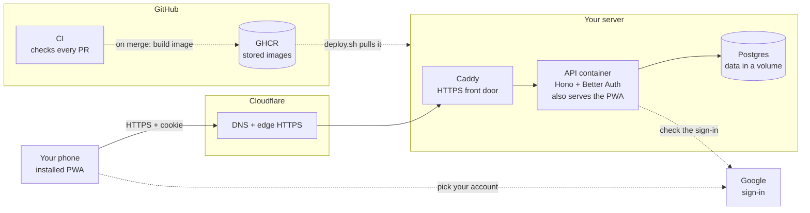

# v0.0 in plain words

> **Background:** none needed. This is an entry point; it links to everything else.

What the walking skeleton is, in plain words, with each piece linked to the note that goes deeper. Read this first if the module notes feel dense. Built on 2026-10-12 (PR #4).

## What "walking skeleton" means

The thinnest possible version of the *whole* app, wired end to end: you can sign in on your phone, the server checks who you are against the database, and the screen shows something from the server. It doesn't do anything useful yet (no timetable). The point is that every pipe exists and has been tested once, so v0.2 only has to add rooms, not plumbing.

Concretely, after you sign in, the app shows three things:
- your name and email (from the database);
- the server's clock, shown in *your* time zone (Asia/Kolkata);
- the **commit** the server was built from: a short code like `19b11d7` that names one exact version of the code. When you merge a PR and the code is deployed, that code changes on your phone. That's the v0.0 demo.

## The whole picture

Solid arrows happen on every request; dotted ones only at sign-in or on a deploy.



## The pieces, and what each one does

### The contract (`packages/core/src/api.ts`)
Three workers built three parts at the same time. Before they started, the names they had to agree on were written down: ports, settings, and the exact shape of the server's answers. Like agreeing on the size of a plug before two people build the socket and the lamp. Deeper: [[v0.0 contracts]].

### The API (`apps/api`)
The program on the server that answers requests. You open the app; the app asks the API "who am I?"; the API checks your cookie, looks you up in the database and answers. Deeper: [[API server]], [[How a request travels]], [[Middleware]].

- **It checks its settings at start-up.** If the database address or the cookie key is missing in production, it refuses to start and says which one, instead of crashing later at 2 a.m. Deeper: [[Environment variables and config]].
- **One shape for every error.** "Not signed in" always looks the same: `{ code: "unauthenticated", … }`. So the app can react to the *code* instead of guessing from the message. Deeper: [[Error responses]].
- **Logs** are one line of JSON per request (method, path, status, time taken), never including your cookie. Deeper: [[Structured logging]].

### The database (Postgres, through Drizzle)
Where data lives. For now it holds your user, your sign-in session and your profile (time zone, when your day rolls over). Tables are created by a **migration**: a SQL file in the repo that says "create these tables". It's applied once per database, in order, like numbered instructions. Deeper: [[Database and migrations]], [[Database migrations]], [[Connection pools]].

This is what one of those instructions looks like, the one that makes the profile table:

*From `apps/api/drizzle/0000_init.sql`:*
```sql
CREATE TABLE "profile" (
	"user_id" uuid PRIMARY KEY NOT NULL,
	"tzid" text DEFAULT 'Asia/Kolkata' NOT NULL,
	"day_boundary" time DEFAULT '04:00' NOT NULL,
	"created_at" timestamp with time zone DEFAULT now() NOT NULL,
	"updated_at" timestamp with time zone DEFAULT now() NOT NULL
);
```

Each line is one column: its name, what kind of value it holds, and its rules. `DEFAULT 'Asia/Kolkata'` means a new profile starts in India time unless told otherwise. `day_boundary` `'04:00'` is "when your day rolls over": a late night studying until 2 a.m. still counts as the day before. `NOT NULL` means the value can never be left empty.

### Sign-in (Better Auth + Google)
- You tap "Continue with Google". Google confirms who you are and sends you back.
- The API checks your email against the **allowlist**, a list of one email: yours. Anyone else is turned away *before* a user row is created. The whole check is one line:

  *From `apps/api/src/auth/allowlist.ts` (shortened):*
  ```ts
  export function isEmailAllowed(allowed: readonly string[], email: string): boolean {
    return allowed.includes(email.trim().toLowerCase());
  }
  ```

  "Is this email in the list?", after removing stray spaces and capital letters, so `Atif@Gmail.com ` still matches. The list itself comes from the setting `AUTH_ALLOWED_EMAILS`, not from the code.
- If you're allowed, the API stores a session in the database and gives your browser a **cookie**: a small ticket the browser sends back with every request. The cookie lasts 30 days and renews itself each day you use the app.
- Signing out deletes the session row, so the old ticket stops working immediately.

Deeper: [[Auth]], [[OAuth sign-in]], [[Cookies and sessions]].

### The web app (`apps/web`)
What you see: a login screen and a "me" page. It's a **PWA** (progressive web app), a website your phone can install like an app, with its own icon and no address bar. A small helper program, the **service worker**, stores the app's own files on the phone, so the app opens even with no network. It never stores your data; that always comes fresh from the server. Deeper: [[Web app]], [[PWAs and service workers]], [[Single-page apps and routing]], [[Server state and caching]].

### The box and the pipeline
- **Image:** the API plus the built web app, packed into one sealed bundle (a Docker image) that runs the same on your laptop and on the server. Deeper: [[Containers and images]].
- **Compose stack:** three containers on the server:
  - **Caddy**, the front door, which handles HTTPS;
  - **the API**;
  - **Postgres**, which only the API can reach.

  Deeper: [[Docker Compose]], [[Reverse proxies and TLS]].
- **CI:** every PR runs the checks on GitHub's computers (lint, typecheck, all tests, a secret scan, building the image). A PR with a mistake shows a red X. Deeper: [[CI and CD]], [[Secret scanning]].
- **CD:** merging into `main` builds the image and, once the server exists, runs `deploy.sh` on it: back up the database, apply migrations, start the new version, and check that `/healthz` reports the new commit. If the check fails, it rolls back. Deeper: [[Deploy and CI]], [[Deploy choices]].

  `/healthz` is the page that answers "are you alive, and which version are you?". Its whole answer:

  *From `apps/api/src/routes/healthz.ts` (shortened):*
  ```ts
      const dbOk = await pingDatabase(deps.pool);
      const body: Healthz = {
        sha: deps.env.GIT_SHA,
        dbOk,
        // toISOString() is always UTC with a `Z`, as the contract requires.
        time: deps.now().toISOString(),
      };
      // …
      return c.json(body, dbOk ? 200 : 503);
  ```

  `sha` is the commit code that was stamped into the image when it was built: the same short code you see at the bottom of the app (shortened there). `dbOk` says whether the database answered. If it didn't, the status is `503` ("temporarily unavailable") instead of `200` ("OK"), so the deploy sees a broken version as broken.

## What was tested, and how

- **213 automated tests.** The API's tests use a real Postgres (not a fake) and a fake Google, because there's no real Google client yet.
- **In a real browser:** the login screen, the signed-in page, sign-out, and what happens when the server is down.
- **The production image on this laptop:** same image and same Compose file as the real server, with `localhost` instead of the domain. `/healthz` showed the right commit, and Chrome said the app is installable.

## What's not done yet (your steps)

Only you can do these: they need your accounts, your money or your phone. The runbook is `deploy/README.md`.

1. Create the Google sign-in client.
2. Get the server (Oracle Always Free, or a paid India VPS).
3. Point `tasks.ahmedatif.in` at it in Cloudflare.
4. Add the GitHub secrets, and turn on branch protection.
5. Merge PR #4. The first deploy runs once `DEPLOY_ENABLED` is set.
6. Install the app on your phone, restart the phone, and check you're still signed in.

## Check yourself
- You tap "Continue with Google" with your friend's account. At which step is it refused, and does a row appear in `auth_user`?
- Your phone has no network and you open the installed app. What appears, and why doesn't your (future) timetable data come from the service worker?
- You merge a PR with a bug that crashes the API at start-up. Walk through `deploy.sh`: what does the server end up running?
- Why does the app show the *commit* at the bottom of the page? What would you check if it didn't change after a merge?
