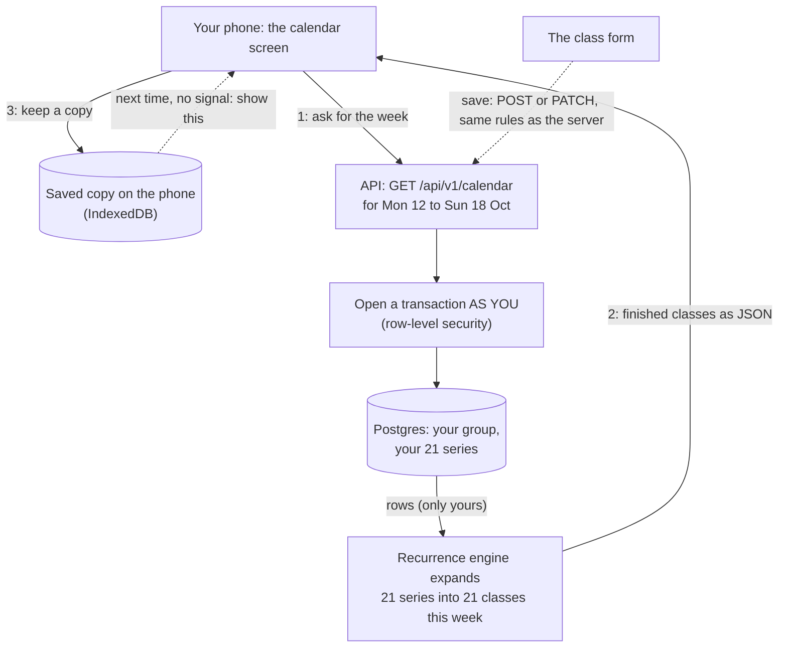

# v0.2 in plain words

> **Background:** none needed. This is an entry point; it links to everything else.

v0.2 is the readable calendar, built 2026-10-13 and 14. In one sentence: **your real timetable is now on the app's home screen, it opens without signal, and nobody else's account can ever see it.** This note explains what was built without jargon, and every section links to the note that goes deeper.

## What you'll see

- **On your phone:** one day at a time (today first), a strip of Mon–Sun at the top to jump between days, and your classes as coloured blocks: "DS, 8:00–9:00 AM, C-301". It opens scrolled to an hour before now, but never earlier than 7 AM, so at 9:15 you see 8:15 onward.
- **On your laptop:** the whole week, Monday to Sunday.
- **Previous / Today / Next** move you up to 8 weeks back or forward.
- **"+ Add class"** opens a form: title, subject, room, the days, start time, how long, first and last day. Tapping a class on the calendar opens the same form, to change or delete it.
- **No signal?** The app still opens and shows the weeks you looked at recently, with a small badge: "offline · last synced 8:42 AM".

## The whole picture

Solid arrows happen every time you open the calendar; dotted ones only when you save a class.



## The pieces, one at a time

### 1. Agreeing on shapes first
Four workers built v0.2 at the same time: the API, the calendar grid, the form and offline reads, and these notes. Before they started, the shared pieces were fixed: what a valid class looks like, the ten colours, the three new tables, the URLs. That's [[v0.2 contracts]]. The point is that the form and the server use **the very same rulebook**, so the form can never let through something the server then refuses ([[Validating input with schemas]]).

Here's part of that rulebook, "what a valid class looks like". Each line is one field of the form and its rule:

*From `packages/core/src/schemas.ts` (shortened):*
```ts
const seriesFields = {
  // …
  /** The short name on the calendar block: "DS". */
  title: text(80),
  /** The full name attendance is counted by (B8): "Data Structures". */
  subject: text(120),
  location: optionalText(80),
  // …
  startTime: wallTimeSchema,
  /** Up to a whole day. */
  durationMin: z.number().int().min(1).max(1440),
  // …
};
```

Read it almost as English: a title is text of up to 80 characters, the room is optional text, and the length is a whole number (`int`) of minutes from 1 to 1440, a whole day. Type "90.5" or "0" into the form, and this line is what says no, on your phone and on the server alike.

### 2. Three new tables
- `schedule_group`: "Classes · Sem 3", with a colour and the days it's active.
- `series`: one repeating class, like "DS, every Monday 08:00, 60 minutes, room C-301". Your timetable is 21 of these.
- `occurrence_override`: one row per *exception* ("this Monday's DS was cancelled"). Empty for now; v0.3's cancel button fills it.

Notice what's **not** stored: the individual classes. "DS on 14 Oct" is worked out from the series every time you look ([[Recurrence engine]]).

### 3. Nobody else can see your rows: row-level security
Until v0.2, the only thing keeping two people's data apart was that every query in our code said "…where the owner is you". One forgotten line in some future feature, and a friend's account could read your timetable.

Now **Postgres itself** checks. For every request, the API opens a small transaction ([[Transactions]]) that says "this is Atif" and switches to a limited database account, `tasks_app` ([[Roles and privileges]]). Inside that transaction, even a query with no filter at all sees only your rows. The tests prove it: as "Bob", asking for *every* series returns only Bob's. How it works: [[Row-level security]] (the idea) and [[Row-level security in our database]] (our code).

The rule Postgres enforces, for the classes table:

*From `apps/api/drizzle/0002_calendar_rls.sql` (shortened):*
```sql
ALTER TABLE series ENABLE ROW LEVEL SECURITY;
-- …
CREATE POLICY series_owner ON series
  USING (user_id = app_current_user_id())
  WITH CHECK (user_id = app_current_user_id());
```

In words: on `series`, a row can be seen (`USING`) or written (`WITH CHECK`) only if its owner is the person this request is for. `app_current_user_id()` reads the "this is Atif" note the API sets at the start of each transaction. The other two tables have the same rule.

One honest limit: the API logs into Postgres with an all-powerful account and only *switches* to the limited one per request. So this protects against **forgotten filters**, the realistic bug, not against someone who could run any SQL they like on the server. Giving the API its own limited login is on the later list.

### 4. The calendar API
`GET /api/v1/calendar?from=2026-10-12&to=2026-10-18` returns that week's finished classes. The server runs the engine, so your phone doesn't need to (B6). A window longer than 62 days is refused (B7), so nobody can ask the server to work out ten years in one go. Creating and editing groups and classes are the other routes. Details: [[Calendar API]]; why each choice: [[Calendar API choices]].

A detail worth knowing: when your phone saves a new class, **the phone picks its id**. If campus Wi-Fi drops the answer and the phone sends the same "create" again, the server sees that the id already exists and doesn't make a second copy ([[Idempotency and retries]]).

### 5. Your real timetable, kept private
The repo is public, so your timetable never goes into it:
- the timetable file format is public, with a **made-up** example (`fixtures/sample-timetable.json`);
- your real one is `private/kiit-sem3.json`, in a folder git ignores;
- `pnpm --filter @tasks/api seed:private` reads it and writes it **only** to the database on your laptop. It refuses to run if the database isn't on this machine, and it prints counts only ("Seeded 1 group and 21 series"), never names or rooms.

The "only on this machine" check runs before anything connects:

*From `apps/api/src/calendar/seed.ts` (shortened):*
```ts
const LOCAL_HOSTS = new Set(['localhost', '127.0.0.1', '[::1]']);
// …
  const host = new URL(env.DATABASE_URL).hostname;
  if (!LOCAL_HOSTS.has(host)) {
    return `DATABASE_URL points at ${host}, and seeding is only for a database on this machine`;
  }
```

It looks at the database's address. `localhost`, `127.0.0.1` and `[::1]` are three ways of writing "this computer", and anything else (your future server, say) gets a refusal message instead of your timetable.

More in [[Timetable files and seeding]].

### 6. The calendar grid
Drawing a week is harder than it looks:
- **Overlaps.** If a lab and a club meeting overlap, they sit side by side, in as few columns as possible. The trick is a classic algorithm, [[Interval partitioning]].
- **Days that aren't 24 hours.** In countries with daylight saving, a day can be 23 or 25 hours, so the grid walks real days instead of adding 24 hours. India doesn't have this, but the code must not break for someone who does.
- **The display.** 12-hour times, weeks from Monday, ten fixed colours that stay readable in dark mode, and a red "now" line that moves every minute.

See [[Calendar grid]] and [[Calendar grid choices]].

### 7. The class form
One screen for adding and changing a class. "Subject" fills itself from the title until you type your own, so "OOP" becomes the subject "OOP" unless you write "Object-Oriented Programming". Errors appear under the field that's wrong ("Pick at least one day"). Saving needs a connection, for now. See [[Series form]].

### 8. Offline reads
TanStack Query keeps every answer the app got (your user, your groups, the weeks you viewed) in memory. A "persister" also writes a copy to **IndexedDB**, a small database inside the browser on your phone, about a second after each change. When the app opens, that copy is put back *before* the first screen is drawn. So opening the app in a lecture hall with no signal shows this week straight away, plus the badge. The general idea: [[IndexedDB and offline storage]]; ours: [[Offline reads]].

Signing out deletes that copy too, so whoever uses the phone next sees nothing of yours.

## How it was checked

- **Your real timetable**, loaded into your laptop's database and compared with the hand-checked golden weeks in `private/`:
  - through the API: 12 Oct to 15 Nov (5 weeks), 105 classes, **0 differences**;
  - on a phone-sized screen: all 35 days stepped through one by one, 0 differences;
  - on a laptop-sized screen: all 5 weeks, 0 differences.
- **The real thing, end to end:** a made-up "Club" class was added through the form, appeared on Saturday, then was deleted, against the real API and database.
- **The production image** (exactly what the server will run) on the laptop. It reported the right commit. Then the network was cut and the page reloaded, and the app opened from the phone's saved copy with the offline badge.
- **A 4G estimate:** a tiny program slowed the connection to a slow 4G link (1.6 Mbit/s, 150 ms delay). Opening the app cold drew the first class in about **3.0 s** (the target is 4 s); with the app already cached, about **0.4 s** (target 1.5 s). It's an estimate: a laptop is faster than your phone, and there was no real internet in between.
- **438 automatic tests** (132 core, 157 API against a real Postgres, 149 web), all green, in CI too.

## Things that went wrong and got fixed

- **A date that doesn't exist crashed the calendar.** Asking for `2026-02-30` made the server fail (error 500) instead of saying "that's not a real date" (422). The shared rule now checks the dates before counting the days between them. The story: [[Calendar API]], "A pitfall we hit".
- **The offline badge didn't fit on a phone.** It pushed the date and the buttons off the screen. Found by looking at the screenshot, and fixed by giving it its own line on small screens.
- **A real class slipped into a test.** One test used one of your real classes (its day, time and room) as its example. The privacy check caught it before anything was pushed, and the history was rewritten so that commit never reached GitHub. The check now scans every commit, not just the final result.

## What's not done yet

- **The phone checks wait for the server:** your real timetable on your actual phone, and the real 4G timing. The server setup is still your step from v0.0 (`deploy/README.md`).
- **Four defaults for you to confirm:**
  - B6, the server works out the classes;
  - B7, a 62-day limit, refused with 422;
  - B10, our own grid rather than a library;
  - B11, Monday weeks, 24 hours scrolled to an hour before now (never before 7 AM), 12-hour times, ten colours, day view on phones.
- **Cancelling a class** ("Prof cancelled" / "I skipped") is v0.3.

## Check yourself
- You open the app on the bus with no signal. Name the two things that make the screen appear (one is in the browser, one is the service worker from v0.0).
- A future feature forgets "where the owner is you" in a query on `series`. What does row-level security return, and what would v0.0 have returned?
- Your phone sends "create OOP on Tuesdays" twice because the first answer got lost. How many OOP series exist afterwards, and why?
- Why does the seed script print "Seeded 1 group and 21 series" and not the class names?
