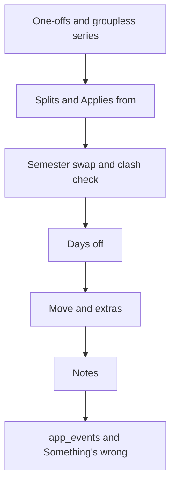

# Swap, days off and series choices

The choices behind v0.3b: the semester swap, days off, changing a series from a date, moves, extras and notes. They were settled by grilling on 2026-11-05 and 2026-11-07, before v0.3 itself was built, in five rounds of questions, each with a recommended answer. The short record is **ADR v0.3b** in `JOURNEY.md`, and the words are defined in `CONTEXT.md` at the repo root. It builds on [[Cancel and group choices]], which made a group a folder with no first day; most of what follows leans on that. The engine underneath is explained in [[Recurrence engine]].

## A series doesn't need a group

"Feed the dog" every morning, "Run" on weekday evenings, "Reading" on Sundays. None of them belong to a semester, and forcing them into a folder called "Personal" just to exist is a chore. So a series can now sit in **no group**.

A series in no group:
- has **its own colour**, picked in the series form, from the same ten colours as groups;
- never tracks attendance;
- isn't hit by a Holiday, but is hit by "I'm away" (more on both below);
- ends only by its own last day.

The series list shows these under "No group", and Change group moves a series into a group or out of one. A series *in* a group still takes the group's colour, so changing a whole semester's colour is still one edit.

In the database this is two small changes. `series.group_id` becomes nullable (allowed to be empty), and the series gets a colour column that's used only when there's no group. An *entity* is a kind of thing the app stores as its own row with its own id, in its own table: group, series, override. A series in no group is not a new entity. It's the same series, just outside any folder.

What lost:
- A hidden built-in "No group" folder. It needs no database change, but every ungrouped series would share one colour, and that folder needs special cases everywhere: it can't be renamed, archived or deleted.
- Keeping groups required and making a "Personal" group by hand. Free, but it's exactly the folder that wasn't wanted.

## A one-off is a series that happens once

A dentist visit on Tuesday at 4 PM. Google Calendar handles this with one kind of thing, an *event*, which has a start and an end. Repeating is an optional field on it (`recurrence: ["RRULE:FREQ=WEEKLY;BYDAY=MO"]`), so a dentist visit is an event without that field.

Our app also has one kind of thing, the series, but its repeat pattern (the `rule`) is required. The rule is a *discriminated union*, "one of several shapes" told apart by one field: `{ freq: 'daily', … }` or `{ freq: 'weekly', … }`. v0.3b adds a third shape, `{ freq: 'once' }`, and the database insists that a once-series' last day equals its first. The form shows it as "Repeat: Never".

Why a new shape and not a trick? Because TypeScript checks every `switch` on `freq`: add `'once'` and every place that handles rules but forgets "once" stops compiling. That's the compiler finding the forgotten code for you. And a later export to Google or an `.ics` file writes it as an event with no `RRULE`, exactly Google's shape.

What lost:
- Saving it as "daily, first day = last day". No engine change, but the stored row says "daily" when it means "once", and a weekly series that happened to start and end on the same day would look identical, so the form would have to guess whether to show "Never".
- An empty rule meaning "no repeat". Same meaning as `'once'`, but every reader of the rule then has to remember to check for empty, and nothing forces it to.

All-day ("Mom's birthday") and multi-day ("trip Fri–Sun") events are left out. They need a strip drawn above the hours, which is a different kind of drawing. They're on the later list.

## Changing a series: one "Applies from" box

Tapping a class already gives "Only this" on the occurrence sheet: cancel it, move it, write a note on it. So the series form, which changes *all* of a series, doesn't need the classic three-way chooser "Only this / This and following / All".

Instead, when you change the **timing** (the days, the repeat interval, the start time or the duration), one box appears: **Applies from**, set to today.

- **A day after the series' first day** (today, or a past day): the series *splits* there. The old series ends the day before, and a new linked series carries on with the new timing (D-023). Past classes keep the timing they actually had.
- **The series' own first day**: this means "I got it wrong from the start", so the change is made in place, past included.

Everything else (title, room, subject, colour, group) always changes in place, past included. A room typo should be fixed everywhere.

Why does even a start-time change split? The brainstorm let a time change edit in place, because occurrences are identified by their date, not their time, so nothing breaks. But it silently rewrites history: last Tuesday's 10:00 class would suddenly have been at 11:00. That matters once the timer (v1) and attendance (v2) look back at what happened when. So the rule is simple: timing never rewrites the past unless you say it was a mistake.

**A past "Applies from".** On Wednesday you notice Physics moved to Tue/Thu last Monday. Set Applies from to last Monday and the split happens there. Cancels or notes you'd put on old-pattern days after that Monday (say, a skip on Wednesday) are now on days the new timing never produces. They're hidden, never erased, with v0.3's warning: "2 changes after 3 Nov will stop showing. They're kept." Moved classes don't care, because they show where they landed.

**A split reads as one series.** In the database a split is two linked rows ("Physics Mon/Wed until 3 Nov", then "Physics Tue/Thu from 4 Nov"). You see one Physics: one row in the series list, and a line in its form: "Earlier: Mon/Wed until 3 Nov". Archive and Delete act on the whole chain. The split is how the past stays safe, and you shouldn't have to manage it.

What lost:
- The three-way chooser. "Only this" already lives on the sheet, and "All" either rewrites the past or quietly means "from today".
- Editing a start time in place (D-023's original rule): it rewrites history.
- Showing both halves of a split as separate series: two Physics rows for one subject.

## The semester swap copies a group

Every semester ends in a swap, and the next one starts in January. The goal from D-004: swap to a new timetable in under 30 minutes.

**Start next semester…** on the group form copies the group:
- **Copied:** every series' title, subject, days, start time, duration, room and repeat interval, plus the group's colour, attendance setting and "Observes holidays" setting.
- **Not copied:** cancels, notes, moves, extras and last days. Those are Sem 3's history.
- Every copied series starts on one **Starts on** date and has no last day.
- The name suggests the old one with its number bumped: "Sem 3" becomes "Sem 4".

Then you land on Sem 4's series list and edit or delete what changed.

**Two dates, not one.** Classes end in late November, exams and a break follow, and Sem 4 starts in January. If the swap set Sem 3's last day to "the day before Sem 4 starts", Sem 3's classes would show all through the exam weeks. So the swap asks only for Sem 4's start. Sem 3's last day is its own field (v0.3's Last day / Archive). If Sem 3 would still be running when Sem 4 starts, the swap warns, with a one-tap fix: "Sem 3 has no last day, so it would run alongside Sem 4. End it on 27 Nov?"

**Preview and undo.** Before you confirm, a preview: "Creates *Sem 4* with 21 series from 5 Jan. Sem 3's last day: 27 Nov", plus any clashes (next section). After confirming, the usual 8-second Undo deletes Sem 4 and puts Sem 3's last day back if the swap changed it. After that, deleting Sem 4 is a plain confirm, because a group that hasn't started has no history to lose (v0.3's rule). No special undo is needed.

There's no reminder card ("Sem 3 ends in 7 days, set up next semester"). There's no Today screen to put it on, and you know when your semester changes.

What lost:
- An empty new group plus retyping every class. Already possible with v0.3's Groups screen, and it stays possible, but copying saves retyping rooms, durations and subjects.
- Importing a timetable file (D-008). The format exists; the upload screen doesn't. Later.
- The brainstorm's "copy and archive the old one" in one step with a 10-minute undo. It assumed one date, and there are two.

## Clashes are checked when you save

A *clash* is two occurrences from different series overlapping in time. (The brainstorm called it a "conflict", but `conflict` is already our HTTP 409 error code, and one word shouldn't mean two things.)

Before v0.3, the natural moment to check was "when a group starts". Groups no longer start. So the check runs when a **series is saved** (created, edited or split) and right after a **swap**. It compares against every series that isn't archived, from the series' first day to 16 weeks ahead, ignores cancelled occurrences, and counts every group: a lab over your evening run is a real clash.

How: D-029's expand-and-sweep. *Expand* the series into actual occurrences over that window, sort them by start time, and *sweep* through once, noting every pair that overlaps by a positive amount. It's the same idea as [[Interval partitioning]], which the calendar grid already uses to place overlapping blocks side by side.

The result never blocks the save. It's a note: "Chem Lab (Thu 17:00–19:00) overlaps Run (daily 18:00) · 12 times from 7 Jan · Keep both / Edit". "Move the other one" waits until it's actually missed.

What lost: a standing Clashes screen (one more place to check), and checking only at swap time (a clash added mid-semester would go unnoticed).

## Days off

A *day off* is a whole day that cancels occurrences. Two kinds:
- **Holiday**: classes don't happen. Stored as `not_held`, so it doesn't count against attendance. It hits every group that **observes holidays**, a group setting that's on by default for attendance groups. "Health" has it off, so a holiday doesn't cancel your run.
- **I'm away**: you're absent. Stored as `skipped`, and it hits **everything**, every group and no group, because if you're away the run is skipped too.

"Days off…" in the calendar header menu takes a date range, a label ("Puja break") and the kind. Whole days only; a half-day is a few single cancels. Each entry is saved as one **batch**, so one Undo removes the whole break. Past dates are allowed, for the break you forgot to enter.

On the calendar, the day header shows the label and the cancelled classes show the usual stripes. A **Days off** screen in the account menu lists upcoming and past entries, where you remove a whole batch or just one day.

Why a setting per group, not ticking groups each time? With the setting, a holiday entered now also covers groups made later. Enter Republic Day in November and Sem 4, created in December, observes it in January with nothing to tick.

**What you set by hand beats a day off.** This is the rule that keeps the calendar trustworthy:
- The college says Physics happens on the holiday after all. You tap Physics and press Restore. In v0.3, Restore just emptied the cancel fields. That's not enough here: with nothing stated, the holiday would cancel it again. So on a day off, Restore saves an explicit "held" (`status: scheduled`, which the table already allows). Everywhere else, Restore still empties the fields.
- A move or an extra that **lands** on a day off stays. You placed it deliberately. The Days off preview names them: "2 classes you placed by hand fall on these days. They stay; cancel them yourself if needed."
- A class you'd already cancelled by hand inside the range keeps its own reason, and the preview counts only what the day off actually changes.

What lost:
- One `not_held` override per class per holiday (the brainstorm's 02 slice). Undo becomes a hunt, and it can't cover groups created later.
- Ticking groups on every day off.
- A day off that overrules hand-made changes. Restore a class, and a holiday silently cancels it again.

## Moving a class, and extra classes

**Move…** on the occurrence sheet sets a new date, start time and duration. The old slot keeps a faded **ghost**; tap it and it says "Moved to Wed 19 Nov, 2:00 PM · Put back". As decided in v0.3, a moved class shows where it *landed*, and only its group's last day can hide it. So the form refuses a landing after the group's last day: it would vanish the moment you saved it. A moved class can still be cancelled, noted, or moved again; moving again just replaces where it landed.

**Add extra class…** adds an occurrence the timing never produced, like a Saturday make-up class. It works in every group (an extra gym session in Health counts too), counts as held, and obeys the group's last day the same way. Removing one is a plain confirm until attendance exists in v2.

Detaching a moved class into a standalone item waits for v1, when tasks and *blocks* (tasks placed on the calendar, D-028) exist. Careful when it comes: a detached Physics class drops out of Physics' attendance count.

## Notes on one class

A *note* is plain text on one occurrence: "bring lab manual", "quiz today", or a page of lecture notes. Up to **3,000 words**. It has no checkbox and no reminder; it's memory attached to a class.

**Saving.** There's no Save button. The note saves itself one second after you stop typing, and again when the sheet closes. "Wait until the typing stops, then act" is called *debouncing*: without it, every keystroke would be a request. Every save is the same `PATCH` the cancel buttons use, carrying the whole note. It's *idempotent*, meaning sending it twice leaves the same result as once, so a retry on bad Wi-Fi can't duplicate anything (see [[Idempotency and retries]]). Offline, the latest version waits in the queue; only the newest is sent.

**No quota, with numbers.** 3,000 words is about 18 KB. Even if every one of ~25 classes a week had a full note, that's ~450 KB a week, about 9 MB a semester. The server's disk will hold tens of gigabytes, and Postgres compresses long text by itself. Only you can sign in, so nobody else can fill it. Per-user limits come back when the app opens to others.

**Previews, not whole notes, in the calendar.** The calendar loads up to 62 days at once and keeps them on the phone for offline use (see [[Offline reads]]). Full notes there could add megabytes to every cold open and break the "next class on screen within 4 seconds on 4G" target. So the calendar carries only a dot and the first ~100 characters. The full note loads when you open the sheet, and stays on the phone from then on. The cost: offline, you can read a full note only if you've opened it before. A later setting will download all notes' text on Wi-Fi.

**Links.** A URL in a note becomes tappable. The server never opens it, not even to fetch the page title. A server that fetches any URL a user hands it can be pointed at addresses only the server can reach, such as its own database port; that attack is called *SSRF* (server-side request forgery). Not fetching means not having to defend against it.

**Why not files from Google Drive (yet).** PDFs and photos would go into *your* Drive, never onto our server. That needs one more Google permission, called a *scope*, here `drive.file` ("only the files this app created or you picked"). Research turned up the costs. The app would have to store a *refresh token* (the long-lived key that gets a fresh one-hour access pass), today our Google tokens sit in the database as plain text, and if the Google app is still in "Testing" mode those keys expire every 7 days. Each has a fix, but together they're a feature of their own, so Drive comes after the app is built (later list #33, with what was agreed so far).

## What works offline

Only what v0.3 already queues (cancel, restore, change reason) plus notes. Swap, days off, move, extras and series or group edits need a connection; their buttons are greyed out with "Needs a connection". Those write many rows at once and need the server's checks (clashes, last days), so replaying them hours later could go wrong where you can't see it.

## Dogfood counters

The formal dogfood (D-014) ends when there are "zero wrong occurrences in the last 7 days", so something has to count them. An `app_events` table records opens, cancels, restores, swaps and days off, server-side. The occurrence sheet gets a small **Something's wrong** link with an optional line of text. You only see a "Noted" toast.

## Size and order

The milestone grew from 10 hours (alarm at 13) to **16 hours, alarm at 20**, for extras, groupless series, one-offs, note previews and the wrong-class report. It ships as one release, built in this order so the January swap never waits on extras:

The model changes come first because everything after builds on them: the swap copies series that might be one-offs, the clash check expands them, and days off must know which series have no group.

## What moved out of v0.3b

| Item | Where it went | Why |
|---|---|---|
| Files on a class, via Google Drive | After the app is built (later #33) | A new permission, stored keys and Google's 7-day rule for testing apps |
| Downloading every note's text on Wi-Fi | A later setting (#32) | Previews cover daily use |
| All-day and multi-day events | Later (#34) | A different kind of drawing; days off cover holidays |
| "Turn into a block" for a moved class | v1 (#35) | Blocks arrive with tasks |
| A reminder card before the semester ends | Dropped | No Today screen, and you know your own dates |

## Check yourself
- "Feed the dog" sits in no group. A Holiday covers tomorrow, and on Friday you're away. Which of the two days cancels it, and as what?
- Why does `{ freq: 'once' }` make the compiler help you, where "daily with first day = last day" wouldn't?
- You change Physics from 10:00 to 11:00 with Applies from = today. What happens to last week's classes, and what would happen with Applies from = the series' first day?
- Why does the swap ask for only one date, and what does it do when the old group has no last day?
- The college holds Physics on a holiday, and you press Restore. What's stored, and why wouldn't v0.3's Restore have been enough?
- A note is 3,000 words. Why doesn't the calendar send it with the occurrence, and what does it send instead?
- Why does the server never open the links in a note?
