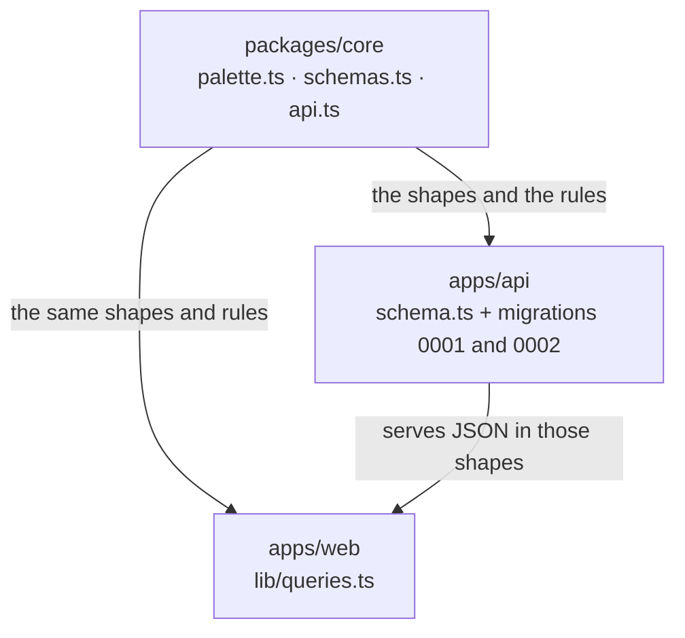
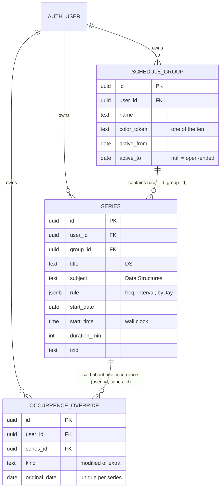
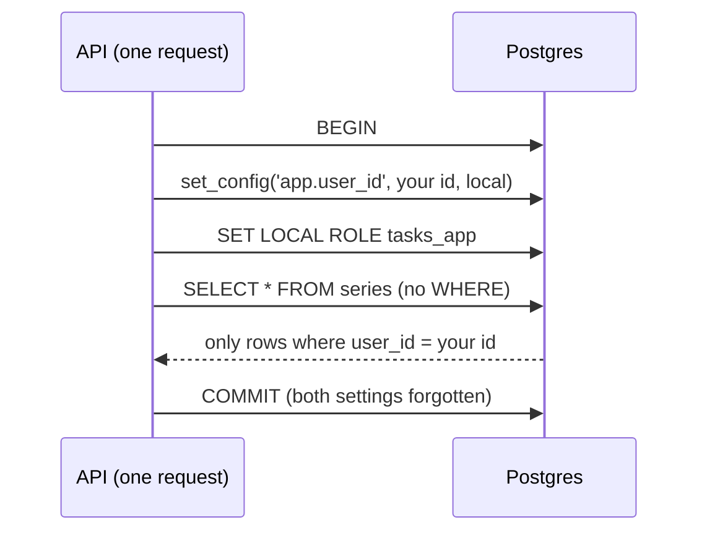

# v0.2 contracts

Written 2026-10-13, before any v0.2 feature code. Like v0.0, v0.2 was built by several workers at once: one for the API, one for the calendar grid, one for the series form and offline reads. Before they started, the shared pieces were fixed in one small change (branch `chore/v0-2-contracts`), so the parts would fit together. This note is that list, and why each piece looks the way it does. The general idea of a contract is in [[v0.0 contracts]].

## What changed, at a glance

| File | What it adds |
|---|---|
| `packages/core/src/palette.ts` | The ten group colours, as names (`blue`, `sky`, …, `violet`) |
| `packages/core/src/schemas.ts` | The rules for what a valid group, series and calendar window look like (zod schemas) |
| `packages/core/src/api.ts` | The new URLs, the response shapes, and a new error code `conflict` |
| `apps/api/src/db/schema.ts` + `drizzle/0001_calendar_tables.sql` | Three tables: `schedule_group`, `series`, `occurrence_override` |
| `apps/api/drizzle/0002_calendar_rls.sql` | Row-level security on those three tables, written by hand |
| `apps/web/src/lib/queries.ts` | How the PWA asks for groups, series and a calendar window, and the cache keys it files them under |

## The URLs

| Request | Answer |
|---|---|
| `GET /api/v1/groups` | `{ groups: [...] }`, every group you have |
| `POST /api/v1/groups` | 201 and the new group (or 200 and the existing one, see "Retries") |
| `GET`, `PATCH`, `DELETE /api/v1/groups/:id` | The group; the changed group; 204 and nothing |
| the same five for `/api/v1/series` | Same rules |
| `GET /api/v1/calendar?from=2026-10-12&to=2026-10-18` | `{ from, to, occurrences: [...] }`: what the engine computed for those days |

**Why lists come wrapped in an object** (`{ groups: [...] }`, not just `[...]`): an object can grow. If v0.3 wants to add `"archivedCount": 2` next to the list, old copies of the app on your phone ignore the new field and keep working. A bare list has nowhere to put it.

**Why the calendar returns occurrences and not series:** the server runs the recurrence engine ([[Recurrence engine]]) and sends finished answers, "DS on Tuesday at 1 PM", so the phone never needs the engine (B6). The engine is still in shared code, so the phone *could* run it later without a rewrite.

## The rules (zod schemas)

A **schema** here is a description of valid input that code can check: "a series needs a title of 1 to 80 characters, at least one weekday, and a duration from 1 to 1440 minutes". zod turns that description into a function. Give it untrusted JSON, and you get back either a clean typed value or a list of what's wrong, field by field. The general idea is in [[Validating input with schemas]].

The point of putting them in `packages/core` is **one rulebook, two readers**. The API checks every request body with them, and the series form checks what you typed with the very same rules before sending. So the form can never accept something the server then refuses, or the other way round.

Some rules worth knowing:
- **Dates** must be real (`2026-02-30` is refused). **Times** are `HH:MM`, 24-hour, no seconds. **Zones** must be names like `Asia/Kolkata`: `IST` is refused (India? Israel? Ireland?), and so is `+05:30` (an offset never follows daylight saving). `asia/kolkata` is accepted and stored as `Asia/Kolkata`.
- **Weekly days** are stored Monday first, each once: `["FR", "MO", "FR"]` becomes `["MO", "FR"]`, so two equal rules always look equal.
- **New ids must be UUIDv7**, made by the client (see "Retries").
- **Subject defaults to the title** (B8). Create "OOP" without a subject, and its subject is "OOP"; attendance will later count by subject.
- **The calendar window** is at most **62 days**, both ends counted (B7).

## Retries: client-made ids and the `conflict` code

Your phone on campus Wi-Fi sends "create this class", the answer gets lost, and the app sends it again. Without care you'd get the class twice. The fix (D-042) is that **the phone picks the id** before sending. The second request carries the same id, the server sees it already has that row for you, and it answers 200 with that row instead of creating another. The general idea is in [[Idempotency and retries]].

The ids are **UUIDv7**: 128-bit, random-looking ids whose first part is the time, so new rows sort to the end of the database's index instead of landing all over it.

**`conflict` (HTTP 409)** is new: the id you sent is already used by a row you can't see (someone else's). With random 128-bit ids this practically never happens by accident. It exists so the answer is defined, instead of a crash.

## Why 422 and not 400 for a too-wide window

The plan said "a 400 above 62 days". But our contract already gives 400 a narrow meaning, `malformed_request`: "I couldn't even read that" (broken JSON). A window of 90 days is perfectly readable; its *value* is wrong. That's what 422 `validation_failed` means, and its `errors` list says which field: `[{ "path": "to", "message": "the window can span at most 62 days" }]`. So: **422, no new code.** The PWA never asks for more than a week or so anyway.

## The tables

- **`user_id` on every row.** Every row says whose it is.
- **Composite foreign keys.** A series doesn't just point at a group id; it points at the pair `(user_id, group_id)`. So the database itself refuses "my series in your group", even if the API forgot to check. (Foreign-key checks ignore row-level security, so this guard is needed separately.)
- **CHECK constraints** are the database's last line of defence behind zod: the rule's `freq` must be `daily` or `weekly`, a weekly rule needs at least one day, an end date can't be before the start, a duration is 1–1440 minutes, and the colour is one of the ten.
- **`occurrence_override`** exists now, but nothing writes to it until v0.3 (cancel and skip). The API already reads it, so the calendar is ready.
- Deleting a group deletes its series and their overrides (`ON DELETE CASCADE`).

## Row-level security: the database hides other people's rows

Until now, the only thing keeping two users apart was that every query said `WHERE user_id = <you>`. One forgotten `WHERE` in some future feature, and your friend could see your timetable. **Row-level security (RLS)** moves that rule into Postgres itself: even a query with no `WHERE` at all only gets your rows. The general idea is in [[Row-level security]], and how our code uses it in [[Row-level security in our database]].

How migration `0002` sets it up:
1. A role `tasks_app` that owns nothing and can't log in. Roles are explained in [[Roles and privileges]].
2. `tasks_app` may read and write the three calendar tables, and nothing else.
3. A tiny function, `app_current_user_id()`, reads "who is asking" from a per-transaction setting, `app.user_id`. Unset means nobody, and nobody sees no rows.
4. Each table gets `ENABLE` + `FORCE ROW LEVEL SECURITY` and one policy: you may see and write a row only if its `user_id` is you.

For each request about calendar data, the API opens a transaction ([[Transactions]]), sets `app.user_id` to the signed-in user with `SET LOCAL`, switches to `tasks_app` with `SET LOCAL ROLE`, runs its queries, and commits. `LOCAL` means both settings vanish when the transaction ends, so the next request on the same pooled connection ([[Connection pools]]) starts as nobody.

Why not just rely on `FORCE`? Our API connects as the database's superuser (the account Docker's Postgres image creates), and **superusers skip RLS even when it's forced**. Switching to `tasks_app` is what actually turns it on. The tests in `apps/api/src/db/schema.test.ts` prove it: as Alice, a `SELECT` with no `WHERE` sees only Alice's group, inserting a row that claims to be Bob's fails, and updating or deleting Bob's rows touches nothing.

What stays outside RLS: the four `auth_*` tables (Better Auth reads them before anyone is signed in) and `profile`.

## Packages added

These were added before the workers started, so no two of them would edit `pnpm-lock.yaml` at once: zod in core, and in the web app the IndexedDB persister for TanStack Query (`@tanstack/react-query-persist-client`, `@tanstack/query-async-storage-persister`, `idb-keyval`), `temporal-polyfill` and `uuid`. zod 4.6.6 and react-query 5.104.2 were also bumped; they'd been refused the day before for being under 24 hours old.

## Check yourself
- The form and the API both call `createSeriesSchema`. Predict what happens if you only changed the form's copy of the rules. Why can't that happen here?
- Your phone sends `POST /api/v1/series` twice with the same `id`. What does each answer say, and how many rows exist afterwards?
- A future route forgets `WHERE user_id = …` and runs `SELECT * FROM series` inside the API's per-request transaction. What comes back? What if it ran on the plain connection instead, outside that transaction?
- Why does `GET /api/v1/calendar?from=2026-10-01&to=2026-12-02` answer 422 and not 400? Which field does the error name?
