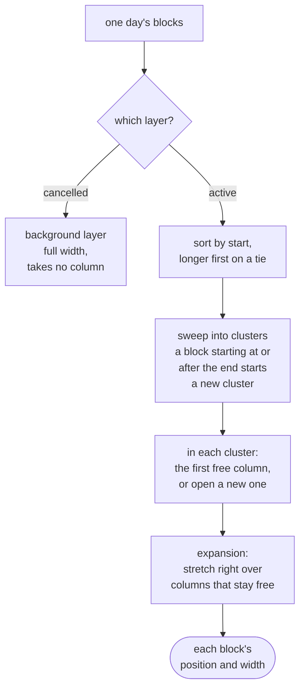

# Interval partitioning

> **Builds on:** [[Dates, times and instants]] (half-open ranges)

When two blocks on a calendar day overlap, they're drawn side by side. How many columns does the day need, and which block goes in which? That's **interval partitioning**, a classic greedy algorithm from algorithms courses. Our grid's version, line by line, is in [[Calendar grid]].

## The problem

Each block is an **interval**, a start and an end. The grid works in minutes since midnight, so a 10:00–11:00 class is the interval [600, 660).

Think of the exam cell assigning lecture halls for one day. Two classes at the same time need different halls, and the cell wants as few halls as possible. On the calendar, the halls are **columns**: each overlapping block gets its own, and fewer columns means wider, more readable blocks. The same puzzle is known as **"minimum meeting rooms"**.

The goal: give every block a column so that no two overlapping blocks share one, using as few columns as possible.

## Overlap, and why touching isn't overlap

Two intervals overlap when each starts before the other ends:

```ts
const overlaps = (a, b) => a.start < b.end && b.start < a.end;
```

- 10:00–11:00 and 10:30–11:30 **overlap**: both are on at 10:45.
- 10:00–11:00 and 11:00–12:00 **don't overlap**; they *touch*. The ranges are half-open, `[start, end)` ([[Dates, times and instants]]), so the first class is over at 11:00 when the second begins. If touching counted, every pair of back-to-back classes would be squeezed into half-width for no reason.

## Clusters

A **cluster** is a group of blocks joined by overlaps, directly or through a chain. If A overlaps B and B overlaps C, then A, B and C are one cluster even when A and C don't overlap. A busy morning and a lone afternoon class are separate clusters.

Each cluster is laid out on its own. Otherwise a crowded 10:00 would make the 15:00 class thin too, for a crowd it never met.

Finding clusters takes one pass: go through the blocks in start order and remember the latest end seen so far. A block that starts at or after that time can't overlap anything before it, so it begins a new cluster.

In our grid:

*From `apps/web/src/calendar/model/layout.ts` (shortened):*
```ts
  let cluster: Segment[] = [];
  let clusterEnd = 0;
  for (const s of foreground) {
    if (cluster.length > 0 && s.startMin >= clusterEnd) {
      // Everything in the cluster has ended by now: it's complete.
      out.push(...packCluster(cluster, background));
      cluster = [];
    }
    if (cluster.length === 0) clusterEnd = s.endMin;
    cluster.push(s);
    clusterEnd = Math.max(clusterEnd, s.endMin);
  }
  if (cluster.length > 0) out.push(...packCluster(cluster, background));
```

What to notice:
- `foreground` is already sorted by start (longer first on a tie), and holds only the active blocks.
- `>=` is "touching isn't overlapping": a block starting at 12:00 when `clusterEnd` is 12:00 closes the cluster before it and starts a new one (D in the worked example below).
- `clusterEnd` is the latest end so far (`Math.max`), not the last block's end, so one long block keeps the cluster open for everything that starts under it.
- The last line hands over the final cluster, which no later block was there to close.

## The greedy algorithm

1. **Sort** the blocks by start time (on a tie, the longer one first).
2. **Place** each block, in that order, in the **first column that's free** at its start: one whose last block has already ended. If none is free, open a new column.
3. The number of columns opened is the cluster's width. Each block gets `1 / columns` of the day's width, at its column's position.

```ts
const colEnds: number[] = [];   // colEnds[c] = when the last block in column c ends
for (const block of blocksSortedByStart) {
  let col = colEnds.findIndex((end) => end <= block.start);   // first free column
  if (col === -1) {
    col = colEnds.length;        // none free: open a new one
    colEnds.push(block.end);
  } else {
    colEnds[col] = block.end;
  }
  block.col = col;
}
```

It's called **greedy** because each block takes the best choice available right now (the first free column) and never reconsiders. Usually greedy is a shortcut that's only roughly right. Here it's exactly right, as the proof below shows.

Our grid's version is the same loop, plus the expansion step at the end (explained further down):

*From `apps/web/src/calendar/model/layout.ts` (shortened):*
```ts
function packCluster(cluster: Segment[], background: Segment[]): Positioned[] {
  // `columnEnds[i]` is when the last block placed in column i ends.
  const columnEnds: number[] = [];
  const placed = cluster.map((s) => {
    let col = columnEnds.findIndex((end) => end <= s.startMin);
    if (col === -1) {
      col = columnEnds.length; // every column is busy: open a new one
      columnEnds.push(s.endMin);
    } else {
      columnEnds[col] = s.endMin;
    }
    return { s, col };
  });

  const cols = columnEnds.length;
  // …
  return placed.map(({ s, col }) => {
    let span = 1;
    while (col + span < cols && !placed.some((p) => p.col === col + span && overlaps(p.s, s))) {
      span++;
    }
    return { ...s, layer: 'foreground', col, cols, span, overCancelled };
  });
}
```

What to notice:
- `findIndex` returns the first column whose test is true, or `-1` if none is. That's exactly "the first free column, or open a new one".
- It's `end <= s.startMin`, not `<`: a column whose last block ended at 11:00 is free for a block starting at 11:00. That `=` is the touching rule again.
- `cols` is how many columns were opened: the cluster's width, and (by the proof below) its depth.
- The `while` loop widens a block one column at a time, as long as there's a column to its right and nothing placed in it overlaps this block.

The whole layout of one day, as our grid does it:



(The background layer is our app's rule, D-077: a cancelled class is drawn behind, so the freed time doesn't look occupied. The algorithm itself only sees active blocks.)

## A worked example

A made-up Wednesday:

| Block | Time |
|---|---|
| A: Maths class | 10:00–11:00 |
| B: Club meeting | 10:30–11:30 |
| C: Physics class | 11:00–12:00 |
| D: Study block | 12:00–13:00 |

They're already in start order. A, B and C form one cluster (A overlaps B, B overlaps C). D starts at 12:00, exactly when the cluster's last block ends, so it touches without overlapping and starts a new cluster.

| Step | Block | Column end times before | First free column? | Goes in | Column end times after |
|---|---|---|---|---|---|
| 1 | A 10:00–11:00 | none | none exist | new column 1 | [11:00] |
| 2 | B 10:30–11:30 | [11:00] | column 1 ends 11:00, after 10:30: busy | new column 2 | [11:00, 11:30] |
| 3 | C 11:00–12:00 | [11:00, 11:30] | column 1 ends 11:00, not after 11:00: **free** | column 1 | [12:00, 11:30] |
| 4 | D 12:00–13:00 | (new cluster) | none exist | new column 1 | [13:00] |

The result: the first cluster needs **2 columns**, A and C share column 1 (they only touch), and D gets the full width.

```
          column 1      column 2
10:00   ┌───────────┐
        │ A Maths   │
10:30   │           │ ┌───────────┐
        │           │ │ B Club    │
11:00   ├───────────┤ │           │
        │ C Physics │ │           │
11:30   │           │ └───────────┘
        │           │
12:00   ├───────────┴─────────────┐
        │ D Study: its own        │
        │ cluster, full width     │
13:00   └─────────────────────────┘
```

## Why it's optimal: a proof by picture

Call the **depth** of a cluster the largest number of its blocks happening at one moment. At 10:45 above, A and B are both on, so the depth is at least 2.

- **No layout can use fewer columns than the depth.** The blocks on at that one moment all overlap each other, so each needs its own column.
- **Greedy never uses more than the depth.** Suppose greedy opens column *k* for some block X. Then all *k − 1* earlier columns were busy at X's start: each one's last block **started before X** (we go in start order) and **hadn't ended yet** (or the column would be free). Draw a vertical line at the moment X starts. It crosses those *k − 1* blocks, plus X itself. So *k* blocks are on at that moment, and the depth is at least *k*.

Put the two together, and greedy's column count equals the depth, which is the minimum. Notice where the sorting was used: "its last block started before X" is only true because blocks arrive in start order.

## The expansion step

Placing is done, and now some blocks can be wider. A block may **stretch right** over neighbouring columns that are empty for its whole time. It's purely cosmetic: the column count doesn't change, but empty space gets used.

Example: a Physics lab 9:00–11:00 (column 1), a Maths tutorial 9:00–10:00 (column 2), a club call 9:00–10:00 (column 3), and a study block 10:00–11:00. The study block goes into column 2, since the tutorial ended at 10:00. Column 3 holds only the club call, which also ended at 10:00, so nothing in column 3 overlaps the study block. It spans 2 columns and gets two-thirds of the width instead of one-third.

```
          col 1        col 2        col 3
 9:00   ┌──────────┐ ┌──────────┐ ┌──────────┐
        │ Physics  │ │ Maths    │ │ Club     │
        │ lab      │ │ tutorial │ │ call     │
10:00   │          │ ├──────────┴─┴──────────┤
        │          │ │ Study block, span 2   │
11:00   └──────────┘ └───────────────────────┘
```

## What it costs

- Sorting: **O(n log n)** for *n* blocks. That's the dominant cost.
- Placing: each block scans the columns, so O(n · k) for *k* columns. A heap of end times makes it O(n log k), which only matters for huge inputs.
- Expansion: each block checks its right-hand neighbours, a few comparisons inside a cluster.

A student's day has 10–15 blocks and clusters of 2–4. The whole layout takes microseconds, and nothing here will ever need optimising.

## The same problem, under other names

- **Minimum meeting rooms**, a common interview question: "how many rooms do these meetings need?" The answer is the depth.
- **Interval graph colouring:** draw each block as a dot and join overlapping dots with a line, then colour the dots so joined dots differ. Columns are colours. For graphs in general, using the fewest colours is a famously hard problem; for intervals, this greedy solves it exactly.
- Compilers use the same idea to share a few CPU registers among many variables ("linear-scan register allocation").

## Check yourself
- Lay out by hand: 9:00–10:30, 9:30–10:00, 10:00–11:00, 10:30–11:30. How many clusters and columns, which block goes where, and what's the depth?
- The code remembers only each column's *last* end time. Try placing the worked example out of order: C (11:00–12:00) first, then A (10:00–11:00). How many columns do you get, and why does sorting prevent that?
- In the proof, which sentence would be false if the blocks weren't sorted by start?
- Why does D, the 12:00–13:00 study block, get the full width even though the blocks before it needed two columns?
