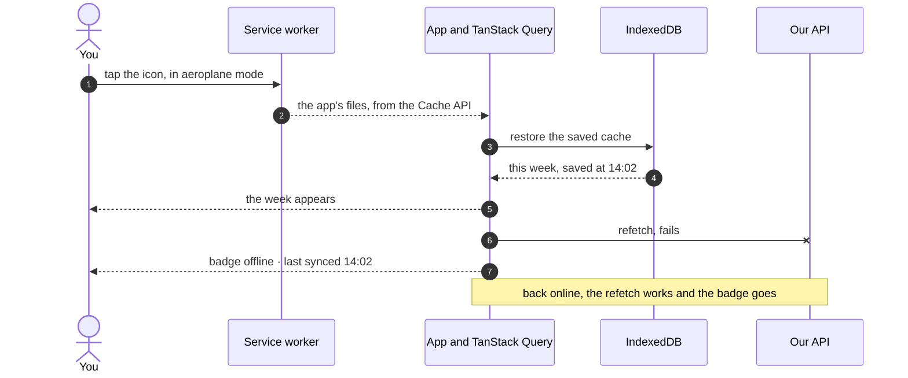

# IndexedDB and offline storage

> **Builds on:** [[Origin]] · [[Server state and caching]] · [[PWAs and service workers]]

In v0.0 the app *opens* offline (the service worker keeps its files), and then says "You're offline": the data it fetched lived only in memory and vanished when the app closed. From v0.2 the last answers stay on the phone, so the calendar opens with no network. This note covers where a browser can keep data, and why ours goes where it does. Our setup, file by file, is in [[Offline reads]].

## Where a browser can keep data

| Store | Holds | Size | Blocks the page? | Sent to the server? | Lasts | Good for |
|---|---|---|---|---|---|---|
| **Cookies** | Small text values | About 4 KB each | No | **Yes, with every request** | Until they expire | The session id ([[Cookies and sessions]]) |
| **localStorage** | Text key → text value | About 5 MB | **Yes:** reads and writes freeze the page until done | No | Until cleared | Small preferences: "dark mode on" |
| **sessionStorage** | The same, but per tab | About 5 MB | Yes | No | Until the tab closes | A half-filled form in this tab |
| **IndexedDB** | Structured data by key, with indexes | Large: a share of the free disk | No: asynchronous | No | Until cleared or evicted | App data: our cached calendar |
| **Cache API** | Request → response pairs | Large, sharing IndexedDB's quota | No | No | Until cleared or evicted | The service worker's copies of the app's files |

All of them belong to one **origin** ([[Origin]]). `https://tasks.ahmedatif.in` can't read another site's storage, and another site can't read ours.

## IndexedDB in plain words

**IndexedDB** is a small database built into every browser, one per origin.

- It holds **object stores**, roughly tables. Each maps **keys** to **values**, and can keep indexes for looking values up by a field.
- A value can be almost any JavaScript data: objects, arrays, numbers, dates, `Map`s, even a `Blob` such as a recorded voice note. The browser copies it in with **structured clone**, its built-in deep copy. What doesn't survive: functions, page elements, and the *class* of an object (an instance comes back as a plain object).
- It's **asynchronous**. You ask, and the answer arrives later as a promise, so a large read never freezes scrolling. localStorage, by contrast, stops everything while it works.
- Writes happen in **transactions**, all or nothing, like Postgres's ([[Transactions]]).
- Its own API is old and awkward (request objects and events), so nearly everyone uses a wrapper. Ours is **idb-keyval**: just `get(key)`, `set(key, value)` and `del(key)`, with promises. **Dexie** is the full-featured one (queries, live updates), which the bigger sync design (D-047) would need.

To look inside: Chrome DevTools → **Application** → **IndexedDB**.

## Quotas and eviction: storage the browser may take back

- **Quota** is the most an origin may store. Chrome allows one origin up to about 60% of the disk. A timetable's cache is tens of kilobytes, so the limit never matters to us. `navigator.storage.estimate()` reports `usage` and `quota`.
- **Eviction:** when the phone runs low on space, the browser deletes whole origins' storage, least recently used first, **without asking**. That's the default, "best-effort" kind of storage.
- **Persistent storage:** `navigator.storage.persist()` asks to be exempt, so that only the user can clear it. Chrome on Android decides by itself, with no prompt, and usually agrees for installed apps and sites you use a lot. Firefox asks the user.
- **Safari** (any iPhone browser) deletes a site's stored data after 7 days without a visit, unless the site is installed on the home screen (D-048).
- And the user can always clear site data in settings.

So browser storage is a **cache, never the only copy**. For us that's fine: the server has everything, and losing the cache only makes the next open slower. (From v0.3, writes waiting to be sent will be the exception. Losing those loses a change, which is why the plan asks for persistent storage then.)

## Why API data goes in IndexedDB, through TanStack Query

D-046 says the app keeps **one** cache of API data.

- TanStack Query already keeps every answer in memory ([[Server state and caching]]). A **persister** saves that whole cache to storage after it changes (at most once a second) and puts it back (**restores** it) when the app starts. Ours writes it to IndexedDB through idb-keyval.
- Two settings guard the saved copy. **`maxAge`** throws away a saved cache older than this (the library's default is 24 hours). **`buster`** is a version string: when a new app version changes the data's shape, an old saved cache is discarded instead of misread.
- The service worker's Cache API keeps **only the app shell**, the app's own files ([[PWAs and service workers]]). It never keeps `/api` answers, because two caches of the same data drift apart: the service worker would show last Tuesday's week while TanStack Query has today's.
- Not localStorage: it freezes the page while a large cache is written, holds only text, and is small.
- **Sign-out must delete the saved copy**, not only the one in memory. Otherwise the next person to open the app on that laptop sees your timetable, offline, without signing in.

In our app, the persister and its two guards:

*From `apps/web/src/lib/persist.ts` (shortened):*
```ts
import { del, get, set } from 'idb-keyval';
// …
export const CACHE_BUSTER = 'v0.2.0';
// …
export const CACHE_MAX_AGE_MS = 30 * 24 * 60 * 60 * 1000;
// …
const persister = createPersister({ get, set, del });
// …
  const [, restored] = persistQueryClient({
    queryClient,
    persister,
    buster: CACHE_BUSTER,
    maxAge: CACHE_MAX_AGE_MS,
    dehydrateOptions,
  });
```

What to notice:
- idb-keyval's `get`, `set` and `del` are all the persister needs, because the whole cache is one value under one key.
- `maxAge` is 30 days (days × hours × minutes × seconds × milliseconds), not the library's 24 hours, so last month's weeks still open on the bus.
- `buster` is a plain string. A new app version with a different string throws the old copy away instead of misreading it.

## "offline · last synced 14:02"

The badge means: what's on screen is a saved copy, and the server last confirmed it at 14:02 (in our 12-hour display, 2:02 pm). Each cached answer records when it arrived (TanStack Query's `dataUpdatedAt`), so the time stays right even after the phone restarts. Nothing on screen is made up. It's the server's last answer, possibly out of date: a class cancelled at 15:00 still shows until the next successful refetch.

## A cold open, offline

You tap the icon in aeroplane mode, with the app closed:



## navigator.onLine, and why it can lie

`navigator.onLine` (and the `online` / `offline` events on `window`) report whether the device has a network connection.

- **`false` is trustworthy:** aeroplane mode, Wi-Fi and data off.
- **`true` only means "connected to *some* network".** KIIT's Wi-Fi before you've logged in through its portal page counts as "online": the phone is connected, but every request fails or gets the login page. Same for Wi-Fi with no internet behind it, or one bar of signal in a basement lab.

So "online" is a hint, and the real test is whether a request to *our* server got an answer. TanStack Query treats the events only as a hint too: it assumes it's online until the browser says otherwise. A badge built on `navigator.onLine` alone would say "online" on the portal Wi-Fi while nothing loads.

Our badge uses both signals:

*From `apps/web/src/lib/sync-status.ts` (shortened):*
```ts
  let state: SyncStatus['state'] = 'synced';
  if (!browserOnline || newest?.result === 'no-answer') state = 'offline';
  else if (newest?.result === 'error') state = 'failing';
```

`browserOnline` is the browser's flag (through TanStack Query's `onlineManager`), and its `false` is believed at once. `'no-answer'` means the newest request to our server got no answer at all (a `NetworkError`). That's the real test, and it catches the portal Wi-Fi. A server that answered with an error is "can't sync", not "offline".

## Check yourself
- Where would you keep each of these, and why: "this user prefers the Week view"; the session; this week's occurrences; `index.html`?
- You sign out on a friend's laptop. What must be deleted besides the in-memory cache? What would the next person see if it weren't?
- You're on KIIT Wi-Fi but haven't logged in to the portal. What does `navigator.onLine` say, what happens when the calendar refetches, and what should the screen show?
- Chrome evicts the app's storage while you're away on holiday. What do you lose? What happens on the next open with a network, and without one?
