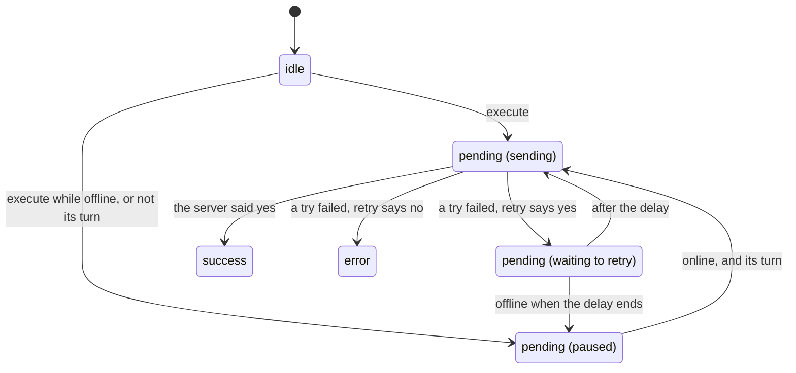
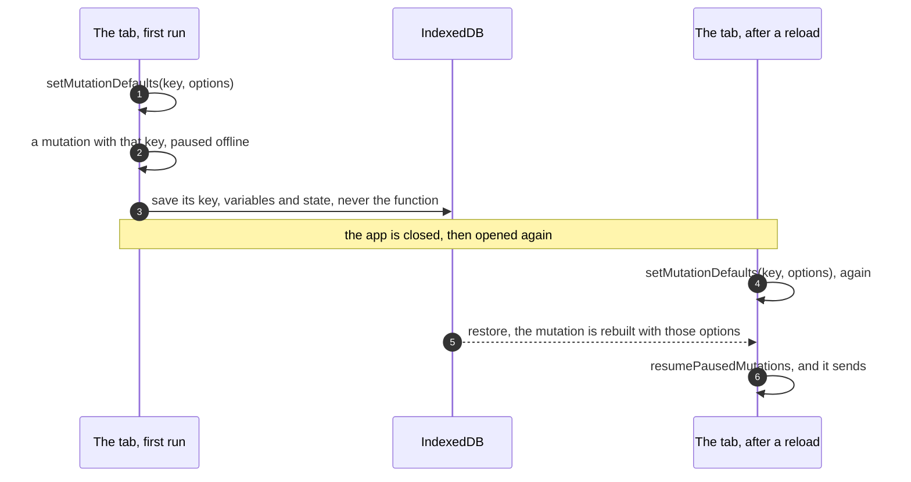

# Mutations and offline queues

> **Builds on:** [[Server state and caching]] · [[Idempotency and retries]] · [[IndexedDB and offline storage]]

A **query** reads from the server; a **mutation** changes something there. Until v0.3, every write in our app was sent the moment you tapped, and failed at once with no signal. A cancel made on the bus has to behave differently: it waits, survives the app being closed, and goes out in the right order once the signal is back. TanStack Query can do all of that with mutations, if it's set up right. This note is the general machinery. How our cancels use it, file by file: [[Offline cancels]].

## A mutation, and where it lives

In TanStack Query a mutation is an object for one write. It holds:

- the function that sends it, `mutationFn` (for us, one `PATCH`);
- the **variables**, the input that function gets (which class, which date, what change);
- its **state**: how the sending is going.

Queries live in the query cache ([[Server state and caching]]). Mutations live in the **mutation cache**, a second list on the same client, from the moment they start until a little after they finish. Any part of the app can look at it: count what's still unsent, draw it, save it.

The usual way to make one is the `useMutation` hook inside a component, then `mutate(variables)`. That ties the mutation to a component on screen. A mutation can also be built straight in the mutation cache from plain code, `getMutationCache().build(...)` and then `.execute(variables)`, with no component involved. Our queue does that: the Undo button in a toast queues a change too, and nothing about a queued change should depend on which screen is open.

## Its states

| `status` | Means |
|---|---|
| `idle` | Made, not started |
| `pending` | Started, no final outcome yet |
| `success` | The server said yes; `data` holds its answer |
| `error` | Failed for good, with no more retries; `error` holds why |

Beside `status` sit a few more fields:

- `isPaused`: `true` while a pending mutation is *waiting* instead of sending. Either the browser says it's offline, or it isn't this mutation's turn yet (the scope rule below).
- `failureCount` and `failureReason`: how many tries have failed so far, and the last error.
- `submittedAt`: when it started, in milliseconds since 1970 (epoch milliseconds).

So "pending" covers three different situations: sending right now, paused, and waiting between two tries.



## networkMode: wait, or try anyway

Mutations take the same three network modes as queries ([[Offline reads]] has the table). For a write, the choice decides whether there's a queue at all:

- `'online'`, TanStack's default: while the browser says offline, a new mutation doesn't try. It starts paused and waits for the browser's `online` event. This *is* the queue.
- `'always'`: send now, whatever the browser says. With no signal it fails at once with a network error, which a form can show.
- `'offlineFirst'`: try once, then pause the retries while offline.

Our app sets `'always'` as the default for every write, so the series form fails fast instead of holding a half-typed timetable change for later (D-048). The cancel queue overrides it with `'online'` on its own mutations.

## Retries and backoff

A mutation's `retry` defaults to `0`. A write is never retried unless you say so, because repeating a write is only safe if it's idempotent ([[Idempotency and retries]]). `retry` can be a number of retries, or a function `(failureCount, error) => boolean` that decides after each failure: is this one worth asking again?

Between tries TanStack waits `retryDelay`. The default doubles each time and stops growing at 30 seconds, `Math.min(1000 * 2 ** failureCount, 30000)`: 1 s, 2 s, 4 s, 8 s, 16 s, then 30 s, 30 s, 30 s, for as long as `retry` keeps saying yes. That's **exponential backoff** ([[Idempotency and retries]] has the idea). If the browser goes offline during a wait, the mutation pauses instead of trying, and carries on when the browser says online.

A retry that never gives up has one danger: a failure that can never succeed (a bug in the app, a request the server will always refuse) retries forever. The fix lives in the `retry` function: say yes only to failures that time can fix.

## scope: one at a time, in order

Mutations normally run side by side. Two quick changes to one class, "skipped" and then "Prof cancelled", start two requests at once, and the network decides which arrives first. If "skipped" lands second, the server keeps the choice you'd already changed your mind about.

`scope: { id: 'some-name' }` puts mutations in a line. Mutations with the same scope id run one after another, in the order they were made: a mutation may run only when it's the first pending one in its scope, and the rest wait, paused. So offline you can tap Me, then Prof, then Restore on Tuesday's Discrete Mathematics. When the signal returns, the server gets them in that order and ends at "restored", the last thing you said.

The cost is **head-of-line blocking**: a mutation stuck at the front (retrying a server that keeps answering `503`) holds up every mutation behind it. That's one more reason the `retry` function must give up on what can never succeed.

## Surviving a reload

A queue in memory dies with the tab. The persister that saves the query cache to IndexedDB ([[IndexedDB and offline storage]]) can save mutations too, and `shouldDehydrateMutation` picks which ones. (Its default saves only paused mutations.)

What's saved is plain data: each mutation's key, its variables and its state. The function that sends it isn't saved, because a function can't be turned into JSON. So a mutation restored after a reload knows *what* to send but not *how*.

**`setMutationDefaults(mutationKey, options)`** closes that gap. It registers options (`mutationFn`, `retry`, `networkMode`, `scope`, `onSuccess` and the rest) on the client, for every mutation whose `mutationKey` starts with that key. The client looks them up each time a mutation is built, and restoring builds every saved mutation afresh. Two rules follow:

- Give every queued mutation a `mutationKey`, and put its options in `setMutationDefaults`, not in a component.
- Call `setMutationDefaults` **before** the restore. A mutation built before its defaults exist has no `mutationFn`, and sending it fails with "No mutationFn found".

Then **`resumePausedMutations()`** starts every paused mutation again, in order within each scope. Only paused ones. A mutation saved while it was mid-request was pending but *not* paused; restored like that, nothing ever starts it, and with a scope it blocks every mutation behind it. So a queue meant to survive a reload should mark every mutation paused when it's saved.



## onlineManager: seed it, and know when it listens

TanStack decides "offline" with its `onlineManager` ([[Offline reads]]). Two of its habits matter for a queue.

**It starts out believing it's online,** and changes its mind only on the browser's `offline` event. Open the app with no signal and no event fires, so it still believes "online". A queued mutation then tries, gets no answer, and backs off: 1 s, 2 s, 4 s … When the signal comes back, the browser fires `online`, but to `onlineManager` that's no news, so nothing is resumed. The mutation goes out at its next backoff timer, which by then can be 30 seconds away. The fix is one line at startup: `onlineManager.setOnline(navigator.onLine)`. The browser's `false` is reliable ([[IndexedDB and offline storage]]), so the queue starts paused, and the real `online` event wakes it.

**It only hears events while something listens.** `onlineManager` adds its `online` and `offline` listeners to `window` when its first subscriber arrives, and removes them when the last one leaves. Its subscriber is the `QueryClient`, once the client is **mounted**, which `QueryClientProvider` does when the app draws. A page that hasn't drawn the app yet hears nothing, so its `onlineManager` can be out of date. Read `navigator.onLine` at the moment the app starts, not when the page loaded.

When the mounted client does hear `online` (or the window gets focus back), it does two things in order: `resumePausedMutations()`, *awaited*, and then a refetch of the queries on screen. The refetch waits until the resumed mutations have finished. Our known limitation comes from exactly that ([[Offline cancels]]).

In our app, the startup order and the resume:

*From `apps/web/src/main.tsx` and `apps/web/src/lib/occurrence-queue.ts` (shortened):*
```tsx
// apps/web/src/main.tsx
  await restoreQueryCache(queryClient);
  // …
  onlineManager.setOnline(navigator.onLine);
  // …
  void sendQueuedChanges(queryClient);

// apps/web/src/lib/occurrence-queue.ts
export async function sendQueuedChanges(queryClient: QueryClient): Promise<void> {
  if (queuedChanges(queryClient).length === 0) return;
  await queryClient.resumePausedMutations();
  await refetchCalendar(queryClient);
}
```

What to notice:
- The order: restore the saved queue (its defaults were registered when the client was created, before this), then seed the online flag, then resume.
- `void` marks a promise that's deliberately not awaited: the app draws while the queue sends.
- `resumePausedMutations` resolves only when every resumed mutation has finished. Only then are the weeks fetched again, so that fetch reads the server *after* the changes.

## Three places to say "when it's done"

[[Dialogs and toasts]] met two: on the `mutate` call, which runs only while that component is still on screen, and on the `useMutation` hook, which belongs to the mutation. `setMutationDefaults` adds a third: on the **client**. Those callbacks run for every mutation with that key, whichever screen started it, and even for one restored after a reload, which no screen started at all. A queue's "after it's sent" work belongs there.

To hear about *every* mutation as it changes (to show a message when one is dropped, say), subscribe to the mutation cache with `getMutationCache().subscribe(listener)`. The listener gets events such as `{ type: 'updated', mutation, action }`, where `action.type` says what happened: `'pending'`, `'pause'`, `'continue'`, `'failed'` (one try failed and a retry may follow), `'success'`, or `'error'` (failed for good).

To *draw* the mutations, React gets **`useMutationState({ filters, select })`**. It returns every mutation matching `filters` (a key, a status), each passed through `select`, and re-renders as they change.

## Showing a write before the server confirms it

An **optimistic update** shows the result of a write before the server has confirmed it, betting that it will work. With a queue that's not optional: an offline cancel that changes nothing on screen looks like a tap that missed. There are two ways to do it.

**Write the guess into the cache.** In the mutation's `onMutate`, `setQueryData` puts the guessed result into the cached query. If the write fails, `onError` puts the old value back, which is called a **rollback**. It's the classic way. Its weak spot is that the cache is also where the server's answers land: a refetch that arrives while the write still waits replaces the guess with the server's old state, and your change seems to vanish until it's sent. You also have to keep the old value somewhere to roll back to.

**Draw the guess on top.** Leave the cache holding only what the server said. When drawing, take the cached answer and apply every pending mutation to it, read with `useMutationState`. A refetch can't wipe a waiting change, because the change was never in the cache; it's applied again every time the screen draws. A failed write needs no rollback: it stops being pending, so it stops being applied. TanStack's docs call this updating "via the UI", and the first way "via the cache". The cost is that everything showing that data must apply the pending mutations, not just read the cache.

Our app draws on top. Why, and what lost: [[Offline cancel choices]].

## Check yourself

1. A mutation is `pending` with `isPaused: true`. Give two different reasons it could be paused.
2. Offline, you queue Me, then Prof, then Restore on one class, with no `scope`. What can the server end up with when the signal returns? And with a scope?
3. Why can't the saved copy of a mutation hold its `mutationFn`? What does `setMutationDefaults` do about it, and why must it run before the restore?
4. A mutation was mid-request when the tab closed, and it's saved exactly as it was: pending, not paused. What happens after the reload, to it and to the mutations queued behind it?
5. The app opens in aeroplane mode, and `onlineManager.setOnline(navigator.onLine)` has been deleted. You tap Me, then switch aeroplane mode off 40 seconds later. Roughly when does the change reach the server, and why not at once?
6. A refetch lands while your change still waits. What does the screen show if the guess was written into the cache? And if it's drawn on top?
