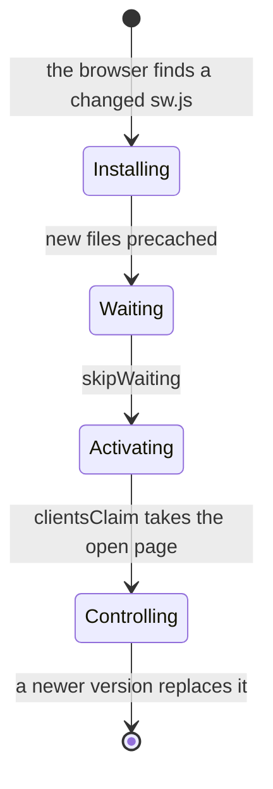

# PWAs and service workers

> **Builds on:** [[Single-page apps and routing]] · [[Server state and caching]]

## What a PWA is

A **progressive web app** is a website that a phone can install like an app: an icon on the home screen, its own window with no address bar, a splash screen when it starts, and it still opens without a network. On your Android phone, Chrome shows "Install app" (or "Add to home screen") for it. There's no app store and no APK to build: a deploy to the server updates it. Two things make a site installable:

1. **A web app manifest**, a small JSON file that describes the app.
2. **A service worker** that the page registers.

Chrome also wants HTTPS (or `localhost`) and big enough icons (192 px and 512 px are the usual pair). Recent Chrome versions will install a site with only a manifest, but without a service worker the "app" can't open offline, so it's an app in name only.

## The manifest

Ours is `manifest.webmanifest`, generated by `vite-plugin-pwa` from `apps/web/vite.config.ts`, and linked from `index.html` (`<link rel="manifest">`).

| Field | Ours | What it controls |
|---|---|---|
| `name`, `short_name` | `Tasks` | The name under the icon and in the app switcher |
| `start_url` | `/` | What opens when you tap the icon |
| `display` | `standalone` | Its own window, no browser address bar |
| `theme_color` | `#4338ca` | The status bar colour on Android |
| `background_color` | `#f8fafc` | The splash screen behind the icon while it starts |
| `icons` | 64, 192, 512, and a **maskable** 512 | The home-screen and splash icons |
| `id`, `scope` | `/` | The app's identity, and which URLs belong to it |

**Maskable icons.** Android cuts every icon into its launcher's shape (a circle, a rounded square). A normal icon would get its corners clipped or float on a white blob. A *maskable* icon is a full square with the important part inside the middle 80% circle, so any shape cut from it looks right. Ours is the calendar glyph on solid indigo, made by `pnpm --filter @tasks/web generate-pwa-assets` from `public/logo.svg`.

## The service worker

A **service worker** is a JavaScript file (`sw.js`) the browser runs **beside** your page, not inside it. It sits between the page and the network: every request the page makes passes through it, and it can answer from a cache instead. It keeps working when the page is closed (that's also how push notifications will work later).

**Ours precaches the app shell, and nothing else.** At build time, Workbox (Google's service-worker library) lists every built file (`index.html`, the JS, the CSS, the icons) with a fingerprint of its contents, and writes that list into `sw.js`. On install, the service worker downloads them all into a cache. After that:

- **Opening the app** loads those files from the phone, instantly, even in aeroplane mode. You see the app itself instead of Chrome's dinosaur: since v0.2 with the data saved last time ([[Offline reads]]), and with nothing saved, its own "You're offline" screen.
- **Navigating to any app URL** (`/`, `/login`, `/series/<id>`) gets the cached `index.html` (`navigateFallback`), and the router draws the right screen.
- **Except** `/api/...` and `/healthz` (`navigateFallbackDenylist`). The important one: after Google sign-in, Google sends your browser to `/api/auth/callback/google`. That must reach the server to set your cookie; if the service worker answered it with the cached page, sign-in would silently break.
- **API answers are never cached here.** TanStack Query owns API data (D-046; see [[Server state and caching]]).

In our app, all of that is a few lines of settings:

*From `apps/web/vite.config.ts` (shortened):*
```ts
      workbox: {
        // Precache the app shell only: the built HTML, JS, CSS and icons.
        // Opening the app offline then still draws a screen (D-048).
        globPatterns: ['**/*.{html,js,css,svg,png,ico}'],
        // …
        navigateFallback: 'index.html',
        // …
        navigateFallbackDenylist: [/^\/api\//, /^\/healthz/],
        // …
        skipWaiting: true,
        clientsClaim: true,
        // No runtimeCaching: API answers are never stored by the service
        // worker. TanStack Query is the one cache of API data (D-046).
      },
```

What to notice:
- `globPatterns` picks which built files go on the precache list: every `.html`, `.js`, `.css` and icon.
- `/^\/api\//` is a regular expression, a pattern for text: "starts with `/api/`" (the `\/` is an escaped `/`). Navigations matching it skip the fallback and reach the server.
- What's missing matters too: no `runtimeCaching`, so nothing from `/api` is ever stored.

## Updates: how a new deploy reaches your phone

A service worker's life. Ours sets `skipWaiting` and `clientsClaim`, so it barely pauses in "waiting".



The service worker's life has steps: **install** (download the new files), **waiting** (by default, a new version waits until every window of the app is closed, so a page never runs half old and half new code), **activate** (take over, delete the old cache).

On an installed PWA, "every window closed" can take days. So ours skips the wait:

1. You open the app. The old service worker shows the old version straight away, and the page asks the server whether `sw.js` changed.
2. After a deploy it has (new file list, new fingerprints). The new service worker installs in the background.
3. `skipWaiting`: it activates immediately. `clientsClaim`: it takes control of the open page.
4. The page notices (`registerType: 'autoUpdate'`) and reloads itself once, now on the new version.

*From `apps/web/vite.config.ts` and `apps/web/src/lib/pwa.ts` (shortened):*
```ts
// apps/web/vite.config.ts
    VitePWA({
      // …
      registerType: 'autoUpdate',
      // src/lib/pwa.ts registers it, so the plugin shouldn't add a <script>.
      injectRegister: false,

// apps/web/src/lib/pwa.ts
export function registerServiceWorker(): void {
  // …
  registerSW({ immediate: true });
}
```

`registerSW` comes from `virtual:pwa-register`, a module the plugin writes at build time; with `autoUpdate` it does the reload in step 4. `immediate: true` registers straight away instead of after the page's `load` event, and `main.tsx` calls `registerServiceWorker()` before anything else.

That's the v0.0 demo: merge a PR, open the app a few minutes later, and it's on the new build. The deployed commit (on the home screen in v0.0, behind the avatar since v0.2) comes from `/healthz`, so it shows the server's new commit even before the app reloads.

The trade-off: the reload is automatic. Fine with nothing to lose on screen; once the calendar has drags and unsaved edits, the plan (09 §5.8) switches to a "Update ready, reload" prompt.

## Why there's no service worker in `pnpm dev`

A service worker caches the app. In development you change code every few seconds; a cached old copy makes your edit look like it didn't work, and you lose an hour. So `devOptions.enabled` is `false`. To try the PWA locally, run `pnpm --filter @tasks/web build` then `pnpm --filter @tasks/web preview` (port 4173), and in Chrome DevTools look at **Application → Manifest** and **Application → Service workers**.

## Check yourself
- Predict: you install the app, turn on aeroplane mode, and tap the icon. Which files come from where, and what screen do you end up on?
- Trace a deploy: the server now has a new `sw.js`. You open the installed app once. List what happens, step by step, until you're running the new code.
- Break it: remove `/^\/api\//` from `navigateFallbackDenylist`, build, and try signing in with Google. What goes wrong, and at which step?
- Why would caching `/api/v1/me` in the service worker, as well as in TanStack Query, be a bad idea?
