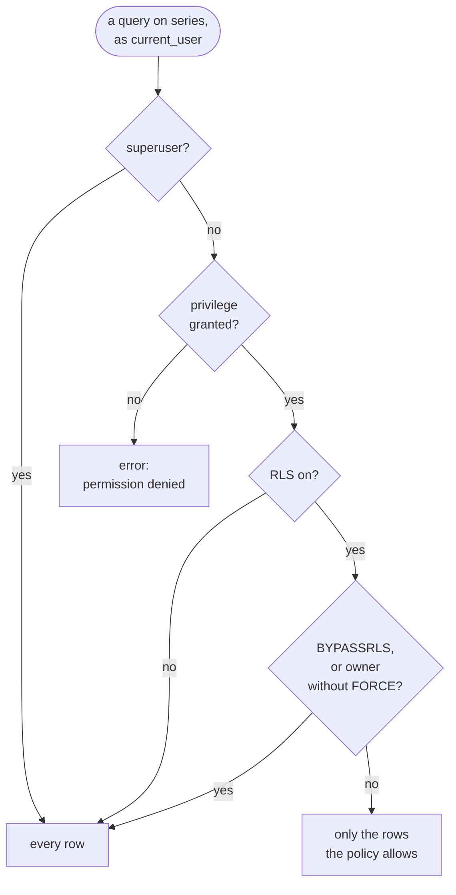
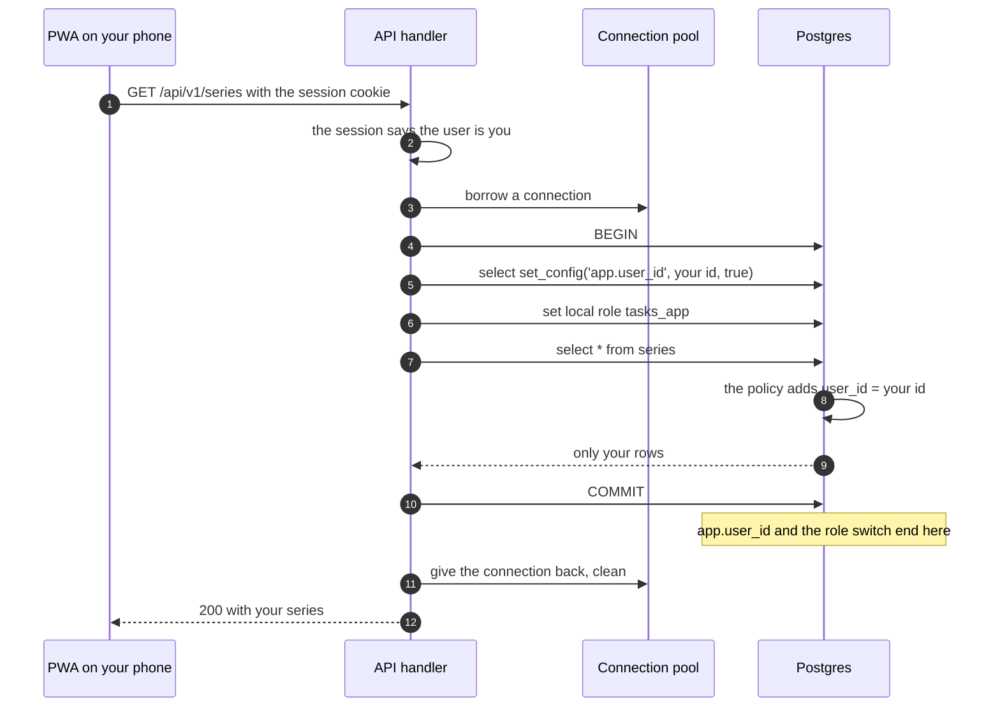

# Row-level security

> **Builds on:** [[Postgres and SQL basics]] · [[Transactions]] · [[Roles and privileges]] · [[Connection pools]]

How Postgres itself can make sure each user only ever sees their own rows, even when our code forgets to ask. Our setup, file by file, is in [[Row-level security in our database]].

## The problem it solves

Until v0.1 there was one user: you. From v0.2 a second person can exist. Say a friend signs up to try the app (in the tests, a made-up `alice@example.com`). Both of you have rows in `series`, so every query that reads series must now say `where user_id = <whoever is asking>`.

Doing that in the app's code is **app-only filtering**, and it's what v0.0 did. It works as long as nobody ever forgets. One handler written in a hurry, one refactor that drops a line, and your friend's calendar shows your DBMS class.

**Row-level security (RLS)** moves the rule into the database. Each table gets a **policy**, a condition saying which rows the current request may see and write, and Postgres adds that condition to *every* query on the table by itself. A query that forgets `where user_id = …` still gets only the asking user's rows. Your code still filters too; RLS is the second lock on the same door. The name for that is **defence in depth**.

## Three pieces

**1. Turn it on, per table:**

```sql
alter table series enable row level security;
alter table series force row level security;    -- see "Who skips RLS" below
```

**2. Write a policy:**

```sql
create policy series_owner on series
  using      (user_id = nullif(current_setting('app.user_id', true), '')::uuid)
  with check (user_id = nullif(current_setting('app.user_id', true), '')::uuid);
```

Read it as: "a row of `series` is yours when its `user_id` equals the `app.user_id` setting." The `nullif` part is explained below.

**3. Say who's asking, at the start of each request's transaction:**

```sql
begin;
select set_config('app.user_id', $1, true);   -- $1 = the signed-in user's id, from the session
set local role tasks_app;                      -- a role RLS applies to
select * from series;                          -- only that user's rows come back
commit;
```

The id comes from the session cookie, which the server checked ([[Cookies and sessions]]). Never from the request body or the URL, which the client could fake.

You can watch Postgres add the condition. `explain` on `select * from series where title = 'DBMS'` shows a plan with `Index Cond: (user_id = (NULLIF(current_setting('app.user_id'::text, true), ''::text))::uuid)`: the policy has become part of the query.

## USING and WITH CHECK

A policy has two halves, for the two directions data moves:

| Clause | Checks | When a row fails it | Example |
|---|---|---|---|
| `USING` | **Existing** rows: what `SELECT` returns and what `UPDATE` and `DELETE` may touch | The row is simply invisible: `UPDATE 0`, `DELETE 0`, no error | Your friend's request runs `update series set title = 'x' where id = <your DBMS id>`: nothing happens |
| `WITH CHECK` | **New** row versions written by `INSERT` and `UPDATE` | An error: `new row violates row-level security policy for table "series"` | A buggy request tries to insert a row with `user_id` = someone else |

Without `WITH CHECK`, a policy uses its `USING` condition for both. We write both anyway, so the rule is visible. A policy can also be limited to one command (`for select`, `for insert`, …) or to one role (`to tasks_app`), and several policies on one table are combined with OR. We use one policy per table, covering everything.

## Default deny

Once RLS is on, a row is visible only if some policy lets it through. So:

- **No policy at all** on a table with RLS on means zero rows, for everyone RLS applies to.
- **No user set** means `app.user_id` is empty, `nullif` turns that into `NULL`, and `user_id = NULL` is never true in SQL. Zero rows again.

Both fail **closed**. A bug shows an empty calendar, never someone else's.

## Who skips RLS

| Who | Skips RLS? |
|---|---|
| A **superuser** | Always, even with `FORCE` |
| A role with the **`BYPASSRLS`** attribute | Always. Meant for jobs that must see everyone's rows, like a nightly clean-up |
| The table's **owner** | Yes with only `ENABLE`; no once the table also has `FORCE ROW LEVEL SECURITY` |
| Everyone else | No |

`ENABLE` alone protects the table from everyone except its owner (and the two rows above it). `FORCE` adds the owner.

The whole check Postgres makes for one query, privileges first ([[Roles and privileges]]), then RLS:



This is why the per-request role switch matters for us. The API logs in as `tasks`, which is a superuser *and* owns the tables ([[Roles and privileges]]). No table setting can hold back a superuser, so each request switches to `tasks_app`, which is neither. `FORCE` is still on, so if the API later logs in as an owner that isn't a superuser, the rule still holds.

## "Who is asking": a setting, and the empty-string trap

`current_setting('app.user_id', true)` reads the custom setting. The second argument, `true`, means "missing is fine": return `NULL` instead of an error when the setting was never set.

**The trap:** once any transaction on a connection has used `set_config('app.user_id', …, true)`, the setting no longer counts as missing after that transaction ends. It reads as `''`, empty text. (Tried on Postgres 18: `NULL` on a fresh connection, `''` after the first request.) And `''::uuid` is an error: `invalid input syntax for type uuid: ""`.

So without `nullif`, a request that forgot to set the user would get an empty result on a fresh connection and a crash on a reused one, depending on luck. `nullif(x, '')` returns `NULL` when `x` is `''`, so both cases mean "nobody", and both return zero rows.

In our app, the expression is written once, as a function, and every policy calls it:

*From `apps/api/drizzle/0002_calendar_rls.sql` (shortened):*
```sql
-- The signed-in user's id, or NULL when no request set one. After a SET LOCAL
-- ends, Postgres reads an unset custom setting back as '' rather than NULL, so
-- '' counts as "nobody" too. NULL matches no row: no user, no rows.
CREATE FUNCTION app_current_user_id() RETURNS uuid
  LANGUAGE sql STABLE
  AS $$ SELECT nullif(current_setting('app.user_id', true), '')::uuid $$;
-- …
CREATE POLICY series_owner ON series
  USING (user_id = app_current_user_id())
  WITH CHECK (user_id = app_current_user_id());
```

The policy means exactly the one in "Three pieces" above; the function just gives the `nullif(…)::uuid` part a name. `STABLE` promises Postgres that the answer can't change during one query, so it's worked out once per query and the `user_id` index can still be used (gotcha 3 below).

## Why per transaction, because of the pool

The pool hands the same connection to request after request ([[Connection pools]]). A plain `SET app.user_id = …` or `SET ROLE` would stay on the connection, and the next request would run as *you* ([[Transactions]], "State that lives on a connection"). `set_config(…, true)` and `SET LOCAL ROLE` both end with the transaction. So every request opens one, sets both, runs its queries, and commits, and the connection goes back clean whether the request succeeded or failed.



## Gotchas

**1. Foreign-key checks ignore RLS.** When Postgres checks "does this `group_id` exist?", it looks at *all* rows, including ones you can't see. Tried on Postgres 18: with a plain `group_id` foreign key, your friend's request could create a series inside *your* group, and the difference between "accepted" and "violates foreign key constraint" told them which ids exist. The fix is a **composite foreign key**: the child stores `user_id` too, and points at the parent by the pair:

```sql
-- the parent offers the pair as a key
alter table schedule_group add unique (user_id, id);
-- the child must match both: same user AND an existing group
foreign key (user_id, group_id) references schedule_group (user_id, id)
```

Your friend's series has their `user_id`, so it can only point at a group with their `user_id`. This is the "second guard" from D-034: RLS hides rows, and composite keys stop links across users.

The real lines, in our first calendar migration:

*From `apps/api/drizzle/0001_calendar_tables.sql` (shortened):*
```sql
CREATE TABLE "schedule_group" (
	-- …
	CONSTRAINT "schedule_group_user_id_id_unique" UNIQUE("user_id","id"),
	-- …
);
-- …
ALTER TABLE "series" ADD CONSTRAINT "series_group_fk" FOREIGN KEY ("user_id","group_id") REFERENCES "public"."schedule_group"("user_id","id") ON DELETE cascade ON UPDATE no action;--> statement-breakpoint
```

`id` alone is already unique, so the pair looks redundant. But a foreign key can only point at columns declared unique together. Our API turns a `series_group_fk` failure into a `422` on `groupId` ("must be one of your groups"), the same answer for a group that doesn't exist and a group that's someone else's ([[Calendar API]]).

**2. Unique constraints see hidden rows.** Our ids are made by the client ([[Idempotency and retries]]). If your friend's request inserts a row with an `id` one of *your* rows already has, the insert fails with `duplicate key value violates unique constraint`, even though they can't see your row. With `insert … on conflict (id) do nothing`, it quietly inserts nothing, and a follow-up `select` finds nothing either: the id is taken by someone invisible. That's exactly the case our API answers with **409 `conflict`**, without saying whose row it is. (And `on conflict (id) do update` onto a hidden row is refused outright: `new row violates row-level security policy (USING expression)`.) With random UUIDv7 ids it never happens by accident; it would take a deliberately copied id.

**3. Performance.** The policy is a `where` on every query, so it needs an index on `user_id`, or every query reads the whole table. With one ([[Postgres and SQL basics]], "Indexes"), the plan above uses it. Keep policies simple: `current_setting` is worked out once per query, but a policy that runs a subquery per row would not be.

**4. psql shows you everything.** You log into `psql` as `tasks`, a superuser, so RLS doesn't apply and you see both users' rows. That proves nothing about what the app sees. To see what the app sees, act like a request: `begin; select set_config('app.user_id', '<id>', true); set local role tasks_app; select …; rollback;`.

**5. Not every table.** The `auth_*` tables and `profile` stay without RLS in v0.2. Better Auth reads `auth_session` to find out who you are, before anyone could set `app.user_id`. Those tables stay protected by the app's code, and by never being reachable from the calendar routes.

**6. It guards against mistakes, not against arbitrary SQL.** Code that can run any SQL on the connection can `reset role`, which hands the superuser back ([[Roles and privileges]], "The limit of this trick"). Parameters keep attackers' SQL out; RLS catches our own forgotten filters.

## Alternatives

| Option | How it isolates users | Why not, for us |
|---|---|---|
| **App-only filtering** (v0.0) | Every query adds `where user_id = …` | One forgotten filter leaks. We keep doing it; RLS is the layer underneath |
| **A database per user** | Each user gets their own database | Every migration runs N times, a pool per user, and queries across users (jobs, admin) get hard. Suits a few big business customers, not many small users |
| **A schema per user** | `user_1.series`, `user_2.series`, … | The same costs, plus thousands of tables |
| **RLS (chosen)** | One set of tables, a policy per table | Costs a transaction per request and the gotchas above. One migration, and every future query is covered |

The plan (A10, D-034) was to add RLS, the app role and composite keys before a second real person signs in, which is v0.2.

## Check yourself
- Your friend's phone sends `PATCH /api/v1/series/<your DBMS id>`. Which half of the policy decides what happens, what does the `UPDATE` report, and so what status should the API send?
- A handler switches to `tasks_app` but forgets `set_config`. What does `select * from series` return on a fresh connection? On a reused one, if the policy had no `nullif`?
- Why can't RLS alone stop your friend's series from pointing at your group, and what does?
- You open `psql`, run `select count(*) from series;`, and see both users' rows. Is RLS broken? How would you check what your friend's requests can see?
