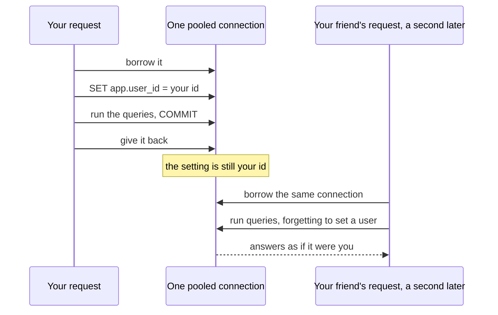

# Transactions

> **Builds on:** [[Postgres and SQL basics]] · [[Connection pools]]

[[Postgres and SQL basics]] showed the five-line version: `begin; insert …; insert …; commit;`. This note is the rest: what a transaction promises, what "isolation" means, and the part that matters from v0.2, settings that live for exactly one transaction. Those settings are what make a shared [[Connection pools|connection pool]] safe for row-level security.

## All or nothing

A **transaction** is a group of SQL statements that Postgres treats as one unit: either every change in it happens, or none does.

Say you import your semester timetable: one group ("Classes · Sem 3") and 22 series. The 17th series has a mistake (its end date is before its start date), and a CHECK constraint refuses it. Without a transaction, 16 classes would be saved and 6 lost, and you might not notice Thursday is missing for a week. Inside one transaction, the whole import fails, and the database looks exactly as it did before. You fix the file and import again.

```sql
begin;                                       -- start the unit
insert into schedule_group (…) values (…);   -- "Classes · Sem 3"
insert into series (…) values (…);           -- DBMS, Mon and Wed 10:00
-- … 20 more …
insert into series (…) values (…);           -- the 22nd
commit;                                      -- make all of it permanent, at once
```

- **`BEGIN`** opens the transaction. **`COMMIT`** makes every change permanent, and visible to everyone at the same instant. **`ROLLBACK`** throws every change away.
- **Until `COMMIT`, nobody else sees anything.** Your phone, asking for this week's calendar halfway through the import, sees the old timetable, never half of the new one.
- **One failure poisons the rest.** After an error the transaction is **aborted**, and Postgres answers every further statement with `current transaction is aborted, commands ignored until end of transaction block`. Even if you send `COMMIT`, Postgres replies `ROLLBACK`. There's no "skip the bad row and carry on" inside one transaction.
- **A crash counts as a rollback.** If the server loses power mid-import, Postgres discards the unfinished transaction when it starts again.
- **Every statement is a transaction anyway.** Without `BEGIN`, each statement runs in its own little transaction (**autocommit**). So one `update` that changes five rows never changes only three.

The textbook name for these promises is **ACID**:

| Letter | Means | In the import example |
|---|---|---|
| **A**tomic | All or nothing | 22 classes or none |
| **C**onsistent | Every constraint holds when it commits | No series points at a group that doesn't exist |
| **I**solated | Transactions running at the same time don't see each other's unfinished work | Your phone sees the old timetable until the commit |
| **D**urable | Once `COMMIT` returns, it survives a crash | The power cut a second later loses nothing |

## Isolation, in one paragraph

Two transactions can run at the same time: your laptop importing, your phone reading. What does each one see? Postgres's default level, **READ COMMITTED**, says each *statement* sees everything committed before that statement began, and never another transaction's uncommitted changes. Two stricter levels exist. **REPEATABLE READ** gives the whole transaction one frozen snapshot, so reading the same row twice gives the same answer. **SERIALIZABLE** makes the result as if the transactions had run one after the other, and when Postgres can't guarantee that, it fails one of them and you retry. We use the default: nothing in v0.2 needs more, and the stricter levels mean handling retries.

## In code: one connection for the whole transaction

A transaction belongs to **one connection**, and with a pool that matters. `pool.query('begin')` followed by `pool.query('insert …')` may borrow two *different* connections. The `BEGIN` opens a transaction on one, the insert autocommits on the other, and nothing is all-or-nothing.

So libraries borrow one connection for the whole unit. Drizzle's version:

```ts
await db.transaction(async (tx) => {
  await tx.insert(scheduleGroup).values(group);
  await tx.insert(series).values(classes);   // 22 rows
});
// Drizzle sent BEGIN, ran the callback on one borrowed connection,
// sent COMMIT because it returned (ROLLBACK if it had thrown),
// then gave the connection back to the pool.
```

Inside the callback, use `tx`, never `db`. `db` borrows a *different* connection, outside the transaction, and its writes commit on their own even when the transaction rolls back.

In our app, the timetable seed is exactly this import ([[Timetable files and seeding]]). `withUser` (below) is a `db.transaction` with two settings added, and `scope` carries its `tx`:

*From `apps/api/src/calendar/seed.ts`:*
```ts
  const replaced = await withUser(deps.db, user.id, async (scope) => {
    const deleted = await deleteGroupsNamed(
      scope,
      groups.map((group) => group.name),
    );
    for (const group of groups) await createGroup(scope, group);
    for (const row of series) await createSeries(scope, row);
    return deleted;
  });
```

Every write goes through `scope`, never `deps.db`, so all of them share one connection and one transaction. If the 17th `createSeries` is refused, the callback throws, everything rolls back (the `deleteGroupsNamed` too), and your old timetable is still there. If it returns, the `deleted` count comes out as `replaced` after the `COMMIT`.

## State that lives on a connection

A connection carries more than an open transaction. It also holds **settings**: Postgres's own (`timezone`, the current role) and custom ones you invent, such as `app.user_id` ("who is asking"). A custom setting's name needs a dot in it, like `app.user_id`; the part before the dot is just a prefix you choose.

With a pool, the connection outlives your request, so the next request that borrows it **inherits whatever you left behind**. Think of the reading-room chair in [[Connection pools]]: you raise the seat and leave, and the next reader gets your height. Harmless for a chair. For "whose rows may this connection see", it's a leak, because the next request would see *your* classes.



Three ways to change a setting:

| How | Lasts until | Fit behind a pool? |
|---|---|---|
| `SET app.user_id = '…'` (same as `SET SESSION`) | The connection closes or someone `RESET`s it. If it was set inside a transaction that rolls back, it's undone | **No:** leaks to the next borrower |
| `SET LOCAL app.user_id = '…'` | The end of the current transaction (`COMMIT` or `ROLLBACK`). Outside a transaction it only prints a warning and does nothing | Yes |
| `select set_config('app.user_id', $1, true)` | The third argument is `is_local`: `true` behaves like `SET LOCAL`, `false` like `SET` | Yes, with `true` |

**Why `set_config` and not `SET LOCAL`?** `SET` isn't a normal query, so it can't take a `$1` parameter (Postgres answers `syntax error at or near "$1"`). The user id would have to be pasted into the SQL text, which reopens the SQL-injection door that parameters close ([[Postgres and SQL basics]]). `set_config` is an ordinary function call, so the id travels separately, as `$1`. For a fixed value, like the role name in `SET LOCAL ROLE tasks_app`, plain `SET LOCAL` is fine: there's nothing to inject.

What the leak looks like (tried on Postgres 18):

```sql
set app.user_id = '0000000a-…';              -- plain SET, by mistake
-- the request ends, the connection goes back to the pool
begin;                                       -- the next request borrows it
select current_setting('app.user_id');       -- '0000000a-…': someone else's id
commit;
```

## What COMMIT and ROLLBACK reset

At the end of a transaction, either way:

- The locks the transaction took are released.
- Every `SET LOCAL` and `set_config(…, true)` value goes back to what it was before the transaction.
- `SET LOCAL ROLE` goes back to the role the connection logged in as ([[Roles and privileges]]).
- `ROLLBACK` also undoes plain `SET`s made inside it; `COMMIT` keeps them. One more reason not to use plain `SET`.

So a request that does all its work inside one transaction, with only transaction-local settings, hands back a clean connection, whatever happened. One wrinkle: a custom setting that has been set once and then reverted reads as `''` (empty text), not as "missing". [[Row-level security]] explains why that matters.

In our app, every request that touches the v0.2 tables (groups, series, overrides) runs inside one transaction that starts with `set_config('app.user_id', <your id>, true)` and `set local role tasks_app`. See [[Row-level security in our database]].

*From `apps/api/src/db/user-scope.ts` (`withUser`):*
```ts
  return db.transaction(async (tx) => {
    // `true` = local: both settings end with this transaction, so the pooled
    // connection goes back to the pool as the owner again, naming nobody.
    await tx.execute(sql`select set_config('app.user_id', ${userId}, true)`);
    await tx.execute(sql`set local role tasks_app`);
    return fn({ tx, userId } as UserScope);
  });
```

Both settings use the transaction-local forms from the table above: `set_config(…, true)` for the id, which travels as a parameter (`${userId}` in Drizzle's `sql` tag becomes `$1`), and `SET LOCAL ROLE` for the fixed role name. Whatever `fn` does, the `COMMIT` or `ROLLBACK` at the end wipes both.

## Check yourself
- Your 22-class import fails at class 17 with a CHECK violation. How many series rows exist afterwards? What happens if the code catches the error and inserts class 18 in the same transaction?
- Inside `db.transaction(async (tx) => …)`, someone writes `await db.insert(series)…` instead of `tx.insert(series)…`, and the callback then throws. Which rows survive, and why?
- Why would `SET app.user_id = '…'` pass every test that uses a single connection, and still leak in production?
- Predict: you `begin; select set_config('app.user_id', 'x', true); commit;` and then run `select current_setting('app.user_id', true);`. What comes back: `x`, `NULL`, or something else?
