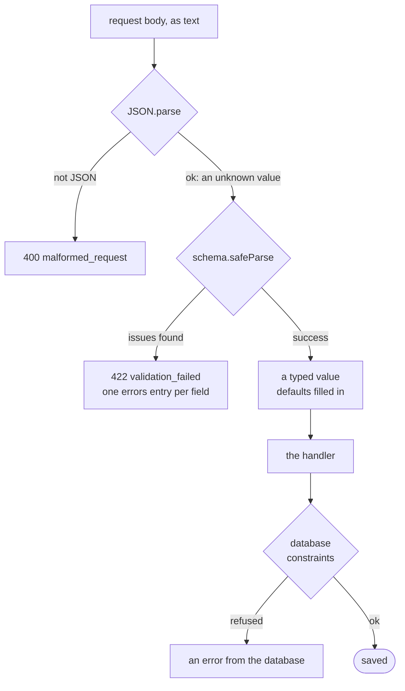

# Validating input with schemas

> **Builds on:** [[HTTP basics]] · [[Error responses]] · [[Environment variables and config]]

How a server decides whether a request's data is acceptable, and turns it into something the rest of the code can trust. [[Environment variables and config]] already used zod for settings at start-up; from v0.2, the same tool checks every request body and query string.

## Never trust the client

Anything can arrive at the API:
- **our own app with a bug** (the form forgot to fill a field);
- **an old copy of the app** still installed on someone's phone, sending last month's shape;
- **someone with `curl`**, sending whatever JSON they like. For them, the browser's checks don't exist.

The server is the one place a check can't be skipped. So every body and query string is checked **on the server, every time**, even when the form already checked it.

What "wrong" looks like with series:

| Sent | What's wrong |
|---|---|
| `"durationMin": -30` | A class that ends before it starts |
| `"rule": { "freq": "weekly", "byDay": [] }` | Weekly on no days: a series that silently never appears |
| `"durationMin": "sixty"` | Wrong type |
| `"startTime": "25:00"`, `"startDate": "2026-02-30"` | Not a real time or date |
| `"tzid": "IST"` | Ambiguous zone name ([[Dates, times and instants]]) |

## Parse, don't validate

There are two attitudes to checking:

- **Validate:** look at the data, answer yes or no, and carry on holding the same unchecked value. The type system still knows nothing about it, so later code checks again "to be safe", or forgets to.
- **Parse:** turn the unknown input into a **typed value**, or fail with a list of everything that's wrong. After parsing, the handler holds a series whose `durationMin` is a number of at least 1, and TypeScript knows it. Nothing downstream has to wonder.

The phrase comes from Alexis King's essay "Parse, don't validate" (2019). The tool that does the parsing is a **schema**: a description of the shape and rules data must follow, written once as code, that can both check data and produce its TypeScript type. (This isn't a *database* schema, the list of tables. Same word, different thing.)



## zod in one screen

**zod** is the schema library we use, in both the API and the app. Here's an illustration, simpler than our real schemas in `packages/core/src/schemas.ts`:

```ts
import { z } from 'zod';

const weekday = z.enum(['MO', 'TU', 'WE', 'TH', 'FR', 'SA', 'SU']);

const rule = z.discriminatedUnion('freq', [
  z.object({ freq: z.literal('daily'), interval: z.int().min(1).default(1) }),
  z.object({
    freq: z.literal('weekly'),
    interval: z.int().min(1).default(1),
    byDay: z.array(weekday).min(1, 'Pick at least one day'),
  }),
]);

const createSeries = z
  .object({
    id: z.uuid({ version: 'v7' }),
    title: z.string().trim().min(1).max(120),
    subject: z.string().trim().max(120).optional(),
    startDate: z.iso.date(),                          // "2026-10-05"
    untilDate: z.iso.date().nullable().default(null),
    startTime: z.iso.time({ precision: -1 }),         // "10:00", no seconds
    durationMin: z.int().min(1).max(1440),
    rule,
  })
  .refine((s) => s.untilDate === null || s.untilDate >= s.startDate, {
    message: 'Must be on or after the start date',
    path: ['untilDate'],
  })
  .transform((s) => ({ ...s, subject: s.subject ?? s.title }));
```

| Piece | What it does |
|---|---|
| `z.object({ … })` | An object with these fields. Extra fields nobody asked for are dropped from the result |
| `z.string()`, `z.int()`, `z.iso.date()`, `z.uuid()` | A type, plus a format |
| `.min()`, `.max()` | Limits on a number, a string's length, or an array's length |
| `z.enum([…])`, `z.literal('daily')` | One of these exact values |
| `z.discriminatedUnion('freq', […])` | One of several shapes; the `freq` field says which |
| `.optional()`, `.nullable()`, `.default(x)` | May be missing; may be `null`; use `x` when missing |
| `.refine(check, { message, path })` | A custom rule, often comparing two fields. `path` says which field gets the blame |
| `.transform(fn)` | Change the value once every check passed (here: `subject` defaults to the title) |
| `.safeParse(x)` | Returns `{ success: true, data }` or `{ success: false, error }`; never throws. `.parse(x)` throws instead |

What it says about a bad series (run against zod 4.6.6):

```ts
createSeries.safeParse({
  id: '01a12f57-1a80-73c0-b0c8-b93a75a2a8df', title: 'DBMS', durationMin: -30,
  startDate: '2026-10-05', startTime: '10:00', rule: { freq: 'weekly', byDay: [] },
});
// success: false, with two issues:
//   path ['durationMin']    "Too small: expected number to be >=1"
//   path ['rule', 'byDay']  "Pick at least one day"
```

- **Every problem at once**, not just the first, so a form can mark all the bad fields in one go.
- **Cross-field rules don't always wait.** A `.refine` on the whole object is skipped only after a *type* error (a field of the wrong type, a missing field, a value outside an enum). After a field's own `.regex`, `.min` or `.refine` fails, the object's rule **still runs**, on the bad value. Send an `untilDate` before the start date *and* a duration of `-30`, and you get both errors at once. So an object rule must never assume its fields are valid. Our calendar window check once crashed on `2026-02-30` for exactly this reason ([[Calendar API]], "A pitfall we hit").
- Our API turns those issues into the `errors` list of a `422` body, joining each path with dots: `rule.byDay` (`validationFailed` in `apps/api/src/http/errors.ts`).

## z.input and z.output

A schema has two types, because parsing can change the value:

- **`z.input<typeof createSeries>`** is what a client may **send**. `subject`, `untilDate` and `interval` are optional.
- **`z.output<typeof createSeries>`** (also called `z.infer`) is what the handler **gets** after parsing. `subject` is always a string (filled from the title), `untilDate` is a string or `null`, and `interval` is a number.

Our contracts export the *input* types (`CreateSeries = z.input<typeof createSeriesSchema>`), because the app is the one writing requests, and the form needs to know what it may leave out.

## One schema for the form and the server

The schemas live in `packages/core`, which both apps import ([[Monorepo and workspaces]]):

- The [[Series form]] runs the schema **before sending**. You see "Pick at least one day" under the day buttons straight away, with no round trip.
- The API runs **the same schema** when the request arrives, because the client can't be trusted.

In our app, the two calls side by side:

*From `apps/web/src/series/form-values.ts` and `apps/api/src/routes/series.ts` (shortened):*
```ts
// apps/web/src/series/form-values.ts: the form, before sending
export function checkCreateSeries(input: CreateSeries): Problems {
  return mergeProblems(
    problemsFromErrors(check(createSeriesSchema, input), 'series'),
    checkDateOrder(input),
  );
}
// apps/api/src/routes/series.ts: the server, when the request arrives
  app.post(paths.series, async (c) => {
    const input = await jsonBody(c, createSeriesSchema);
```

Both files import `createSeriesSchema` from `@tasks/core`: one object, used twice. The form turns its issues into messages under each field (`problemsFromErrors`), and the server turns the same issues into a `422` (`jsonBody`, below).

One definition means the two can't disagree. If the longest allowed class becomes 600 minutes, the form and the server change in the same commit. With two hand-written copies, the form would sooner or later accept something the server refuses, and you'd find out from a confusing error after tapping Save.

## 400 or 422

Our API reads a body in two steps (`apps/api/src/http/json-body.ts`):

1. **Is it JSON at all?** `{"title": "DBMS",` (cut off mid-way) gets **`400 malformed_request`**. There's no field to point at; the sending program is broken.
2. **Does it match the schema?** `{"durationMin": -30}` gets **`422 validation_failed`**, with one `errors` entry per field. That's something a person can fix in a form.

*From `apps/api/src/http/json-body.ts` (shortened):*
```ts
  let raw: unknown;
  try {
    raw = await c.req.json();
  } catch (error) {
    throw new AppError('malformed_request', {
      detail: 'The request body is not valid JSON.',
      cause: error,
    });
  }
  const result = schema.safeParse(raw);
  if (!result.success) throw validationFailed(result.error);
  return result.data;
```

What to notice:
- There's one `try`/`catch` per step: `c.req.json()` throwing means "not JSON" (400), and `safeParse` failing means "JSON, but wrong" (422).
- `raw: unknown` is "parse, don't validate" in TypeScript. Nothing may use a field of `raw` until the schema has turned it into `result.data`, the typed value with its defaults filled in.

Query strings go through the second step too: `GET /api/v1/calendar?from=2026-10-12&to=2027-01-01` asks for more than 62 days and gets `422`, with the error on `to`.

## What a schema can't check

A schema sees one request, alone. It can't know whether `groupId` names a group that exists, let alone one that's *yours*. Facts about other rows are the database's job: foreign keys (composite ones, see [[Row-level security]]), CHECK constraints such as `rule->>'freq' in ('daily', 'weekly')`, and unique constraints.

So there are three layers, each for a reason: the **form** (fast feedback), the **API's schema** (the real gate), and the **database's constraints** (the last line, which holds even if the API has a bug).

## Why zod

zod is the most widely used TypeScript schema library, so answers exist for every question. We already used it for settings. And zod 4 can export a schema as JSON Schema (`z.toJSONSchema`), which is what the planned OpenAPI document needs (D-041).

What lost: Valibot (the same idea, smaller bundles, fewer users), ArkType (fast, unusual syntax), TypeBox (writes JSON Schema directly), and hand-written `if`s (no types out, and every rule written twice).

## Check yourself
- The form sends `{"durationMin": "60"}`, a string. Which status and `errors` entry come back? Would changing the schema to `z.coerce.number()` be a good fix?
- You send an `untilDate` before the start date *and* `durationMin: -30`. Why do both errors come back at once, even though the duration already failed? What kind of mistake in another field would hold the date error back?
- The form already ran the very same schema. Why must the server run it again?
- Which layer stops a series whose `groupId` is your friend's group, and why can't zod?
