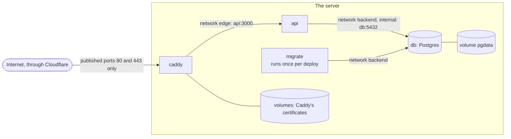

# Docker Compose

> **Builds on:** [[Containers and images]]

How several containers are described and run together. Used by `compose.yaml` (development: just Postgres) and `deploy/compose.prod.yaml` (production: everything). See [[Containers and images]] first.

## What it is

The app on the box is three programs: Caddy, the API and Postgres. Starting each with a long `docker run …` command, in the right order, with the right settings, is error-prone. **Docker Compose** lets you write them down once in a YAML file and start them all with `docker compose up`.

Each entry under `services:` is one container. The words you'll meet:

| Word | Meaning | In `deploy/compose.prod.yaml` |
|---|---|---|
| `image` | Which image to run | `caddy:2.11.7@sha256:…`, the API image, `postgres:18.6@sha256:…` |
| `ports` | Make a container reachable from outside the box: "host port → container port" | Only Caddy: `80:80`, `443:443` |
| `networks` | Private networks between containers. On one, a container's service name works as a hostname | The API reaches Postgres at `db:5432`; Caddy reaches the API at `api:3000` |
| `volumes` | Folders that outlive containers. Delete and recreate the `db` container and the data is still there | `pgdata`, Caddy's certificates |
| `environment`, `env_file` | Environment variables for the container | The API gets everything in `.env` |
| `healthcheck` | A command Docker runs every few seconds to ask "are you OK?" | `pg_isready` for Postgres; a `fetch` of `/healthz` for the API |
| `depends_on` | Start order; with `condition: service_healthy`, wait until the other one is healthy | The API waits for a healthy Postgres |
| `restart` | What to do when a container stops | `unless-stopped`: restart after a crash or a reboot |
| `profiles` | Services that `up` skips unless asked | `migrate`, run once per deploy with `docker compose run --rm migrate` |

`${TAG}` in the file is **interpolation**: Compose fills it in from the shell's environment or from `.env` next to the file before doing anything. `${TAG:?message}` refuses to run, with that message, if it's empty.

Most of the table in one service, the API:

*From `deploy/compose.prod.yaml` (shortened):*
```yaml
x-app-image: &app-image "${IMAGE:-ghcr.io/signioratif/tasks}:${TAG:?TAG is empty. Deploy with ./deploy.sh <sha>, which sets it}"

services:
  # …
  api:
    image: *app-image
    restart: unless-stopped
    # …
    init: true
    env_file: .env
    depends_on:
      db:
        condition: service_healthy
    healthcheck:
      # The image has no curl, but it has Node, and Node has fetch. 200 means the API
      # answers and the database replied to `select 1`.
      test:
        - CMD
        - node
        - -e
        - "fetch('http://127.0.0.1:3000/healthz').then((r) => process.exit(r.ok ? 0 : 1), () => process.exit(1))"
      interval: 15s
      # …
    networks: [edge, backend]
```

- `&app-image` names a value and `*app-image` reuses it (a YAML *anchor* and *alias*), so `api` and `migrate` can never run different images.
- `${IMAGE:-ghcr.io/…}` is the other interpolation form: `:-` means "use this default if `IMAGE` is unset". It's how a laptop run swaps in `tasks-local`.
- The health check is a command run *inside* the container every 15 s; exit code 0 means healthy. `process.exit(r.ok ? 0 : 1)` turns "did `/healthz` answer 2xx?" into that exit code.

## Our production stack as a picture

Only Caddy is reachable from outside. Postgres sits on a network with no internet access, and its data lives in a volume, outside every container.



## How it fits our deploy

`docker compose up --detach --wait` compares the file with what's running and changes only what differs. Deploying a new commit changes one thing, the API's image tag, so only the API container is replaced; Postgres and Caddy keep running. `--wait` blocks until every health check passes, which is what lets `deploy.sh` notice a broken release and roll it back.

## Networks as a security tool

Postgres has no `ports:`, so nothing outside the box can reach it, whatever the firewall says. It sits on a network marked `internal: true`, which also blocks it from reaching the internet. Caddy isn't on that network at all. If Caddy were ever compromised, the database still wouldn't be one hop away.

*From `deploy/compose.prod.yaml` (shortened):*
```yaml
  db:
    # …
    # No `ports:` on purpose: only containers on the backend network can reach it.
    networks: [backend]
    # …
networks:
  edge: {}
  # internal: containers on it can talk to each other but not to the internet.
  backend:
    internal: true
```

The API, as shown above, is on both `edge` and `backend`: it's the one bridge between Caddy and the database. Caddy is on `edge` only, `db` and `migrate` on `backend` only.

## Alternatives

- **Kubernetes**: runs containers across many machines, with self-healing and rolling updates. Built for fleets; for one box it's mostly overhead and a lot to learn.
- **systemd units**, one per container: works, but you write the ordering, health checks and networking yourself.
- **Docker Swarm / Nomad**: multi-machine schedulers, again more than one box needs.

## Check yourself
- Your phone opens the app. Which of the three containers does the request touch, in order? Which one never sees it?
- You run `docker compose -f compose.prod.yaml down` and then `up` again. Is your data gone? What about `down -v`?
- Predict: what does `docker compose -f compose.prod.yaml ps` print if `.env` has `TAG=` (empty)?
