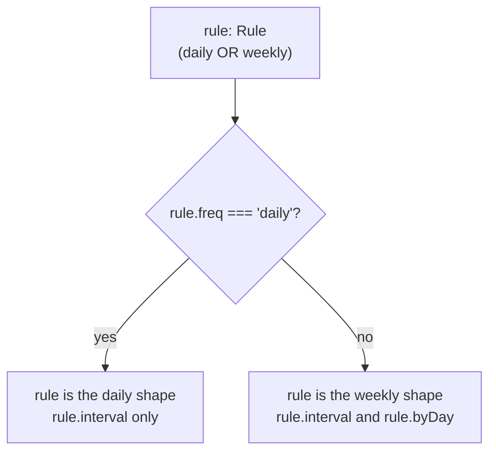

# TypeScript essentials

> **Builds on:** nothing but the JavaScript from your course (variables, functions, objects, arrays, `import`). Read this before [[TypeScript checking vs running]].

Every file in this repo is TypeScript, and your course teaches only JavaScript. This note covers the TypeScript you need to read our code, from zero, with real lines from the repo. It isn't the whole language, just the parts the code actually uses.

## What TypeScript adds, in one idea

TypeScript is JavaScript plus **labels that say what kind of value goes where**: `durationMin: number`, `title: string`. A program called the **type checker** (`tsc`, run by `pnpm typecheck`) reads the labels and complains before anything runs: "you passed a string where a number goes", "this might be `null`", "this object has no field `titel`".

Then the labels are **thrown away**. Node and the browser run plain JavaScript, and the types never exist while the app runs ([[TypeScript checking vs running]]). So TypeScript can't protect you from bad data arriving at run time, like a broken request body. That's why the API also checks input with zod ([[Validating input with schemas]]).

A real example from v0.2. A new error code was added to the contract:

```ts
// packages/core/src/api.ts
export type ErrorCode = 'unauthenticated' | 'forbidden' | 'not_found' | 'conflict' | /* … */;
```

and `pnpm typecheck` immediately failed, in a different package:

```text
apps/api src/http/errors.ts(14,7): error TS2741: Property 'conflict' is missing in type
'{ malformed_request: …; unauthenticated: …; … }' but required in type
'Record<ErrorCode, { status: ContentfulStatusCode; title: string; }>'.
```

The API's table of codes had to say which HTTP status `conflict` maps to, and the checker wouldn't let anyone forget. That's the point of TypeScript: a change in one place shows you every other place it affects.

## Annotations and inference

You write a type after a colon:

```ts
const MAX_BODY_BYTES: number = 256 * 1024;
function daysInclusive(from: string, to: string): number { … }
```

Most of the time you don't have to. TypeScript **infers** the type from the value, so `const MAX_BODY_BYTES = 256 * 1024` is already a `number`. Our code writes types on function parameters and on exported things, so the reader sees them, and lets inference do the rest.

The basic types: `string`, `number`, `boolean`, `null`, `undefined`, arrays (`string[]`, or `readonly string[]` for one you promise not to change), and `void` for "a function that returns nothing useful".

## Describing objects: `interface` and `type`

```ts
// packages/core/src/types.ts (shortened)
export interface Series {
  id: string;
  title: string;
  location: string | null;
  durationMin: number;
  previousSeriesId: string | null;
}
```

An `interface` describes the shape of an object: which fields, of which types. `type` can do the same (`type Series = { … }`) and more (unions, below). The repo uses `interface` for plain object shapes and `type` for everything else, and the difference rarely matters.

A **type alias** gives an existing type a second name:

```ts
export type ISODate = string;   // 'YYYY-MM-DD'
export type WallTime = string;  // 'HH:MM'
```

It doesn't make anything stricter: TypeScript still treats an `ISODate` as any `string`. It's documentation the checker carries around, so `startDate: ISODate` tells the reader which format to expect.

**Optional vs `null`.** `note?: string` means "the field may be missing". `note: string | null` means "the field is always there, and may be empty". Our rule ([[Core types]]): stored data uses `| null`, because the database and JSON have a real `null`, and `?` is for things a caller may leave out, such as `GetOptions`' `signal?`.

## Unions and literal types: "one of these"

```ts
export type CancelReason = 'not_held' | 'skipped';
```

`|` means "or". `'not_held'` here isn't "a string"; it's that exact string, a **literal type**. So `CancelReason` allows exactly two values, and `'not-held'` (with a dash) is an error before the code runs. The brainstorm docs had seven spellings of these. The union makes an eighth impossible.

## Narrowing: TypeScript follows your `if`s

A union is "one of several shapes". Before you can use a field only some shapes have, you have to check which one you've got, and TypeScript follows the check:

```ts
// packages/core/src/types.ts
export type Rule =
  | { freq: 'daily'; interval: number }
  | { freq: 'weekly'; interval: number; byDay: Weekday[] };

// packages/core/src/recurrence/dates.ts
if (rule.freq === 'daily') {
  // here TypeScript knows: rule is the daily shape. rule.byDay would be an error.
  …
  return out;
}
// here: the only shape left is weekly, so rule.byDay is allowed.
```

This is a **discriminated union**: every shape has one field (`freq` here, `kind` in `OccurrenceOverride`) with a different literal value, and checking that field tells TypeScript which shape you have. It also makes impossible states impossible to write: a daily rule with a `byDay` isn't a valid `Rule`.



Other checks narrow too:
- `typeof value === 'string'`;
- `error instanceof ApiError` (in `apps/web/src/lib/query-client.ts`, `error` starts as `unknown`, and after the check `error.status` is allowed);
- `if (!row)`, which removes `undefined` and `null`.

## `null`, `undefined` and the strict rules

With our settings (`"strict": true` in `tsconfig.base.json`), `null` and `undefined` aren't allowed where a value is expected. If something might be missing, the type says so (`string | null`), and you must handle it before use. This alone prevents the most common JavaScript crash, "Cannot read properties of undefined".

We also turn on `noUncheckedIndexedAccess`. Reading from an array or a map by position or key might find nothing, so the result includes `undefined`:

```ts
// apps/api/src/profile/profile.ts
const [row] = await db.select(…).from(profile).where(…);
// row is `{ tzid, dayBoundary } | undefined`: the query may return no rows
if (!row) return undefined;
// from here on, row is the object
```

Two operators you'll see everywhere. `a?.b` reads `b` only if `a` isn't null or undefined (otherwise it gives `undefined`). `a ?? b` means "`a`, unless it's null or undefined, in which case `b`". For example, `subject ?? title` is how a class's subject defaults to its title.

## Functions, `async` and `Promise<T>`

```ts
export async function getProfile(db: Database, userId: string): Promise<Profile> { … }
```

Parameters have types, and the part after the last `:` is the return type. An `async` function always returns a `Promise`, which means "a `Profile`, later". `await getProfile(…)` waits for it and gives you the `Profile`. Default values work as in JavaScript (`options: GetOptions = {}`), and a parameter with a default may be left out.

## Generics: a type with a blank to fill in

```ts
// apps/web/src/lib/api.ts
export async function apiGet<T>(path: string, options: GetOptions = {}): Promise<T> { … }

// apps/web/src/lib/queries.ts: the caller fills the blank with Me
queryFn: ({ signal }) => apiGet<Me>(paths.me, { signal }),
```

`<T>` is a **type parameter**, a blank the caller fills in. `apiGet` works the same way for every path, so it's written once, and each caller says what it expects back: `Me`, `CalendarResponse`. You've already used generics without noticing: `Promise<Profile>`, `Array<string>` (the same as `string[]`), `Map<string, Series>`. In our API, `Created<T>` ("the row, and whether this request made it") works for groups and series alike.

## Types made from values

Sometimes the list of allowed values must exist at run time too (to loop over, or to check against), and you don't want to write it twice. TypeScript can **make a type from a value**:

```ts
// packages/core/src/palette.ts
export const COLOR_TOKENS = ['blue', 'sky', 'teal', /* … */ 'violet'] as const;
export type ColorToken = (typeof COLOR_TOKENS)[number];   // 'blue' | 'sky' | … | 'violet'
```

Read it piece by piece:
- `as const` tells TypeScript "this array never changes, so remember the exact strings", instead of just "an array of strings";
- `typeof COLOR_TOKENS` is the type of that array;
- `[number]` asks for "the type of any element of it", which is the union of the ten strings.

The form loops over `COLOR_TOKENS` to draw the swatches, and the database's CHECK constraint is generated from the same list. The type, the swatches and the database can never disagree.

`satisfies` checks a value against a type **without** replacing the value's own, more exact type:

```ts
// packages/core/src/schemas.ts
const WEEKDAYS = ['MO', 'TU', 'WE', 'TH', 'FR', 'SA', 'SU'] as const satisfies readonly Weekday[];
```

"Make sure every entry is a real `Weekday`, but keep knowing the exact seven."

## Template literal types

A type can be a pattern of text:

```ts
// packages/core/src/types.ts
export type OccurrenceKey = `${string}:${string}`;   // 'series-id:2026-10-14'

// apps/web/src/calendar/model/palette.ts
export function paletteVar(token: ColorToken): `--palette-${ColorToken}` { … }   // '--palette-teal'
```

The second one says the function can only ever return one of the ten CSS variable names.

## Utility types: building types from types

TypeScript ships helpers that turn one type into another. The ones in our code:

| Helper | Means | Our example |
|---|---|---|
| `Partial<T>` | Every field of `T`, but optional | (zod's `.partial()` does the same for the PATCH schemas) |
| `Pick<T, 'a' \| 'b'>` | Only fields `a` and `b` of `T` | `Pick<Series, 'rule' \| 'startDate' \| 'untilDate'>`: "anything with these three fields" (`dates.ts`) |
| `Omit<T, 'a'>` | Every field except `a` | `Omit<Occurrence, 'date' \| 'start' \| …>`: an occurrence before its times are filled in (`expand.ts`) |
| `Record<K, V>` | An object with exactly the keys `K`, each holding a `V` | `Record<ErrorCode, { status; title }>`: one entry per error code, none missing (the story at the top) |
| `NonNullable<T>` | `T` without `null` and `undefined` | `NonNullable<Problem['errors']>` (`apps/web/src/lib/api.ts`) |
| `Parameters<F>`, `ReturnType<F>` | The parameter list, or the return type, of a function type | `Parameters<…>` digs out the type of Drizzle's transaction object in `apps/api/src/db/user-scope.ts` |

`Problem['errors']`, with square brackets on a type, means "the type of the `errors` field of `Problem`".

## `unknown`, `any` and `as`

- **`unknown`** means "could be anything; prove what it is before using it". Data from outside (a parsed request body, a caught error) starts as `unknown`, and you narrow it (`instanceof`, `typeof`, a zod parse) before touching it. Our code uses `unknown` for exactly those spots.
- **`any`** means "stop checking". It switches TypeScript off for that value, and the code avoids it.
- **`as`**, a **type assertion**, tells the checker "trust me, this is a `T`". It checks nothing at run time. In `apps/web/src/lib/api.ts`, `return body as T` trusts the server to send the shape the contract promises. That's a deliberate trust boundary: our own API, the same contract file. Where we *don't* trust the input (the API's request bodies), zod checks the data for real instead of asserting.

## Types that come from zod

A zod schema is a check that runs (it exists at run time) **and** a type (TypeScript can read it):

```ts
// packages/core/src/schemas.ts
export type CreateSeries = z.input<typeof createSeriesSchema>;
```

`z.input` is "what a caller may send": `subject` optional, `location` allowed to be missing. `z.output` is "what the code gets after parsing": the defaults filled in, and `subject` set to the title. So the form, the API and the tests share one definition of a valid series ([[Validating input with schemas]]).

## A trick: types only one function can make

```ts
// apps/api/src/db/user-scope.ts (shortened)
declare const scoped: unique symbol;
export interface UserScope {
  readonly tx: Transaction;
  readonly userId: string;
  readonly [scoped]: true;
}
```

`scoped` is a marker that exists only in the type system, and nothing outside the file can name it. So the only way to get a `UserScope` is from `withUser`, which really did open the row-level-security transaction. A repository function that takes a `UserScope` therefore can't be handed the plain database connection by mistake ([[Row-level security in our database]]). This is called **branding**.

## Our settings, and what they forbid

`tsconfig.base.json` is shared by every package:

| Setting | What it does here |
|---|---|
| `strict` | All the strict checks, including the `null` rules above |
| `noUncheckedIndexedAccess` | `rows[0]` and `map[key]` may be `undefined` |
| `noUnusedLocals`, `noUnusedParameters` | A variable or parameter nobody uses is an error, so dead code doesn't pile up |
| `erasableSyntaxOnly` | Only TypeScript that can simply be deleted is allowed. Node runs our `.ts` files by stripping the types ([[TypeScript checking vs running]]), so features that would need real code generated are banned: `enum` (we use unions of strings instead), `namespace`, constructor shorthand like `constructor(private x)` |
| `verbatimModuleSyntax` | Imports used only as types must say so: `import type { Series } from …`, or `import { type Series, paths } from …`. Then Node knows it can delete them |
| `allowImportingTsExtensions` | Imports name the real file, `./api.ts`, because Node loads exactly that file |

## Reading a type error

`tsc` errors look scary but have a fixed shape: **file (line, column): code: message**. Read the message from the end. "Property 'conflict' is missing in type X but required in type Y" means "Y needs `conflict`; you gave X, which lacks it". When an error is long, look at the first line, then the last; the middle repeats the types involved. In VS Code, hovering over any name shows its type, which answers most "why is this an error" questions.

## Check yourself
- `type Status = 'scheduled' | 'cancelled'`. Predict what `tsc` says about `const s: Status = 'canceled'` (one l), and when: while typing, at `pnpm typecheck`, or when the app runs?
- In `dates.ts`, delete the `if (rule.freq === 'daily') { … return out; }` block's `return`. Which later line becomes an error, and why?
- Why is `ColorToken` written as `(typeof COLOR_TOKENS)[number]` instead of typing the ten names into a union by hand? What would go wrong over time with the hand-written version?
- `apiGet` returns `body as T`, and the API also checks request bodies with zod. Why does one side trust the data with `as` while the other checks it at run time?
- Break it: add `enum Freq { Daily, Weekly }` to any file in `packages/core` and run `pnpm typecheck`. Which setting refuses it, and why does that setting exist here?
