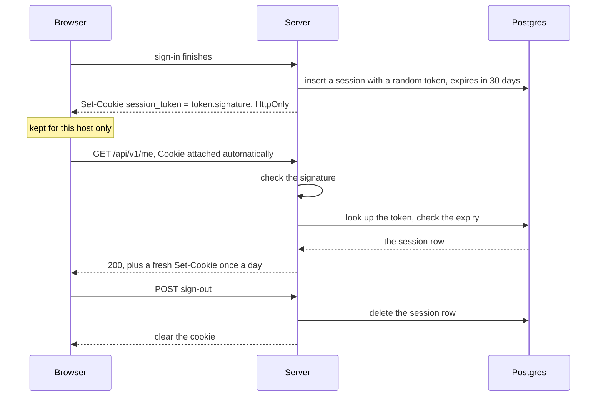

# Cookies and sessions

> **Builds on:** [[HTTP basics]] · [[Origin]]

HTTP has no memory: each request arrives alone. After you sign in once, something must prove "it's me again" on every later request. That proof is a **session**, carried by a **cookie**.

## Cookies

A **cookie** is a small named value the server asks the browser to store (`Set-Cookie` response header) and that the browser then sends back by itself on every request to the same site (`Cookie` request header). Our session cookie, as the server sets it in production:

```
Set-Cookie: __Secure-better-auth.session_token=<token>.<signature>; Max-Age=2592000; Path=/; HttpOnly; Secure; SameSite=Lax
```

| Part | Meaning | Protects against |
|---|---|---|
| `Max-Age=2592000` | Keep it 30 days, even across phone restarts | Being logged out every time Android kills the PWA |
| `Path=/` | Send it with every path on the site | — |
| `HttpOnly` | JavaScript can't read it (`document.cookie` doesn't show it) | A script injected into the page stealing your login |
| `Secure` (+ `__Secure-` name) | Only over https | Someone on the hostel Wi-Fi reading it in transit |
| `SameSite=Lax` | Not sent on requests started by *other sites*, except plain link clicks | Another site making your browser act as you |
| no `Domain` | **Host-only**: sent to `tasks.ahmedatif.in` and nothing else | A bug on another `*.ahmedatif.in` subdomain using your session ([[Origin]]) |

In our app, Better Auth sets `HttpOnly`, `SameSite=Lax` and `Path=/` by default. The cookie setting our own code makes is one line:

*From `apps/api/src/auth/auth.ts`:*
```ts
      // `Secure` cookies (and the `__Secure-` name prefix) exactly when the
      // site is served over https. No `crossSubDomainCookies`: the cookie is
      // host-only, sent to this host and no other (D-063).
      useSecureCookies: env.BETTER_AUTH_URL.startsWith('https:'),
```

`startsWith('https:')` is `true` for `https://tasks.ahmedatif.in` and `false` for `http://localhost:5173`, so production gets `Secure` and the `__Secure-` name while your laptop gets neither. The no-`Domain` row comes from what's *missing*: Better Auth adds a `Domain` when its `crossSubDomainCookies` option is on, and we leave it off.

## Sessions in the database (D-060)

The cookie holds no personal data, just a random 32-character **token** plus a **signature**. The token is a key to a row in `auth_session` (user id, expiry, IP, browser). On every request the API looks the row up (one indexed query, well under a millisecond).

- **Signature:** an HMAC, a fingerprint computed from the token and `BETTER_AUTH_SECRET`. Without the secret nobody can produce a valid one, so a token stolen from a database backup is useless as a cookie, and a made-up cookie is rejected before any lookup.
- **Revocation is instant:** delete the row and that browser is signed out on its next request. "Sign out everywhere" is one `delete … where user_id = …`.
- **Sliding expiry:** a session expires 30 days after it was last *extended*. At most once a day of use, the API pushes the expiry 30 days out and re-sends the cookie with a fresh `Max-Age`. Use the app daily and you're never logged out; leave it for a month and you are.

The three rules above are three settings:

*From `apps/api/src/auth/auth.ts` (shortened):*
```ts
    session: {
      modelName: 'auth_session',
      // 30 days, sliding: each day of use pushes the expiry 30 days out again.
      expiresIn: 30 * DAY_SECONDS,
      updateAge: DAY_SECONDS,
      // …
      // Look the session up in Postgres on every request rather than trusting a
      // cached copy in a second cookie: signing out anywhere takes effect at once.
      cookieCache: { enabled: false },
    },
```

What to notice:
- `expiresIn` is in seconds: `30 * DAY_SECONDS` is 2,592,000, the `Max-Age=2592000` in the cookie above. `updateAge: DAY_SECONDS` is "extend at most once a day".
- `cookieCache` would keep a signed copy of the session in a second cookie and skip the database for a while, a small step towards the JWT idea below. It's off, which is what makes revocation instant.

**The alternative, JWTs:** the cookie itself holds signed data ("user 01a1…, expires …") and the server checks the signature without a database lookup. Faster at huge scale, but you can't revoke one before it expires without building… a table of revoked tokens. Useful between services; not needed here.

## A session's life as a picture



## CSRF: the attack cookies invite

Because the browser attaches cookies *by itself*, a page on `evil.example` can make your browser send a request to our API, and the cookie goes along. That's **cross-site request forgery** (CSRF). Reading the answer is blocked by the browser; *causing* a change isn't. Our layers:

1. `SameSite=Lax`: a cross-site form POST arrives without the cookie at all.
2. Hono's `csrf()` on `/api/v1/*`: a form-style POST (`application/x-www-form-urlencoded`, `multipart/form-data`, `text/plain`) must come from our own origin (`Origin` / `Sec-Fetch-Site` headers). This also covers sibling subdomains, which `SameSite` treats as "same site".
3. JSON requests from another origin need a CORS "preflight" (the browser asks first: "may I?"). We never say yes, so they never get sent.
4. Better Auth checks `Origin` on its own state-changing routes.
5. `GET` never changes anything, so following a link can't do damage.

How the signature works, and why a database dump alone can't forge a cookie: [[Hashing and signing]]. What a request carries, including `Cookie` and `Set-Cookie`: [[HTTP basics]].

## Check yourself
- Which cookie attribute stops a malicious browser extension's injected page script from reading your session token? Which one stops the hostel Wi-Fi?
- An attacker gets a copy of `auth_session` from a leaked backup but not the server's environment. Can they sign in as you? What if they got both?
- Why does `requireSession` copy Better Auth's `Set-Cookie` headers onto our response? What would happen after 30 days if it didn't?
