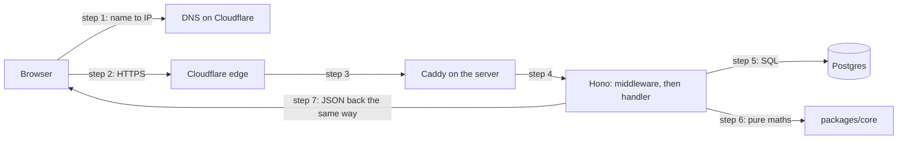

# How a request travels

> **Builds on:** [[HTTP basics]]

This is the most useful mental model in backend work: what happens between "you tap a button" and "the screen updates". Every other note hangs off this one. What a request *contains* (methods, headers, status codes) is in [[HTTP basics]]; the same trip through our actual code, function by function, is [[One request, line by line]].

## The journey, using our app

Say you open the app and it asks for this week's classes:

```
GET https://tasks.ahmedatif.in/api/v1/calendar?from=2026-10-05&to=2026-10-12
```

1. **Browser → DNS.** The browser only knows a name, `tasks.ahmedatif.in`, and DNS turns that name into an IP address. Our DNS is on Cloudflare, so the answer is a Cloudflare IP, not our server's.
2. **Browser → Cloudflare (TLS).** The browser opens an encrypted HTTPS connection to Cloudflare's nearest data centre. Cloudflare is a *reverse proxy*: it receives requests on our behalf, so it can block abusive traffic (rate limits) and keep our server's real IP hidden.
3. **Cloudflare → our VPS → Caddy.** Cloudflare forwards the request to our server, where **Caddy** is the first program to receive it. Caddy is a reverse proxy too: it handles HTTPS certificates and forwards to the right program on the machine (our API on, say, port 3000).
4. **Caddy → Hono (our code).** Our Node process runs Hono. Hono looks at the method and path (`GET /api/v1/calendar`) and picks the matching *handler* function. Before the handler, *middleware* runs: functions every request passes through. Ours:
   - read the session cookie and work out *who* you are (auth),
   - log the request.

   The handler's first job is then to validate the query string (`from`, `to`) with zod.
5. **Handler → Postgres.** The handler asks the database for your groups, your series and the overrides in that window: SQL queries over a TCP connection, reused from a *connection pool*.
6. **Handler → core logic.** The recurrence engine (`packages/core`) expands rules into concrete occurrences. This is pure TypeScript, with no network and no database, which is exactly why it's easy to test.
7. **Response back.** The handler returns JSON with a status code (`200 OK`), and it travels back through Caddy → Cloudflare → browser.

   In our app, steps 4 to 7 are this one handler (the step numbers are in the comments):

   *From `apps/api/src/routes/calendar.ts` (shortened):*
   ```ts
     app.get(paths.calendar, async (c) => {
       // A missing, malformed or too wide window is a 422 naming `from` or `to`.
       const query = calendarQuerySchema.safeParse(c.req.query()); // step 4
       if (!query.success) throw validationFailed(query.error);
       const window: DateWindow = { from: query.data.from, to: query.data.to };
       // …
       const rows = await c.var.asUser(async (scope) => ({ // step 5
         groups: await listGroups(scope),
         series: await listSeries(scope),
         overrides: await listOverridesIn(scope, window),
       }));

       // Pure computation, after the transaction ended, so no connection waits on it.
       // …
       const occurrences = expand({ ...rows, dayExceptions: [], window }); // step 6
       const body: CalendarResponse = { ...window, occurrences };
       return c.json(body); // step 7
     });
   ```

   What to notice:
   - `c.req.query()` is the query string as an object (`{ from: '2026-10-05', to: '2026-10-12' }`). `safeParse` checks it against a zod schema from `packages/core` and reports problems instead of throwing.
   - `c.var.asUser(…)` runs the three reads together, in one transaction, as you ([[Row-level security in our database]]). Each `await` is a round trip to Postgres.
   - `expand(…)` has no `await`. It never waits for the network or the disk, and that's what "pure" means here.

8. **Browser.** TanStack Query stores the JSON in its cache, and React draws the week grid.

### The same journey as a picture



## Why so many layers?

Each layer does one job, so our code doesn't have to:

| Layer | Job | If we removed it |
|---|---|---|
| Cloudflare | Edge protection, hides server IP, DNS | Server IP is public; we handle abuse ourselves |
| Caddy | HTTPS certificates, routing on the box | Our Node code would manage certificates |
| Hono | Routing + middleware | We'd parse URLs by hand on `node:http` |
| Postgres | Durable, consistent storage | Data dies when the process restarts |

## Alternatives you'll hear about

- **Nginx** instead of Caddy: older and more common, but you configure certificates yourself. Caddy does it automatically.
- **Express / Fastify** instead of Hono: the same idea, routers with middleware. Express is the one most courses teach, and the concepts transfer one to one.
- **Serverless** (Vercel/Lambda) instead of a VPS: no server to manage, but each request may start a fresh process (a "cold start"), and long-running work like timers and push reminders gets awkward. See `docs/brainstorm/07`.

## What changes at scale (later)

At one user, one process and one database are plenty. At 10k+ users you'd add several API processes behind a load balancer, caching for hot reads, and maybe read replicas for Postgres. The request path keeps its shape; the layers just get duplicated. We'll come back to this once the app is something you're happy with.

## Check yourself

- Which layer knows *who* you are? Which layers don't care?
- Why is the recurrence engine easy to test, while the handler is harder?
- If Postgres is down, which step fails, and what should the user see?
