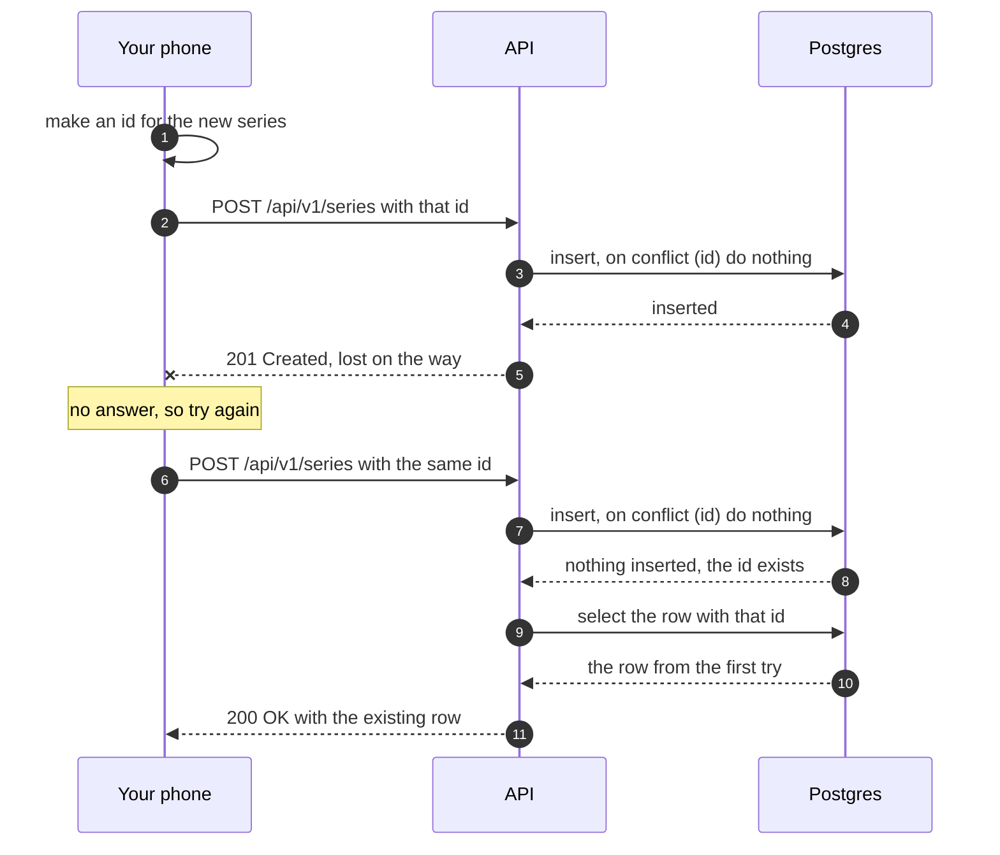

# Idempotency and retries

> **Builds on:** [[HTTP basics]] · [[REST resources and CRUD]]

Why a phone sends some requests more than once, and how an API makes that harmless. [[HTTP basics]] gave the one-line definition of idempotent; this note is the whole story behind D-042.

## Why requests get sent twice

You're in the library on campus Wi-Fi and add a new series: "Club meeting, Fridays 17:00". You tap Save. The request reaches the server, the row is saved, and then the answer is lost on the way back: the Wi-Fi hands you to another access point, or your screen turns off and Android freezes the app mid-request.

Your phone saw no answer. From its side, three different stories look exactly the same:

1. The request never arrived.
2. It arrived and failed.
3. It arrived, **worked**, and only the answer got lost.

The only sensible move is to send it again. And something always will:
- **you**, tapping Save a second time;
- **TanStack Query**, which retries failed requests by itself ([[Server state and caching]]);
- from v0.3, **the offline queue**, which replays writes made without a network when you're back online (D-046).

In story 3, a careless "create" now makes the club meeting **twice**, and your Friday shows two identical blocks side by side.

## Idempotent: twice has the same effect as once

An operation is **idempotent** when doing it twice leaves the server in the same state as doing it once. A light switch's "turn on" is idempotent; its "toggle" isn't.

| Method | Idempotent? | Why |
|---|---|---|
| `GET` | Yes | It only reads |
| `PUT` | Yes, by definition | "Make it exactly this": the second time changes nothing |
| `DELETE` | Yes, by definition | Gone is gone. (The *answer* may differ: our second `DELETE` gets `404`) |
| `PATCH` | Not by definition | "Add a week" twice adds two. Ours only say "set these fields", so they are |
| `POST` | **No**, by definition | "Create one" twice creates two, unless the API does something about it |

Idempotency is about the **effect on the server**, not about getting the same response. A repeated `DELETE` answering `404` is still idempotent: the series is gone either way, and the app should treat that `404` as "done".

## Making a create idempotent: the client picks the id

The trick (D-042, "natural idempotency"): the phone makes up the new row's id **before** sending, and the request carries it. The server's job becomes "insert this row with this id, unless it already exists":

```sql
insert into series (id, user_id, title, …) values ($1, $2, $3, …)
on conflict (id) do nothing        -- a row with this id exists: do nothing, no error
returning *;                       -- returns the row only if it was just inserted
```



| What the server finds | Answer |
|---|---|
| No row with that id: inserted | `201 Created` and the new row |
| A row with that id, **yours**: a retry | `200 OK` and the existing row. Still one row |
| A row with that id that **isn't yours** (invisible under [[Row-level security]]) | `409 conflict` |

In our app, that table is the last two lines of `createSeries` plus a small helper:

*From `apps/api/src/calendar/series.ts` and `apps/api/src/calendar/writes.ts` (shortened):*
```ts
// apps/api/src/calendar/series.ts
  const [row] = await guardedWrite(Object.keys(input), () =>
    scope.tx
      .insert(series)
      .values({ ...input, userId: scope.userId })
      .onConflictDoNothing({ target: series.id })
      .returning(),
  );
  if (row) return { row: toSeries(row), created: true };
  return alreadyCreated(await findSeries(scope, input.id));
// apps/api/src/calendar/writes.ts
export function alreadyCreated<T>(visible: T | undefined): Created<T> {
  if (visible === undefined) {
    throw new AppError('conflict', {
      detail: 'That id is already in use. Make a new one and try again.',
    });
  }
  return { row: visible, created: false };
}
```

What to notice:
- `.onConflictDoNothing({ target: series.id })` is Drizzle for `on conflict (id) do nothing`, and `.returning()` for `returning *`. `const [row]` is the first returned row, or `undefined` when nothing was inserted.
- `findSeries` looks the id up as you, so a row of yours comes back (`created: false` → `200`) and someone else's stays invisible (`undefined` → `409`).
- The `200` answers with the row as stored, not with the retry's body: that's "the retry's body is ignored" below.

The retry's body is ignored: the server answers with what's actually stored, so the phone always ends up showing the truth. And because the phone knows the ids up front, it can create a group *and* a series inside it before either has reached the server; the series simply points at the group's id. With ids that only the server can make, the series would have to wait for the group's answer.

## Which kind of id

A **UUID** (universally unique identifier) is a 128-bit number written as 32 hex digits in five groups: `01a12f57-1a80-73c0-b0c8-b93a75a2a8df`. There are several versions; the version number is the first digit of the third group.

| Kind | Looks like | Who can make one | In time order? | Trade-offs |
|---|---|---|---|---|
| **Serial** (auto-increment) | `41`, `42`, `43` | Only the database, while inserting | Yes | The phone can't know the id before the server answers, so no offline creates and no safe retries. Two offline phones would both "pick" 43. Guessable: seeing `/series/42` invites trying `/series/41` |
| **UUIDv4** | `336cc0ea-887b-4ef0-a90f-bfcd4d470372` | Anyone, anywhere | No, fully random | 122 random bits, so two never collide in practice. Random order means every insert lands at a random place in the primary-key index, which gets slower as tables grow |
| **UUIDv7** (ours, D-034) | `01a12f57-1a80-73c0-b0c8-b93a75a2a8df` | Anyone, anywhere | Yes, to the millisecond | The first 12 hex digits are the creation time (`01a12f571a80` is 2026-10-12 09:00:00 UTC), then the version `7`, then 74 random bits. New rows land at the end of the index, like serials. Postgres 18 has `uuidv7()`; the app uses `v7()` from the `uuid` package |

One rule from the data-model plan: never use the time inside an id as the row's `created_at`. A phone with a wrong clock makes perfectly valid ids with wrong times.

## The alternative: an Idempotency-Key header

Some APIs (Stripe's is the famous one) do it differently. The client sends a random key with any request, `Idempotency-Key: 4f1c…`, and the server keeps a table of keys and the responses it gave. A repeat with a known key gets the stored response back, without running again.

- **Good:** it works for any request, including ones where the server must choose the id or the outcome (v3's "start a session unless one is running").
- **Costs:** a table, expiring old keys, storing whole responses, and deciding what to do when the retry arrives while the first attempt is still running.

D-042 waits for it until such a request exists (v3). Every v0.2 create carries its own id, which does the same job with no extra table. (The frontend brainstorm, 09 §5.7, sketched an `Idempotency-Key` on every write; D-042 is the later decision.)

## Retrying well

- **Only retry what can help:** no answer, or a 5xx. Never a 4xx: the same request gets the same refusal ([[Error responses]]).
- **Wait between tries, longer each time** (**backoff**): TanStack Query's default delay doubles each time, 1 s, then 2 s, then 4 s, up to 30 s, so a struggling server isn't hammered. Our app gives up after two retries (below), so in practice it waits 1 s and then 2 s.
- **Only retry automatically what's idempotent.** TanStack Query retries reads by default but never writes (its mutation default is zero retries). Writes get replayed by the offline queue instead, and that is safe only because our writes are idempotent.

In our app, the rule for reads is one function:

*From `apps/web/src/lib/query-client.ts` (shortened):*
```ts
export function shouldRetry(failureCount: number, error: unknown): boolean {
  if (error instanceof ApiError && error.status < 500) return false;
  if (error instanceof NetworkError && !onlineManager.isOnline()) return false;
  return failureCount < 2;
}
// … (in createQueryClient)
      queries: {
        retry: shouldRetry,
```

What to notice:
- An `ApiError` below 500 is a 4xx: the server answered and refused, so asking again can't help.
- A `NetworkError` while the phone says it's offline isn't retried either: the screen says "You're offline" at once instead of spinning, and the query is fetched again when the connection returns.
- `failureCount < 2`: the first try plus at most two retries. It's set under `queries` only; `mutations` keep TanStack's default of zero retries.

## Check yourself
- Trace the club-meeting story with `on conflict (id) do nothing`: two requests with the same id. How many rows exist at the end, and what status does each request get?
- Why can't a serial id make that create safe to retry, however careful the server is?
- The second `DELETE` of a series gets `404`. Does that break idempotency? What should the app do with it?
- When would we need an `Idempotency-Key` table after all?
